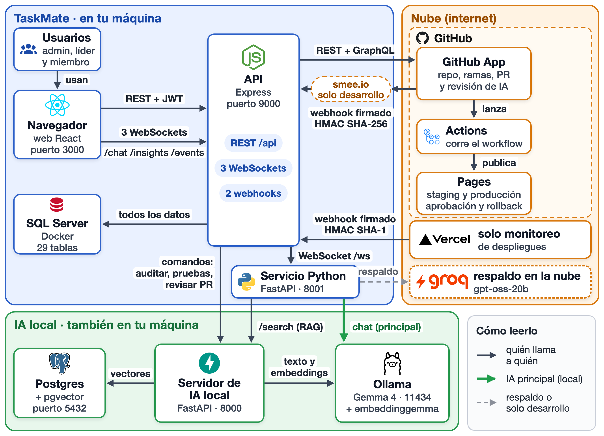

# TaskMate

**En una frase:** una aplicación web donde un equipo planifica su proyecto (tareas, hitos y calendario), lo arma con ayuda de una IA y trabaja con su repositorio de GitHub y su CI/CD sin salir de la app.

> **Estado al 26 nov 2026**
> - **Línea de Pablo: cerró el 3 nov 2026 con las Fases 1–4**, en `master`: PR #2 (`7e1610f`) y PR #4 (`183f1cb`) el 6 oct 2026; PR #5 (`56f7136`) el 22 oct 2026. Las Fases 5 y 8 no se realizarán; la 6 (SonarQube) se canceló en la etapa de plan, sin código; la 7 (colisión de archivos) quedó pospuesta en la línea de Christian.
> - **La línea de Christian siguió** con sus fechas corridas: puntos 1–7 completos (servidor de IA local, comandos, monitoreo de Vercel, archivos por tarea, `audit`, generar pruebas y revisión de PR con IA), además del chat sobre el modelo local. La 8 (colisión de archivos) está pospuesta con la base hecha y la 9 (pruebas finales), pendiente. Entró por la rama `test/e2e`, que se fusionó en `master` el 26 nov 2026 → [línea de Christian](documentacion/09-linea-christian/README.md).
> - La interfaz de la app está en inglés desde el 19 nov 2026 (`d148763`).
> - 2163 pruebas en verde y 0 fallando, y ESLint en 0 (26 nov 2026, con los [arreglos del 26 nov](documentacion/01-proyecto/cierre-del-proyecto.md#correcciones-del-26-nov-2026), también los del chat). Las fechas planificadas de la [calendarización](documentacion/01-proyecto/calendarizacion.md) no cambian.
> - Qué quedó, limitaciones y pendientes: [cierre de la línea de Pablo y estado](documentacion/01-proyecto/cierre-del-proyecto.md).

## Qué hace

- **Cuentas y grupos:** registro (crea un grupo personal) e inicio de sesión con JWT de 24 h; grupos con roles, y el admin agrega o quita miembros. El grupo activo se elige en el selector del navbar.
- **Tareas** (`/tasks`): listas de tareas; crear, editar, completar, mandar a la papelera y asignar personas.
- **Hitos y calendario:** diagrama de hitos con React Flow cuyo avance se propaga solo por la cadena, y calendario mensual.
- **Chat con IA** (`/chat`): asistente del proyecto que conversa sobre el grupo del navbar y responde en streaming; cada proyecto tiene su propia conversación. Arma un plan solo si se lo pides: tareas a partir del repositorio del grupo o, con «New project», un proyecto nuevo (grupo, roles, tareas e hitos) que crea al confirmarlo. En un grupo todavía sin usar, como el grupo personal de una cuenta nueva, el plan se guarda en ese grupo. Usa Groq o el modelo local (Gemma 4 en Ollama), según `LLM_PROVIDER`.
- **Analytics** (`/analytics`, solo líderes): resumen del equipo, carga de trabajo, experiencia y recomendaciones de asignación de la IA.
- **GitHub** (`/github`): conectar el repositorio con la GitHub App, explorarlo, crear la rama de cada tarea y completarla al fusionar su PR; la IA propone tareas a partir del repositorio. En la tarea, «View task files» abre «Task files»: los archivos que cambió su PR y qué otras tareas tocan los mismos.
- **IA sobre el código** (servidor de IA local): en «Task files», «Audit» revisa la rama, «Generate tests» propone pruebas (no las ejecuta) y «Review PR» revisa el PR abierto. La revisión también corre sola al abrir o actualizar el PR y, si la GitHub App tiene «Pull requests: Read and write», se publica en GitHub como comentario. Pide el consentimiento «Allow AI analysis» del grupo.
- **CI/CD** (pestaña CI/CD): TaskMate o la IA propone el pipeline y lo sube; ejecuciones y logs en vivo; ejecutar, re-ejecutar y cancelar.
- **Deploy y avisos:** GitHub Pages con staging automático, producción con aprobación del admin y rollback; avisos en vivo para todo el grupo.
- **Vercel** (pestaña «Vercel (monitoring)»): el admin vincula el proyecto de Vercel y el grupo ve el estado de cada despliegue, que llega por un webhook firmado. Solo monitorea: no despliega.

Todo, por módulo y rol: [funcionalidades](documentacion/01-proyecto/funcionalidades.md).

## Arquitectura



- **Frontend** React 18 + MUI en `:3000` → **API** Express en `:9000` (REST y los WebSockets `/chat`, `/insights` y `/events`).
- La API es la única que habla con **SQL Server 2019** (Docker o Podman, `:1433`, 29 tablas), con **GitHub** y con el **servicio Python del chat**. Recibe los webhooks firmados de GitHub y de Vercel.
- El **servicio Python del chat** es FastAPI en `127.0.0.1:8001` (`MCP_PORT`). Usa **Groq** (`openai/gpt-oss-20b`, el valor por defecto) o el **modelo local** (Gemma 4 en Ollama, `127.0.0.1:11434`), según `LLM_PROVIDER`.
- Su carpeta se llama `mcp/`, pero habla un protocolo JSON propio por WebSocket: **no** es el Model Context Protocol.
- El **servidor de IA local** es un repo aparte de Christian (`taskmate-ai-server`): FastAPI en `127.0.0.1:8000`, con Ollama y Postgres + pgvector. La API le pide `audit`, `generate-tests` y `review-pr`, y el servicio Python del chat le consulta documentos cuando no hay grupo elegido. Es opcional: sin `AI_SERVER_URL`, esas acciones responden 503 (`AI_SERVER_DISABLED`).

Qué conecta cada flecha: [arquitectura general](documentacion/02-arquitectura/00-general.md).

## Primer arranque

Paso a paso completo, con cómo obtener cada secreto y los problemas comunes: [primer arranque](documentacion/07-guias/primer-arranque.md). Hay dos lanzadores:

| Lanzador | Sistema | Qué levanta | Modelo del chat |
|---|---|---|---|
| `./start.sh` | macOS, con Docker Desktop (o Podman, si está corriendo) | SQL Server, servicio Python del chat y API; el frontend va aparte con `npm start` | El de `LLM_PROVIDER` en la `.env`: Groq por defecto (`GROQ_API_KEY`) |
| `./scripts/local-up.sh` | Linux con Podman (probado en Fedora) | IA local, SQL Server con las migraciones pendientes, servicio Python del chat, API y frontend | Modelo local (Ollama) |

### macOS con `start.sh`

1. **Requisitos:** Node.js 18+, Python 3.9+ y Docker Desktop (o Podman).
2. **Clonar e instalar Node** (instala también el workspace `taskmate-api`):
   ```bash
   git clone https://github.com/PabloP150/proyecto-is-cc6.git && cd proyecto-is-cc6
   npm install
   ```
3. **Entorno de Python** del servicio Python del chat:
   ```bash
   cd taskmate-api/mcp && python3 -m venv venv && ./venv/bin/pip install -r requirements-dev.txt && cd ../..
   ```
4. **`.env` en la raíz:** `cp taskmate-api/.env.example .env`. Llena `JWT_SECRET` y `MCP_SHARED_SECRET` (`openssl rand -base64 48`), `DB_PASSWORD` y `GROQ_API_KEY` (solo con `LLM_PROVIDER=groq`, el valor por defecto).
5. **SQL Server** (con Podman, cambia `docker` por `podman`; en Apple Silicon agrega `--platform linux/amd64` a los dos comandos):
   ```bash
   docker build -t taskmate-sql taskmate-api
   docker run -d --name taskmate-sql -e ACCEPT_EULA=Y -e SA_PASSWORD='<tu-password-de-sa>' \
     -e DB_PASSWORD='<el DB_PASSWORD de tu .env>' -p 127.0.0.1:1433:1433 taskmate-sql
   ```
   La imagen trae las migraciones 001–011. `start.sh` no aplica migraciones: si tu contenedor es de una imagen anterior, aplica las nuevas con `npm run db:migrate --workspace=taskmate-api` (usa `MIGRATION_DB_USERNAME` y `MIGRATION_DB_PASSWORD` de la `.env`, la cuenta SA).
6. **Arrancar:** `./start.sh` (BD, servicio Python del chat y API) y, en otra terminal, `npm start` → <http://localhost:3000>.
7. **Entrar:** «Create Account» y luego «Sign In». GitHub y CI/CD son opcionales: [guía de la GitHub App](documentacion/07-guias/guia-github-app.md).

### Linux con IA local (`scripts/local-up.sh`)

1. **Requisitos:** `podman`, `node`, `npm`, `python3`, `curl`, `ss` y `openssl`, y Ollama en `~/.local/ollama/bin/ollama`.
2. **Servidor de IA local:** clona el repo privado `taskmate-ai-server` de Christian en `../ai-server` (junto a TaskMate) y prepáralo según su README; su `scripts/install-ollama.sh` instala Ollama. Sin `../ai-server`, el script solo arranca Ollama: el chat funciona, pero sin los documentos del servidor de IA local, y «Audit», «Generate tests» y «Review PR» fallan.
3. **Arrancar:** `./scripts/local-up.sh` (con `--no-web`, sin React) → <http://localhost:3000>. Genera la `.env` si no existe, o solo le agrega las claves que faltan (`LLM_PROVIDER=ollama`, `AI_SERVER_URL`…) y copia `AI_SERVER_SECRET` de `../ai-server/.env`. También instala las dependencias, crea o arranca `taskmate-sql` y aplica las migraciones pendientes. Logs en `.local/logs/`.
4. **Detener:** `./scripts/local-down.sh` (no borra datos; con `--all` también detiene la IA local).

Detalle del entorno local: [levantar TaskMate en local](documentacion/09-linea-christian/ENTORNO-LOCAL.md).

## Pruebas

**2163 pruebas en verde y 0 fallando (26 nov 2026, en `master`):**

| Capa | Pruebas |
|---|---|
| API (Jest) | 1355 en 54 suites |
| Frontend (React Testing Library) | 448 en 37 suites |
| Servicio Python del chat (pytest) | 238 |
| Base de datos (SQL Server desechable) | 122 en 10 suites |

- ESLint: 0 problemas. El build de producción compilaba el 5 nov 2026 (sobre `master`); no se volvió a correr.
- El repositorio de TaskMate no tiene CI propio: las pruebas se corren a mano. El CI/CD es una funcionalidad para el repositorio de cada grupo.
- Cómo correr cada suite: [pruebas](documentacion/07-guias/pruebas.md).

## Documentación

Todo está en [`documentacion/`](documentacion/README.md). Lo más usado:

| Para… | Lee |
|---|---|
| Entender qué es y cómo quedó | [Qué es TaskMate](documentacion/01-proyecto/que-es-taskmate.md) · [cierre de la línea de Pablo y estado](documentacion/01-proyecto/cierre-del-proyecto.md) · [línea de Christian](documentacion/09-linea-christian/README.md) |
| Usar la app según tu rol | [Guía de uso](documentacion/07-guias/guia-de-uso.md) · [guía de CI/CD](documentacion/07-guias/guia-cicd.md) |
| Desarrollar | [Guía técnica](documentacion/07-guias/guia-tecnica.md) (carpetas, variables, puertos, rutas) |
| Estudiar un módulo | [Tabla de módulos × carpetas](documentacion/README.md#módulos--carpetas) |
| Ver cada fase | [Capítulos de las fases](documentacion/08-fases/README.md) (línea de Pablo) · [línea de Christian](documentacion/09-linea-christian/README.md) |

## Autores

Pablo Pineda y Christian Martínez — Universidad Galileo, Facultad de Ingeniería de Sistemas, Informática y Ciencias de la Computación (FISICC), Seminario Profesional II.

Las 8 fases de la calendarización son la línea de trabajo de Pablo Pineda; la Fase 7 (colisión de archivos) se iba a hacer junto con Christian Martínez y quedó pospuesta en la línea de él. Christian tiene su propia línea de 9 puntos: [09-linea-christian](documentacion/09-linea-christian/README.md).
