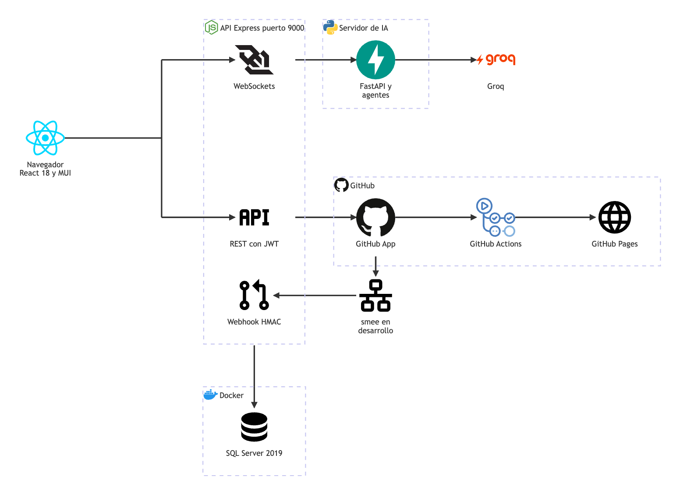

# TaskMate

**En una frase:** una aplicación web donde un equipo planifica su proyecto (tareas, hitos y calendario), lo arma con ayuda de una IA y trabaja con su repositorio de GitHub y su CI/CD sin salir de la app.

> **Estado: proyecto cerrado (3 nov 2026).**
> - Fases 1–4 terminadas y en `master`: PR #2 (`7e1610f`) y PR #4 (`183f1cb`) el 6 oct 2026; PR #5 (`56f7136`) el 22 oct 2026.
> - Fases 5, 7 y 8: no se realizarán. Fase 6 (SonarQube): cancelada en la etapa de plan, sin código.
> - 1960 pruebas en verde (5 nov 2026). Las fechas planificadas de la [calendarización](documentacion/01-proyecto/calendarizacion.md) no cambian.
> - Qué quedó, limitaciones y pendientes: [cierre del proyecto](documentacion/01-proyecto/cierre-del-proyecto.md).

## Qué hace

- **Cuentas y grupos:** registro (crea un grupo personal) e inicio de sesión con JWT de 24 h; grupos con roles, y el admin agrega o quita miembros.
- **Tareas** (`/tasks`): listas de tareas; crear, editar, completar, mandar a la papelera y asignar personas.
- **Hitos y calendario:** diagrama de hitos con React Flow cuyo avance se propaga solo por la cadena, y calendario mensual.
- **Chat con IA** (`/chat`): el asistente arma el plan del proyecto (grupo, roles, tareas e hitos) y lo crea al confirmarlo.
- **Analytics** (`/analytics`, solo líderes): resumen del equipo, carga de trabajo, experiencia y recomendaciones de asignación de la IA.
- **GitHub** (`/github`): conectar el repositorio con la GitHub App, explorarlo, crear la rama de cada tarea y completarla al fusionar su PR; la IA propone tareas a partir del repositorio.
- **CI/CD** (pestaña CI/CD): TaskMate o la IA propone el pipeline y lo sube; ejecuciones y logs en vivo; ejecutar, re-ejecutar y cancelar.
- **Deploy y avisos:** GitHub Pages con staging automático, producción con aprobación del admin y rollback; avisos en vivo para todo el grupo.

Todo, por módulo y rol: [funcionalidades](documentacion/01-proyecto/funcionalidades.md).

## Arquitectura



- **Frontend** React 18 + MUI en `:3000` → **API** Express en `:9000` (REST y los WebSockets `/chat`, `/insights` y `/events`).
- La API es la única que habla con **SQL Server 2019** (Docker, `:1433`), con **GitHub** y con el **servidor de IA**.
- El servidor de IA es FastAPI en `127.0.0.1:8001` (`MCP_PORT`) y llama a **Groq** (`openai/gpt-oss-20b`).
- Su carpeta se llama `mcp/`, pero habla un protocolo JSON propio por WebSocket: **no** es el Model Context Protocol.

Qué conecta cada flecha: [arquitectura general](documentacion/02-arquitectura/00-general.md).

## Primer arranque

Paso a paso completo, con cómo obtener cada secreto y los problemas comunes: [primer arranque](documentacion/07-guias/primer-arranque.md).

1. **Requisitos:** Node.js 18+, Python 3.9+, Docker Desktop y macOS (para `start.sh`).
2. **Clonar e instalar Node** (instala también el workspace `taskmate-api`):
   ```bash
   git clone https://github.com/PabloP150/proyecto-is-cc6.git && cd proyecto-is-cc6
   npm install
   ```
3. **Entorno de Python** del servidor de IA:
   ```bash
   cd taskmate-api/mcp && python3 -m venv venv && ./venv/bin/pip install -r requirements-dev.txt && cd ../..
   ```
4. **`.env` en la raíz:** `cp taskmate-api/.env.example .env`. Llena `JWT_SECRET` y `MCP_SHARED_SECRET` (`openssl rand -base64 48`), `DB_PASSWORD` y `GROQ_API_KEY`.
5. **SQL Server** (en Apple Silicon agrega `--platform linux/amd64` a los dos comandos):
   ```bash
   docker build -t taskmate-sql taskmate-api
   docker run -d --name taskmate-sql -e ACCEPT_EULA=Y -e SA_PASSWORD='<tu-password-de-sa>' \
     -e DB_PASSWORD='<el DB_PASSWORD de tu .env>' -p 127.0.0.1:1433:1433 taskmate-sql
   ```
6. **Arrancar:** `./start.sh` (BD, servidor de IA y API) y, en otra terminal, `npm start` → <http://localhost:3000>.
7. **Entrar:** «Create Account» y luego «Sign In». GitHub y CI/CD son opcionales: [guía de la GitHub App](documentacion/07-guias/guia-github-app.md).

## Pruebas

**1960 pruebas en verde (5 nov 2026):**

| Capa | Pruebas |
|---|---|
| API (Jest) | 1246 en 46 suites |
| Frontend (React Testing Library) | 423 en 33 suites |
| Servidor de IA (pytest) | 177 |
| Base de datos (SQL Server desechable) | 114 en 9 suites |

- ESLint: 0 problemas. El build de producción compila.
- El repositorio de TaskMate no tiene CI propio: las pruebas se corren a mano. El CI/CD es una funcionalidad para el repositorio de cada grupo.
- Cómo correr cada suite: [pruebas](documentacion/07-guias/pruebas.md).

## Documentación

Todo está en [`documentacion/`](documentacion/README.md). Lo más usado:

| Para… | Lee |
|---|---|
| Entender qué es y cómo quedó | [Qué es TaskMate](documentacion/01-proyecto/que-es-taskmate.md) · [cierre del proyecto](documentacion/01-proyecto/cierre-del-proyecto.md) |
| Usar la app según tu rol | [Guía de uso](documentacion/07-guias/guia-de-uso.md) · [guía de CI/CD](documentacion/07-guias/guia-cicd.md) |
| Desarrollar | [Guía técnica](documentacion/07-guias/guia-tecnica.md) (carpetas, variables, puertos, rutas) |
| Estudiar un módulo | [Tabla de módulos × carpetas](documentacion/README.md#módulos--carpetas) |
| Ver cada fase | [Capítulos de las fases](documentacion/08-fases/README.md) |

## Autores

Pablo Pineda y Christian Martínez — Universidad Galileo, Facultad de Ingeniería de Sistemas, Informática y Ciencias de la Computación (FISICC), Seminario Profesional II.

Las 8 fases de la calendarización son la línea de trabajo de Pablo Pineda; la Fase 7 (que no se realizó) se iba a hacer junto con Christian Martínez.
