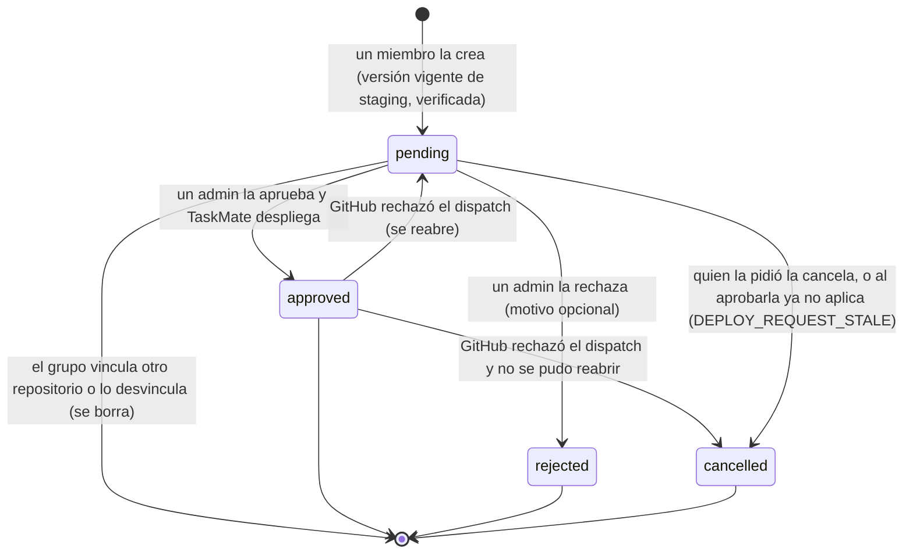
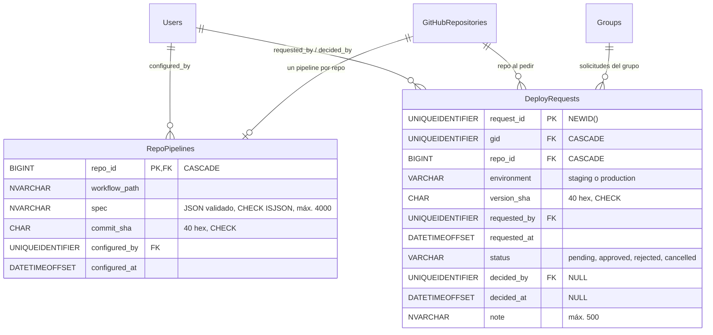

# Fase 4: Pipeline CI/CD completo

**Estado:** ✅ COMPLETADA
**Idea central:** que el grupo maneje el CI/CD de **su** repositorio sin salir de TaskMate: TaskMate (o la IA) propone el pipeline y lo sube, el grupo ve las ejecuciones y los logs en vivo, ejecuta, re-ejecuta y cancela, y publica su sitio en staging (automático) y en producción (con aprobación del admin), con rollback y notificaciones.

---

## Metadata

| Campo | Valor |
|-------|-------|
| **Fase** | 4 |
| **Nombre** | Pipeline CI/CD completo (build, pruebas, análisis estático, deploy y actualización automática) |
| **Complejidad** | Alta |
| **Fechas Planificadas** | 18 sep 2026 — 9 oct 2026 |
| **Fechas Reales** | 9 oct 2026 — 22 oct 2026 (alcance, plan y paso 1 el 9 oct, 14:40–15:28; mejoras y pasos 2–3 el 22 oct, 09:07–09:40; paso 4 (IA) a las 10:20; revisión, verificación y correcciones a las 11:03; E2E con GitHub real y documentación el 22 oct) |
| **Estado** | ✅ Completada |
| **Rama Git** | `feature/fase-4-cicd-github-actions` (creada desde `master` con las Fases 1–3 ya fusionadas) · PR [#5](https://github.com/PabloP150/proyecto-is-cc6/pull/5) |
| **Responsable** | Pablo Pineda |

### Documentos de esta fase

| Documento | Para qué |
|-----------|----------|
| [README.md](README.md) (este) | Capítulo principal: qué se hizo, por qué, arquitectura, seguridad, BD, rutas y cómo verificarlo |
| [GUIA-CICD.md](GUIA-CICD.md) | Guía práctica para miembros y admins: configurar el pipeline, ejecutar, ver logs, entornos, aprobar producción, rollback, notificaciones y solución de problemas |
| [../fase-03-integracion-github/GUIA-GITHUB-APP.md](../fase-03-integracion-github/GUIA-GITHUB-APP.md) | Registro de la GitHub App, actualizada con los permisos y eventos de la Fase 4 y con «Redirect on update» |

---

## Objetivo

La calendarización solo tenía el título de esta fase. El 9 oct 2026 se propuso primero un pipeline de GitHub Actions **para el repositorio de TaskMate** (CI, imagen en GHCR y deploy en la máquina de Pablo), y Pablo lo corrigió: la idea es la misma que en la Fase 3, **hacer todo sin salir de TaskMate**. La Fase 4 es una **funcionalidad del producto**: el grupo configura, ve y opera el CI/CD del repositorio que conectó en la Fase 3 (a través de la misma GitHub App).

De la lluvia de ideas (13 propuestas numeradas) Pablo eligió siete:

| # | Funcionalidad | Estado |
|---|---------------|--------|
| 1 | TaskMate propone el pipeline (detectado del repositorio o, si el grupo lo permite, con IA) y lo sube al repositorio | ✅ |
| 2 | Panel de ejecuciones en vivo en `/github` → pestaña **CI/CD** | ✅ |
| 3 | Logs y anotaciones (errores con archivo y línea) dentro de TaskMate | ✅ |
| 4 | Ejecutar, re-ejecutar fallidos y cancelar | ✅ |
| 5 | Deploy con entornos (staging y producción) y aprobación del admin en TaskMate | ✅ |
| 6 | Entrega continua automática (staging con cada cambio que pasa el CI) y rollback de producción | ✅ |
| 13 | Notificaciones en TaskMate (pipeline fallido, deploy terminado, solicitudes y decisiones) | ✅ |
| 7–12 | La IA explica fallos, CI en el chip de la tarea, exigir CI para fusionar, secretos, métricas DORA, Dependabot | ⏸️ Descartadas o para después ([detalle](#ideas-descartadas-o-para-después)) |

Cómo se cumple cada parte del título de la fase:

| Parte del título | Cómo se cumple |
|------------------|----------------|
| Build | Etapa **Build** con el script `build` del `package.json` (Vite, Create React App u otro) |
| Pruebas | Etapa **Pruebas**: `npm test` (o el script elegido) en Node.js; `pytest` en Python (con anotaciones de archivo y línea) |
| Análisis estático | Etapa **Análisis estático**: el script de lint (`lint`/`eslint`) o, si no hay, la **auditoría de dependencias** (`npm audit --omit=dev --audit-level=high`); **Ruff** en Python (`--output-format=github`: errores con archivo y línea) |
| Deploy | Jobs **Build del deploy** (construye solo la versión que se despliega) y **Deploy a GitHub Pages** (publica): producción en `/<repo>/`, staging en `/<repo>/staging/` |
| Actualización automática | Cada push a la rama principal que pasa el CI actualiza **staging** solo (los deploys esperan su turno en cola, ninguno se descarta); producción se actualiza con un clic del admin (o al aprobar una solicitud) y se puede volver atrás con **rollback** |

### Problemas que Resuelve
- El CI/CD vivía fuera de TaskMate: había que escribir YAML a mano, ir a GitHub para ver si algo falló y a otra herramienta para publicar.
- Los miembros no tenían forma de saber, desde donde planifican, si la rama principal estaba verde ni qué versión estaba publicada.
- Publicar en producción no tenía control: cualquiera con acceso a GitHub decidía; no había aprobación ni historial a la vista del grupo.
- Los fallos se descubrían tarde: el aviso de GitHub llega por correo solo a quien hizo el push.

### Impacto Esperado
- **Producto:** 7 funcionalidades nuevas de CI/CD dentro de TaskMate, sin salir de la app.
- **Calidad:** de 1353 a **1914 pruebas pasando** al 22 oct 2026 (API 1228, frontend 404, Python 177, BD 105), después de una revisión con verificación adversarial y de corregir lo que encontró ([detalle](#revisión-verificación-y-correcciones)).
- **Seguridad:** nada de comandos libres en el workflow, entradas del dispatch fuera de cualquier shell, solo se despliegan versiones de la rama principal que pasaron el CI, el código del repositorio nunca corre con permisos de publicar, solo quien puede escribir en el repositorio lo vincula, tokens de GitHub por operación y eventos en vivo solo para miembros.
- **Habilitación:** la Fase 5 (testing automático por tarea) puede mostrar el resultado del CI en el chip de cada tarea (idea 8) a partir de los runs y eventos de esta fase.

---

## Qué Se Hizo

### Tabla de Commits

Todos en `feature/fase-4-cicd-github-actions` (rango `fe9d87d..HEAD`).

| Hash | Mensaje | Archivos | Fecha |
|------|---------|----------|-------|
| `8473f9d` | feat(cicd): configure the group's CI/CD pipeline from TaskMate | `services/github/{pipelineSpec,pipelineService,actionsService,githubApp,repoSnapshot}.js`, `models/cicd.model.js`, `migrations/007_cicd{,.down}.sql`, `controllers/github.controller.js`, `services/UserSession.js`, `tests/github/**`, `tests/db/cicd.dbtest.js` (19) | 9 oct |
| `d7a0d4b` | feat(cicd): CI/CD tab in the GitHub page | `src/components/github/cicd/{CicdPanel,PipelineCard,PipelineSetup,RunList,RunDetail}.jsx`, `cicdUtils.jsx`, `useVisibleInterval.js`, `src/api/github.js`, `GitHubPage.jsx` (14) | 9 oct |
| `434f916` | fix(ui): opaque dialogs and menus; no horizontal scroll in the pipeline setup | `src/theme/theme.js`, `PipelineSetup.jsx` (2) | 9 oct |
| `3837c5c` | feat(github): come back from GitHub after giving the App access; no never-ending CI scripts | `services/github/{installFlow,pipelineSpec}.js`, `GitHubPage.jsx`, `RepositoryPanel.jsx`, `PipelineSetup.jsx` y pruebas (9) | 22 oct |
| `5c06466` | feat(cicd): job logs, annotations, run controls and live CI/CD events | `services/github/{actionsService,cicdEvents,webhookHandler,githubApp}.js`, `services/{realtime,WebSocketServer}.js`, `models/github.model.js`, `controllers/github.controller.js` y pruebas (13) | 22 oct |
| `97613da` | feat(cicd): continuous delivery from TaskMate (environments, approvals, rollback) | `services/github/deployService.js`, `controllers/github.controller.js` y pruebas (4) | 22 oct |
| `cf40b84` | feat(cicd): live CI/CD tab with logs, run controls, environments and notifications | `src/components/github/cicd/{DeployPanel,JobLog,RunList,RunDetail}.jsx`, `src/components/realtime/{RealtimeContext,CicdNotifications}.jsx`, `src/App.js`, `src/api/github.js` (19) | 22 oct |
| `5bbd220` | fix(tasks): no deadlock between completing a task and linking its branch | `models/tasks.model.js` (1) | 22 oct |
| `316a9b8` | feat(cicd): the AI proposes the pipeline | `mcp/agents/{pipeline_agent,orchestrator}.py`, `mcp/{schemas,server}.py`, `services/github/{pipelineAi,pipelineService}.js`, `controllers/github.controller.js`, `src/api/github.js`, `PipelineSetup.jsx` y pruebas (15) | 22 oct |
| `00bdf5a` | fix(cicd): safer generated workflow (template v2) and outdated-workflow warning | `services/github/{pipelineSpec,pipelineService}.js`, `mcp/agents/pipeline_agent.py`, `PipelineCard.jsx` y pruebas, incluida `tests/github/pipelineSpec.scripts.test.js` (8) | 22 oct |
| `069da9a` | fix(cicd): verified versions, staging-only requests, stale requests and write-only linking | `services/github/{deployService,installFlow}.js`, `models/{cicd,github}.model.js` y pruebas (8) | 22 oct |
| `c6c1c22` | fix(cicd): job log tail, redaction and run-control errors | `services/github/{actionsService,githubApp,repoSnapshot}.js` y pruebas (6) | 22 oct |
| `2572ddc` | fix(realtime): never drop a subscribe; DB hiccups do not unsubscribe members | `services/{realtime,WebSocketServer}.js` y pruebas (4) | 22 oct |
| `bebcb60` | fix(ui): reliable live updates and notifications in the CI/CD tab | `src/components/realtime/{RealtimeContext,CicdNotifications}.jsx`, `src/components/github/cicd/{DeployPanel,JobLog,RunDetail,RunList}.jsx`, `githubUtils.js` y pruebas (10) | 22 oct |
| `67dd910` | fix(cicd): deploy runs are titled in Spanish | `services/github/pipelineSpec.js` y pruebas (5) | 22 oct |
| `be738bc` | fix(cicd): skip the download of a published site GitHub no longer keeps | `services/github/pipelineSpec.js`, `tests/github/pipelineSpec.scripts.test.js` (2) | 22 oct |

### Cómo se trabajó

| Paso | Contenido | Commits | Fecha |
|------|-----------|---------|-------|
| Alcance | Corrección del enfoque (funcionalidad del producto), lluvia de 13 ideas, elección de 1–6 y 13, plan y decisiones (abajo) | — | 9 oct |
| 1 | Configurar el pipeline desde TaskMate (detección, spec, validación, YAML, Pages, commit) y pestaña CI/CD con ejecuciones | `8473f9d`, `d7a0d4b`, `434f916` | 9 oct |
| Mejoras | Regreso desde GitHub tras dar acceso a otro repositorio (prioridad de Pablo) y scripts que nunca terminan fuera de las etapas | `3837c5c` | 22 oct |
| 2 | Logs, anotaciones, ejecutar / re-ejecutar / cancelar y eventos en vivo por el WebSocket `/events` | `5c06466` (backend), `cf40b84` (UI) | 22 oct |
| 3 | Entrega continua: entornos, solicitudes y aprobación de producción, rollback, historial | `97613da` (backend), `cf40b84` (UI) | 22 oct |
| 4 | La IA propone el pipeline (si el grupo lo permitió) y Node lo valida igual que cualquier otra spec. De paso se corrigieron un *deadlock* existente en la BD y un fallo del servidor de Python ([problemas encontrados](#problemas-encontrados-y-corregidos)) | `316a9b8`, `5bbd220` | 22 oct |
| Revisión | Un agente revisor y un flujo de verificación adversarial sobre todo lo de la fase ([detalle](#revisión-verificación-y-correcciones)) | — | 22 oct |
| Correcciones | Cinco áreas corregidas, cada una revisada y vuelta a corregir: workflow (plantilla v2), reglas de deploy y vinculación, logs y controles, tiempo real (servidor) y pestaña CI/CD (UI) | `00bdf5a`, `069da9a`, `c6c1c22`, `2572ddc`, `bebcb60` | 22 oct |
| 5 | E2E con GitHub real ([resultados](#pasos-24-y-plantilla-v2-22-oct-2026-en-verde)), dos ajustes que salieron de él y esta documentación | `67dd910`, `be738bc` | 22 oct |

El 9 oct, después del paso 1, se creó el repositorio de prueba **público** `PabloP150/taskmate-fase4-demo` (sitio Vite con pruebas y lint), Pablo aceptó los permisos nuevos en la instalación de desarrollo, la BD de desarrollo se migró a la 007 (con respaldo previo en `~/taskmate-backups/`) y el primer recorrido E2E quedó en verde ([Pruebas E2E](#pruebas-e2e-con-github-real)). El 22 oct Pablo autorizó completar los pasos 2–5 y las dos mejoras. Los workflows generados se revisaron con **actionlint** y **shellcheck** durante el desarrollo (`8473f9d`) y las pruebas los parsean como YAML (dependencia de desarrollo `yaml`). Con la plantilla v2, actionlint 1.7.12 solo marca la clave `queue` de `concurrency`, que todavía no conoce; los bloques `run` pasan shellcheck.

### Revisión, verificación y correcciones

Antes de cerrar la fase, el código de los pasos 1–4 pasó por una revisión en dos partes y después por un flujo de correcciones:

| Etapa | Qué se hizo | Resultado |
|-------|-------------|-----------|
| Revisión | Un agente revisor leyó los cambios de la fase | Una primera lista de problemas |
| Verificación | Un flujo de **107 agentes**: 7 auditores revisaron **112 requisitos** y cada hallazgo pasó por **2 verificadores adversariales** que intentaron refutarlo | **43 defectos confirmados**, unos **30 distintos** (varios auditores llegaron al mismo) |
| Corrección | Un flujo por **5 áreas** (workflow; reglas de deploy y vinculación; logs y controles; tiempo real; pestaña CI/CD): cada área se corrigió, se revisó y se volvió a corregir lo que esa revisión encontró | 5 commits: `00bdf5a`, `069da9a`, `c6c1c22`, `2572ddc`, `bebcb60` |

Lo que cambió con esas correcciones está descrito en cada funcionalidad y resumido en [Problemas encontrados y corregidos](#problemas-encontrados-y-corregidos).

### Decisiones de diseño

| Tema | Decisión | Por qué |
|------|----------|---------|
| Dónde se ve | Pestaña **CI/CD** en `/github` (junto a Repositorio, Archivos y Commits) | Todo lo de GitHub del grupo en un solo lugar |
| Cómo se escribe el workflow | La IA o la detección producen una **spec** (JSON); Node la **valida** y genera el YAML con una **plantilla fija** | Ni la IA ni el admin pueden meter comandos de shell libres |
| Qué comandos se permiten | Solo scripts que **existen** en `package.json` y herramientas fijas (`npm ci`/`install`/`audit`, `pip`, Ruff, `pytest`) | Lo que corre en el runner es predecible y revisable |
| Scripts que inician servidores o *watchers* | Excluidos de las etapas | Nunca terminan: colgarían el job hasta su *timeout* |
| Dónde se sube | Commit **directo** a la rama principal en `.github/workflows/taskmate-ci.yml`, con la marca `# taskmate-pipeline: 2` (el número es la versión de la plantilla) | Un solo archivo de TaskMate; nunca se pisa uno que TaskMate no escribió, y la pestaña CI/CD avisa cuando el del repositorio es de una plantilla anterior |
| Destino del deploy | **GitHub Pages** (elección de Pablo) | Gratis, sin infraestructura extra, se maneja con la misma App |
| Activar Pages | Lo hace **TaskMate** al subir un pipeline con deploy (permisos Administration write + Pages write, usados **solo** en esa acción) | El admin no tiene que ir a *Settings → Pages* |
| Entornos | Staging en `/<repo>/staging/` y producción en `/<repo>/` en **un solo sitio de Pages**; cada deploy construye **solo** la versión que se despliega y conserva el otro entorno del sitio ya publicado (el artefacto de Pages se guarda 90 días) | Pages publica un único artefacto por repositorio; reconstruir el otro entorno con la configuración de hoy podía romper un deploy que no tenía nada que ver |
| Build y deploy separados | Job **build** (instala y construye, sin permisos de publicar) y job **deploy** (solo `deploy-pages` y registrar el estado, sin código del repositorio) | Las dependencias y scripts del repositorio nunca corren con `id-token` ni `pages: write` |
| Orden de los deploys | Las ejecuciones que pueden desplegar comparten un grupo de `concurrency` de todo el workflow con `queue: max`: esperan en orden y ninguna se descarta | Con el comportamiento por defecto de GitHub, solo queda una ejecución pendiente y las demás se cancelan; con grupos por job, el build de otra ejecución podía colarse entre un build y su deploy |
| Qué se despliega | Solo **sitios estáticos** (HTML, Vite, Create React App); APIs y proyectos Python tienen CI pero no deploy. Un sitio estático nunca publica una carpeta que contiene otro proyecto Node.js o Python | Pages solo sirve archivos estáticos; publicar la raíz de un monorepo expondría el código de la API |
| Lenguajes | **Node.js (npm)** y **Python** | Los stacks de los proyectos del curso |
| Qué versiones se despliegan | Solo commits que TaskMate ya desplegó, o que están en la **rama principal** y cuyo job de CI de TaskMate pasó (su *check run*; un deploy lanzado desde TaskMate no cuenta como CI) | Nada llega a un entorno sin pasar build, pruebas y análisis; una rama de trabajo o un *fork* no se publican |
| Qué puede pedir un miembro | Solo **promover la versión vigente de staging** a producción | Producción recibe lo que el grupo ya vio en staging; cualquier otra versión la decide un admin |
| Quién puede vincular un repositorio | Solo quien tiene permiso **push, maintain o admin** sobre él en GitHub | Vincular le da al grupo el token de la App para ese repositorio (ramas, workflow, deploys de producción): alguien con solo lectura podría vincularlo a su propio grupo y publicar su producción |
| Entradas del dispatch | Viajan por `env`, se validan dentro del job y **nunca** se interpolan en un shell | Evita inyección por `inputs` |
| Re-ejecutar o cancelar un deploy | Solo el admin; re-ejecutar una ejecución vieja (o solo su job de deploy) nunca publica una versión desactualizada, y «Cancelar» detiene el deploy de verdad | Re-ejecutar un deploy viejo de producción sería un rollback hecho por un miembro |
| Logs | Solo el final, pedido con `Range`; se descargan **sin** el token de GitHub y con secretos redactados (también llaves privadas de varias líneas y cabeceras `Authorization`) | El token no sale hacia el almacenamiento de logs; un log enorme no se descarga entero |
| Tiempo real | WebSocket `/events` con **membresía re-verificada**; una suscripción nunca se pierde y un fallo momentáneo de la BD no saca a nadie; *polling* de respaldo sin conexión y uno lento de seguridad con ella | Un miembro expulsado deja de recibir eventos en minutos; un miembro real no se queda sin avisos |
| Historial de deploys | Los **GitHub Deployments** (tarea `deploy:taskmate`) son el historial; en la BD solo se guardan el pipeline y las solicitudes de producción pendientes de un admin | GitHub es la fuente de verdad; nada que sincronizar |

### Narrativa por Cambio

#### Funcionalidad 1 — TaskMate propone el pipeline y lo sube

**Qué hace para el usuario:** el admin entra a **GitHub** → pestaña **CI/CD** → **«Configurar pipeline»**. TaskMate revisa la rama principal y abre un diálogo con su propuesta: proyecto (si hay varios, un selector), versión de Node.js o Python, cómo instalar dependencias, análisis estático, pruebas, build y deploy a GitHub Pages. Unas notas explican cada decisión («No hay script de lint: el análisis estático será la auditoría de dependencias», «No se usa «dev»: inicia un servidor…»). Cada cambio se valida y se vuelve a generar en el servidor; el diálogo muestra las **Etapas** con sus comandos y el botón **«Ver el archivo YAML»**. Un aviso dice exactamente qué pasará: un commit en la rama principal con `.github/workflows/taskmate-ci.yml` y, si hay deploy, la activación de GitHub Pages. **«Subir al repositorio»** hace el commit (`ci: configurar el pipeline de TaskMate`, «Configurado por *usuario* desde TaskMate») y muestra el enlace al commit y al sitio. GitHub lo ejecuta en segundos. **«Editar pipeline»** reabre la configuración guardada (chip «Guardado») si sigue siendo válida para el repositorio; si no, propone una nueva y lo avisa. Si el grupo activó **«Permitir análisis con IA»** (Fase 3), la primera propuesta la hace la IA (chip «Propuesto por IA») y el diálogo ofrece **«Proponer con IA»** para pedirla de nuevo; sin ese permiso, el diálogo explica cómo activarlo.

**Cómo funciona:**
- **Detección** (`pipelineService.collectFacts`): lee el árbol de la rama principal y busca proyectos hasta 2 niveles de profundidad (máx. 6), sin carpetas ocultas ni `node_modules`, `dist`, `build`, `vendor`, `tests`, `examples`, etc. Solo lee archivos que el árbol lista (sin 404 de más) y de hasta 256 KB: `package.json`, `.nvmrc`/`.node-version`, `requirements*.txt` (máx. 4), `pyproject.toml`, `.python-version`. De ahí salen los *facts*: scripts (máx. 40, nombres `[A-Za-z0-9][A-Za-z0-9:_.-]*`), lockfile, versión (Node 20/22/24/26, por defecto 24; Python 3.10–3.14, por defecto 3.13), framework (`vite` o `react-scripts`), carpetas con `index.html` (`.`, `public`, `docs`, `site`) y scripts que nunca terminan. Los *facts* se guardan 15 min por (repositorio, usuario) para que las vistas previas no relean el repositorio.
- **Propuesta** (`pipelineSpec.proposeSpec`): elige el primer proyecto Node.js desplegable, si no un sitio estático que se pueda publicar sin exponer otro proyecto, si no un Node.js, si no el primero. Node.js: `npm ci` si hay `package-lock.json` (si no, `npm install`; yarn y pnpm se instalan con npm y se avisa), lint con `lint`/`eslint` o `npm audit` si no hay, pruebas con `test` (salvo el «no test specified» de `npm init`), build con `build`, deploy si hay build y framework conocido (Vite → `dist`, CRA → `build`). Con Vite, el script `build` debe **terminar en un `vite build` simple** (sin `--base` propio): TaskMate le agrega `--base=…` para publicar en `/` y en `/staging/`, y npm se lo pasa al último comando (en `vite build && cp …` le llegaría a `cp`); si no, no hay deploy y una nota lo explica. Python: `pip install -r` o `pip install .`, Ruff y pytest (si hay pytest o archivos de prueba), sin deploy. Sitio estático: solo verificar `index.html` y desplegar la carpeta, pero **nunca** una carpeta que contenga otro proyecto Node.js o Python (un `index.html` en la raíz de un monorepo publicaría también el código de la API): se usa otra carpeta del sitio (`docs/`, `site/`…) o no se propone, con una nota.
- **Spec** (JSON, versión 1): `{version, project: {dir, stack}, runtime, install, lint, audit, test, build, deploy: {target: 'github-pages', framework, outputDir}}`. La versión de la spec es independiente de la de la plantilla: las specs guardadas siguen siendo válidas con la plantilla v2.
- **Validación** (`pipelineSpec.validateSpec`): **toda** spec pasa por aquí, venga de la detección, de la IA, del admin o de la BD. Rechaza campos desconocidos; cada script debe existir en ese `package.json` y no ser de los que nunca terminan; `npm ci` exige `package-lock.json`; los archivos de `pip` deben ser los del proyecto; el deploy solo puede ser `github-pages`; Python no despliega; un deploy Vite exige que el build termine en `vite build`; un deploy estático nunca puede publicar una carpeta con otro proyecto Node.js o Python; un sitio estático necesita deploy desde una carpeta con `index.html`; las rutas solo aceptan segmentos `[A-Za-z0-9_][A-Za-z0-9._-]*` (sin `..` ni carpetas ocultas); el pipeline debe tener al menos una etapa. Error → `400 INVALID_PIPELINE`.
- **YAML** (`pipelineSpec.renderWorkflow`): determinista (la misma spec da siempre el mismo texto), plantilla fija, cada valor validado y además entre comillas simples (también los `run`: un script cuyo nombre termina en `:` daba un YAML inválido). Detalle en [El workflow generado](#el-workflow-generado-job-por-job).
- **Subir** (`pipelineService.applyPipeline`, `PUT /pipeline`): vuelve a leer el repositorio **tal como está ahora**, valida y genera; si hay deploy, `ensurePages` activa Pages con `build_type: workflow` (o cambia un sitio que publicaba desde una rama) **antes** del commit, porque ese mismo push ya ejecuta el deploy; `commitWorkflow` lee el archivo actual: si existe y no tiene la marca de TaskMate (de cualquier versión) → `409 WORKFLOW_CONFLICT` (nunca lo pisa); si es idéntico, no hace otro commit; si no, lo escribe con el `sha` actual. Rama protegida → `409 BRANCH_PROTECTED`; cambio concurrente → `409 WORKFLOW_CHANGED`. Al final guarda la spec en `RepoPipelines`.
- **Aviso de workflow anterior** (`00bdf5a`, `pipelineService.getWorkflowStatus`): `GET /pipeline` lee el archivo de la rama principal y devuelve `workflow: {present, templateVersion, currentVersion, outdated}`. Si es de una plantilla anterior (p. ej. `# taskmate-pipeline: 1`), la tarjeta dice «El workflow del repositorio es de una versión anterior de TaskMate y no tiene las últimas mejoras (deploys en cola, sin reconstruir el otro entorno).» y, al admin, «Pulsa «Editar pipeline» y vuelve a subirlo para actualizarlo.»; si alguien lo borró, «El workflow de TaskMate ya no está en el repositorio, así que el pipeline no corre.». Volver a subirlo con la misma spec genera la plantilla v2.
- **Scripts que nunca terminan** (`3837c5c`): por nombre (`start`, `dev`, `develop`, `serve`, `server`, `preview`, `watch`) o por lo que ejecutan (`vite` o `parcel` sin `build`, `next dev`, `nuxt dev`, `astro dev`, `react-scripts start`, `ng serve`, `webpack serve`, `nodemon`, `http-server`, `json-server`, `--watch`, `-w`…), también a través de `npm run <otro>`. Se marcan en los *facts*, la propuesta los salta (con nota), la validación los rechaza y el diálogo los muestra deshabilitados con «(inicia un servidor o vigila cambios: nunca termina)».

**Paso 4 — La IA propone el pipeline.** Usa el mismo permiso por grupo de la Fase 3 (**«Permitir análisis con IA»**, apagado por defecto):
- **Cuándo:** si el grupo lo permite, la primera propuesta (sin pipeline guardado y sin cambiar de proyecto) ya la hace la IA; además, el diálogo ofrece **«Proponer con IA»** en cualquier momento (también para otro proyecto). La ruta de propuesta acepta `ai`: `true` la pide (sin permiso → `409 AI_ANALYSIS_DISABLED`), `false` nunca la usa y sin el campo decide el servicio. El diálogo muestra «La IA está revisando el repositorio…», luego «La IA revisó el repositorio y propone este pipeline…», el chip **«Propuesto por IA»** y la explicación de la IA como nota.
- **Qué se envía** (`services/github/pipelineAi.js`): los proyectos detectados (máx. 6) con sus scripts (nombre y comando, con secretos redactados y recortado a 200 caracteres), los scripts que nunca terminan, lockfile, versión, framework, carpetas del sitio y archivos de Python, más la spec detectada y las versiones permitidas. **Nunca el código fuente.** El aviso del diálogo lo dice: «Se envía a Groq la lista de proyectos y scripts del repositorio, nunca el código fuente.»
- **Python** (`mcp/agents/pipeline_agent.py`, método `propose_pipeline` por el mismo WebSocket autenticado con `X-MCP-Secret`): el modelo solo **elige** valores entre las opciones de los datos (proyecto, versión, nombres de scripts, carpetas), nunca escribe comandos; los datos van dentro de una etiqueta aleatoria `DATA-xxxxxxxx` declarada como no confiable; modo JSON, temperatura 0.1, `max_tokens` 900, hasta 2 propuestas simultáneas y un plazo de 50 s (Node espera 60 s).
- **Node no confía en la respuesta:** la spec de la IA pasa por el **mismo `validateSpec`**; si eligió otro proyecto cuando se pidió uno concreto, no es válida, o la IA tardó, está limitada o no responde, TaskMate se queda con la propuesta detectada y lo avisa («No se pudo usar la IA (…); esta es la propuesta de la detección automática.»). La IA no puede agregar nada que la detección no permitiría. Desde `00bdf5a` su *prompt* incluye las reglas nuevas de deploy (Vite solo con un build que termina en `vite build`; un sitio estático nunca en una carpeta con otro proyecto), así que rara vez propone algo que la validación rechace.

**Archivos clave:** `taskmate-api/services/github/{pipelineSpec,pipelineService,pipelineAi}.js`, `taskmate-api/models/cicd.model.js`, `taskmate-api/migrations/007_cicd.sql`, `taskmate-api/mcp/agents/{pipeline_agent,orchestrator}.py`, `taskmate-api/mcp/schemas.py`, `src/components/github/cicd/{PipelineSetup,PipelineCard,CicdPanel}.jsx`.

**Cómo probarlo:** [GUIA-CICD.md](GUIA-CICD.md#2-configurar-el-pipeline-admin). Pruebas: `tests/github/{pipelineSpec,pipelineSpec.scripts,pipelineService,pipelineAi,cicd.controller}.test.js`, `tests/db/cicd.dbtest.js`, `mcp/tests/{test_pipeline_agent,test_server}.py`, `src/components/github/cicd/__tests__/{PipelineSetup,CicdPanel}.test.jsx`.

**Commits relacionados:** `8473f9d`, `d7a0d4b`, `434f916`, `3837c5c`, `316a9b8`, `00bdf5a`

---

#### Funcionalidad 2 — Panel de ejecuciones en vivo

**Qué hace para el usuario:** la pestaña **CI/CD** muestra, de arriba abajo: la tarjeta **Pipeline de CI/CD** (stack, etapas, quién lo configuró y cuándo, enlace al workflow y el sitio de Pages), **Entornos** (si el pipeline despliega) y **Ejecuciones**: todas las ejecuciones de GitHub Actions del repositorio (las de TaskMate y las de otros workflows), con filtros por workflow y por estado, 20 por página y «Ver más». Cada fila muestra estado, título, workflow y número, evento (Push, Pull request, Manual…), rama, commit, quién la lanzó, hace cuánto y duración. Al expandirla aparecen el enlace a GitHub, los controles (funcionalidad 4) y los **jobs con sus pasos** y duraciones. Todo se actualiza solo mientras algo corre.

**Cómo funciona:** `actionsService` lee GitHub **en vivo**, sin copiar nada a la BD: `GET /actions/runs` (o `/actions/workflows/:id/runs`), `GET /actions/runs/:id` y sus jobs (último intento, máx. 100), con un token de instalación `actions: read` acotado al repositorio. En vivo: el evento `ci_run` recarga la lista (agrupando ráfagas en 1 s) y `ci_run`/`ci_job` de esa ejecución recargan su detalle (800 ms; los eventos de otras ejecuciones se filtran **antes** de agrupar, para que no desplacen al que el detalle espera). Mientras haya algo en curso y la pestaña del navegador esté visible, la lista y el detalle además consultan GitHub: cada 15 s y 10 s sin conexión a `/events`, y cada 60 s con ella, como red de seguridad por si se perdió un evento. Cada vez que el servidor confirma de nuevo la suscripción (una reconexión), las pantallas se recargan una vez para recuperar lo que pasó mientras tanto (`bebcb60`).

**Archivos clave:** `taskmate-api/services/github/actionsService.js`, `src/components/github/cicd/{RunList,RunDetail,cicdUtils,useVisibleInterval}.{jsx,js}`.

**Cómo probarlo:** [GUIA-CICD.md](GUIA-CICD.md#3-ver-las-ejecuciones). Pruebas: `tests/github/actionsService.test.js`, `src/components/github/cicd/__tests__/{RunList,RunControls}.test.jsx`.

**Commits relacionados:** `8473f9d`, `d7a0d4b`, `5c06466`, `cf40b84`, `bebcb60`

---

#### Funcionalidad 3 — Logs y anotaciones

**Qué hace para el usuario:** en un job fallido aparecen sus **anotaciones** (Error / Advertencia / Aviso, con `archivo:línea` y mensaje). Las producen ESLint (con los *problem matchers* que registra `setup-node`), Ruff (`--output-format=github`), pytest (plugin `pytest-github-actions-annotate-failures`, que se activa solo dentro de Actions) y Vitest (anota por sí mismo); los fallos de Jest (Create React App) se ven en el log. Si las anotaciones no se pueden cargar, el job lo dice («No se pudieron cargar los errores y advertencias: …», p. ej. porque faltan los permisos de CI/CD) en lugar de parecer un job sin errores. En cualquier job terminado, **«Ver log»** muestra el final del log con los grupos como encabezados (▸), errores en rojo (✖) y advertencias (⚠), un interruptor **«Solo errores»**, desplazamiento automático al final (donde suele estar el fallo) y «Se muestra el final del log» cuando es largo.

**Cómo funciona:**
- `GET /actions/jobs/:id/logs` con `redirect: 'manual'`: GitHub responde con una redirección a un almacenamiento temporal. TaskMate solo la sigue si es `https` y el host termina en `.actions.githubusercontent.com`, `.blob.core.windows.net` o `.githubusercontent.com`; descarga **sin** cabecera de autorización (la URL ya viene firmada), sin seguir más redirecciones y con 20 s de límite para toda la descarga.
- **Solo el final** (`c6c1c22`): si el log mide más de 256 KB, TaskMate vuelve a pedirlo con `Range: bytes=<tamaño − 256 KB>-` y recibe solo la cola (`206`). Si el almacenamiento ignorara `Range`, lo lee en *streaming* hasta 20 MB conservando los últimos 256 KB y marca `endMissing` cuando ese tope cortó antes del final (antes, en un log de más de 20 MB se mostraba el texto de la marca de 20 MB como si fuera el final). Una conexión cortada a mitad de descarga → `502`. Máx. 3 000 líneas de 2 000 caracteres; quita marcas de tiempo y colores ANSI; separa las líneas `##[error]`. Log en curso o vencido → `404 LOG_NOT_AVAILABLE`.
- **Redacción:** una **llave privada impresa en varias líneas** (`-----BEGIN … KEY-----`, su cuerpo y `-----END … KEY-----`, también con prefijos como los de BuildKit o docker compose, o cortada al inicio de la cola) se vuelve una sola línea `[REDACTED]`; las cabeceras **`Authorization`** (`Bearer`, `token`, `Basic`) pierden la credencial (las referencias `$VAR` o `${{ secrets.X }}` se dejan); el resto de los secretos se redacta línea por línea con los patrones del *snapshot* de la Fase 3, y ningún patrón alcanza la línea siguiente («Enter password:» ya no borra la línea de abajo).
- Anotaciones: el id de un job es también el de su *check run*: `GET /check-runs/:id/annotations` (`checks: read`), máx. 50, textos redactados y recortados (1 000 caracteres).

**Archivos clave:** `taskmate-api/services/github/actionsService.js` (`getJobLogForRepo`, `parseLog`, `redactKeyBlocks`, `getJobAnnotationsForRepo`), `taskmate-api/services/github/repoSnapshot.js` (`redactSecrets`), `src/components/github/cicd/JobLog.jsx`.

**Cómo probarlo:** [GUIA-CICD.md](GUIA-CICD.md#5-ver-logs-y-errores). Pruebas: `tests/github/{actionsService,repoSnapshot}.test.js` (hosts no permitidos, cola con `Range`, llaves de varias líneas, cabeceras `Authorization`), `src/components/github/cicd/__tests__/RunControls.test.jsx`.

**Commits relacionados:** `5c06466`, `cf40b84`, `00bdf5a` (Ruff y pytest), `c6c1c22`, `bebcb60`

---

#### Funcionalidad 4 — Ejecutar, re-ejecutar y cancelar

**Qué hace para el usuario:** con un pipeline de TaskMate configurado, **«Ejecutar pipeline»** pide una rama (por defecto la principal) y corre **solo el CI** (instalar, análisis estático, pruebas y build; no despliega). En una ejecución terminada con fallo, cancelada o vencida, **«Re-ejecutar fallidos»**; en una en cola o en curso, **«Cancelar»**. Cualquier miembro puede hacerlo con el CI; las ejecuciones de **deploy** que lanzó TaskMate («Deploy a producción desde TaskMate») solo las re-ejecuta o cancela el admin, y el miembro ve «Solo el administrador del grupo puede re-ejecutar o cancelar un deploy».

**Cómo funciona:**
- Ejecutar: `ref` debe ser un nombre de rama que exista (`GET /branches/:rama` → `404 BRANCH_NOT_FOUND`; un nombre que parece un SHA, como `deadbeef` o `20261022`, es una rama válida; un SHA real no es una rama y da 404) y el repositorio debe tener pipeline de TaskMate (`PIPELINE_NOT_CONFIGURED`); `POST /actions/workflows/taskmate-ci.yml/dispatches` con `inputs: {environment: 'none'}`. Si GitHub rechaza el *dispatch* (`c6c1c22`): la rama se borró entre medio → `404 BRANCH_NOT_FOUND`; el workflow está desactivado en el repositorio → `409 WORKFLOW_DISABLED`; la rama no tiene el workflow de TaskMate o tiene uno anterior que no acepta esas entradas → `409 BRANCH_WORKFLOW_OUTDATED` (se arregla actualizando la rama con la principal).
- Re-ejecutar: `POST /actions/runs/:id/rerun-failed-jobs`; GitHub lo rechaza si la ejecución tiene más de un mes o ya está corriendo → `409 RUN_NOT_RERUNNABLE`. Cancelar: `POST /actions/runs/:id/cancel`; ya terminada → `409 RUN_NOT_CANCELLABLE`. Un límite de GitHub (también el secundario, que llega como `403`) se informa como `503 GITHUB_RATE_LIMITED` con `Retry-After`, no como «no se puede re-ejecutar».
- Con la plantilla v2, **«Cancelar» detiene un deploy de verdad**: los jobs de deploy usan `!cancelled()` en lugar de `always()` (un job con `always()` sigue corriendo aunque se cancele la ejecución). Re-ejecutar no publica versiones viejas: ver [el workflow](#versiones-viejas-y-re-ejecuciones).
- Una ejecución es «de deploy» si es del workflow de TaskMate, su evento es `workflow_dispatch` y su título (el `run-name`) empieza con «Deploy a ». La API decide con `isGroupAdmin` (la UI aplica la misma regla solo para mostrar u ocultar botones).
- Token `actions: write` solo para estas tres acciones; límite de 10 por minuto por usuario (gastan minutos de Actions del repositorio).

**Archivos clave:** `taskmate-api/services/github/{actionsService,githubApp}.js`, `taskmate-api/controllers/github.controller.js`, `src/components/github/cicd/RunList.jsx`.

**Cómo probarlo:** [GUIA-CICD.md](GUIA-CICD.md#4-ejecutar-re-ejecutar-y-cancelar). Pruebas: `tests/github/{actionsService,githubApp,cicd.controller}.test.js`, `src/components/github/cicd/__tests__/RunControls.test.jsx`.

**Commits relacionados:** `5c06466`, `cf40b84`, `00bdf5a`, `c6c1c22`

---

#### Funcionalidad 5 — Deploy con entornos y aprobación del admin

**Qué hace para el usuario:** la tarjeta **Entornos** muestra **Staging** y **Producción**: versión publicada (commit con enlace, hace cuánto, «Automático al pasar el CI en la rama principal» o «Pedido por *usuario*»), URL del sitio, estado («En línea», «Desplegando…», «Falló el último deploy», «Sin versión»), el deploy en curso y el último fallo con enlace a la ejecución. Debajo de staging: el admin ve **«Publicar en producción»** (despliega ya) y el miembro **«Solicitar producción»** (envía una solicitud); ambos usan la versión de staging que se mostraba **al abrir el diálogo**, y si staging cambia mientras está abierto el diálogo lo avisa («Staging cambió a … mientras este diálogo estaba abierto. Esta acción usa …; para usar la nueva versión, cancela y vuelve a abrir.»). En **Solicitudes de producción** el admin pulsa **«Aprobar»** (y TaskMate despliega) o **«Rechazar»** (con un motivo opcional); quien pidió puede **«Cancelar solicitud»**. **«Historial de deploys»** lista los últimos 15. Después de publicar, aprobar o hacer rollback, el panel sigue consultando hasta que el deploy aparece (aunque espere en cola detrás de otro), por hasta 10 min.

**Cómo funciona** (ver [Diagrama 2](#diagrama-2-solicitud-y-aprobación-de-producción)):
- **Historial** (`deployService.fetchDeploys`): una sola consulta GraphQL con **dos listas separadas**, los 20 Deployments más recientes de `staging` y los 20 de `production`, filtrados por la tarea `deploy:taskmate` (`deployments: read`). Antes era una sola lista de 30 para los dos entornos, y 30 deploys de staging seguidos hacían desaparecer producción (`069da9a`). La versión publicada de cada entorno es el último deploy en `success` (los anteriores de staging pasan a `inactive` por `auto_inactive`; en producción gana el más reciente). Un deploy que lleva **más de 1 hora** sin estado final (se perdió el *runner*, se canceló antes de registrar el fallo) se muestra como fallido (`abandoned: true`) en lugar de «Desplegando…» para siempre.
- **Solo versiones verificadas** (`assertVersionPassedCi`, `069da9a`): la versión (SHA completo de 40 caracteres) debe cumplir una de dos: (a) TaskMate ya la desplegó (rollbacks y promociones), o (b) está en la **rama principal** (`GET /compare/<sha>...<rama principal>` responde `ahead` o `identical`) **y** el job de CI de TaskMate pasó en ese commit: un *check run* de la app `github-actions` cuyo nombre empieza con «CI (», `completed` y `success`, con ese mismo `head_sha` (`checks: read`). Antes bastaba una ejecución exitosa del workflow, y un deploy lanzado desde TaskMate (CI omitido) también contaba; ahora no, y los commits de una rama de trabajo o de un *fork* tampoco. Como los *check runs* llegan unos segundos después del push, una respuesta negativa se repite una vez a los 2 s. Si no → `409 VERSION_NOT_VERIFIED`.
- **Desplegar ya** (admin, `POST /deployments`): valida entorno y SHA, que el pipeline tenga deploy (`DEPLOY_NOT_CONFIGURED`) y la versión; luego `workflow_dispatch` en la rama principal con `inputs: {environment, version, requested_by}`. Si el workflow de la rama principal no acepta esas entradas → `409 PIPELINE_OUTDATED`.
- **Solicitar** (miembro, `POST /deploy-requests`): un miembro **solo puede pedir producción para la versión vigente de staging** (otro entorno → `400 VALIDATION_ERROR`; otra versión → `409 VERSION_NOT_STAGING`), y además la versión debe estar verificada. La solicitud queda ligada al **repositorio actual** del grupo: dentro de la misma transacción se bloquea el vínculo grupo–repositorio y, si el grupo cambió de repositorio entre medio, → `409 DEPLOY_REQUEST_STALE`. Solo puede haber **una pendiente por grupo y entorno** (índice único filtrado → `409 DEPLOY_REQUEST_PENDING`). Se avisa en vivo a los admins.
- **Aprobar** (admin): antes de aprobar se comprueba que la solicitud **siga aplicando**: mismo repositorio y su versión todavía la vigente de staging. Si no, TaskMate la **cancela** con una nota para quien la pidió («El grupo cambió de repositorio.» o «La versión de staging cambió; pide de nuevo.») y responde `409 DEPLOY_REQUEST_STALE`. El cambio a `approved` es un `UPDATE … WHERE status = 'pending'`, así que dos admins no pueden aprobar la misma (`409 DEPLOY_REQUEST_DECIDED`); después se lanza el deploy con el nombre de quien lo pidió. Si GitHub rechaza el *dispatch*, la solicitud **vuelve a pendiente**; si eso no es posible (otra solicitud ocupó el lugar, el grupo cambió de repositorio o falló la BD) se **cancela** con la nota «No se pudo iniciar el deploy en GitHub; pide de nuevo.»: una solicitud nunca queda «aprobada» sin un deploy que la respalde. **Rechazar** guarda el motivo (máx. 500); **cancelar** solo lo puede hacer quien la pidió (`403 NOT_REQUESTER`).
- **Solicitudes por repositorio:** la lista solo muestra las del repositorio actual del grupo; vincular otro repositorio o desvincularlo **borra las pendientes** del anterior (ya no se podrían aprobar y ocuparían el único lugar por entorno); las decididas se conservan como historial.
- **Un solo sitio, dos versiones:** el job `build` construye **solo** la versión del entorno que se despliega y la combina con el sitio publicado (producción en la raíz, staging en `/staging/`), porque Pages publica un único artefacto por repositorio. Detalle en [el workflow](#job-build--build-del-deploy).

**Archivos clave:** `taskmate-api/services/github/deployService.js`, `taskmate-api/models/{cicd,github}.model.js`, `src/components/github/cicd/DeployPanel.jsx`.

**Cómo probarlo:** [GUIA-CICD.md](GUIA-CICD.md#6-entornos-staging-y-producción). Pruebas: `tests/github/{deployService,cicd.controller,githubModel}.test.js`, `tests/db/cicd.dbtest.js`, `src/components/github/cicd/__tests__/DeployPanel.test.jsx`.

**Commits relacionados:** `8473f9d` (tabla y plantilla), `97613da`, `cf40b84`, `069da9a`, `bebcb60`

---

#### Funcionalidad 6 — Entrega continua automática y rollback

**Qué hace para el usuario:** cada push a la rama principal que **pasa el CI** publica staging sin que nadie haga nada; el grupo recibe «Staging se actualizó con `abc1234`» con **«Abrir sitio»**. En producción, el admin tiene **«Rollback…»**: elige una de hasta 10 versiones anteriores (distintas de la actual) y **«Volver a esta versión»**.

**Cómo funciona:** los jobs `build` y `deploy` del workflow corren en un push a la rama principal solo si `needs.ci.result == 'success'`, con entorno `staging` y versión `github.sha`; si para entonces ese commit ya no es la punta de la rama principal (llegó otro push, o se re-ejecutó una corrida vieja), no se despliega nada y la ejecución lo anota («No se despliega abc1234: ya no es la última versión de main.»). Los pull requests y las otras ramas ejecutan el CI pero nunca despliegan. El rollback es un «desplegar ya» de producción con un SHA anterior (verificado porque ya se había desplegado). Todas las ejecuciones que pueden desplegar comparten el grupo `taskmate-pages` **a nivel de workflow**, sin cancelar y con `queue: max`: se encolan en orden y ninguna se descarta (con el valor por defecto de GitHub solo quedaba una pendiente y las demás se cancelaban). El CI de la rama principal nunca se cancela, así que un push más nuevo o un «Ejecutar pipeline» no pueden saltarse el deploy a staging de un push.

**Archivos clave:** `taskmate-api/services/github/{pipelineSpec,deployService}.js` (`buildJob`, `deployJob`, `closeJob`, `rollbackCandidates`), `src/components/github/cicd/DeployPanel.jsx`.

**Cómo probarlo:** [GUIA-CICD.md](GUIA-CICD.md#8-rollback-de-producción). Pruebas: `tests/github/{pipelineSpec,deployService}.test.js`.

**Commits relacionados:** `8473f9d`, `97613da`, `cf40b84`, `00bdf5a`

---

#### Funcionalidad 13 — Notificaciones

**Qué hace para el usuario:** en cualquier pantalla de TaskMate aparecen avisos abajo a la derecha (9 s, hasta 5 en cola), con el nombre del grupo:
- «Falló «*título*» en *rama*.» cuando una ejecución del repositorio termina en fallo.
- «Staging se actualizó con `abc1234`.» (con **«Abrir sitio»**) o «Falló el deploy de `abc1234` a producción.». Un deploy fallido da **un solo** aviso (antes llegaba también el «Falló…» de su ejecución).
- Solo a los admins: «Se canceló «Deploy a producción desde TaskMate» antes de publicar.» cuando se cancela un deploy antes de que cree su Deployment.
- A los admins (salvo a quien la pidió): «*usuario* pide publicar `abc1234` en producción.».
- A quien pidió: «*admin* aprobó tu solicitud…» o «*admin* rechazó tu solicitud… Motivo: …».

**«Ver»** selecciona el grupo y abre `/github?tab=cicd`.

**Cómo funciona:**
- **Servidor** (`services/realtime.js`, `WebSocketServer.js`): ruta nueva `/events` en el mismo servidor WebSocket que `/chat` y `/insights`, con las mismas reglas (JWT de acceso en el *handshake*, `Origin` = `FRONTEND_URL`, mensajes de máx. 64 KB, cierre `4001` al vencer el token). El cliente envía `{type: 'subscribe', groups: [gid…]}` (máx. 50 grupos); el servidor comprueba la **membresía** de cada grupo y responde `{type: 'subscribed', groups}`. Antes de entregar un evento, si esa comprobación tiene más de 5 min se repite: un miembro expulsado deja de recibir eventos en minutos.
- **Suscripciones que nunca se pierden** (`2572ddc`): al cargar la página el cliente puede enviar dos `subscribe` seguidos (`[]` y luego sus grupos) y antes el segundo se descartaba por el límite de 1 por segundo, dejando al usuario suscrito a nada. Ahora cada socket aplica sus `subscribe` de a uno, como máximo uno por segundo, y **siempre el último** que esté esperando (cada uno reemplaza la lista completa). Más de 20 por minuto → `{type: 'error', code: 'RATE_LIMITED', retryAfterMs}` y el cliente reintenta; un fallo inesperado → `SUBSCRIBE_FAILED`.
- **Un fallo de la BD no saca a nadie:** si la comprobación de membresía falla (no es un «no»), el grupo queda **pendiente** (`{type: 'subscribed', groups, pending}`), se saltan sus eventos y se vuelve a comprobar con el siguiente; cuando pasa, el socket recibe un `subscribed` nuevo y la página se pone al día. Las comprobaciones en curso se comparten (una ráfaga de eventos de un run hace una sola consulta) y los eventos de cada grupo llegan en orden.
- **Máx. 10 sockets `/events` por usuario** (uno por pestaña): al abrir el undécimo se cierra el más viejo (código `1000`, para que no se reconecte y desaloje a otro; esa pestaña sigue con *polling*).
- **Origen de los eventos:** los webhooks `workflow_run` → `ci_run`, `workflow_job` → `ci_job` y `deployment_status` (solo de la tarea `deploy:taskmate`) → `deployment` pasan por la misma verificación HMAC e idempotencia de la Fase 3, **no se guardan** (solo se marca la entrega) y se reenvían a todos los grupos vinculados a ese repositorio (si ninguno, la entrega queda `ignored`). La API publica `deploy_request` cuando se crea, aprueba, rechaza o cancela una solicitud.
- **Mensaje:** `{type: 'event', event, gid, data, at}` con un `data` mínimo (`cicdEvents.js`): nunca el *payload* crudo de GitHub, textos de máx. 300 caracteres y URLs solo `https` (sitio) o `https://github.com/` (logs).
- **Cliente** (`RealtimeProvider`, `bebcb60`): una sola conexión por usuario, suscrita a todos sus grupos. Después de recargar la página **carga los grupos del usuario** (antes la lista estaba vacía hasta que alguna pantalla la pedía y los avisos no llegaban fuera de esas pantallas); **se reconecta siempre** (espera máxima de 30 s entre intentos; antes se rendía tras 10) y de inmediato al volver la conexión o la pestaña; `connected` es verdadero solo cuando el servidor confirmó la suscripción, y cada confirmación nueva hace que las pantallas se recarguen una vez para recuperar los eventos perdidos. Mientras algo corre, las pantallas además consultan cada 60 s como red de seguridad. `CicdNotifications` decide qué evento merece un aviso para ese usuario y recuerda los runs cuyo deploy fallido ya avisó (el `completed` de su ejecución espera 3 s por si el aviso del deploy llega después).

**Archivos clave:** `taskmate-api/services/{realtime,WebSocketServer}.js`, `taskmate-api/services/github/{cicdEvents,webhookHandler}.js`, `src/components/realtime/{RealtimeContext,CicdNotifications}.jsx`, `src/App.js`.

**Cómo probarlo:** [GUIA-CICD.md](GUIA-CICD.md#9-notificaciones). Pruebas: `tests/realtime.test.js`, `tests/api/websocket.test.js`, `tests/github/webhookHandler.test.js`, `src/components/realtime/__tests__/Realtime.test.jsx`.

**Commits relacionados:** `5c06466`, `97613da`, `cf40b84`, `2572ddc`, `bebcb60`

---

#### Ideas descartadas o para después

| # | Idea | Decisión / nota |
|---|------|-----------------|
| 7 | La IA explica por qué falló el CI y crea la tarea «Arreglar build» | Para después: se apoyaría en los logs y anotaciones de la funcionalidad 3 |
| 8 | Estado del CI en el chip de cada tarea | Pasa a la **Fase 5** (testing automático por tarea), que cruza tareas, ramas y ejecuciones |
| 9 | Exigir que el CI pase para fusionar | Descartada: cambiar la protección de ramas del grupo requiere Administration sobre las reglas y cambia cómo trabaja el equipo en GitHub |
| 10 | Secretos de Actions desde TaskMate | Descartada: TaskMate tendría que manejar secretos del grupo |
| 11 | Métricas DORA en Analytics | Para después: los datos ya están en los Deployments y los runs que lee esta fase |
| 12 | Dependabot desde TaskMate | Para después |

#### Mejoras adicionales

| Mejora | Antes | Ahora | Commit |
|--------|-------|-------|--------|
| Diálogos y menús opacos | `background.paper` del tema es casi transparente (para las tarjetas sobre el degradado), así que el diálogo de CI/CD y el selector de proyecto del chat dejaban ver la página detrás | `MuiDialog` y `MuiPopover` con fondo opaco en el tema; la vista previa del YAML ya no ensancha el diálogo (solo se renderiza abierta) | `434f916` |
| Regreso desde GitHub tras dar acceso a otro repositorio | Con «Redirect on update» desmarcado no se volvía; marcado, GitHub vuelve **sin `state`** y TaskMate decía «El enlace de conexión expiró» | El callback reconoce ese regreso (`setup_action` `update`/`install` con `installation_id` y sin `state`) y redirige a `/github?status=updated` **sin canjear ni vincular nada**; si quien vuelve es admin del grupo seleccionado, `/github` lo manda por el flujo normal protegido con `state` (GitHub responde al instante porque la App ya está autorizada) y cae en la **selección de repositorio**. A un miembro o sin grupo le explica qué hacer | `3837c5c` |
| Scripts que nunca terminan | Una propuesta podía usar `start` o `dev` y colgar el job 30 min | Detectados, saltados, rechazados y deshabilitados en el diálogo ([funcionalidad 1](#funcionalidad-1--taskmate-propone-el-pipeline-y-lo-sube)) | `3837c5c` |

#### Problemas encontrados y corregidos

Dos problemas que ya existían antes de esta fase, encontrados mientras se trabajaba en el paso 4:

| Problema | Causa | Corrección | Commit |
|----------|-------|------------|--------|
| *Deadlock* intermitente al completar o borrar una tarea mientras se crea su rama (una prueba de BD fallaba de vez en cuando con el error 1205 en lugar de `TASK_NOT_FOUND`) | `readLinkedBranches` bloqueaba las ramas de la tarea con `UPDLOCK, HOLDLOCK` por el índice que eligiera el optimizador; con el plan que pasaba por `UQ_TaskBranches_Repo_Branch`, un `insertTaskBranch` concurrente tomaba la llave nueva de `PK_TaskBranches`, esperaba en ese índice y el borrado en cascada esperaba esa llave: un ciclo, que además bloqueaba la creación de ramas en todos los repositorios vinculados | El bloqueo sale de una consulta propia que solo une `Tasks` y fuerza la búsqueda en `PK_TaskBranches (tid)`, el índice donde un `INSERT` toma su primera llave: el insert espera sin tener nada bloqueado y luego falla por la FK, como estaba diseñado. `tasks.dbtest.js` 20/20 (antes 6 de 6 corridas con fallo) y la suite de BD completa 5/5 | `5bbd220` |
| El servidor de IA (Python) cerraba la conexión **compartida por todos los usuarios** al recibir un JSON muy anidado | `json.loads` lanza `RecursionError`, que no se atrapaba en `dispatch` | Se atrapa junto con `ValueError` y se responde el error habitual «Invalid JSON format.»; la conexión sigue abierta (prueba en `test_server.py`) | `316a9b8` |

Y los defectos que confirmó la [verificación](#revisión-verificación-y-correcciones) sobre el código de esta fase, por área:

| Área | Qué estaba mal | Ahora | Commit |
|------|----------------|-------|--------|
| Workflow | «Cancelar» no detenía un deploy (`always()`); con el valor por defecto de `concurrency` un deploy pendiente podía descartarse y los grupos por job dejaban que dos deploys se cruzaran; un «Ejecutar pipeline» o un push nuevo podían cancelar el CI de un push y saltarse su deploy a staging; la instalación y el build corrían con `id-token`/`pages: write`; cada deploy reconstruía el otro entorno con la spec de hoy (un cambio de configuración podía bloquear todos los deploys); re-ejecutar una corrida vieja (o solo su job de deploy) podía publicar una versión desactualizada; CRA perdía la ruta base `/` en sitios de usuario (`<usuario>.github.io`) o con dominio propio (`${BASE_PATH%/}` la dejaba vacía y CRA la ignoraba); Vite con un build que no termina en `vite build` publicaba con rutas rotas; un sitio estático podía publicar el código de otro proyecto; `run: npm run lint:` era YAML inválido; Ruff y pytest sin archivo y línea | Plantilla **v2** ([El workflow generado](#el-workflow-generado-job-por-job)) y aviso de workflow anterior en la pestaña | `00bdf5a` |
| Reglas de deploy y vinculación | Un deploy lanzado desde TaskMate contaba como CI y los commits de otras ramas o de *forks* se podían desplegar; un miembro podía pedir cualquier versión; producción desaparecía del historial tras 30 deploys de staging; deploys sin estado final quedaban «Desplegando…» para siempre; se podía aprobar una solicitud de otro repositorio o de una versión de staging que ya cambió; un *dispatch* fallido podía dejar una solicitud «aprobada»; un usuario con solo lectura en GitHub podía vincular el repositorio | [Funcionalidad 5](#funcionalidad-5--deploy-con-entornos-y-aprobación-del-admin) y [Seguridad](#seguridad) | `069da9a` |
| Logs y controles | En logs de más de 20 MB se mostraba como «final» el texto de la marca de 20 MB; las llaves privadas de varias líneas y las cabeceras `Authorization` no se redactaban y un patrón podía borrar la línea siguiente; ramas con nombre hexadecimal se rechazaban; el rechazo de un *dispatch* siempre decía `PIPELINE_OUTDATED`; un límite de GitHub al re-ejecutar decía «no se puede re-ejecutar» | [Funcionalidades 3 y 4](#funcionalidad-3--logs-y-anotaciones) | `c6c1c22` |
| Tiempo real (servidor) | Un `subscribe` que llegaba antes de 1 s del anterior se descartaba (al recargar, el usuario quedaba suscrito a nada); un fallo momentáneo de la BD daba de baja a un miembro real; sin límite de sockets por usuario | [Funcionalidad 13](#funcionalidad-13--notificaciones) | `2572ddc` |
| Pestaña CI/CD (UI) | Tras recargar, los avisos no llegaban fuera de las pantallas que cargan los grupos; el cliente dejaba de reconectar tras 10 intentos; lo que pasaba durante una reconexión se perdía; el evento de otra ejecución podía «tapar» al que esperaba el detalle; dos avisos por un deploy fallido; promover podía usar una versión de staging distinta de la mostrada; un error al cargar anotaciones parecía «sin errores» | [Funcionalidades 2, 5 y 13](#funcionalidad-2--panel-de-ejecuciones-en-vivo) | `bebcb60` |

---

## Arquitectura

### Diagrama 1: TaskMate ↔ GitHub App ↔ Actions ↔ Pages ↔ webhooks ↔ `/events`

```
   NAVEGADOR                     TASKMATE  (API Node :9000)                  GITHUB
 +----------------------+      +--------------------------------+      +--------------------------------------+
 | /github > CI/CD      | (1)  | /api/github/groups/:gid/...    | (2)  |  TaskMate App (REST + GraphQL)       |
 |   PipelineCard       |----->|   pipeline*  actions/*         |----->|  token de instalación de 1 h,        |
 |   PipelineSetup      | REST |   deployments  deploy-requests | token|  un repo, permisos por operación     |
 |   RunList, RunDetail | JWT  |                                | por  |        |                             |
 |   JobLog (logs)      |      | pipelineSpec  pipelineService  | op.  |        | (3) commit del YAML, activar|
 |   DeployPanel        |      | actionsService  deployService  |      |        |     Pages, dispatch, re-run,|
 |   CicdNotifications  |      |                                |      |        |     cancel                  |
 +----------^-----------+      | SQL Server (migración 007):    |      |        v                             |
            |                  |   RepoPipelines                |      |  GitHub Actions: taskmate-ci.yml     |
            |                  |   DeployRequests               |      |    push / PR ------> job ci          |
            |                  |                                |      |    rama principal -> build > deploy  |
            | (7) WebSocket    | RealtimeHub                    |      |    dispatch -------> build > deploy  |
            |     /events      |   ci_run  ci_job  deployment   |      |        |                             |
            +------------------|   deploy_request (por grupo)   |      |        | (4) un solo sitio con las   |
                               |        ^                       |      |        v     dos versiones           |
                               |        | (6) reenvío en vivo   |      |  GitHub Pages                        |
                               |        |     (no se guarda)    |      |    /<repo>/          producción      |
                               | POST /api/github/webhook       |      |    /<repo>/staging/  staging         |
                               |   HMAC + idempotencia          |      |  Deployments (task deploy:taskmate)  |
                               +--------^-----------------------+      +------------------+-------------------+
                                        |                                                 |
                                        |  (5) webhooks firmados de GitHub:               |
                                        |      workflow_run, workflow_job,                |
                                        |      deployment_status                          |
                                        |      (smee.io en desarrollo)                    |
                                        +-------------------------------------------------+
```

1. El navegador llama a la API con el JWT del usuario; la API exige membresía o admin del grupo según la ruta ([tabla de rutas](#api-rutas)).
2. La API habla con GitHub como la **TaskMate App**: un token de instalación de 1 h, **acotado al repositorio del grupo** y con los permisos mínimos de esa operación (tabla en [Seguridad](#seguridad)).
3. Configurar sube el workflow y activa Pages; ejecutar, re-ejecutar, cancelar y desplegar usan la API de Actions (`workflow_dispatch`).
4. El job `build` construye **solo** la versión que se despliega y la combina con el sitio ya publicado; el job `deploy` publica ese **único sitio** de Pages. Cada deploy queda registrado como un GitHub Deployment (`task: deploy:taskmate`), que es el historial que lee TaskMate.
5. GitHub avisa de ejecuciones, jobs y deploys con webhooks firmados (en desarrollo, por smee.io).
6. La API verifica la firma, registra la entrega (idempotencia) y la **reenvía** sin guardarla a los grupos vinculados a ese repositorio.
7. Cada navegador recibe por `/events` solo los eventos de los grupos de los que (todavía) es miembro; listas, detalle y entornos se recargan y aparecen las notificaciones. Si un evento se pierde, la recarga tras cada reconexión y la consulta de seguridad (cada 60 s mientras algo corre) lo cubren.

### Diagrama 2: Solicitud y aprobación de producción

```mermaid
sequenceDiagram
    autonumber
    actor M as Miembro
    actor A as Admin del grupo
    participant FE as Pestaña CI/CD
    participant API as API Node
    participant DB as SQL Server
    participant GH as GitHub (Actions y Pages)

    M->>FE: Solicitar producción (la versión vigente de staging)
    FE->>API: POST /groups/:gid/deploy-requests {environment: production, version}
    API->>GH: ¿es la versión vigente de staging? (Deployments) Si no, VERSION_NOT_STAGING
    API->>GH: ¿ya desplegada, o en la rama principal (compare) con el job CI en success (check runs)?
    API->>DB: INSERT DeployRequests (repositorio actual; una pendiente por grupo y entorno)
    API-->>A: /events deploy_request pending → aviso «pide publicar…»
    A->>FE: Aprobar
    FE->>API: POST /deploy-requests/:id/approve
    API->>GH: ¿mismo repositorio y la misma versión vigente en staging?
    alt ya no aplica
        API->>DB: status = cancelled con la nota (DEPLOY_REQUEST_STALE)
    end
    API->>DB: UPDATE … SET status = approved WHERE status = pending
    API->>GH: workflow_dispatch en la rama principal {environment: production, version, requested_by}
    alt GitHub rechaza el dispatch
        API->>DB: vuelve a pending (o cancelled si no se puede)
    end
    API-->>M: /events deploy_request approved → «aprobó tu solicitud»
    GH->>GH: job build: Deployment in_progress, sitio publicado + build solo de producción
    GH->>GH: job deploy: deploy-pages y Deployment success
    GH-->>API: webhook deployment_status success
    API-->>FE: /events deployment → Entornos se recarga y «Producción se actualizó con abc1234»
```

### Diagrama 3: Estados de una solicitud de producción



---

## El workflow generado (job por job)

Archivo: `.github/workflows/taskmate-ci.yml` en la rama principal, **plantilla v2** (`00bdf5a`). Abajo, el que genera TaskMate para un proyecto **Vite en la raíz** con `package-lock.json` y scripts `lint`, `test` y `build` (el caso del repositorio de prueba), resumido donde se indica. Con deploy tiene cuatro jobs; sin deploy (Python, o Node.js sin sitio) solo `ci` y ninguna `concurrency` de workflow.

| Job | Nombre en GitHub | Cuándo corre | Permisos del `GITHUB_TOKEN` | Qué hace |
|-----|------------------|--------------|-----------------------------|----------|
| `ci` | «CI (Node.js)», «CI (Python)» o «CI (sitio estático)» | Push a cualquier rama, pull request y «Ejecutar pipeline»; nunca en un deploy lanzado desde TaskMate | `contents: read` | Instalar, análisis estático, pruebas y build |
| `build` | «Build del deploy» | Push a la rama principal con el CI en verde, o deploy desde TaskMate | `actions: read`, `contents: read`, `deployments: write`, `pages: read` | Decide las versiones, registra el Deployment, descarga el sitio publicado, construye **solo** la versión a desplegar y sube el artefacto de Pages |
| `deploy` | «Deploy a GitHub Pages» | Si `build` terminó bien y no se saltó | `actions: read`, `deployments: write`, `id-token: write`, `pages: write` | Solo `deploy-pages` y registrar el estado: **nunca** código del repositorio |
| `close` | «Cerrar el deploy» | Si hay un Deployment de este intento y `deploy` no terminó bien | `deployments: write` | Marca el Deployment como fallido si sigue abierto |

### Cabecera, disparadores y concurrencia

```yaml
# Generado por TaskMate (GitHub → CI/CD). Cámbialo desde TaskMate: si lo editas a mano,
# TaskMate lo reemplaza la próxima vez que alguien configure el pipeline.
# taskmate-pipeline: 2
name: 'TaskMate CI/CD'
run-name: ${{ inputs.environment && inputs.environment != 'none' && format('Deploy a {0} desde TaskMate', inputs.environment) || '' }}

on:
  push:
    branches: ['**']
  pull_request:
  workflow_dispatch:
    inputs:
      environment:   # choice: none | staging | production (none = solo CI)
      version:       # SHA completo del commit a desplegar
      requested_by:  # usuario de TaskMate que pidió el deploy

permissions:
  contents: read

concurrency:
  group: >-
    ${{ github.ref_name == github.event.repository.default_branch && (github.event_name == 'push' ||
    (github.event_name == 'workflow_dispatch' && inputs.environment != 'none'))
    && 'taskmate-pages' || format('taskmate-run-{0}', github.run_id) }}
  cancel-in-progress: false
  queue: max
```

- La marca `# taskmate-pipeline: 2` dice que el archivo es de TaskMate **y** de qué versión de la plantilla. TaskMate reconoce como suyo un archivo con la marca de cualquier versión (y lo puede reemplazar); uno con el mismo nombre sin la marca nunca se toca (`WORKFLOW_CONFLICT`). Si la versión es menor que la actual, la pestaña CI/CD avisa para que el admin lo vuelva a subir.
- `run-name` titula las ejecuciones de deploy «Deploy a producción desde TaskMate» o «Deploy a staging desde TaskMate» (`67dd910`): el prefijo «Deploy a » es lo que identifica la regla de «solo el admin re-ejecuta o cancela un deploy».
- Permisos por defecto mínimos: `contents: read`; cada job pide solo lo suyo.
- **Concurrencia del workflow** (solo si el pipeline despliega): las ejecuciones que pueden desplegar (push a la rama principal y deploys desde TaskMate) comparten el grupo `taskmate-pages`; las demás (otras ramas, pull requests, «Ejecutar pipeline») tienen un grupo propio por ejecución, así que no esperan a nadie. En `taskmate-pages` nada se cancela y `queue: max` deja esperando hasta 100 ejecuciones, en orden; con el valor por defecto GitHub deja **una sola** pendiente y cancela la anterior, o sea, un deploy se podía perder. Va a nivel de workflow y no de job porque `build` lee el sitio publicado y reemplaza un entorno: con grupos por job, el `build` de otra ejecución se podía colar entre este `build` y su `deploy`. Consecuencia visible: un push a la rama principal espera a que termine el deploy en curso antes de empezar su CI.
- actionlint 1.7.12 todavía no conoce la clave `queue` y la marca como error; el resto del archivo pasa actionlint y shellcheck.

### Job `ci` — «CI (Node.js)» / «CI (Python)» / «CI (sitio estático)»

```yaml
  ci:
    name: 'CI (Node.js)'
    if: github.event_name != 'workflow_dispatch' || inputs.environment == 'none'
    runs-on: ubuntu-latest
    timeout-minutes: 30
    concurrency:
      group: taskmate-ci-${{ github.event_name }}-${{ github.ref }}
      cancel-in-progress: ${{ github.ref_name != github.event.repository.default_branch }}
    steps:
      - name: 'Checkout'                    # actions/checkout@v7, persist-credentials: false
      - name: 'Node.js 24'                  # actions/setup-node@v7, caché de npm con package-lock.json
      - name: 'Instalar dependencias'       # run: 'npm ci'
      - name: 'Análisis estático'           # run: 'npm run lint'
      - name: 'Pruebas'                     # run: 'npm test'
      - name: 'Build'                       # run: 'npm run build'
```

| Paso | Node.js | Python | Sitio estático |
|------|---------|--------|----------------|
| Checkout | `actions/checkout@v7` sin dejar credenciales en el disco | igual | igual |
| Entorno | `actions/setup-node@v7` (caché de npm solo con `npm ci`) | `actions/setup-python@v7` | — |
| Instalar dependencias | `npm ci` o `npm install` | `python -m pip install --upgrade pip` + `python -m pip install -r <archivo>` (o `python -m pip install .`) | — |
| Análisis estático | `npm run <lint>` | `python -m pip install ruff` + `ruff check --output-format=github .` | — |
| Auditoría de dependencias | `npm audit --omit=dev --audit-level=high` (si se eligió; por defecto cuando no hay lint) | — | — |
| Pruebas | `npm test` o `npm run <script>` | `python -m pip install pytest pytest-github-actions-annotate-failures` + `python -m pytest` | — |
| Build | `npm run <build>` | — | — |
| Verificar el sitio | — | — | `test -f '<carpeta>/index.html' \|\| { echo "::error::Falta <carpeta>/index.html"; exit 1; }` |

- Corre en **cada push a cualquier rama y en cada pull request**, y cuando TaskMate lo lanza con `environment: none` («Ejecutar pipeline»). No corre cuando TaskMate lanza un deploy (la versión ya pasó el CI).
- Si el proyecto no está en la raíz, todo el job usa `defaults.run.working-directory: '<carpeta>'`. Todos los `run` van entre comillas simples.
- **Grupo por evento y rama:** un «Ejecutar pipeline» (`workflow_dispatch`) nunca cancela el CI de un push. En otras ramas y en pull requests un commit nuevo cancela el CI anterior; en la **rama principal** no se cancela nada, porque ese push todavía puede desplegar a staging.
- **Errores con archivo y línea:** Ruff y pytest reportan en el formato de GitHub (anotaciones); ESLint usa los *problem matchers* que registra `setup-node`; Vitest anota por sí mismo; Jest (el de Create React App) no tiene reporter de GitHub y sus fallos se leen en el log.

### Job `build` — «Build del deploy»

```yaml
  build:
    name: 'Build del deploy'
    needs: ci
    if: >-
      !cancelled() && github.ref_name == github.event.repository.default_branch && (
        (github.event_name == 'push' && needs.ci.result == 'success') ||
        (github.event_name == 'workflow_dispatch' && inputs.environment != 'none')
      )
    runs-on: ubuntu-latest
    timeout-minutes: 30
    permissions:
      actions: read
      contents: read
      deployments: write
      pages: read
    outputs:
      skip: ${{ steps.versions.outputs.skip }}
      target: ${{ steps.versions.outputs.target }}
      deployment_id: ${{ steps.versions.outputs.deployment_id }}
      attempt: ${{ github.run_attempt }}
```

Cuándo corre: (a) push a la **rama principal** con el CI en verde → **staging** con `github.sha`; (b) `workflow_dispatch` de TaskMate en la rama principal con `environment` = `staging` o `production` y `version` = SHA. Nunca en pull requests ni en otras ramas. Hace falta una función de estado porque en (b) el job `ci` se omite a propósito; es `!cancelled()` y no `always()`, porque un job con `always()` sigue corriendo aunque se cancele la ejecución (antes «Cancelar» no detenía un deploy). Este job instala y construye el código del repositorio, así que **no** tiene `id-token` ni `pages: write`.

| # | Paso | Qué hace |
|---|------|----------|
| 1 | **Versiones a publicar** (`actions/github-script@v9`) | Lee `TARGET_ENV`, `TARGET_VERSION` y `REQUESTED_BY` **de variables de entorno** (nunca interpoladas en el script): el entorno debe ser `staging` o `production`, la versión un SHA de 40 caracteres hexadecimales y el usuario se limpia (`[A-Za-z0-9_.@ -]`, 60 caracteres). En un **push**, si el commit ya no es la punta de la rama principal, anota «No se despliega abc1234: ya no es la última versión de main.», devuelve `skip=true` y no hace nada más (ni Deployment). Si no: busca `base_run`, la ejecución del último deploy exitoso de TaskMate (de cualquiera de los dos entornos), cuyo artefacto de Pages **es el sitio publicado ahora**; y `other_version`, la versión vigente del otro entorno (solo para el respaldo). Crea el GitHub Deployment del entorno destino (`ref` = versión, `task: deploy:taskmate`, `production_environment` si es producción, *payload* `{taskmate, requestedBy, runId}`), guarda `deployment_id` **de inmediato** (para que el paso de fallo pueda cerrarlo pase lo que pase después) y lo marca `in_progress` con el enlace a la ejecución |
| 2 | **Configurar GitHub Pages** (`actions/configure-pages@v6`) | Obtiene `base_path` (p. ej. `/taskmate-fase4-demo`; vacío en un sitio de usuario o con dominio propio) |
| 3 | **Node.js** (`actions/setup-node@v7`, sin caché) | Solo proyectos Node.js |
| 4 | **Descargar el sitio publicado** (`actions/download-artifact@v8`, `continue-on-error`) | El artefacto `github-pages` de `base_run` en `_taskmate/previous`. Antes, «Versiones a publicar» comprueba que GitHub todavía guarde ese artefacto (`be738bc`); si no (p. ej. los de la plantilla v1 duraban un día), deja `base_run` vacío y el otro entorno se reconstruye sin el error rojo «Artifact not found» |
| 5 | **Checkout de la versión a desplegar** + **Build de la versión a desplegar** | Checkout de ese SHA en `_taskmate/target` (sin credenciales) e instalación + build con `BASE_PATH = <base_path>/` (producción) o `<base_path>/staging/` (staging). Vite: `npm run build -- --base="$BASE_PATH"`; CRA: `PUBLIC_URL="$BASE_PATH" npm run build` (tal cual: CRA acepta la `/` final, y antes `${BASE_PATH%/}` dejaba vacía la ruta `/` de un sitio de usuario); estático: sin build |
| 6 | **Checkout del otro entorno (respaldo)** + **Build del otro entorno (respaldo)** | Solo si hay `other_version` y el sitio publicado no se pudo descargar (p. ej. el artefacto venció tras 90 días sin deploys). `continue-on-error`: el respaldo nunca hace fallar el deploy |
| 7 | **Armar el sitio (producción en /, staging en /staging/)** | `set -euo pipefail`. Parte del sitio publicado (`artifact.tar`); si no lo hay, del otro entorno reconstruido; si eso también falló, deja en ese entorno una página provisional («TaskMate no pudo reconstruir la versión publicada de producción. Vuelve a desplegarla desde TaskMate.» o la equivalente de staging) con una advertencia en el log; en el primer deploy a staging, la raíz es la página «Producción todavía no tiene una versión publicada desde TaskMate.» con enlace a staging. Después borra el entorno destino (producción = todo menos `staging/`; staging = `staging/`) y copia ahí el build nuevo, sin `.git` ni `.github` |
| 8 | **Subir el sitio** (`actions/upload-pages-artifact@v5`, `retention-days: 90`) | El artefacto `github-pages` se guarda **90 días** (por defecto, 1): el próximo deploy lo descarga para conservar el entorno que no reconstruye |
| 9 | **Registrar el deploy fallido** | Si algo falló o se canceló después de crear el Deployment, lo marca `failure` con el enlace a la ejecución, solo si todavía no tiene un estado final |

Los pasos 2–8 llevan `if: steps.versions.outputs.skip != 'true'`. Los SHA se pasan a `checkout` con `${{ steps.versions.outputs.* }}` solo **después** de que el paso 1 los validó o los obtuvo de la API de GitHub. Antes de la v2, cada deploy reconstruía **las dos** versiones con la spec de hoy: si la versión del otro entorno ya no compilaba con esa configuración, ningún deploy podía pasar.

### Job `deploy` — «Deploy a GitHub Pages»

```yaml
  deploy:
    name: 'Deploy a GitHub Pages'
    needs: build
    if: >-
      !cancelled() && needs.build.result == 'success' && needs.build.outputs.skip != 'true'
    runs-on: ubuntu-latest
    timeout-minutes: 20
    permissions:
      actions: read
      deployments: write
      id-token: write
      pages: write
    environment:
      name: github-pages
      url: ${{ steps.publish.outputs.page_url }}
    steps:
      - name: 'Comprobar que el build es de este intento'   # actions/github-script@v9
      - name: 'Publicar en GitHub Pages'                     # actions/deploy-pages@v5
      - name: 'Registrar el deploy'                          # Deployment → success
      - name: 'Registrar el deploy fallido'                  # Deployment → failure, si sigue abierto
```

No hace checkout ni ejecuta nada del repositorio: es el único job con `id-token: write` y `pages: write`.

| # | Paso | Qué hace |
|---|------|----------|
| 1 | **Comprobar que el build es de este intento** | Compara el intento en que corrió `build` con `github.run_attempt`. Si se re-ejecutó **solo** este job, publicaría el sitio que armó un intento anterior (quizá ya superado por otros deploys) y marcaría su Deployment viejo como vigente, así que falla con «No se vuelve a ejecutar solo el deploy: publicaría el sitio que armó el intento N de esta ejecución, que puede estar desactualizado. Vuelve a desplegar desde TaskMate (o vuelve a ejecutar todos los jobs).» |
| 2 | **Publicar en GitHub Pages** (`actions/deploy-pages@v5`) | Publica el artefacto de esta ejecución como el único sitio |
| 3 | **Registrar el deploy** | Deployment en `success` con `environment_url` (`…/staging/` para staging), enlace a la ejecución y `auto_inactive: true` |
| 4 | **Registrar el deploy fallido** | Si algo falló o se canceló: `failure`, solo si sigue abierto |

Los pasos 3 y 4 solo corren si el paso 1 pasó: un re-intento rechazado nunca escribe sobre el Deployment viejo (que puede ser el vigente).

### Job `close` — «Cerrar el deploy»

```yaml
  close:
    name: 'Cerrar el deploy'
    needs: [build, deploy]
    if: >-
      always() && needs.build.outputs.deployment_id != '' && needs.build.outputs.attempt == github.run_attempt
      && needs.deploy.result != 'success'
    runs-on: ubuntu-latest
    timeout-minutes: 5
    permissions:
      deployments: write
```

Cierra el Deployment (`failure`) cuando el job `deploy` no llegó a sus pasos de registro: la ejecución se canceló entre `build` y `deploy`, una regla del entorno `github-pages` lo rechazó antes de su primer paso, o se perdió el *runner*. Aquí `always()` no es un problema: el job no ejecuta código del repositorio, solo escribe sobre un Deployment que sigue abierto, y la comparación de intentos lo mantiene lejos del Deployment de un intento anterior. Si ni esto llega a correr, TaskMate muestra como fallido un deploy que lleva más de 1 hora sin estado final.

### Versiones viejas y re-ejecuciones

| Situación | Qué pasa |
|-----------|----------|
| Re-ejecutar una corrida de push vieja (su commit ya no es la punta de la rama principal) | El CI corre; `build` lo detecta en el paso 1 y no publica nada ni crea un Deployment |
| «Re-ejecutar fallidos» cuando solo falló el deploy | Se re-ejecutan `deploy` (y `close`); la comprobación de intento falla con el mensaje de arriba. Para publicar: en producción, publicar de nuevo desde TaskMate; en staging, un push nuevo a la rama principal o re-ejecutar todos los jobs en GitHub |
| «Re-ejecutar fallidos» en una ejecución de deploy lanzada desde TaskMate | Solo el admin (TaskMate se lo impide a los miembros); vuelve a intentar publicar **esa** versión, como un rollback |
| «Cancelar» un deploy | `build` y `deploy` se detienen (`!cancelled()`); el Deployment queda `failure` por el paso de fallo o por `close` |
| Dos deploys seguidos (dos pushes, o un push y una publicación a producción) | El segundo espera en la cola de `taskmate-pages` y parte del sitio que dejó el primero: ninguno se pierde ni pisa al otro |

Para ver el YAML completo de una spec cualquiera sin tocar GitHub: diálogo **«Configurar pipeline» → «Ver el archivo YAML»**, o `pipelineSpec.renderWorkflow(spec)` en Node ([paso 6 de Cómo reproducir](#pasos-para-validar-los-cambios)).

---

## Seguridad

| Riesgo | Medida |
|--------|--------|
| Comandos arbitrarios en el workflow (de la IA, del admin o de una fila de la BD manipulada) | El cliente nunca envía YAML, solo una **spec**; el servidor la valida contra los *facts* del repositorio y genera el YAML con una plantilla fija. Solo scripts existentes del `package.json` y herramientas fijas; nombres y rutas con listas de caracteres permitidos y entre comillas simples (también los `run`) |
| Instrucciones escondidas en el repositorio (p. ej. en el comando de un script) dirigidas a la IA | Los datos van en una etiqueta aleatoria `DATA-…` declarada como no confiable; el modelo solo elige valores entre opciones; la respuesta pasa por `validateSpec` y, si no sirve, se usa la propuesta detectada. A la IA solo se envían proyectos y scripts (con secretos redactados), nunca código fuente, y solo con el permiso de IA del grupo |
| Inyección por las entradas de `workflow_dispatch` | Las entradas llegan al job solo como `env` y se validan dentro del script (entorno en la lista, SHA de 40 hex, usuario saneado); TaskMate también las valida antes de lanzar el *dispatch* |
| Pisar un workflow que no es de TaskMate | Se exige la marca `# taskmate-pipeline: N`; si no está → `WORKFLOW_CONFLICT`. Si el contenido es igual no se hace commit; si cambió mientras tanto → `WORKFLOW_CHANGED` |
| Código del repositorio con permisos de publicar | Build y deploy son jobs separados: la instalación y el build corren en `build`, sin `id-token` ni `pages: write`; `deploy` tiene esos permisos pero solo ejecuta `deploy-pages` y los pasos que registran el estado, nunca código del repositorio |
| Desplegar código que no pasó el CI | Push: el deploy depende de `needs.ci.result == 'success'` y solo publica si el commit sigue siendo la punta de la rama principal. Desde TaskMate: `assertVersionPassedCi` exige que TaskMate ya la haya desplegado, o que esté en la **rama principal** y que el **job de CI** de TaskMate haya pasado en ese commit (su *check run*; un deploy lanzado desde TaskMate, que omite el CI, no cuenta). Los commits de una rama de trabajo o de un *fork* no se despliegan |
| Publicar una versión vieja o un sitio armado por otro intento | Una corrida de push re-ejecutada cuyo commit ya no es la punta de la rama principal no publica; re-ejecutar solo el job `deploy` falla antes de publicar (el sitio sería el de un intento anterior); los deploys esperan en una cola de todo el workflow (`queue: max`), así que nunca se cruzan ni se descarta uno |
| «Cancelar» no detiene un deploy | Los jobs de deploy usan `!cancelled()`; el Deployment abierto se cierra como fallido (`close`) y uno sin estado final después de 1 h se muestra como fallido |
| Publicar el código de otro proyecto como sitio estático | La propuesta y la validación rechazan una carpeta de publicación que contenga otro proyecto Node.js o Python del repositorio |
| Vincular a un grupo un repositorio ajeno | Al conectar solo se ofrecen los repositorios donde el usuario tiene permiso **push, maintain o admin** en GitHub; si no tiene ninguno → `NO_WRITABLE_REPOSITORIES`. Vincular entrega al grupo el token de la App para ese repositorio (crear ramas, subir el workflow, desplegar producción y hacer rollback): sin esta regla, alguien con solo lectura podría vincularlo a su propio grupo y publicar su producción |
| Un miembro publica en producción lo que quiere | Un miembro solo puede **pedir** producción y solo para la versión vigente de staging (`VERSION_NOT_STAGING`); al aprobar se vuelve a comprobar que siga siendo esa versión y el mismo repositorio (si no, la solicitud se cancela: `DEPLOY_REQUEST_STALE`) |
| Un miembro hace rollback re-ejecutando un deploy viejo | Re-ejecutar o cancelar ejecuciones de deploy de TaskMate es solo del admin (lo decide la API) |
| Dos admins deciden la misma solicitud, o una solicitud de otro repositorio | `UPDATE … WHERE status = 'pending'` (el segundo recibe `DEPLOY_REQUEST_DECIDED`) e índice único filtrado de una pendiente por grupo y entorno; crear, reabrir y vincular/desvincular bloquean el vínculo grupo–repositorio en el mismo orden, y vincular otro repositorio borra las pendientes del anterior; si el *dispatch* falla, la solicitud se reabre o se cancela, nunca queda «aprobada» |
| Tokens con más permisos de los necesarios | Cada operación pide un token de instalación **acotado al repositorio** y con su propio conjunto de permisos (tabla abajo). `administration: write` solo se pide al **activar Pages** |
| El token de GitHub viaja al bajar logs | Redirección manual, solo hosts de almacenamiento de GitHub por `https`, descarga **sin** `Authorization`, sin seguir otras redirecciones, 20 s como máximo; solo la cola (`Range`) o, si no se acepta, 20 MB como máximo |
| Secretos en logs o anotaciones | GitHub ya enmascara los secretos registrados; además TaskMate redacta las llaves privadas impresas en varias líneas (una sola línea `[REDACTED]`), las credenciales de las cabeceras `Authorization` y, línea por línea, los patrones de `redactSecrets` de la Fase 3 en cada línea y anotación, sin que un patrón alcance la línea siguiente |
| Credenciales que quedan en el runner | `persist-credentials: false` en todos los checkouts; `permissions: contents: read` por defecto y permisos mínimos por job |
| Eventos en vivo para quien no es miembro | JWT y `Origin` en el *handshake*; suscripción solo a grupos donde es miembro (re-verificado cada 5 min antes de entregar; si la comprobación falla por la BD, se saltan los eventos de ese grupo hasta que una comprobación pase); entrega por grupo; *payload* mínimo sin datos crudos de GitHub; cierre al vencer el token; máx. 10 sockets `/events` por usuario y 20 `subscribe` por minuto por socket |
| Gasto de minutos de Actions o del presupuesto de la API | 10 acciones por minuto por usuario (ejecutar, re-ejecutar, cancelar, desplegar, solicitudes); lecturas con los límites de la Fase 3 (60/min y 600/h por usuario); *polling* con la pestaña visible y solo mientras algo corre (cada 10–15 s sin conexión en vivo, cada 60 s con ella) |
| Enlaces o HTML peligrosos | La UI solo enlaza URLs `https` (sitio) o `https://github.com/` (commits, logs), con `rel="noopener noreferrer"`; logs y anotaciones se muestran como texto |
| Webhooks falsos o repetidos | Igual que en la Fase 3: HMAC-SHA256 sobre el cuerpo crudo, bitácora `GitHubWebhookDeliveries` (por `X-GitHub-Delivery` y SHA-256 del cuerpo) |

**Permisos de los tokens de instalación por operación** (`githubApp.PERMISSIONS`):

| Operación | Permisos del token |
|-----------|--------------------|
| Leer el repositorio para proponer (árbol, `package.json`, …) y el workflow actual (aviso de plantilla anterior) | `contents: read` |
| Subir el workflow | `contents: write`, `workflows: write` |
| Leer el estado de Pages | `pages: read` |
| Activar Pages | `administration: write`, `pages: write` |
| Listar workflows, ejecuciones, jobs y logs | `actions: read` |
| Anotaciones | `checks: read` |
| Verificar una versión: ¿está en la rama principal? (`compare`) · ¿pasó el job de CI? (*check runs*) | `contents: read` · `checks: read` |
| Ejecutar, re-ejecutar, cancelar, desplegar | `actions: write` |
| Historial de deploys (GraphQL) | `deployments: read` |

Los Deployments los escribe el propio workflow con su `GITHUB_TOKEN` (`deployments: write` en `build`, `deploy` y `close`), no la App. Si la instalación todavía no aceptó un permiso, GitHub rechaza el token y TaskMate responde `409 APP_PERMISSIONS_MISSING` con un mensaje claro (el análisis con IA de la Fase 3 lo trata como sección opcional y sigue).

**Riesgos residuales:**
- La aprobación de producción gobierna lo que se hace **desde TaskMate**. Quien tenga permiso de escritura en el repositorio de GitHub puede lanzar el workflow con `environment: production` desde GitHub o editar el YAML. Mitigación posible: reglas de protección en el entorno `github-pages` o en la rama principal (configuración del grupo en GitHub). Desde `069da9a`, vincular el repositorio ya exige ese mismo permiso de escritura, así que TaskMate no le da a nadie más poder del que ya tiene en GitHub.
- Un repositorio vinculado a **varios grupos** comparte pipeline, entornos e historial (como en la Fase 3, el repositorio es uno): el admin de cualquiera de esos grupos puede configurarlo y desplegar; las solicitudes sí son por grupo (y por repositorio).
- **Administration: write** en la App amplía lo que podría hacer su llave privada si se filtra. TaskMate solo lo usa para activar Pages; quien prefiera no darlo puede activar Pages a mano (*Settings → Pages → Source: GitHub Actions*): TaskMate lo detecta y no pide ese permiso.
- Si la rama principal solo acepta cambios por PR, TaskMate no puede subir el workflow (`BRANCH_PROTECTED`); no intenta saltarse la regla.
- Los repositorios con un workflow de la plantilla v1 siguen con el comportamiento anterior (sin cola de deploys, `always()`, reconstrucción de los dos entornos) hasta que un admin lo vuelva a subir; la pestaña CI/CD lo avisa.
- El sitio publicado se conserva gracias al artefacto de Pages, que GitHub guarda 90 días: después de 90 días sin deploys, el siguiente reconstruye el otro entorno desde su versión vigente y, si ya no compila, deja ahí una página provisional hasta su próximo deploy (el deploy pedido sí se publica).
- GitHub no reintenta webhooks fallidos: un evento perdido solo afecta la vista en vivo, y la recarga tras cada reconexión y la consulta de seguridad cada 60 s lo cubren; nada guardado depende de ellos.
- Estado en memoria (suscripciones de `/events`, *facts* en caché, límites por usuario): igual que en la Fase 3, TaskMate corre como **una sola instancia**.

---

## Base de Datos (migración 007)

`taskmate-api/migrations/007_cicd.sql` (reversa en `007_cicd.down.sql`) agrega dos tablas. Las ejecuciones, los logs y el historial de deploys **no se copian**: GitHub es la fuente de verdad y TaskMate los lee en vivo.



| Tabla | Restricciones e índices | Notas de diseño |
|-------|-------------------------|-----------------|
| `RepoPipelines` | PK `repo_id` (FK a `GitHubRepositories`, `ON DELETE CASCADE`), `CHECK (ISJSON(spec) = 1)`, `CHECK` de SHA hexadecimal, FK `configured_by` → `Users` con índice | Un pipeline por **repositorio** (los grupos que comparten repositorio comparten su workflow). `spec` es la spec **validada** con la que se generó el YAML: se lee y escribe completa, nunca por partes, y se vuelve a validar al reabrir el diálogo. El upsert va en una transacción con `HOLDLOCK` |
| `DeployRequests` | PK `request_id`; FKs a `Groups` y `GitHubRepositories` (`CASCADE`) y a `Users` (`requested_by`, `decided_by`), todas con índice; `CHECK` de entorno, SHA y estado; `CK_DeployRequests_Decision`: pendiente ⇔ sin `decided_by`/`decided_at`; **índice único filtrado** `UX_DeployRequests_Pending (gid, environment) WHERE status = 'pending'`; índice `(gid, requested_at DESC)` para la lista | Solo las solicitudes que esperan (o esperaron) a un admin. Los nombres de usuario se obtienen con `JOIN`, no se copian. `createDeployRequest` bloquea primero la fila de `GroupRepositories` del grupo (`UPDLOCK, HOLDLOCK`) y comprueba que `repo_id` siga siendo el vinculado (`DEPLOY_REQUEST_STALE` si no). Decidir es un `UPDATE` condicionado a `pending`; `reopenDeployRequest` devuelve una aprobada a pendiente si GitHub rechazó el *dispatch*, con el mismo bloqueo y solo si el grupo sigue en ese repositorio; si no se puede, `cancelApprovedDeployRequest` la cierra como cancelada con una nota. La lista (`listDeployRequests`) se filtra por el repositorio actual |

Borrar el grupo borra sus solicitudes; quitar el repositorio de la instalación o desinstalar la App borra en cascada pipeline y solicitudes. Vincular otro repositorio o desvincularlo (`github.model`) borra, en la misma transacción y tomando el mismo bloqueo en el mismo orden, las solicitudes **pendientes** de los otros repositorios del grupo (nunca se podrían aprobar y ocuparían el único lugar por entorno); las decididas se conservan. La migración 007 no cambió en las correcciones: todo esto es lógica de los modelos. La migración es idempotente, corre en una transacción con su registro en `dbo.SchemaMigrations` y las pruebas de BD la aplican arriba, abajo y arriba (`tests/db/migrations.dbtest.js`). Esquema total: **24 tablas**.

---

## API (rutas)

Todas bajo `/api/github`, con JWT. «Lecturas» = límites de la Fase 3 (60/min y 600/h por usuario). Las respuestas usan el sobre `{data}` o `{success: false, error, code}`.

| Método | Ruta | Quién | Límite | Qué hace |
|--------|------|-------|--------|----------|
| GET | `/groups/:gid/pipeline` | Miembro | Lecturas | Pipeline guardado (spec, etapas, quién y cuándo, `deploys`), estado de Pages y `workflow {present, templateVersion, currentVersion, outdated}` del archivo en la rama principal |
| POST | `/groups/:gid/pipeline/proposal` | Admin | 10/min | Lee el repositorio y propone (o reabre la configuración guardada si sigue siendo válida). Cuerpo opcional `{dir, stack}` para elegir otro proyecto y `{ai}` (`true` pide la propuesta a la IA; sin permiso del grupo → `409 AI_ANALYSIS_DISABLED`). Devuelve `spec`, `stages`, `yaml`, `notes`, `facts`, `options`, `source` (`saved`, `detected` o `ai`) y `ai {available, used, error}` |
| POST | `/groups/:gid/pipeline/preview` | Admin | 60/min | Valida `{spec}` contra los *facts* en caché y devuelve etapas y YAML |
| PUT | `/groups/:gid/pipeline` | Admin | 10/min | Valida `{spec}` contra el repositorio actual, activa Pages si despliega, hace el commit y guarda. Devuelve `pipeline`, `commit {sha, url, changed}`, `pages` |
| GET | `/groups/:gid/actions/workflows` | Miembro | Lecturas | Workflows del repositorio (filtro de la lista) |
| GET | `/groups/:gid/actions/runs?branch&status&workflow&page` | Miembro | Lecturas | Ejecuciones, 20 por página (máx. página 50) |
| GET | `/groups/:gid/actions/runs/:runId` | Miembro | Lecturas | Ejecución con sus jobs y pasos |
| GET | `/groups/:gid/actions/jobs/:jobId/logs` | Miembro | Lecturas | Final del log `{lines, errors, truncated}` |
| GET | `/groups/:gid/actions/jobs/:jobId/annotations` | Miembro | Lecturas | Anotaciones del job |
| POST | `/groups/:gid/actions/runs` | Miembro | 10/min | `{ref}`: ejecuta el CI de TaskMate en una rama (202) |
| POST | `/groups/:gid/actions/runs/:runId/rerun-failed` | Miembro (deploy: admin) | 10/min | Re-ejecuta los jobs fallidos (202) |
| POST | `/groups/:gid/actions/runs/:runId/cancel` | Miembro (deploy: admin) | 10/min | Cancela (202) |
| GET | `/groups/:gid/deployments` | Miembro | Lecturas | `environments` (vigente, en curso, último fallo), `history` (15), `rollbackCandidates` (10), `requests`, `pages` |
| POST | `/groups/:gid/deployments` | Admin | 10/min | `{environment, version}`: despliega ya una versión verificada; también es el rollback (202) |
| POST | `/groups/:gid/deploy-requests` | Miembro | 10/min | `{environment?, version}`: solo `production` (el valor por defecto) y solo la versión vigente de staging (`VERSION_NOT_STAGING`); crea la solicitud para el repositorio actual (201) |
| POST | `/groups/:gid/deploy-requests/:requestId/approve` | Admin | 10/min | Aprueba y despliega |
| POST | `/groups/:gid/deploy-requests/:requestId/reject` | Admin | 10/min | `{note?}`: rechaza |
| POST | `/groups/:gid/deploy-requests/:requestId/cancel` | Quien la pidió | 10/min | Cancela su solicitud |

**WebSocket `/events`** (`ws://localhost:9000/events?token=<JWT>`):

| Dirección | Mensaje |
|-----------|---------|
| Cliente → servidor | `{type: 'subscribe', groups: [gid…]}` (máx. 50 grupos; se aplica uno por segundo y siempre el último pendiente; máx. 20 por minuto) · `{type: 'ping'}` |
| Servidor → cliente | `{type: 'subscribed', groups, pending?}` (`pending`: grupos cuya comprobación de membresía falló y se reintenta; llega otro `subscribed` cuando pasa) · `{type: 'pong'}` · `{type: 'error', code: 'RATE_LIMITED', retryAfterMs}` · `{type: 'error', code: 'SUBSCRIBE_FAILED'}` · `{type: 'event', event, gid, data, at}` |
| Conexiones | Máx. 10 sockets `/events` por usuario: al abrir otro se cierra el más viejo (código `1000`) |
| Eventos | `ci_run` (`action`, `runId`, `title`, `status`, `conclusion`, `branch`, `shortSha`, `actor`, `isTaskmate`, `isDeploy`…) · `ci_job` (`runId`, `jobId`, `name`, `status`, `conclusion`) · `deployment` (`environment`, `state`, `sha`, `url`, `logUrl`, `requestedBy`) · `deploy_request` (`requestId`, `environment`, `versionSha`, `status`, `requestedBy`, `requestedByUsername`, `decidedByUsername`, `note`) |

**Webhooks nuevos** que procesa `POST /api/github/webhook`: `workflow_run`, `workflow_job` y `deployment_status` (además de los de la Fase 3). Los tres requieren suscribirse en la App ([GUIA-GITHUB-APP.md](../fase-03-integracion-github/GUIA-GITHUB-APP.md#4-registrar-la-github-app)).

**Códigos de error nuevos:** `APP_PERMISSIONS_MISSING`, `PAGES_UNAVAILABLE`, `WORKFLOW_CONFLICT`, `WORKFLOW_CHANGED`, `BRANCH_PROTECTED`, `INVALID_PIPELINE`, `PIPELINE_UNSUPPORTED`, `PIPELINE_NOT_CONFIGURED`, `PIPELINE_OUTDATED` (ahora solo al desplegar: el workflow de la rama principal no acepta las entradas de deploy), `RUN_NOT_FOUND`, `RUN_NOT_RERUNNABLE`, `RUN_NOT_CANCELLABLE`, `BRANCH_NOT_FOUND`, `BRANCH_WORKFLOW_OUTDATED` (la rama de «Ejecutar pipeline» no tiene el workflow actual), `WORKFLOW_DISABLED`, `LOG_NOT_AVAILABLE`, `DEPLOY_NOT_CONFIGURED`, `VERSION_NOT_VERIFIED`, `VERSION_NOT_STAGING`, `DEPLOY_REQUEST_PENDING`, `DEPLOY_REQUEST_NOT_FOUND`, `DEPLOY_REQUEST_DECIDED`, `DEPLOY_REQUEST_STALE`, `NOT_REQUESTER` y, en el regreso de GitHub al conectar (`/github?status=error&code=…`), `NO_WRITABLE_REPOSITORIES`. `GITHUB_RATE_LIMITED` (de la Fase 3) ahora también sale de re-ejecutar y cancelar. Qué significa cada uno y qué hacer: [GUIA-CICD.md](GUIA-CICD.md#11-solución-de-problemas).

---

## Antes vs. Ahora

| Funcionalidad | Antes | Después | Mejora | Medición |
|---------------|-------|---------|--------|----------|
| CI/CD del repositorio del grupo | Fuera de TaskMate (YAML a mano, GitHub, otra herramienta para publicar) | Se configura, se ve y se opera desde la pestaña CI/CD | 7 funcionalidades nuevas | Real (pruebas + E2E con GitHub real) |
| Crear el workflow | Escribir YAML | Propuesta detectada (o con IA), validada, con vista previa, en un clic | Sin comandos libres | Real |
| Ver ejecuciones y logs | En GitHub | En TaskMate, en vivo, con anotaciones `archivo:línea` y filtro «Solo errores» | | Real |
| Deploy | No existía | Staging automático + producción con aprobación + rollback, en GitHub Pages; en cola y sin reconstruir el otro entorno (plantilla v2) | | Real (E2E 22 oct, plantilla v2: CI 12 s + build 14 s + deploy 9 s; producción desde TaskMate en ~35 s) |
| Avisos | Correo de GitHub a quien hizo el push | Notificaciones en TaskMate para el grupo, según rol | | Real |
| Tiempo real | WebSocket `/chat` e `/insights` | + `/events` por grupo con membresía re-verificada; suscripciones que no se pierden, reconexión sin límite, recarga tras reconectar y *polling* de respaldo | | Real |
| Quién puede vincular un repositorio | El admin del grupo con acceso a la instalación | El admin del grupo **con permiso de escritura** en ese repositorio de GitHub | Nadie obtiene por TaskMate más poder que el que ya tiene en GitHub | Real (pruebas) |
| Volver de GitHub tras dar acceso a otro repositorio | «El enlace de conexión expiró» | El admin cae directo en la selección de repositorio | | Real |
| Pruebas API (Jest) | 36 suites / 846 | 44 suites / 1228 | +382 | Real |
| Pruebas frontend (CRA) | 26 suites / 310 | 32 suites / 404 | +94 | Real |
| Pruebas de BD (SQL Server real) | 8 suites / 91 | 9 suites / 105 | +14 | Real |
| Pruebas Python (pytest) | 106 | 177 | +71 | Real |
| **Total** | **1353** | **1914** (22 oct 2026) | **+561** | Real |
| Esquema de BD | 22 tablas, migraciones 001–006 | 24 tablas, migraciones 001–007 | +`RepoPipelines`, `DeployRequests` | Real (arriba/abajo/arriba en pruebas) |
| Permisos de la App | Contents RW, Metadata R, Pull requests R, Issues R | + Actions RW, Administration RW, Checks R, Deployments R, Pages RW, Workflows RW; eventos Workflow run, Workflow job, Deployment status | | Real (aceptados en la instalación de desarrollo el 9 oct) |

---

## Pruebas E2E con GitHub real

Con la App de desarrollo `taskmate-dev-pablop150` (permisos de la Fase 4 aceptados en la instalación, acceso a repositorios seleccionados), smee y la BD de desarrollo migrada a la 007 (respaldo previo en `~/taskmate-backups/`). Usuario de TaskMate **Admin**.

| Repositorio | Para qué | Grupo de TaskMate |
|-------------|----------|-------------------|
| `PabloP150/taskmate-fase4-demo` (público; Vite 8 + Vitest + ESLint, rama `main`) | Recorrido E2E y verificación | **Demo CI/CD** |
| `PabloP150/taskmate-fase4-vivo` (público) | Demostración en vivo | **CI/CD en vivo** |

### Ya verificado

**Paso 1 — Configurar y primer CI/CD (9 oct 2026, plantilla v1):** en verde.
- «Configurar pipeline» propuso Node.js 24, `npm ci`, `npm run lint`, `npm test`, `npm run build` y deploy Vite (`dist`) a GitHub Pages; «Subir al repositorio» activó Pages y subió el workflow (commit `c63301a` en el repositorio de prueba).
- Ese push ejecutó la corrida **37993077200** en verde: **CI 11 s + deploy 23 s**.
- Staging quedó publicado en <https://pablop150.github.io/taskmate-fase4-demo/staging/>; la raíz del sitio muestra la página «Producción todavía no tiene una versión publicada desde TaskMate» con enlace a staging.

### Pasos 2–4 y plantilla v2 (22 oct 2026): en verde

La API y el servidor de IA corrían con el código final; un cliente del WebSocket `/events` estuvo suscrito al grupo todo el recorrido, y se creó con la API local un usuario de prueba **`e2e-miembro`**, miembro (no admin) del grupo **Demo CI/CD**. Las llamadas se hicieron a la API de TaskMate como cada usuario (lo mismo que hacen los botones de la pestaña), y al final se revisó la pestaña CI/CD en el navegador.

| Qué | Resultado |
|-----|-----------|
| Aviso de plantilla anterior | Antes de re-subir, `GET /pipeline` devolvía `workflow: {templateVersion: 1, currentVersion: 2, outdated: true}` y la tarjeta mostraba el aviso. «Subir al repositorio» lo reemplazó por la v2 (commit `403757e`) y el aviso desapareció (`outdated: false`). |
| Paso 4 — Propuesta con IA | Con «Permitir análisis con IA» activo, la propuesta llegó en **2,1 s** con `source: ai`: proyecto Vite de la raíz, Node 24, `npm ci`, `lint`, `test`, `build` y deploy de `dist`; la explicación dice que dejó fuera `dev` y `preview` por no terminar nunca. Esa es la spec que se subió. |
| Staging automático | El push de `403757e` ejecutó la corrida **39819610529**: CI 12 s, build 14 s, deploy 9 s; staging publicado. |
| Producción por el admin | «Publicar en producción» de `403757e` → corrida **39819805382**: descargó el sitio publicado (artefacto 12443168545) y construyó solo producción; la raíz y `/staging/` sirven la misma versión. |
| Solicitud de un miembro | El push de `cb8ecc8` actualizó staging (corrida 39820072347). Como miembro: pedir staging → 400 `VALIDATION_ERROR`; pedir una versión que no es la de staging → 409 `VERSION_NOT_STAGING`; desplegar directo → 403 `NOT_GROUP_ADMIN`; pedir `cb8ecc8` → 201 (pendiente); pedirla otra vez → 409 `DEPLOY_REQUEST_PENDING`; aprobarla él mismo → 403. El admin la aprobó → corrida **39820230604**; producción quedó en `cb8ecc8` «pedido por e2e-miembro» y la solicitud como «Aprobada · respondió Admin». Los eventos `deploy_request` (pendiente y aprobada) llegaron por `/events`. |
| Rollback | «Rollback…» a `403757e` → corrida **39820402371**: producción volvió a `403757e` (`assets/index-69IedEqF.js`) y staging siguió en `cb8ecc8` (`assets/index-DKfTvh2k.js`) sin reconstruirse. |
| Paso 2 — Fallo, anotaciones y log | En la rama `e2e/prueba-falla` una prueba espera 80 en vez de 75 → corrida **39820613139**: falla «CI (Node.js)» y el build y el deploy se saltan. Como miembro, la anotación apunta a `tests/tasks.test.js:6` con «AssertionError: expected 75 to be 80»; el log completo (13 KB, sin truncar) muestra el `FAIL`. |
| Controles | Como miembro: «Re-ejecutar fallidos» → 202 y «Cancelar» ese intento → 202 (intento 2 «cancelled»); re-ejecutar o cancelar un deploy → 403 `NOT_GROUP_ADMIN`; ejecutar en una rama que no existe → 404 `BRANCH_NOT_FOUND`; «Ejecutar pipeline» en `e2e/prueba-falla` → 202 (corrida manual 39820754215). El push que creó la rama quedó cancelado por el siguiente push a esa misma rama (grupo de concurrencia por evento y rama), como se esperaba. |
| Tiempo real | El cliente `/events` recibió **118 eventos** (`ci_run` 32, `ci_job` 74, `deployment` 10, `deploy_request` 2), en orden y sin cortes, hasta que la API se reinició al final. |
| Pestaña CI/CD | Captura como admin: pipeline con sus etapas, staging y producción «En línea» con su versión y quién la pidió, la solicitud aprobada, y las ejecuciones (manuales, push, canceladas y la fallida) con su rama, commit y duración. |

**Dos ajustes que salieron del E2E** (con su prueba y verificados otra vez con GitHub real):
- Las ejecuciones de deploy se llamaban «Deploy a production desde TaskMate», mitad en inglés. Ahora son «Deploy a producción…» / «Deploy a staging…» (`67dd910`); la corrida 39821394887 ya muestra «Deploy a producción desde TaskMate».
- La primera corrida con la plantilla v2 mostró un error rojo «Artifact not found» aunque publicó bien: los artefactos de Pages de la plantilla v1 duraban un día. Ahora se comprueba antes que el sitio siga guardado y, si no, el otro entorno se reconstruye sin ese error (`be738bc`); la corrida 39821782975 descargó el sitio publicado sin errores.

Estado final del repositorio de prueba: staging en `367320b` y producción en `ccdf9f8`, los dos en línea. La rama `e2e/prueba-falla` y el usuario `e2e-miembro` se dejaron para poder mostrar una ejecución fallida y una solicitud en la demostración.

---

## Cómo Reproducir / Verificar

### Pasos para Validar los Cambios

1. **Revisar commits:**
   ```bash
   git log --oneline fe9d87d..feature/fase-4-cicd-github-actions
   git show --stat 8473f9d      # pipeline: spec, validación, YAML, migración 007
   git show --stat 97613da      # entrega continua
   git show --stat 00bdf5a      # plantilla v2 del workflow
   git show --stat 069da9a      # versiones verificadas, solicitudes y vinculación
   ```

2. **Pruebas de la API (Jest, GitHub simulado):**
   ```bash
   cd taskmate-api
   npm test                      # 44 suites / 1228 pruebas
   ```

3. **Pruebas de BD contra un SQL Server desechable:** mismo procedimiento que en la Fase 3 ([README de la Fase 3, paso 3](../fase-03-integracion-github/README.md#cómo-reproducir--verificar)), con otra etiqueta de imagen (p. ej. `taskmate-sql:fase4-test`); **nunca** contra `taskmate-sql`.
   ```bash
   TEST_DB_ENV_FILE="$HOME/taskmate-testdb.env" npm run test:db    # 9 suites / 105 pruebas
   ```

4. **Pruebas del frontend (CRA):**
   ```bash
   CI=true npm test -- --watchAll=false   # desde la raíz: 32 suites / 404 pruebas
   ```

5. **Pruebas de Python (pytest, sin red):**
   ```bash
   cd taskmate-api/mcp && source venv/bin/activate
   python -m pytest                         # 177 pruebas
   ```

6. **Ver el YAML que genera una spec** (función pura, sin GitHub):
   ```bash
   cd taskmate-api
   node -e 'const p=require("./services/github/pipelineSpec");
   const f={projects:[p.nodeFacts(".",["package.json","package-lock.json"],{packageJson:JSON.stringify({scripts:{lint:"eslint .",test:"vitest run",build:"vite build"},devDependencies:{vite:"*"}})},["."])]};
   console.log(p.renderWorkflow(p.validateSpec(p.proposeSpec(f).spec,f)))' > /tmp/taskmate-ci.yml
   grep -n 'taskmate-pipeline' /tmp/taskmate-ci.yml   # 3:# taskmate-pipeline: 2
   actionlint /tmp/taskmate-ci.yml          # opcional (usa shellcheck si está instalado); la 1.7.12 solo marca «queue» en concurrency
   ```

7. **GitHub App:** agregar los permisos y eventos de la Fase 4 y marcar «Redirect on update» ([GUIA-GITHUB-APP.md](../fase-03-integracion-github/GUIA-GITHUB-APP.md#4-registrar-la-github-app)); aceptar los permisos en la instalación ([cómo](../fase-03-integracion-github/GUIA-GITHUB-APP.md#aceptar-permisos-nuevos-en-una-instalación-existente)).

8. **Migrar la BD de desarrollo a la 007:**
   ```bash
   cd taskmate-api
   MIGRATION_DB_USERNAME=sa MIGRATION_DB_PASSWORD="$SA_PW" npm run db:migrate
   MIGRATION_DB_USERNAME=sa MIGRATION_DB_PASSWORD="$SA_PW" node migrations/runner.js status   # [x] 007_cicd
   ```

9. **Verificar en UI:** seguir [GUIA-CICD.md](GUIA-CICD.md) con un repositorio **público** que tenga un proyecto Node.js (npm) con `build` (Vite o CRA) o un sitio HTML.

### Requisitos
- **Dependencias:** las de la Fase 3. Nueva solo de desarrollo: `yaml` (pruebas de la API).
- **Variables de entorno:** ninguna obligatoria nueva. `/events` usa `FRONTEND_URL` (Origin) y `JWT_SECRET` igual que `/chat`; el frontend usa `REACT_APP_WS_URL` (por defecto `ws://localhost:9000`). Opcionales del servidor de IA para la propuesta del pipeline (con valores por defecto): `PIPELINE_AGENT_TIMEOUT_SEC` (25), `PIPELINE_AGENT_DEADLINE_SEC` (50) y `PIPELINE_AGENT_QUEUE_TIMEOUT_SEC` (15).
- **GitHub:** App con los permisos y eventos de la Fase 4 aceptados en la instalación; repositorio **público** para Pages (en privados requiere GitHub Pro, Team o Enterprise); rama principal que acepte commits de la App; quien conecta el repositorio debe tener permiso de escritura (push, maintain o admin) en él.
- **BD:** migraciones 001–007 (los contenedores nuevos las aplican al arrancar con `setup-db.sh`).

---

## Commits Relacionados

- `8473f9d` — Configurar el pipeline desde TaskMate: detección, spec, validación, plantilla YAML, Pages, commit, migración 007, rutas de pipeline y ejecuciones
- `d7a0d4b` — Pestaña CI/CD: tarjeta del pipeline, diálogo de configuración, ejecuciones con jobs y pasos
- `434f916` — Diálogos y menús opacos; sin *scroll* horizontal en el diálogo
- `3837c5c` — Regreso desde GitHub tras dar acceso a otro repositorio; scripts que nunca terminan fuera de las etapas
- `5c06466` — Logs, anotaciones, ejecutar / re-ejecutar / cancelar y eventos en vivo (`/events`)
- `97613da` — Entrega continua: entornos, solicitudes, aprobación y rollback
- `cf40b84` — UI en vivo: logs, controles, entornos y notificaciones
- `5bbd220` — Sin *deadlock* entre completar una tarea y vincular su rama (problema existente)
- `316a9b8` — La IA propone el pipeline (paso 4); el servidor de Python ya no cierra la conexión compartida con un JSON muy anidado
- `00bdf5a` — Workflow más seguro (plantilla v2) y aviso de workflow anterior
- `069da9a` — Versiones verificadas, solicitudes solo de la versión de staging, solicitudes desactualizadas y vinculación solo con permiso de escritura
- `c6c1c22` — Cola del log con `Range`, redacción de llaves y cabeceras, y errores de ejecutar / re-ejecutar / cancelar
- `2572ddc` — Tiempo real: ninguna suscripción se pierde y un fallo de la BD no da de baja a un miembro
- `bebcb60` — Pestaña CI/CD: actualizaciones en vivo y notificaciones confiables
- `67dd910` — Ejecuciones de deploy con título en español
- `be738bc` — No se intenta descargar un sitio publicado que GitHub ya no guarda

**Ver todos:**
```bash
git log --oneline fe9d87d..feature/fase-4-cicd-github-actions
```

---

## Pendientes

- [x] Permisos nuevos de la App aceptados en la instalación de desarrollo (9 oct 2026)
- [x] BD de desarrollo migrada a la 007 con respaldo previo (9 oct 2026)
- [x] E2E paso 1 con GitHub real: corrida 37993077200 en verde y staging publicado (9 oct 2026)
- [x] E2E pasos 2–4 y plantilla v2 con GitHub real ([resultados](#pasos-24-y-plantilla-v2-22-oct-2026-en-verde)) (22 oct 2026)
- [ ] Agregar `PabloP150/taskmate-fase4-vivo` a la instalación y vincularlo al grupo «CI/CD en vivo» para la demostración (lo hace Pablo en GitHub; no-bloqueador)
- [ ] Protección de producción para quien tiene escritura directa en el repositorio de GitHub (reglas del entorno `github-pages` o de la rama; configuración del grupo) (no-bloqueador)
- [ ] Repositorios privados en GitHub Free: sin Pages (limitación de GitHub); tienen CI pero no deploy (no-bloqueador)
- [ ] Rama principal protegida: TaskMate no sube el workflow; alternativa futura: abrir un PR con el archivo (opcional)
- [ ] Otros destinos de deploy (APIs, contenedores) y gestores `yarn`/`pnpm` nativos (hoy se instala con npm) (opcional)
- [ ] Estado en memoria (suscripciones de `/events`, *facts* en caché, límites): una sola instancia, como en la Fase 3 (no-bloqueador)
- [ ] Volver a subir el pipeline en los repositorios que tengan un workflow de la plantilla v1 (la pestaña CI/CD lo avisa; lo hace el admin de cada grupo) (no-bloqueador)
- [ ] Cuando actionlint conozca `concurrency.queue`, volver a revisar el workflow sin ese falso positivo (opcional)
- [ ] Ideas 7, 11 y 12 (opcional); la 8 pasa a la Fase 5

**Notas:**
- Las tareas marcadas como no-bloqueador están documentadas y no afectan el cierre de esta fase.
- Las pendientes opcionales pueden abordarse en fases futuras.

---

## Referencias Relacionadas

- [Fase 3 — Integración con GitHub](../fase-03-integracion-github/README.md) (fase anterior: GitHub App, webhooks, repositorio por grupo, permiso de IA)
- Fase 5 — Testing automático (ciclo de pruebas por tarea; recibe la idea 8) — ver [Calendarizacion_TaskMate.md](../../Calendarizacion_TaskMate.md)
- [GUIA-CICD.md](GUIA-CICD.md) · [GUIA-GITHUB-APP.md](../fase-03-integracion-github/GUIA-GITHUB-APP.md) · [SEGURIDAD-Y-BASE-DE-DATOS.md](../fase-03-integracion-github/SEGURIDAD-Y-BASE-DE-DATOS.md)
- `taskmate-api/services/github/pipelineSpec.js` — plantilla del workflow y reglas de validación

---

**Documento generado:** 22 oct 2026 · **Última actualización:** 22 oct 2026 (paso 4, revisión y correcciones: plantilla v2, reglas de deploy, vinculación, logs y tiempo real)
**Autor:** Pablo Pineda
