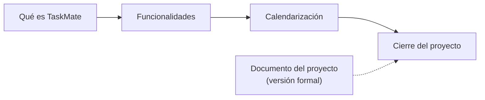

# 01 · Proyecto

**En una frase:** qué es TaskMate, qué puede hacer, cuándo se planificó cada fase y cómo quedó al cerrarse el 3 nov 2026.

## Páginas

Esta carpeta no tiene páginas por módulo: son documentos de todo el proyecto. Léelos en este orden.

| Página | Qué explica |
|---|---|
| [Qué es TaskMate](que-es-taskmate.md) | Para quién es, qué problema resuelve, sus 4 capacidades principales, el stack y el estado |
| [Funcionalidades](funcionalidades.md) | Cada funcionalidad, por módulo: quién puede usarla, en qué pantalla y dónde leer más |
| [Calendarización](calendarizacion.md) | Las 8 fases con sus fechas planificadas (no cambian) y lo que de verdad pasó |
| [Cierre del proyecto](cierre-del-proyecto.md) | Qué se entregó, estado verificado, qué no se hizo, limitaciones, pendientes y cómo retomarlo |
| [Documento del proyecto](documento-del-proyecto.md) | El documento formal: objetivos, problema, marco teórico, solución, resultados y conclusiones |

## Lo más buscado

- Estado verificado al cierre (pruebas, lint, build): [cierre, estado verificado](cierre-del-proyecto.md#estado-verificado-al-3-nov-2026).
- Lo que no se hizo (Fases 5–8): [cierre, qué no se hizo](cierre-del-proyecto.md#qué-no-se-hizo).
- Limitaciones conocidas: [cierre, limitaciones](cierre-del-proyecto.md#limitaciones-conocidas).
- Pendientes (TODO): [cierre, pendientes](cierre-del-proyecto.md#pendientes-todo).
- Correcciones de rutas del 3 nov 2026: [cierre, correcciones](cierre-del-proyecto.md#correcciones-del-cierre-3-nov-2026).

## Diagramas e imágenes

- Los diagramas de estas páginas son bloques Mermaid.
- Su copia en PNG está en [`imagenes/`](imagenes/), con el nombre `<página>-<n>.png` (n = orden del diagrama en la página).

## Para saber más

- [Índice de la documentación](../README.md).
- Capítulo de cada fase: [08-fases](../08-fases/README.md).
- Arquitectura general: [02-arquitectura](../02-arquitectura/00-general.md).
