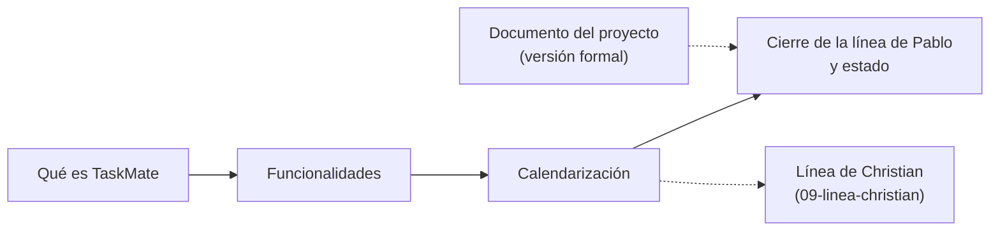

# 01 · Proyecto

**En una frase:** qué es TaskMate, qué puede hacer, cuándo se planificó cada fase y en qué estado está al 25 nov 2026: la línea de Pablo cerró el 3 nov con las Fases 1–4; la de Christian siguió, y lo nuevo vive en `test/e2e`.

## Páginas

Esta carpeta no tiene páginas por módulo: son documentos de todo el proyecto. Léelos en este orden.

| Página | Qué explica |
|---|---|
| [Qué es TaskMate](que-es-taskmate.md) | Para quién es, qué problema resuelve, sus 5 capacidades principales, el stack y el estado al 25 nov 2026 |
| [Funcionalidades](funcionalidades.md) | Cada funcionalidad de los 10 módulos: quién puede usarla, en qué pantalla y dónde leer más |
| [Calendarización](calendarizacion.md) | Las 8 fases de Pablo con sus fechas planificadas (no cambian), lo que de verdad pasó y la tabla de la línea de Christian |
| [Cierre de la línea de Pablo y estado](cierre-del-proyecto.md) | Qué entregó la línea de Pablo al cerrar el 3 nov, estado verificado, qué no se hizo, limitaciones conocidas (también las de lo nuevo), pendientes y cómo retomarlo |
| [Documento del proyecto](documento-del-proyecto.md) | El documento formal: objetivos, problema, marco teórico, solución, resultados y conclusiones |

## Lo más buscado

- Estado al 25 nov 2026 (2087 pruebas en verde, lo nuevo en `test/e2e`): [qué es TaskMate, estado](que-es-taskmate.md#estado).
- Lo que trajo la línea de Christian (servidor de IA local, Vercel, archivos por tarea, IA sobre el código, chat sobre el modelo local): [09-linea-christian](../09-linea-christian/README.md).
- Estado verificado al cierre de la línea de Pablo (pruebas, lint, build): [cierre, estado verificado](cierre-del-proyecto.md#estado-verificado-al-3-nov-2026).
- Lo que no hizo la línea de Pablo (Fases 5–8): [cierre, qué no se hizo](cierre-del-proyecto.md#qué-no-se-hizo).
- Limitaciones conocidas: [cierre, limitaciones](cierre-del-proyecto.md#limitaciones-conocidas).
- Pendientes (TODO): [cierre, pendientes](cierre-del-proyecto.md#pendientes-todo).
- Correcciones de rutas del 3 nov 2026: [cierre, correcciones](cierre-del-proyecto.md#correcciones-del-cierre-3-nov-2026).

## Diagramas e imágenes

- Los diagramas de estas páginas son bloques Mermaid.
- Su copia en PNG está en [`imagenes/`](imagenes/), con el nombre `<página>-<n>.png` (n = orden del diagrama en la página).

## Para saber más

- [Índice de la documentación](../README.md).
- Capítulo de cada fase: [08-fases](../08-fases/README.md).
- Línea de Christian: [09-linea-christian](../09-linea-christian/README.md).
- Arquitectura general: [02-arquitectura](../02-arquitectura/00-general.md).
