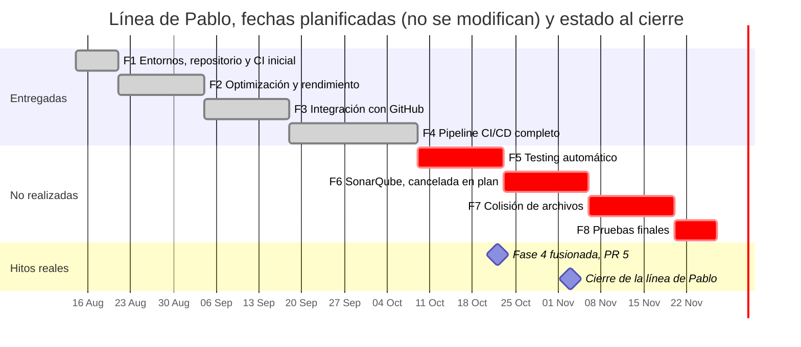
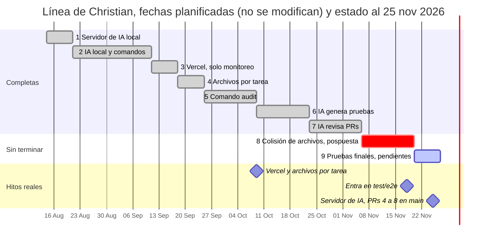

# Calendarización TaskMate — Línea de trabajo de Pablo Pineda

**En una frase:** las 8 fases de la línea de Pablo (14 ago – 27 nov 2026), con sus fechas sin cambios, y lo que de verdad pasó: Fases 1–4 entregadas y la línea cerrada el 3 nov 2026; la [línea de Christian](#línea-de-trabajo-de-christian-martínez) siguió con fechas corridas y al 25 nov 2026 tiene sus puntos 1–7 completos en `test/e2e`.

Las barras son las ventanas **planificadas**; las fechas reales están en cada fase y en la tabla del [cierre](#-cierre-de-la-línea-de-pablo-3-nov-2026).

**Última actualización:** 25 nov 2026 — estado después del cierre (línea de Christian en `test/e2e`)

> **Línea de Pablo cerrada (3 nov 2026).** Pablo Pineda cerró su línea al terminar la Fase 4: en ella no se implementa nada más. Las Fases 1–4 están terminadas y fusionadas en `master`; las Fases 5–8 no se realizarán en esta línea (la Fase 6 se canceló en la etapa de plan). La línea de Christian siguió después del cierre: lo nuevo vive en la rama `test/e2e`, todavía sin fusionar en `master` ([abajo](#línea-de-trabajo-de-christian-martínez)). Las fechas de las tablas son las planificadas y **no se modifican**. Reporte de cierre y estado al 25 nov: [cierre de la línea de Pablo y estado](cierre-del-proyecto.md) · Índice de la documentación: [documentacion/README.md](../README.md)

## Resumen Ejecutivo

**Proyecto:** TaskMate — Plataforma Colaborativa de Gestión de Tareas con IA  
**Duración planificada:** 14 agosto — 27 noviembre 2026 (15 semanas) · trabajo de las fases hasta el 22 oct 2026 · línea cerrada el 3 nov 2026 (con las [correcciones del cierre](cierre-del-proyecto.md#correcciones-del-cierre-3-nov-2026))  
**Responsable:** Pablo Pineda (las 8 fases). La Fase 7 se iba a hacer junto con Christian Martínez; en la línea de Christian quedó pospuesta (punto 8).

| # | Funcionalidad | Complejidad | Fechas | Duración | Estado | Rama |
|---|---------------|-------------|--------|----------|--------|------|
| 1 | Preparación de entornos, repositorio y CI inicial | Baja | 14 ago – 21 ago | 1 semana | ✅ Completo | fusionada en `master` (PR #2) |
| 2 | Optimización y mejora del rendimiento | Media | 21 ago – 4 sep | 2 semanas | ✅ Completo | fusionada en `master` (PR #2) |
| 3 | Integración con GitHub | Media | 4 sep – 18 sep | 2 semanas | ✅ Completo | fusionada en `master` (PR #4) |
| 4 | Pipeline CI/CD completo (build, pruebas, análisis estático, deploy y actualización automática) | Alta | 18 sep – 9 oct | 3 semanas | ✅ Completo | fusionada en `master` (PR #5, 22 oct 2026) |
| 5 | Testing automático (ciclo de pruebas por tarea) | Media | 9 oct – 23 oct | 2 semanas | ❌ No se realizará (línea cerrada el 3 nov 2026) | — (la rama vacía `feature/fase-5-testing-automatico` ya se borró) |
| 6 | Integración con SonarQube | Media | 23 oct – 6 nov | 2 semanas | 🚫 Cancelada en la etapa de plan (SonarQube Cloud), sin código | — (la rama vacía `feature/fase-6-sonarqube` ya se borró) |
| 7 | Algoritmo de colisión de archivos (junto con Christian) | Alta | 6 nov – 20 nov | 2 semanas | ❌ No se realizará en esta línea (cerrada el 3 nov 2026); en la de Christian, ⏸️ pospuesta con la base hecha | — (la rama vacía `feature/fase-7-colision-archivos` ya se borró) |
| 8 | Pruebas finales | — | 20 nov – 27 nov | 1 semana | ❌ No se realizará (línea cerrada el 3 nov 2026) | — |

✅ terminada y fusionada en `master` · ❌ no se realizará · 🚫 cancelada en la etapa de plan. Las tres ramas vacías se crearon desde `master` el 6 oct 2026 (`fe9d87d`) y ya se borraron: el 25 nov 2026 no existen ni en local ni en `origin` (tampoco `feature/fase-4-cicd-github-actions`, ya fusionada).

---

### Fase 1: Preparación de entornos, repositorio y CI inicial ✅
**Fechas:** planificada 14–21 ago 2026 · hecha antes de la calendarización: setup y limpieza del repositorio el 10–12 mar 2026 (`12ee245` crea `start.sh`, `5a9f413` centraliza las URLs, `24cf275` y `3172618` sanean `.gitignore`); el workspace de npm venía de oct 2024 (`0ca7b7a`) · documentada el 31 ago 2026 (`2c9673e`)  
**Estado:** 100% COMPLETADO (fusionada en `master` el 6 oct 2026, PR #2, merge `7e1610f`)

- ✅ Estructura de monorepo
- ✅ Variables de entorno
- ✅ Scripts npm + Jest/react-scripts
- ✅ Git saneado

El «CI inicial» son los scripts de pruebas estandarizados (`npm test`, `test:db`, `test:performance`): el repositorio de TaskMate no tiene un workflow de CI propio. El CI/CD de la Fase 4 es para el repositorio de cada grupo.

**Documentación:** [capítulo de la Fase 1](../08-fases/fase-01-entornos-repositorio-ci/README.md)

---

### Fase 2: Optimización y mejora del rendimiento ✅
**Estado:** 100% COMPLETADO (fusionada en `master` el 6 oct 2026, PR #2, merge `7e1610f`)

**Mejoras implementadas (porcentajes estimados, no medidos):**
- Batchear DELETEs (-50% roundtrips)
- Comprobación e INSERT en una sola sentencia (`INSERT … WHERE NOT EXISTS`): ventana de carrera mucho menor, no cerrada
- Paralelización con Promise.all (-50% a -88% latencia)
- Eliminar N+1 queries (-97.5% ops)
- Row explosion fix (-66%)
- Code-splitting frontend (-65%)
- Logging removal (-100%)

**Mejora global estimada (no medida): -71% latencia | 3.5x más rápido**

Las pruebas de rendimiento del 28 ago 2026 solo midieron tiempos absolutos, sin medición «antes». La Fase 3 reemplazó después parte de este código (borrados en lote e inserciones en paralelo) por transacciones ACID.

**Documentación:** [6 archivos en `08-fases/fase-02-optimizacion-rendimiento/`](../08-fases/fase-02-optimizacion-rendimiento/README.md)

---

### Fase 3: Integración con GitHub ✅
**Fechas:** planificada 4–18 sep 2026 · implementada 10–11 sep 2026 · E2E con GitHub real y limpieza segura de ramas 5–6 oct 2026  
**Estado:** 100% COMPLETADO (fusionada en `master` el 6 oct 2026, PR #4, merge `183f1cb`)

**Funcionalidades (manejar GitHub sin salir de TaskMate):**
- ✅ 1. Conectar un grupo con un repositorio (GitHub App, flujo seguro de instalación)
- ✅ 2. La IA analiza el repositorio y propone las siguientes tareas (chat con selector de proyecto, confirmación explícita, permiso del admin)
- ✅ 3. Explorador del repositorio (página `/github`: repositorio, archivos, commits)
- ✅ 5. Rama por tarea (`tm/<slug>-<tid8>`), con limpieza segura al cerrar la tarea
- ✅ 6. Progreso automático por PR (webhooks firmados; PR fusionado → tarea completada)

**Además:** se corrigieron todos los problemas existentes detectados (transacciones ACID y 3FN, JWT en todas las rutas, autorización por grupo, servicio Python del chat autenticado, XSS en el chat) y los 9 que encontró el E2E con GitHub real. Pruebas: de 52 fallando a 1353 pasando (al cierre de la fase, 6 oct 2026).

**Después del cierre:** la línea de Christian implementó la revisión de PR con IA (la funcionalidad 8, que aquí quedó pospuesta) y cambió el selector de proyecto del chat por el selector de grupo del navbar ([detalle](cierre-del-proyecto.md#después-del-cierre-línea-de-christian-hasta-el-25-nov-2026)).

**Documentación:** [capítulo de la Fase 3](../08-fases/fase-03-integracion-github/README.md), con su anexo de [seguridad y base de datos](../08-fases/fase-03-integracion-github/SEGURIDAD-Y-BASE-DE-DATOS.md) y la [guía de la GitHub App](../07-guias/guia-github-app.md)

---

### Fase 4: Pipeline CI/CD completo ✅
**Fechas:** planificada 18 sep – 9 oct 2026 · implementada 9–22 oct 2026 (alcance, plan y paso 1 el 9 oct; pasos 2–5, revisión y correcciones el 22 oct)  
**Estado:** 100% COMPLETADO (fusionada en `master` el 22 oct 2026, PR #5, merge `56f7136`)

**Funcionalidades (el CI/CD del repositorio del grupo sin salir de TaskMate; pestaña CI/CD en `/github`):**
- ✅ 1. TaskMate propone el pipeline (detectado del repositorio o, si el grupo lo permite, con IA) y lo sube: build, pruebas y análisis estático para Node.js (npm) y Python, sin comandos libres
- ✅ 2. Panel de ejecuciones en vivo (WebSocket `/events`)
- ✅ 3. Logs y anotaciones (errores con archivo y línea) dentro de TaskMate
- ✅ 4. Ejecutar, re-ejecutar fallidos y cancelar
- ✅ 5. Deploy a GitHub Pages con entornos (staging en `/<repo>/staging/`, producción en `/<repo>/`) y aprobación del admin
- ✅ 6. Staging automático con cada cambio que pasa el CI y rollback de producción
- ✅ 13. Notificaciones (pipeline fallido, deploy terminado, solicitudes y decisiones)

**Además:**
- **Ajustes de uso:** regreso directo a la selección de repositorio al volver de GitHub tras darle acceso a otro repositorio, scripts que nunca terminan fuera de las etapas y diálogos opacos.
- **Revisión con verificación adversarial** (107 agentes, 112 requisitos, 43 defectos confirmados, unos 30 distintos), corregida en 5 áreas: plantilla v2 del workflow (build y deploy separados, deploys en cola, solo se reconstruye la versión que se publica), solo versiones verificadas de la rama principal, un miembro solo pide la versión de staging, vincular un repositorio exige permiso de escritura en GitHub, y logs y tiempo real más confiables.
- **Problemas existentes corregidos:** un *deadlock* en la BD al completar una tarea mientras se crea su rama y un fallo del servicio Python del chat con JSON muy anidado.
- **Ideas que no se harán:** 7, 8, 11 y 12 (la 8 iba a pasar a la Fase 5, que no se realizó); 9 y 10 descartadas.
- **Pruebas:** de 1353 a 1914 pasando al cierre de la fase (22 oct 2026: API 1228, frontend 404, Python 177, BD 105). Al cierre de la línea son 1919, con 5 pruebas nuevas de rutas del 3 nov 2026, y 1960 con las correcciones del 4 nov (5 nov 2026).
- **E2E con GitHub real** (22 oct, `PabloP150/taskmate-fase4-demo`): la IA propuso el pipeline, staging automático, producción publicada por el admin y por una solicitud aprobada de un miembro, rollback, logs y anotaciones de un fallo, re-ejecutar y cancelar, y 118 eventos en vivo. De ahí salieron dos ajustes: títulos de deploy en español y sitio publicado que GitHub ya no guardaba. Desde el 19 nov (`d148763`, línea de Christian) el workflow nuevo se genera en inglés («Deploy to production from TaskMate»), y TaskMate sigue reconociendo los títulos viejos.

**Documentación:** [capítulo de la Fase 4](../08-fases/fase-04-pipeline-cicd/README.md), la [guía de CI/CD](../07-guias/guia-cicd.md) y la [guía de la GitHub App](../07-guias/guia-github-app.md) de la Fase 3 actualizada

---

### Fases 5–8: no se realizarán en la línea de Pablo ❌

La línea de Pablo se cerró el 3 nov 2026 al terminar la Fase 4. Las fechas de la tabla son las planificadas y no se modifican.

- **Fase 5 — Testing automático (9–23 oct):** no se realizará; no se empezó. Tampoco se hará la idea 8 de la Fase 4 (estado del CI en el chip de cada tarea), que dependía de esta fase. La línea de Christian trajo «Generate tests», que propone pruebas para la rama de una tarea pero no las ejecuta: no es el ciclo de pruebas por tarea de esta fase.
- **Fase 6 — Integración con SonarQube (23 oct – 6 nov):** cancelada en la etapa de plan (SonarQube Cloud), sin código. El 23 oct se definió el alcance y se escribió y revisó el plan de la Parte 1; el plan quedó fuera del repositorio.
- **Fase 7 — Algoritmo de colisión de archivos (6–20 nov, con Christian Martínez):** no se realizará en esta línea. En la de Christian (punto 8) quedó ⏸️ pospuesta con la base hecha: la tabla `TaskFiles` (migración 010), `findTasksTouchingPaths` y `GET /api/github/tasks/:tid/overlaps`; el diálogo «Task files» marca con «Also changed by» las rutas que otra tarea también toca.
- **Fase 8 — Pruebas finales (20–27 nov):** no se realizará como fase de Pablo. Al cierre pasaban las 1960 pruebas automáticas de las cuatro capas (verificado el 5 nov 2026); el 25 nov, en `test/e2e`, pasan 2087. Las pruebas finales de la línea de Christian (punto 9) siguen ⏳ pendientes.

---

### 🏁 Cierre de la línea de Pablo (3 nov 2026)

| Fase | Planificada | Real | Integración en `master` |
|------|-------------|------|-------------------------|
| 1 | 14 ago – 21 ago | Antes de la calendarización: setup y limpieza el 10–12 mar 2026; documentada el 31 ago | PR #2 (`7e1610f`, 6 oct 2026) |
| 2 | 21 ago – 4 sep | Código del 10–12 mar 2026; pruebas de rendimiento el 28 ago | PR #2 (`7e1610f`, 6 oct 2026) |
| 3 | 4 sep – 18 sep | 10–11 sep; E2E con GitHub real 5–6 oct | PR #4 (`183f1cb`, 6 oct 2026) |
| 4 | 18 sep – 9 oct | 9–22 oct | PR #5 (`56f7136`, 22 oct 2026) |
| 5–8 | 9 oct – 27 nov | No se realizarán (la 6 se canceló en la etapa de plan el 3 nov) | — |

**Calidad al cierre:** 1960 pruebas pasando y 0 fallando (5 nov 2026): API 1246 (46 suites), frontend 423 (33 suites, con las pruebas nuevas del 3 y 4 nov), Python 177 y BD 114 (9 suites). Antes de la Fase 3 había 155 pruebas en dos capas y 52 fallaban; al cerrar la Fase 3 (6 oct) pasaban 1353 y al cerrar la Fase 4 (22 oct), 1914. **Hoy, en `test/e2e`:** 2087 pasando y 0 fallando (25 nov 2026: API 1322, frontend 438, Python 210 y BD 117), ver el [estado al 25 nov](cierre-del-proyecto.md#estado-verificado-al-25-nov-2026).

Qué se entregó, el inventario funcional, el estado verificado, lo que vino después, las limitaciones conocidas, los pendientes y cómo retomar el proyecto: [cierre de la línea de Pablo y estado](cierre-del-proyecto.md).

---

**Documento generado:** 31 ago 2026  
**Última actualización:** 25 nov 2026 — estado después del cierre (fechas planificadas sin cambios, según la tabla oficial de la línea de trabajo de Pablo Pineda)

---

# Línea de trabajo de Christian Martínez

El cierre del 3 nov aplica solo a la línea de Pablo. Esta línea siguió con fechas corridas: las planificadas no se modifican y las reales van en su columna. Lo de TaskMate entró en la rama `test/e2e` del 18 al 25 nov 2026 y **todavía no está en `master`**; lo del servidor de IA local vive en `main` de su repo aparte (`taskmate-ai-server`), con los PRs #4–#8 fusionados el 25 nov.

| # | Funcionalidad | Complejidad | Planificada | Real | Estado | Dónde |
|---|---|---|---|---|---|---|
| 1 | Servidor de IA local y modelo de datos | Baja | 14 – 21 ago | 28 ago (`8ed8436`) | ✅ Completo | `taskmate-ai-server` (`main`): FastAPI en `127.0.0.1:8000`, Ollama y Postgres 17 + pgvector |
| 2 | Entrenamiento de IA local y comandos del proyecto | Alta | 21 ago – 11 sep | 11 sep; fusionado el 9 oct | ✅ Completo | `taskmate-ai-server` (PR #3) |
| 3 | Integración con Vercel / AWS | Baja | 11 – 18 sep | 9 oct (`602b1d8`, `c0d28e2`) | ✅ Solo monitoreo de Vercel: pestaña «Vercel (monitoring)» y migración 009. AWS no está implementado y desplegar desde la app queda para después (GitHub Pages de la Fase 4 ya publica los proyectos). No se ha probado con una cuenta real de Vercel | TaskMate, `test/e2e` |
| 4 | Interfaz de tareas más detallada | Baja | 18 – 25 sep | 9 oct (`602b1d8`) | ✅ Completo: diálogo «Task files» con los archivos del PR de la tarea (migración 010). Según el código, la lista no se guarda al fusionar el PR ([limitación](cierre-del-proyecto.md#archivos-por-tarea)) | TaskMate, `test/e2e` |
| 5 | Comando `audit` con verificación automática | Media | 25 sep – 9 oct | servidor: 9 oct (`3593aa5`); TaskMate: 18 nov (`f5c1359`, `efba978`) | ✅ Completo: botón «Audit» | `taskmate-ai-server` PR #4 (en `main` el 25 nov) + TaskMate `test/e2e` |
| 6 | IA para generar pruebas | Alta | 9 – 23 oct | 18 nov (`7d83cdf`) | ✅ Completo (propone, no ejecuta): botón «Generate tests» | `taskmate-ai-server` PR #7 + TaskMate `test/e2e` |
| 7 | IA revisando pull requests | Alta | 23 oct – 6 nov | 18–19 nov (`c2a6833`, migración 011) | ✅ Completo: revisión automática con el webhook de PR y botón «Review PR»; se publica en GitHub como comentario (COMMENT) | `taskmate-ai-server` PR #8 + TaskMate `test/e2e` |
| 8 | Algoritmo de colisión de archivos | Alta | 6 – 20 nov | — | ⏸️ Pospuesto, con la base hecha: `findTasksTouchingPaths`, `GET /api/github/tasks/:tid/overlaps` y «Also changed by» en «Task files» | — |
| 9 | Pruebas finales | — | 20 – 27 nov | — | ⏳ Pendiente. Medición del 25 nov en `test/e2e`: 2087 pruebas en verde | — |

**Además, fuera de la tabla:** el chat sobre el modelo local con streaming (`921f8ed`, 9 oct) y como asistente del proyecto (`f152a9e`, 19 nov), la interfaz en inglés con el selector de grupo en el navbar (`d148763`, 19 nov), `scripts/local-up.sh` para Linux con Podman (`beb1e9c`), `start.sh` con Podman (`d529af6`) y `ALLOW_LAN_ORIGINS` (`50f77da`, 25 nov). Qué entró, dónde vive y las cifras actuales: [después del cierre](cierre-del-proyecto.md#después-del-cierre-línea-de-christian-hasta-el-25-nov-2026). Detalle técnico: [09-linea-christian](../09-linea-christian/README.md) y el módulo [10 · IA sobre el código](../02-arquitectura/10-ia-sobre-el-codigo.md).
