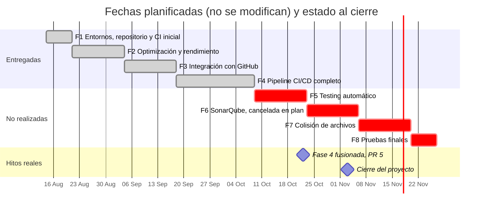

# Calendarización TaskMate — Línea de trabajo de Pablo Pineda

**En una frase:** las 8 fases planificadas (14 ago – 27 nov 2026), con sus fechas sin cambios, y lo que de verdad pasó: Fases 1–4 entregadas y proyecto cerrado el 3 nov 2026.

Las barras son las ventanas **planificadas**; las fechas reales están en cada fase y en la tabla del [cierre](#-cierre-del-proyecto-3-nov-2026).

**Última actualización:** 3 nov 2026 — cierre del proyecto

> **Proyecto cerrado (3 nov 2026).** Pablo Pineda decidió cerrar TaskMate al terminar la Fase 4: no se implementará nada más. Las Fases 1–4 están terminadas y fusionadas en `master`; las Fases 5–8 no se realizarán (la Fase 6 se canceló en la etapa de plan). Las fechas de la tabla son las planificadas en la tabla oficial y **no se modifican**. Reporte de cierre: [cierre del proyecto](cierre-del-proyecto.md) · Índice de la documentación: [documentacion/README.md](../README.md)

## Resumen Ejecutivo

**Proyecto:** TaskMate — Plataforma Colaborativa de Gestión de Tareas con IA  
**Duración planificada:** 14 agosto — 27 noviembre 2026 (15 semanas) · trabajo de las fases hasta el 22 oct 2026 · proyecto cerrado el 3 nov 2026 (con las [correcciones del cierre](cierre-del-proyecto.md#correcciones-del-cierre-3-nov-2026))  
**Responsable:** Pablo Pineda (las 8 fases). La Fase 7 se iba a hacer junto con Christian Martínez.

| # | Funcionalidad | Complejidad | Fechas | Duración | Estado | Rama |
|---|---------------|-------------|--------|----------|--------|------|
| 1 | Preparación de entornos, repositorio y CI inicial | Baja | 14 ago – 21 ago | 1 semana | ✅ Completo | fusionada en `master` (PR #2) |
| 2 | Optimización y mejora del rendimiento | Media | 21 ago – 4 sep | 2 semanas | ✅ Completo | fusionada en `master` (PR #2) |
| 3 | Integración con GitHub | Media | 4 sep – 18 sep | 2 semanas | ✅ Completo | fusionada en `master` (PR #4) |
| 4 | Pipeline CI/CD completo (build, pruebas, análisis estático, deploy y actualización automática) | Alta | 18 sep – 9 oct | 3 semanas | ✅ Completo | fusionada en `master` (PR #5, 22 oct 2026) |
| 5 | Testing automático (ciclo de pruebas por tarea) | Media | 9 oct – 23 oct | 2 semanas | ❌ No se realizará (proyecto cerrado el 3 nov 2026) | `feature/fase-5-testing-automatico` (vacía: sin commits propios) |
| 6 | Integración con SonarQube | Media | 23 oct – 6 nov | 2 semanas | 🚫 Cancelada en la etapa de plan (SonarQube Cloud), sin código | `feature/fase-6-sonarqube` (vacía: sin commits propios) |
| 7 | Algoritmo de colisión de archivos (junto con Christian) | Alta | 6 nov – 20 nov | 2 semanas | ❌ No se realizará (proyecto cerrado el 3 nov 2026) | `feature/fase-7-colision-archivos` (vacía: sin commits propios) |
| 8 | Pruebas finales | — | 20 nov – 27 nov | 1 semana | ❌ No se realizará (proyecto cerrado el 3 nov 2026) | — |

✅ terminada y fusionada en `master` · ❌ no se realizará · 🚫 cancelada en la etapa de plan. Las tres ramas vacías se crearon desde `master` el 6 oct 2026 (`fe9d87d`) y se pueden borrar cuando Pablo lo decida.

---

### Fase 1: Preparación de entornos, repositorio y CI inicial ✅
**Fechas:** planificada 14–21 ago 2026 · hecha antes de la calendarización: setup y limpieza del repositorio el 10–12 mar 2026 (`12ee245` crea `start.sh`, `5a9f413` centraliza las URLs, `24cf275` y `3172618` sanean `.gitignore`); el workspace de npm venía de oct 2024 (`0ca7b7a`) · documentada el 31 ago 2026 (`2c9673e`)  
**Estado:** 100% COMPLETADO (fusionada en `master` el 6 oct 2026, PR #2, merge `7e1610f`)

- ✅ Estructura de monorepo
- ✅ Variables de entorno
- ✅ Scripts npm + Jest/react-scripts
- ✅ Git saneado

El «CI inicial» son los scripts de pruebas estandarizados (`npm test`, `test:db`, `test:performance`): el repositorio de TaskMate no tiene un workflow de CI propio. El CI/CD de la Fase 4 es para el repositorio de cada grupo.

**Documentación:** [capítulo de la Fase 1](../08-fases/fase-01-entornos-repositorio-ci/README.md)

---

### Fase 2: Optimización y mejora del rendimiento ✅
**Estado:** 100% COMPLETADO (fusionada en `master` el 6 oct 2026, PR #2, merge `7e1610f`)

**Mejoras implementadas (porcentajes estimados, no medidos):**
- Batchear DELETEs (-50% roundtrips)
- Comprobación e INSERT en una sola sentencia (`INSERT … WHERE NOT EXISTS`): ventana de carrera mucho menor, no cerrada
- Paralelización con Promise.all (-50% a -88% latencia)
- Eliminar N+1 queries (-97.5% ops)
- Row explosion fix (-66%)
- Code-splitting frontend (-65%)
- Logging removal (-100%)

**Mejora global estimada (no medida): -71% latencia | 3.5x más rápido**

Las pruebas de rendimiento del 28 ago 2026 solo midieron tiempos absolutos, sin medición «antes». La Fase 3 reemplazó después parte de este código (borrados en lote e inserciones en paralelo) por transacciones ACID.

**Documentación:** [6 archivos en `08-fases/fase-02-optimizacion-rendimiento/`](../08-fases/fase-02-optimizacion-rendimiento/README.md)

---

### Fase 3: Integración con GitHub ✅
**Fechas:** planificada 4–18 sep 2026 · implementada 10–11 sep 2026 · E2E con GitHub real y limpieza segura de ramas 5–6 oct 2026  
**Estado:** 100% COMPLETADO (fusionada en `master` el 6 oct 2026, PR #4, merge `183f1cb`)

**Funcionalidades (manejar GitHub sin salir de TaskMate):**
- ✅ 1. Conectar un grupo con un repositorio (GitHub App, flujo seguro de instalación)
- ✅ 2. La IA analiza el repositorio y propone las siguientes tareas (chat con selector de proyecto, confirmación explícita, permiso del admin)
- ✅ 3. Explorador del repositorio (página `/github`: repositorio, archivos, commits)
- ✅ 5. Rama por tarea (`tm/<slug>-<tid8>`), con limpieza segura al cerrar la tarea
- ✅ 6. Progreso automático por PR (webhooks firmados; PR fusionado → tarea completada)

**Además:** se corrigieron todos los problemas existentes detectados (transacciones ACID y 3FN, JWT en todas las rutas, autorización por grupo, servidor de IA autenticado, XSS en el chat) y los 9 que encontró el E2E con GitHub real. Pruebas: de 52 fallando a 1353 pasando (al cierre de la fase, 6 oct 2026).

**Documentación:** [capítulo de la Fase 3](../08-fases/fase-03-integracion-github/README.md), con su anexo de [seguridad y base de datos](../08-fases/fase-03-integracion-github/SEGURIDAD-Y-BASE-DE-DATOS.md) y la [guía de la GitHub App](../07-guias/guia-github-app.md)

---

### Fase 4: Pipeline CI/CD completo ✅
**Fechas:** planificada 18 sep – 9 oct 2026 · implementada 9–22 oct 2026 (alcance, plan y paso 1 el 9 oct; pasos 2–5, revisión y correcciones el 22 oct)  
**Estado:** 100% COMPLETADO (fusionada en `master` el 22 oct 2026, PR #5, merge `56f7136`)

**Funcionalidades (el CI/CD del repositorio del grupo sin salir de TaskMate; pestaña CI/CD en `/github`):**
- ✅ 1. TaskMate propone el pipeline (detectado del repositorio o, si el grupo lo permite, con IA) y lo sube: build, pruebas y análisis estático para Node.js (npm) y Python, sin comandos libres
- ✅ 2. Panel de ejecuciones en vivo (WebSocket `/events`)
- ✅ 3. Logs y anotaciones (errores con archivo y línea) dentro de TaskMate
- ✅ 4. Ejecutar, re-ejecutar fallidos y cancelar
- ✅ 5. Deploy a GitHub Pages con entornos (staging en `/<repo>/staging/`, producción en `/<repo>/`) y aprobación del admin
- ✅ 6. Staging automático con cada cambio que pasa el CI y rollback de producción
- ✅ 13. Notificaciones (pipeline fallido, deploy terminado, solicitudes y decisiones)

**Además:**
- **Ajustes de uso:** regreso directo a la selección de repositorio al volver de GitHub tras darle acceso a otro repositorio, scripts que nunca terminan fuera de las etapas y diálogos opacos.
- **Revisión con verificación adversarial** (107 agentes, 112 requisitos, 43 defectos confirmados, unos 30 distintos), corregida en 5 áreas: plantilla v2 del workflow (build y deploy separados, deploys en cola, solo se reconstruye la versión que se publica), solo versiones verificadas de la rama principal, un miembro solo pide la versión de staging, vincular un repositorio exige permiso de escritura en GitHub, y logs y tiempo real más confiables.
- **Problemas existentes corregidos:** un *deadlock* en la BD al completar una tarea mientras se crea su rama y un fallo del servidor de IA con JSON muy anidado.
- **Ideas que no se harán:** 7, 8, 11 y 12 (la 8 iba a pasar a la Fase 5, que no se realizó); 9 y 10 descartadas.
- **Pruebas:** de 1353 a 1914 pasando al cierre de la fase (22 oct 2026: API 1228, frontend 404, Python 177, BD 105). Al cierre del proyecto son 1919, con 5 pruebas nuevas de rutas del 3 nov 2026, y 1960 con las correcciones del 4 nov (5 nov 2026).
- **E2E con GitHub real** (22 oct, `PabloP150/taskmate-fase4-demo`): la IA propuso el pipeline, staging automático, producción publicada por el admin y por una solicitud aprobada de un miembro, rollback, logs y anotaciones de un fallo, re-ejecutar y cancelar, y 118 eventos en vivo. De ahí salieron dos ajustes: títulos de deploy en español y sitio publicado que GitHub ya no guardaba.

**Documentación:** [capítulo de la Fase 4](../08-fases/fase-04-pipeline-cicd/README.md), la [guía de CI/CD](../07-guias/guia-cicd.md) y la [guía de la GitHub App](../07-guias/guia-github-app.md) de la Fase 3 actualizada

---

### Fases 5–8: no se realizarán ❌

El proyecto se cerró el 3 nov 2026 al terminar la Fase 4. Las fechas de la tabla son las planificadas y no se modifican.

- **Fase 5 — Testing automático (9–23 oct):** no se realizará; no se empezó. Tampoco se hará la idea 8 de la Fase 4 (estado del CI en el chip de cada tarea), que dependía de esta fase.
- **Fase 6 — Integración con SonarQube (23 oct – 6 nov):** cancelada en la etapa de plan (SonarQube Cloud), sin código. El 23 oct se definió el alcance y se escribió y revisó el plan de la Parte 1; el plan quedó fuera del repositorio.
- **Fase 7 — Algoritmo de colisión de archivos (6–20 nov, con Christian Martínez):** no se realizará. Los datos en los que se iba a apoyar (tablas `TaskBranches` y `PullRequests` de la Fase 3) quedan disponibles.
- **Fase 8 — Pruebas finales (20–27 nov):** no se realizará como fase. Al cierre pasan las 1960 pruebas automáticas de las cuatro capas (verificado el 5 nov 2026).

---

### 🏁 Cierre del proyecto (3 nov 2026)

| Fase | Planificada | Real | Integración en `master` |
|------|-------------|------|-------------------------|
| 1 | 14 ago – 21 ago | Antes de la calendarización: setup y limpieza el 10–12 mar 2026; documentada el 31 ago | PR #2 (`7e1610f`, 6 oct 2026) |
| 2 | 21 ago – 4 sep | Código del 10–12 mar 2026; pruebas de rendimiento el 28 ago | PR #2 (`7e1610f`, 6 oct 2026) |
| 3 | 4 sep – 18 sep | 10–11 sep; E2E con GitHub real 5–6 oct | PR #4 (`183f1cb`, 6 oct 2026) |
| 4 | 18 sep – 9 oct | 9–22 oct | PR #5 (`56f7136`, 22 oct 2026) |
| 5–8 | 9 oct – 27 nov | No se realizarán (la 6 se canceló en la etapa de plan el 3 nov) | — |

**Calidad al cierre:** 1960 pruebas pasando y 0 fallando (5 nov 2026): API 1246 (46 suites), frontend 423 (33 suites, con las pruebas nuevas del 3 y 4 nov), Python 177 y BD 114 (9 suites). Antes de la Fase 3 había 155 pruebas en dos capas y 52 fallaban; al cerrar la Fase 3 (6 oct) pasaban 1353 y al cerrar la Fase 4 (22 oct), 1914.

Qué se entregó, el inventario funcional, el estado verificado, las limitaciones conocidas, los pendientes y cómo retomar el proyecto: [cierre del proyecto](cierre-del-proyecto.md).

---

**Documento generado:** 31 ago 2026  
**Última actualización:** 3 nov 2026 — cierre del proyecto (fechas planificadas sin cambios, según la tabla oficial de la línea de trabajo de Pablo Pineda)
