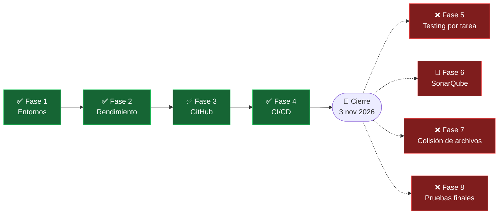

# Cierre del proyecto TaskMate

**En una frase:** TaskMate se cerró el 3 nov 2026 con las Fases 1–4 entregadas; con las correcciones del cierre pasan 1960 pruebas (5 nov 2026); esta página dice qué quedó, qué no se hizo, qué limitaciones tiene y cómo retomarlo.



**Última actualización:** 3 nov 2026 — cierre del proyecto  
**Responsable:** Pablo Pineda · **Base:** `master` en `56f7136` (merge del PR #5, 22 oct 2026), más las [correcciones del cierre](#correcciones-del-cierre-3-nov-2026)

Este es el reporte único de cierre. Las **limitaciones conocidas** y los **pendientes** del proyecto viven solo aquí: los capítulos de cada fase, el [índice de la documentación](../README.md) y la [calendarización](calendarizacion.md) enlazan a esta página en lugar de repetir las listas.

**Contenido:** [Decisión y fecha](#decisión-y-fecha) · [Qué se entregó por fase](#qué-se-entregó-por-fase) · [Inventario funcional](#inventario-funcional) · [Correcciones del cierre](#correcciones-del-cierre-3-nov-2026) · [Estado verificado al 3 nov 2026](#estado-verificado-al-3-nov-2026) · [Qué no se hizo](#qué-no-se-hizo) · [Limitaciones conocidas](#limitaciones-conocidas) · [Pendientes (TODO)](#pendientes-todo) · [Recursos de la demostración](#recursos-de-la-demostración) · [Cómo retomar el proyecto](#cómo-retomar-el-proyecto)

---

## Decisión y fecha

El **3 de noviembre de 2026** Pablo Pineda decidió cerrar TaskMate al terminar la Fase 4: **no se implementará nada más**.

- **Terminadas y fusionadas en `master`:** Fases 1, 2, 3 y 4.
- **No se realizarán:** Fases 5, 7 y 8.
- **Cancelada en la etapa de plan:** Fase 6 (SonarQube Cloud), sin código.
- **Fechas:** las planificadas en la tabla oficial de la línea de trabajo no cambian; las reales quedan como están registradas en cada capítulo.

| # | Fase | Fechas planificadas | Fechas reales | Estado |
|---|------|---------------------|---------------|--------|
| 1 | Preparación de entornos, repositorio y CI inicial | 14 ago – 21 ago | Antes de la calendarización: setup y limpieza del repositorio el 10–12 mar 2026; documentada el 31 ago | ✅ Fusionada (PR #2) |
| 2 | Optimización y mejora del rendimiento | 21 ago – 4 sep | Código del 10–12 mar 2026; pruebas de rendimiento el 28 ago | ✅ Fusionada (PR #2) |
| 3 | Integración con GitHub | 4 sep – 18 sep | 10–11 sep; E2E con GitHub real 5–6 oct | ✅ Fusionada (PR #4) |
| 4 | Pipeline CI/CD completo (build, pruebas, análisis estático, deploy y actualización automática) | 18 sep – 9 oct | 9–22 oct | ✅ Fusionada (PR #5) |
| 5 | Testing automático (ciclo de pruebas por tarea) | 9 oct – 23 oct | — | ❌ No se realizará (proyecto cerrado el 3 nov 2026) |
| 6 | Integración con SonarQube | 23 oct – 6 nov | Alcance y plan de la Parte 1 el 23 oct | 🚫 Cancelada en la etapa de plan (SonarQube Cloud), sin código |
| 7 | Algoritmo de colisión de archivos (junto con Christian) | 6 nov – 20 nov | — | ❌ No se realizará (proyecto cerrado el 3 nov 2026) |
| 8 | Pruebas finales | 20 nov – 27 nov | — | ❌ No se realizará (proyecto cerrado el 3 nov 2026) |

---

## Qué se entregó por fase

| Fase | Qué quedó funcionando | Capítulo | Integración en `master` |
|------|-----------------------|----------|-------------------------|
| 1 | Monorepo de tres capas (frontend React en `:3000`, API Express en `:9000`, servidor de IA en Python/FastAPI en `:8001` por defecto, configurable con `MCP_PORT`), variables de entorno con plantilla (`taskmate-api/.env.example`), scripts de desarrollo y de pruebas, Git saneado. El «CI inicial» son los scripts de pruebas (`npm test`, `test:db`, `test:performance`): el repositorio de TaskMate no tiene un workflow de CI propio | [Fase 1](../08-fases/fase-01-entornos-repositorio-ci/README.md) | [PR #2](https://github.com/PabloP150/proyecto-is-cc6/pull/2), merge `7e1610f` (6 oct 2026) |
| 2 | 7 optimizaciones: borrados en lote, comprobación e `INSERT` en una sola sentencia (`INSERT … WHERE NOT EXISTS`, que estrecha la ventana de carrera sin cerrarla: no hay índice único ni `UPDLOCK, HOLDLOCK`), operaciones independientes en paralelo (`Promise.all`), consultas sin N+1, corrección de filas multiplicadas en `UserMetrics`, code-splitting del frontend y menos logging. Las mejoras (-71% latencia, -97.5% operaciones de BD, -65% bundle) son **estimaciones, no mediciones**: el 28 ago solo se midieron tiempos absolutos, sin medición «antes». La Fase 3 reemplazó después los borrados en lote y las inserciones en paralelo por transacciones ACID | [Fase 2](../08-fases/fase-02-optimizacion-rendimiento/README.md) | PR #2, merge `7e1610f` (6 oct 2026) |
| 3 | GitHub dentro de TaskMate con una GitHub App: conectar el repositorio del grupo, explorador (archivos, README, commits), rama por tarea con limpieza segura, progreso automático por PR (webhooks firmados) y la IA analiza el repositorio y propone tareas. Además se corrigieron los problemas existentes: transacciones ACID y 3FN, JWT en todas las rutas, autorización por grupo, servidor de IA autenticado, XSS del chat y migraciones versionadas | [Fase 3](../08-fases/fase-03-integracion-github/README.md) · [Guía de la App](../07-guias/guia-github-app.md) | [PR #4](https://github.com/PabloP150/proyecto-is-cc6/pull/4), merge `183f1cb` (6 oct 2026) |
| 4 | CI/CD del repositorio del grupo desde la pestaña CI/CD de `/github`: TaskMate (o la IA) propone el pipeline y lo sube, ejecuciones en vivo (WebSocket `/events`), logs y anotaciones, ejecutar / re-ejecutar fallidos / cancelar, staging automático y producción en GitHub Pages con aprobación del admin, rollback y notificaciones | [Fase 4](../08-fases/fase-04-pipeline-cicd/README.md) · [Guía de uso](../07-guias/guia-cicd.md) | [PR #5](https://github.com/PabloP150/proyecto-is-cc6/pull/5), merge `56f7136` (22 oct 2026) |

Commits de cada PR (los rangos siguen funcionando aunque se borren las ramas):

```bash
git log --oneline 7e1610f^1..7e1610f^2   # PR #2, Fases 1 y 2 (45 commits de refactor/cleanup)
git log --oneline 183f1cb^1..183f1cb^2   # PR #4, Fase 3 (24 commits)
git log --oneline 56f7136^1..56f7136^2   # PR #5, Fase 4 (18 commits)
```

---

## Inventario funcional

Lo que puede hacer un usuario al cierre, sacado del código el 3 nov 2026, con la prueba que cubre cada cosa. La lista por módulo, con quién puede hacer qué y en qué pantalla, está en [funcionalidades](funcionalidades.md). «FE» son las pruebas del frontend (`src/**/__tests__`), «API» las de Jest (`taskmate-api/tests`), «BD» las de SQL Server (`taskmate-api/tests/db`) y «Python» las de pytest (`taskmate-api/mcp/tests`).

| Funcionalidad | Qué hace | Dónde | Cómo se prueba |
|---------------|----------|-------|----------------|
| Iniciar sesión | Entrar con usuario y contraseña; la sesión dura 24 h (JWT) | `/` · `Login.jsx` → `POST /api/users/login` | API `api/auth`, `api/rateLimit`; FE `AppGitHubRoute`, `AppUnknownRoute`, `AppLegacyRoutes` |
| Registrarse | Crear una cuenta; se crea también un grupo personal. Con la sesión iniciada, `/register` lleva a `/home` | `/register` · `Register.jsx` → `POST /api/users` | API `api/auth`; BD `unicode`; FE `AppLegacyRoutes` (la ruta; el formulario `Register.jsx` no tiene prueba) |
| Inicio y navegación | Tarjetas de acceso a Tareas, Calendario, Hitos y Grupos; menú (Home, Tasks, Calendar, Milestones, Groups, Analytics, GitHub, AI Bot) y cerrar sesión. El grupo activo se elige en Groups con «Use» | `/home` · `HomePage.jsx`, `Navbar.jsx`, `GroupContext.jsx` | FE `AppUnknownRoute`, `GroupContext`; `Navbar` sin prueba |
| Tareas | Listas de tareas del grupo: crear, editar, completar, mandar a la papelera, borrar una lista, ver y vaciar completadas y papelera, asignar personas | `/tasks` · `Recordatorios.jsx`; `/api/tasks`, `/api/completados`, `/api/delete`, `/api/usertask` | FE `Recordatorios`, `RecordatoriosGitHub`, `formLimits`; API `api/authorization`, `api/validation`, `api/modelErrors`, `api/taskBranchCleanup`; BD `tasks` |
| Calendario | Calendario mensual con las fechas de tareas e hitos | `/calendar` · `CalendarView.jsx` → `GET /api/nodes/tasks/:gid` | Solo el acceso, en API `api/authorization`; sin prueba de FE |
| Hitos | Diagrama de hitos (React Flow): crear, conectar como prerrequisito o progresor, mover, % de avance, completar, editar y borrar; el avance se propaga con triggers de la BD. La dirección antigua `/flow` lleva aquí | `/block-diagram` · `BlockDiagram.jsx`, `flow/*`; `/api/nodes`, `/api/edges`; migración 006 | FE `FlowFitView`, `formLimits`, `AppLegacyRoutes`; API `api/authorization`, `api/validation`; BD `migrations` (triggers), `groups` |
| Grupos y roles | Crear grupo, ver miembros, agregar por usuario (admin), quitar, salir y eliminar; roles con color e icono y su asignación. La dirección antigua `/create-group` lleva aquí | `/groups` · `GroupsView.jsx`, `GroupRolesPanel.jsx`, `AssignRolesDialog.jsx`; `/api/groups`, `/api/grouproles`, `/api/usergrouproles` | FE `GroupsView`, `formLimits`, `AppLegacyRoutes`; API `api/authorization`, `api/validation`, `api/modelErrors`; BD `groups` |
| Analytics del equipo | Solo líderes: resumen, carga de trabajo, experiencia por categoría, filtro por rol y recomendaciones de asignación por IA. Un miembro ve «Solo líderes del equipo» | `/analytics` · `AnalyticsDashboard.jsx` → `GET /api/analytics/dashboard/:gid` y WebSocket `/insights` | FE `AnalyticsDashboard` (2 pruebas); API `analytics-api`, `AnalyticsService`, `analyticsContext`; BD `analytics`; Python `test_analytics_agent` |
| Chat con IA: plan de proyecto | Conversar con la IA (Groq, `openai/gpt-oss-20b`), que arma un plan (grupo, roles, tareas, hitos) y lo guarda al confirmar; el historial se restaura | `/chat` · `ChatPage.jsx`; WebSocket `/chat`; `UserSession.js`, `ProjectService.js` | FE `ChatPage`; API `UserSession`, `SessionManager`, `api/websocket`, `ProjectService`, `llm-fallback`; BD `project`; Python `test_orchestrator`, `test_server` |
| Chat con IA: análisis del repositorio | Elegir un proyecto con repositorio como contexto; la IA lo analiza y propone tareas que se guardan o descartan (requiere el permiso del admin) | `/chat` · `github/ChatProjectSelector.jsx`, `github/RepoPlanCard.jsx` | FE `ChatPageGitHub`, `ChatProjectSelector`, `RepoPlanCard`; API `github/repoPlan`, `github/repoSnapshot`; Python `test_repo_analysis` |
| GitHub › Repositorio | Conectar la GitHub App (admin), elegir y vincular el repositorio, desvincularlo, permitir el análisis con IA y sincronizar PRs | `/github` · `GitHubPage.jsx`, `RepositoryPanel.jsx`, `RepoSelection.jsx` | FE `GitHubPage`, `RepoSelection`, `AppGitHubRoute`; API `github/github.controller`, `github/installFlow`, `github/githubApp`, `github/githubModel`; BD `github` |
| GitHub › Archivos y Commits | Explorar el árbol, ver archivos, README renderizado de forma segura y últimos commits | `/github` · `RepoExplorer.jsx`, `FileViewer.jsx`, `CommitList.jsx` | FE `RepoExplorer`, `GitHubPage`; API `github/repoService`, `github/repoSnapshot` |
| Rama por tarea y progreso por PR | Crear la rama de una tarea, ver el estado de su PR; la tarea se completa al fusionar el PR y la rama se limpia de forma segura | `/tasks` · `TaskGitHubActions.jsx`, `useTaskLinks.js`; webhook `POST /api/github/webhook` | FE `TaskGitHubActions`, `useTaskLinks`, `BranchToastMessage`, `RecordatoriosGitHub`; API `github/branchService`, `github/branchName`, `github/syncService`, `github/webhookHandler`, `github/webhookSignature`; BD `github`, `tasks` |
| CI/CD › Pipeline | Propuesta del pipeline (detectada del repositorio o con IA), vista previa del YAML y subirlo al repositorio; Node.js (npm), Python y sitios estáticos; deploy a GitHub Pages | `/github?tab=cicd` · `cicd/PipelineCard.jsx`, `cicd/PipelineSetup.jsx`; `pipelineService`, `pipelineSpec`, `pipelineAi` | FE `PipelineSetup`, `CicdPanel`; API `github/pipelineService`, `github/pipelineSpec`, `github/pipelineSpec.scripts`, `github/pipelineAi`, `github/cicd.controller`; BD `cicd`; Python `test_pipeline_agent` |
| CI/CD › Ejecuciones y logs | Lista de ejecuciones con filtros, ejecutar el CI en una rama, re-ejecutar fallidos, cancelar y ver cada job con su log y sus anotaciones (archivo y línea) | `cicd/RunList.jsx`, `cicd/RunDetail.jsx`, `cicd/JobLog.jsx`; `actionsService` | FE `RunList`, `RunControls`; API `github/actionsService`, `github/cicd.controller` |
| CI/CD › Despliegues | Staging automático; en producción el admin publica o hace rollback, un miembro solicita, el admin aprueba o rechaza y el solicitante cancela | `cicd/DeployPanel.jsx`; `deployService`; tabla `DeployRequests` | FE `DeployPanel`; API `github/deployService`, `github/cicd.controller`; BD `cicd` |
| Notificaciones de CI/CD en vivo | Avisos en cualquier pantalla y refresco en vivo de ejecuciones y despliegues | `realtime/RealtimeContext.jsx`, `realtime/CicdNotifications.jsx`; WebSocket `/events` | FE `Realtime`; API `realtime`, `api/websocket`, `github/webhookHandler` |

**Piezas internas:**
- **API REST:** 99 rutas (98 en `taskmate-api/controllers/` más el webhook en `app.js`), todas con JWT salvo registro, login, el callback de GitHub (estado firmado) y el webhook (firma HMAC). 20 no tienen llamada desde la interfaz ([limitaciones](#api-y-código)).
- **WebSockets:** `/chat`, `/insights` y `/events`, con JWT en `?token=` y control de `Origin`.
- **Webhook de GitHub:** `installation`, `installation_repositories`, `pull_request`, `workflow_run`, `workflow_job` y `deployment_status`.
- **Servidor de IA** (`taskmate-api/mcp`): FastAPI con WebSocket `/ws` y secreto compartido (`X-MCP-Secret`); agentes de plan de proyecto, análisis de repositorio, pipeline y analytics.
- **BD:** 24 tablas (14 del esquema base, `AnalyticsConfig`, 6 de GitHub, `RepoPipelines`, `DeployRequests` y `SchemaMigrations`) y migraciones 001–008 con reversa.
- **Tareas en segundo plano:** recálculo de métricas de analytics (solo con `ANALYTICS_BATCH_ENABLED=true`) y purga diaria de entregas de webhooks.

---

## Correcciones del cierre (3 nov 2026)

La verificación del cierre encontró tres rutas con problemas. Se corrigieron en `src/App.js`, sobre `56f7136`, y ya no son limitaciones:

| Ruta | Antes | Ahora |
|------|-------|-------|
| `/register` | Con la sesión iniciada mostraba el formulario de registro debajo del navbar | Con sesión lleva a `/home`; sin sesión muestra el registro |
| `/flow` | Ruta sin enlace, con el lienzo de React Flow en 0 px de alto | Lleva a `/block-diagram`, donde vive el diagrama de hitos (sin sesión, a `/`) |
| `/create-group` | Ruta sin enlace con una pantalla aparte para crear grupos | Lleva a `/groups`, donde se crean los grupos (sin sesión, a `/`). Se borró `CreateGroup.jsx` |

- **Pruebas:** 5 nuevas en `src/__tests__/AppLegacyRoutes.test.jsx` (registro sin sesión, registro con sesión, `/flow`, `/create-group` y las dos direcciones sin sesión). El frontend pasó de 404 a 409 pruebas.

### Panel de analytics (4 nov 2026)

Se corrigió la limitación «El panel deja fuera a quien no tiene rol y mezcla grupos». Ahora todo el panel cuenta solo el grupo activo:

| Qué | Antes | Ahora |
|-----|-------|-------|
| Miembros en «Team Workload Distribution» | Solo los que tenían al menos un rol en el grupo (`INNER JOIN dbo.UserGroupRoles`), y de cada uno un solo rol (`MIN(gr_name)`) | Todos los miembros del grupo (`UserGroups`), con todos sus roles en el grupo; quien no tiene ninguno sale como «No role» |
| Tareas y capacidad de las barras | Las tareas de la persona en todos sus grupos, divididas entre su capacidad de `UserMetrics`, que también mezcla todos sus grupos | Solo las tareas del grupo, divididas entre lo máximo que la persona tuvo abierto a la vez en el grupo (3 sin historial). La `historical_capacity` del resumen del equipo y del `team_context` de la IA se calcula igual |
| «Category Expertise» | Leída de `UserExpertise`, que suma todos los grupos de la persona | Calculada con la misma fórmula, solo con los registros cerrados de `TaskAnalytics` del grupo. `UserExpertise` queda para los analytics propios de cada persona |
| Filtro de rol | 6 nombres fijos, comparados con un solo rol del miembro | «All Roles», los roles que tienen los miembros y «No role» si alguien no tiene ninguno. Coincide cualquiera de sus roles, y vuelve a «All Roles» al cambiar de grupo o si el rol deja de existir |

- **Respaldo local:** como ahora aparecen miembros sin rol, las recomendaciones que arma el navegador ya no les ponen «Their No role expertise…» ni «Expertise: No role».
- **Código:** `taskmate-api/services/AnalyticsService.js` (`getWorkloadDistribution`, `getTeamAnalyticsSummary`, `getCategoryExpertiseRankings`), `taskmate-api/services/analyticsContext.js` (`GROUP_CAPACITY_SQL`, la capacidad por grupo) y `src/components/AnalyticsDashboard.jsx`. `/workload` sigue mandando `role` como texto («N/A» sin rol) y agrega `roles`, la lista de roles.
- **Pruebas:** 8 nuevas de la API (`tests/AnalyticsService.test.js` y `tests/analyticsContext.test.js`), 8 del frontend (`AnalyticsDashboard.test.jsx`: filtro de rol y respaldo local) y 1 de BD (`tests/db/analytics.dbtest.js`: dos grupos y un miembro sin rol). Todas pasan (5 nov 2026).

### Orden de las tareas (4 nov 2026)

Se corrigió la limitación «Tareas: al entrar, el orden dice “Priority” sin estar ordenado». Ahora la etiqueta siempre dice el orden que siguen las tarjetas:

| Qué | Antes | Ahora |
|-----|-------|-------|
| Orden al entrar a `/tasks` | Empezaba en `'fechaCreacion'`, que no es ninguna opción del menú: la etiqueta caía en «Priority» y las tarjetas no se ordenaban | Empieza en «Creation Date». Una clave desconocida se ordena y se rotula como «Creation Date», así que la etiqueta no puede nombrar otro orden |
| Fecha de creación | No existía: las tareas llegaban en el orden en que SQL Server devolvía las filas (`getTasksByGroupId` no tenía `ORDER BY`) | `created_at` y `created_seq` en `Tasks`, `Complete` y `DeleteTask` (migración 008). La API manda `created_at` como `createdAt` y las tres listas se leen con `ORDER BY created_at, created_seq` |
| «Creation Date» | Dejaba el orden de la API | La más antigua primero; una tarea recién agregada va al final hasta que la lista se recarga |
| «Deadline» y «Priority» | Una tarea sin fecha límite válida quedaba primero (`null` contaba como 1970) o dejaba el orden sin definir (`NaN`) | Los mismos criterios, y una tarea sin fecha límite va al final |
| «Completed» y «Deleted» | Mostraban la etiqueta de orden, pero las filas llegaban como las devolvía SQL Server (sin `ORDER BY`; en la práctica, por `tid`, un GUID aleatorio) | La tarea completada o borrada conserva su `created_at`, y esas vistas se ordenan igual que las tareas activas |

- **Migración 008 (`taskmate-api/migrations/008_task_created_at.sql`):** agrega a las tres tablas `created_at DATETIMEOFFSET(7) NOT NULL DEFAULT SYSDATETIMEOFFSET()` y `created_seq` (`BIGINT IDENTITY` en `Tasks`; las otras dos copian el de la tarea). A las filas que ya había les pone la primera asignación de la tarea en `TaskAnalytics` si la tiene; si no, la hora de la migración. Las tareas de un plan de la IA se insertan en la misma transacción y su `created_at` puede empatar: `created_seq` desempata en el orden de inserción.
- **En `taskmate-sql` ya está aplicada** (5 nov 2026, con respaldo previo). **Otra BD que ya existía** necesita aplicarla desde el host antes de arrancar la API nueva: `cd taskmate-api && MIGRATION_DB_USERNAME=sa MIGRATION_DB_PASSWORD=<contraseña de SA> npm run db:migrate` (solo corre la 008). El contenedor no la aplica solo: su imagen trae las migraciones que había al construirla, y `./start.sh` solo hace `docker start taskmate-sql`. Sin la 008, `/api/tasks` responde 500 («Invalid column name 'created_at'») y la pantalla de tareas no carga. Un contenedor nuevo ya la trae. Detalle: [guía de la BD en Docker, §5](../07-guias/base-de-datos-docker.md#5-migrar-una-bd-que-ya-existía).
- **Código:** `taskmate-api/models/tasks.model.js` (`getTask`, `getTasksByGroupId`, `completeTask`, `trashTask`), `models/complete.model.js`, `models/delete.model.js`, `src/components/Recordatorios.jsx` y `src/components/ListaRecordatorios.jsx` (`ordenarRecordatorios`).
- **Pruebas:** 10 nuevas de la API (`tests/tasks.model.test.js`, `tests/api/tasksCreatedAt.test.js`, `tests/complete.model.test.js` y `tests/delete.model.test.js`), 6 del frontend (`Recordatorios.test.jsx`: los tres órdenes, una tarea recién creada, «Completed» y «Deleted») y 8 de BD (`tests/db/tasks.dbtest.js`: columna, orden, completar y borrar, empate en el mismo instante (`created_seq`), filas del flujo viejo y relleno de la 008; `tests/db/project.dbtest.js`: las tareas de un plan salen en el orden del plan). Todas pasan (5 nov 2026).

---

## Estado verificado al 3 nov 2026

| Verificación | Resultado | Cómo reproducirlo |
|--------------|-----------|-------------------|
| Pruebas de la API (Jest, GitHub simulado) | **1246/1246**, 46 suites | `cd taskmate-api && npm test` |
| Pruebas del frontend (CRA + Testing Library) | **423/423**, 33 suites (incluye las pruebas nuevas del 3 y 4 nov) | `CI=true npm test -- --watchAll=false` (desde la raíz) |
| Pruebas de Python (pytest, sin red) | **177/177** | `cd taskmate-api/mcp && source venv/bin/activate && python -m pytest` |
| Pruebas de BD | **114/114**, 9 suites, en un contenedor de SQL Server desechable | `cd taskmate-api && TEST_DB_ENV_FILE=<archivo con TEST_DB_*> npm run test:db` |
| ESLint | 0 problemas | `npx eslint src --ext .js,.jsx` (desde la raíz) |
| Build de producción (CRA) | Compila | `npm run build` (desde la raíz) |
| **Total de pruebas** | **1960 pasando, 0 fallando** | |
| App en marcha, solo lectura | 0 respuestas HTTP 5xx en 50 llamadas GET | API, servidor de IA y frontend levantados (`./start.sh` y `npm start`) |
| Smoke de UI | Chrome *headless* renderizó las rutas de `src/App.js` como admin y como miembro, sin excepciones no capturadas | Iniciar sesión como un admin y como `demo-miembro` y abrir cada ruta |

Notas:
- **Fechas:** las cuatro suites, ESLint y el build se volvieron a correr el 5 nov 2026, con las correcciones del 4 nov. La app en marcha y el smoke de UI son del 3 nov.
- **Comparación:** antes de la Fase 3 había 155 pruebas en dos capas (API y frontend) y 52 fallaban; al cerrar la Fase 3 (6 oct 2026) pasaban 1353; al cerrar la Fase 4 (22 oct 2026), 1914; al cierre del proyecto, con las 5 pruebas nuevas de rutas, 1919; con las correcciones del 4 nov, 1960 (5 nov 2026).
- **Pruebas de BD:** el archivo de `TEST_DB_ENV_FILE` define `TEST_DB_SERVER`, `TEST_DB_PORT`, `TEST_DB_NAME`, `TEST_DB_USERNAME`, `TEST_DB_PASSWORD` y `TEST_DB_SA_PASSWORD` (o `TEST_DB_MIGRATION_*`). Corren migraciones arriba y abajo y escriben datos: **nunca** contra el contenedor de desarrollo `taskmate-sql`. Cómo levantar el contenedor desechable: [guía de la BD en Docker, sección 6](../07-guias/base-de-datos-docker.md#6-bd-desechable-para-pruebas) (también en el [capítulo de la Fase 3](../08-fases/fase-03-integracion-github/README.md#cómo-reproducir--verificar)).
- **De las 1246 pruebas de la API, 10 no comprueban nada** si no se corren con `NODE_ENV=integration-test` y una BD: las 5 de `performance.test.js` y las 5 de `integration/analytics-integration.test.js` terminan con `return` antes de su primera aserción.
- Los scripts del smoke de UI y de las llamadas de solo lectura no forman parte del repositorio. Los defectos que encontraron están en [Limitaciones conocidas](#limitaciones-conocidas).

---

## Qué no se hizo

| Fase | Fechas planificadas | Qué pasó |
|------|---------------------|----------|
| 5 — Testing automático (ciclo de pruebas por tarea) | 9 oct – 23 oct | No se realizará; no se empezó. Tampoco se hará la idea 8 de la Fase 4 (estado del CI en el chip de cada tarea), que dependía de esta fase |
| 6 — Integración con SonarQube | 23 oct – 6 nov | **Cancelada en la etapa de plan (SonarQube Cloud), sin código.** El 23 oct se definió el alcance y se escribió y revisó el plan de la Parte 1; Pablo decidió dejarlo en plan y el 3 nov canceló la fase. El plan quedó **fuera del repositorio** ([dónde](#cómo-retomar-el-proyecto)) |
| 7 — Algoritmo de colisión de archivos (junto con Christian Martínez) | 6 nov – 20 nov | No se realizará. Los datos en los que se iba a apoyar (tablas `TaskBranches` y `PullRequests` de la Fase 3) quedan disponibles |
| 8 — Pruebas finales | 20 nov – 27 nov | No se realizará como fase. La última verificación es la del 3 nov 2026 ([arriba](#estado-verificado-al-3-nov-2026)) |

Tampoco se implementarán las funcionalidades que las fases terminadas dejaron para después: de la Fase 3, sincronizar tareas e issues (4), chat con el repositorio (7), revisión de PR con IA (8), analytics con datos de GitHub (9), feed de actividad (10) y que la IA abra PRs (11); de la Fase 4, que la IA explique fallos del CI (7), el CI en el chip de la tarea (8), métricas DORA (11) y Dependabot (12).

**Ramas sobrantes:** `feature/fase-5-testing-automatico`, `feature/fase-6-sonarqube` y `feature/fase-7-colision-archivos` están vacías: se crearon desde `master` el 6 oct 2026 (`fe9d87d`), no tienen commits propios (local ni en `origin`) y se pueden borrar. `feature/fase-4-cicd-github-actions` ya está fusionada (PR #5). La Fase 8 nunca tuvo rama.

---

## Limitaciones conocidas

Solo lo verificado contra el código el 3 nov 2026 (archivo y línea de `master`, `56f7136`). Ninguna se corregirá salvo que el proyecto se retome; cada una tiene su entrada en [Pendientes (TODO)](#pendientes-todo). Las tres rutas que se arreglaron al cierre, el panel de analytics y el orden de las tareas, que se arreglaron el 4 nov, ya no están aquí: ver [Correcciones del cierre](#correcciones-del-cierre-3-nov-2026).

### Interfaz

| Limitación | Qué pasa | Cómo se resolvería |
|------------|----------|--------------------|
| Chat: el avatar del bot es invisible y el botón de enviar es ovalado | El tema define `background.default: 'transparent'` (`src/theme/theme.js:38`) y los Avatar del bot (`ChatPage.jsx:672-681` y `766-773`) solo fijan `bgcolor`, así que el ícono se pinta transparente. El formulario (`ChatPage.jsx:803-812`) es una fila flex sin `alignItems` y el botón (`843-862`) se estira a 40×80 px | `color: 'white'` en los Avatar; `alignItems: 'center'` en el formulario o un alto fijo en el botón |
| La interfaz mezcla inglés y español | En inglés: login, registro, navbar, inicio, calendario, tareas, grupos, hitos, analytics («Team Analytics Dashboard») y el saludo del chat. En español: GitHub y CI/CD, el aviso de analytics para miembros y el selector de proyecto del chat | Unificar los textos en un idioma (o i18n) |
| Grupos: el grupo seleccionado no muestra sus datos | El grupo guardado aparece resaltado, pero el panel dice «Press the group's USE button to view members and roles.» (`GroupsView.jsx:683`) hasta pulsar Use otra vez | Cargar los miembros y roles del grupo ya seleccionado |
| Detalles menores | Dos avisos de React Router v7 en la consola en cada página (el `<Router>` de `App.js` no pasa `future`); la pestaña del navegador dice «React App» (`public/index.html:27`, y `manifest.json`) | `future={{ v7_startTransition: true, v7_relativeSplatPath: true }}`; título y manifest «TaskMate» |

### Analytics

| Limitación | Qué pasa | Cómo se resolvería |
|------------|----------|--------------------|
| Las recomendaciones de respaldo parecen de la IA | Si el agente de `/insights` falla o no responde en 30 s, `AnalyticsDashboard.jsx` (`61-117`, `521-524`) arma «recomendaciones» en el navegador con la tabla de carga de trabajo y texto fijo («estimated 1-2 weeks…») y las muestra bajo «AI Task Assignment Recommendations» (`:536`) sin decir que no vienen de la IA | Etiquetarlas como estimación local (o quitarlas) |
| `AnalyticsConfig` se guarda pero no tiene efecto | `GET/PUT /api/analytics/config/:groupId` guarda en `dbo.AnalyticsConfig` (`analytics.controller.js`), pero nada lo lee: el seguimiento depende solo de `ANALYTICS_ENABLED` (`services/AnalyticsIntegration.js:40`), el acceso siempre es solo para líderes y no hay purga por retención. Ninguna pantalla llama esas rutas | Aplicar la configuración (privacidad, retención, interruptores) o quitar las rutas |
| Un hecho «pending» duplicado sigue siendo posible | `recordTaskAssignment` comprueba e inserta en una sola sentencia (`INSERT … WHERE NOT EXISTS`, `services/AnalyticsService.js:37-45`), pero `TaskAnalytics` no tiene índice único sobre los hechos pendientes de `(tid, uid)` (solo índices normales, `migrations/001_schema_fixes.sql:29-34`) ni la sentencia usa `UPDLOCK, HOLDLOCK`: dos asignaciones simultáneas de la misma persona a la misma tarea pueden insertar las dos | Índice único filtrado `(tid, uid) WHERE success_status = 'pending'`, o `WITH (UPDLOCK, HOLDLOCK)` en la subconsulta |
| Borrar una tarea asignada cuenta como fallo | Por diseño, mandar a la papelera cierra los registros pendientes como `failed` (`models/tasks.model.js:209`), lo que baja la tasa de éxito de la persona asignada; desasignar la cierra como `reassigned` | Cerrar como `reassigned` o excluirla del cálculo |
| Restos de demo en el agente | `record_task_assignment` y `record_task_completion` solo responden «(mock)» (`analytics_agent.py:707`), `_test_recommendations` es inalcanzable (Node lo rechaza) y los datos `DEMO_TEAMS` solo se usan con ids `test-group-*` | Quitarlos |

### API y código

| Limitación | Qué pasa | Cómo se resolvería |
|------------|----------|--------------------|
| 20 rutas REST sin llamada desde la interfaz | `GET /api/tasks/:id`, `GET /api/nodes/:id`, `GET /api/edges/:eid`, `GET /api/groups/:gid/roles` (duplica `GET /api/grouproles/groups/:gid/roles`), 5 de `/api/usergrouproles`, 10 de `/api/analytics` (todas salvo `dashboard`) y `POST /api/utils/populate-assignments/:groupId` (siembra asignaciones aleatorias de demo). La mayoría tiene pruebas de API | Marcarlas como «solo API» en una referencia de la API, o quitarlas; quitar la duplicada |
| Cualquier miembro vacía completadas y papelera | `DELETE /api/completados/:gid` y `DELETE /api/delete/:gid` solo exigen ser miembro (`complete.controller.js:17`, `delete.controller.js:17`) | Restringirlo al admin |
| Código muerto | `generate_stream` (`mcp/llm_service.py:240`) nunca se llama, así que la rama `response_chunk` de `UserSession.js:519` nunca se activa; `publishToRepo` (`services/realtime.js:172`) solo lo usa su prueba; la UI manda `?uid=` a `/api/groups/user-groups` (`GroupContext.jsx:54`) y el servidor lo ignora | Quitarlo |

### Operación y seguridad

| Limitación | Qué pasa | Cómo se resolvería |
|------------|----------|--------------------|
| `start-mcp-server.sh` fija el puerto 8001 | `taskmate-api/start-mcp-server.sh:4` usa `--port 8001 --reload` e ignora `MCP_PORT`; si `.env` usa otro puerto (en la máquina de desarrollo, 8011), la API no encuentra al servidor de IA. `start.sh` sí lee `MCP_PORT` y `LLM_WEBSOCKET_URL` | Usar `start.sh` (el lanzador soportado), o leer `MCP_PORT` en el script y quitar `--reload` |
| El servidor de IA carga todo el `.env` | `mcp/llm_service.py:13-16` carga `mcp/.env`, `taskmate-api/.env` y el `.env` de la raíz, así que el proceso de Python tiene en su entorno todos los secretos de la API (BD, `JWT_SECRET`, llave y secretos de la GitHub App) aunque solo usa `GROQ_API_KEY`/`LLM_*`, `MCP_*`, `PIPELINE_AGENT_*` y `REPO_ANALYSIS_*`. Mitigación actual: escucha en `127.0.0.1`, exige `X-MCP-Secret` y no ejecuta subprocesos | Un `mcp/.env` propio, o cargar solo esas claves (`dotenv_values` con lista blanca) |
| El JWT viaja en la query string del WebSocket | `src/hooks/useWebSocket.js:86` manda el token como `?token=` a `/chat`, `/insights` y `/events`; el servidor lo valida antes del upgrade junto con el `Origin` (`WebSocketServer.js:60-66`). Proxies y logs de acceso pueden guardar la URL | Mandarlo en el primer mensaje o en `Sec-WebSocket-Protocol`, o usar un ticket de un solo uso y vida corta |
| Estado en memoria: una sola instancia | Nonces y selecciones del flujo de instalación, planes pendientes, límites del chat, de analytics y de análisis, contadores de `express-rate-limit`, tokens de GitHub, sesiones del chat y suscripciones de `/events` viven en memoria. TaskMate debe correr como **una sola instancia**, y reiniciar la API invalida flujos de conexión a medias | Mover ese estado a Redis o a la BD |
| Dependencia del servidor de IA y arranque manual | Sin el servidor de IA el chat responde `LLM_ERROR` y el análisis del repositorio, la propuesta del pipeline con IA y las recomendaciones fallan (el dashboard usa el respaldo local). Con uso intenso, el plan gratuito de Groq responde `LLM_RATE_LIMIT`. smee y el frontend se arrancan a mano | Un supervisor de procesos (o contenedores) para los cuatro servicios; plan de pago de Groq si hace falta |
| Docs automáticas de FastAPI abiertas | `/docs` y `/openapi.json` del servidor de IA responden sin el secreto (`mcp/server.py:177`); solo en `127.0.0.1` | `FastAPI(docs_url=None, redoc_url=None, openapi_url=None)` |
| Membresía sin invitación | El admin agrega usuarios a su grupo directamente, sin que acepten; mitigado porque todos los datos se acotan por grupo | Flujo de invitación y aceptación |

### GitHub y CI/CD

| Limitación | Qué pasa | Cómo se resolvería |
|------------|----------|--------------------|
| Repositorios privados en GitHub Free: CI sí, Pages no | GitHub Pages en repositorios privados exige GitHub Pro, Team o Enterprise. TaskMate responde `PAGES_UNAVAILABLE` (`pipelineService.js:118`) y el pipeline queda solo con CI. Caso real: `taskmate-fase3-demo` | Repositorio público, plan de pago u otro destino de deploy |
| Una rama principal protegida bloquea subir el workflow | Si la rama principal solo acepta cambios por PR, TaskMate responde `BRANCH_PROTECTED` (`pipelineService.js:197`) y no intenta saltarse la regla | Abrir un PR con el archivo del workflow |
| La aprobación de producción solo gobierna TaskMate | Quien tiene permiso de escritura en el repositorio puede lanzar el workflow con `environment: production` desde GitHub o editar el YAML | Reglas de protección en el entorno `github-pages` o en la rama principal (configuración del grupo en GitHub) |
| Workflows de la plantilla v1 | Los repositorios que subieron el pipeline antes de `00bdf5a` siguen con el comportamiento anterior (sin cola de deploys, `always()`, reconstrucción de los dos entornos) hasta que un admin lo vuelva a subir; la pestaña CI/CD lo avisa. Caso real: `taskmate-fase3-demo` (`# taskmate-pipeline: 1`) | Volver a subir el pipeline desde la pestaña CI/CD |
| Solo sitios estáticos y npm | Solo se despliegan sitios HTML, Vite y CRA a GitHub Pages; las APIs tienen CI pero no deploy, y `yarn`/`pnpm` se instalan con npm | Otros destinos de deploy y gestores nativos |
| Detalles de la integración con GitHub | La creación de rama no es atómica entre GitHub y la BD (se compensa borrando el ref en la misma petición); `GitHubInstallations.account_login` solo se actualiza al instalar; las ramas huérfanas de antes de la limpieza segura no se limpian hacia atrás; cuando un webhook completa una tarea la UI no recibe aviso en vivo (`/events` solo lleva eventos de CI/CD), se ve al recargar | Manejar `installation_target`; panel «ramas sin tarea»; publicar la tarea completada por `/events` |

### Dependencias y entorno

| Limitación | Qué pasa | Cómo se resolvería |
|------------|----------|--------------------|
| Avisos de `npm audit` | 75 avisos (3 críticos, 33 altos, 20 moderados, 19 bajos), la mayoría en la cadena de build de CRA (`react-scripts` 5.0.1). En tiempo de ejecución: `body-parser` 1.20.8 (alto) y `qs` 6.16.0 (moderado) vía `express` 4.22.2, y `uuid` 8.3.2 anidado bajo `@azure/msal-node` y `node-cron` (moderado); en el frontend, `react-router` 6.30.6 (el arreglo exige la v7) y `moment` 2.30.1 | Actualizar `express`/`body-parser`, pasar a `react-router` 7, reemplazar `moment` y migrar de CRA a Vite |
| Python 3.9 ya no tiene soporte | El venv de `taskmate-api/mcp` usa Python 3.9.6 (`venv/pyvenv.cfg`), sin soporte desde oct 2025. Las versiones de `requirements.txt` son las instaladas y probadas (177 pruebas) | Recrear el venv con Python 3.12 o 3.13 y volver a correr pytest |
| Dependencias sin uso | `@testing-library/user-event` y `web-vitals` (`package.json:15` y `:27`) no se importan en ningún archivo | Quitarlas |
| Huecos en `.gitignore` | No ignora `taskmate-api/coverage/` (Jest la genera), `*.key` ni los 4 entregables PDF/DOCX de la raíz, que no están versionados: un `git add -A` los subiría | Agregarlos a `.gitignore` o a `.git/info/exclude` |

### Pruebas

| Limitación | Qué pasa | Cómo se resolvería |
|------------|----------|--------------------|
| Componentes sin pruebas de frontend | `CalendarView.jsx`, `BlockDiagram.jsx`, `flow/CustomNode.jsx`, `flow/FloatingEdge.jsx`, `Register.jsx`, `Navbar.jsx`, `AssignRolesDialog.jsx` y `hooks/useGroupRoles.js` no tienen una prueba que los renderice (`staticGuards.test.js` solo revisa el texto de `BlockDiagram.jsx`; `AppLegacyRoutes.test.jsx` prueba las rutas de registro e hitos con esas pantallas simuladas). El calendario y las interacciones de los hitos solo se prueban a nivel de acceso en la API, y las pruebas de `AnalyticsDashboard` cubren el aviso, el filtro de rol y el respaldo local, pero no las recomendaciones que llegan de la IA | Pruebas con Testing Library para cada uno |
| 10 pruebas de API que no comprueban nada fuera de integración | Ver [Estado verificado](#estado-verificado-al-3-nov-2026) | Convertirlas en `describe.skip` / `it.skip` condicionales y documentar cómo correrlas |
| Rendimiento sin medir | Las mejoras de la Fase 2 son estimaciones; no hay medición «antes», ni Lighthouse del bundle, ni pruebas de carga (por ejemplo, del *heartbeat* del WebSocket con clientes colgados) | Medir antes y después con la misma carga |

---

## Pendientes (TODO)

Lista única y priorizada, que junta los pendientes de los capítulos de las Fases 1–4 y lo que encontró la verificación del cierre. **Ninguno se hará salvo que el proyecto se retome.** «(opcional)» marca lo que no corrige un defecto.

### Prioridad alta: seguridad y operación
- [x] Aplicar la migración 008 en `taskmate-sql` antes de arrancar la API con el orden de tareas del 4 nov: `npm run db:migrate` como SA ([cómo](#orden-de-las-tareas-4-nov-2026)). Aplicada el 5 nov 2026, con respaldo previo.
- [ ] Servidor de IA: cargar solo las variables que usa (`mcp/llm_service.py:13-16`).
- [ ] Actualizar las dependencias de tiempo de ejecución con avisos (`express`/`body-parser`/`qs`, `react-router` 7, `moment`).
- [ ] Recrear el venv del servidor de IA con un Python con soporte.
- [ ] Sacar el JWT de la query string de los WebSockets.
- [ ] Protección de producción para quien tiene escritura directa en GitHub (reglas del entorno `github-pages` o de la rama; configuración de cada grupo).
- [ ] Contenedor de desarrollo `taskmate-sql`: aplicar el login de mínimo privilegio y el `DENY` sobre `dbo.SchemaMigrations`, que solo tienen los contenedores creados con el `setup-db.sh` actual (pendiente de la Fase 3; no se reverificó al cierre).

### Prioridad media: defectos visibles
- [ ] Avatar del bot y botón de enviar del chat.
- [ ] Etiquetar (o quitar) las recomendaciones de respaldo de analytics.
- [ ] Aplicar `AnalyticsConfig` o quitar sus rutas.
- [ ] Unificar el idioma de la interfaz.
- [ ] Mostrar los datos del grupo ya seleccionado en `/groups`.
- [x] Empezar `/tasks` con el orden «Creation Date» (la etiqueta dice «Priority» sin ordenar) ([corregido el 4 nov 2026](#orden-de-las-tareas-4-nov-2026)).
- [x] Panel de analytics: incluir a los miembros sin rol, acotar la carga y la experiencia al grupo y usar los roles del grupo en el filtro ([corregido el 4 nov 2026](#panel-de-analytics-4-nov-2026)).
- [ ] Restringir al admin el vaciado de completadas y papelera.
- [ ] Volver a subir el pipeline en `taskmate-fase3-demo` (plantilla v1) y en cualquier repositorio con v1.

### Prioridad media: pruebas y medición
- [ ] Pruebas de frontend para los componentes sin prueba (sección [Pruebas](#pruebas)).
- [ ] Convertir las 10 pruebas sin aserciones en *skips* explícitos.
- [ ] Medir el rendimiento con línea base: `npm run test:performance` contra SQL Server, Lighthouse del bundle y prueba de carga del *heartbeat* (Fase 2) (opcional).
- [ ] Confirmar que nada dependía de los conteos inflados que corrigió `getTeamAnalyticsSummary` (Fase 2) (opcional).
- [ ] Pruebas de carga en un entorno de staging de TaskMate (Fase 1) (opcional).

### Prioridad baja: limpieza
- [ ] Quitar `@testing-library/user-event` y `web-vitals`.
- [ ] Quitar el código muerto y los restos de demo de analytics.
- [ ] Cerrar la ventana de carrera de `recordTaskAssignment` con un índice único filtrado sobre los hechos pendientes (Fase 2).
- [ ] Marcar como «solo API» o quitar las 20 rutas sin interfaz; quitar la duplicada `GET /api/groups/:gid/roles`.
- [ ] `start-mcp-server.sh`: leer `MCP_PORT` o marcarlo como heredado.
- [ ] Flags `future` de React Router, título y manifest «TaskMate», desactivar `/docs` de FastAPI.
- [ ] `.gitignore`: `taskmate-api/coverage/`, `*.key` y los entregables PDF/DOCX.
- [ ] Borrar las ramas vacías `feature/fase-5-testing-automatico`, `feature/fase-6-sonarqube` y `feature/fase-7-colision-archivos`, y la ya fusionada `feature/fase-4-cicd-github-actions` (decisión de Pablo).
- [ ] Manejar el evento `installation_target` para que `account_login` no quede viejo (Fase 3).
- [ ] Columna `completed_at` en `Tasks` en lugar de mover las tareas completadas a `Complete` (Fase 3) (opcional).
- [ ] Datos de desarrollo (Fase 3; estado de la BD no reverificado al cierre): 7 grupos vacíos de la creación de grupos anterior, hitos encimados en «E-Component» por planes de IA anteriores al arreglo B1.
- [ ] Datos de la demostración: rastros del E2E en «Demo CI/CD» ([detalle](#recursos-de-la-demostración)), si se quiere una demo limpia (opcional).

### Opcional: funcionalidades nuevas
- [ ] Fases 5, 6, 7 y 8 de la calendarización ([cómo retomar](#cómo-retomar-el-proyecto)).
- [ ] Funcionalidades pospuestas de la Fase 3: 4, 7, 8, 9, 10 y 11; ideas de la Fase 4: 7, 8, 11 y 12.
- [ ] Aviso en vivo a la UI cuando un webhook completa una tarea (Fase 3).
- [ ] Panel «ramas sin tarea» en `/github` para las ramas huérfanas (Fase 3).
- [ ] Flujo de invitación y aceptación a un grupo (Fase 3).
- [ ] Estado compartido (Redis o BD) para correr varias instancias (Fases 3 y 4).
- [ ] Abrir un PR con el workflow cuando la rama principal está protegida (Fase 4).
- [ ] Otros destinos de deploy (APIs, contenedores) y `yarn`/`pnpm` nativos (Fase 4).
- [ ] Revisar el workflow con actionlint cuando conozca `concurrency.queue` (hoy lo marca como falso positivo) (Fase 4).
- [ ] CI propio para el repositorio de TaskMate (Fase 1: se había pensado como parte de la Fase 4, que terminó siendo CI/CD para los repositorios de los grupos).

### Pendientes de las fases que ya no aplican
- Código muerto de la Fase 2 (`deleteAllByTid`, `deleteEdgesByNode`): ya se quitó en `2c9673e`.
- La guía de la BD con el setup anterior (Fase 3; entonces `db-setup.md`, hoy [base-de-datos-docker.md](../07-guias/base-de-datos-docker.md)): ya se reescribió para `setup-db.sh` (`d7d2070`).
- Paso 4 del checklist E2E de la Fase 3 (miembro no admin): el smoke de UI del 3 nov, con `demo-miembro`, confirmó que un miembro ve el repositorio sin «Desconectar» ni el interruptor de IA; el E2E de la Fase 4 (22 oct) probó con `e2e-miembro` los rechazos de la API a un miembro, y el 403 a quien no es miembro lo cubren las pruebas de API.
- Archivos de cada PR para la Fase 7: la Fase 7 no se realizará.
- Agregar `PabloP150/taskmate-fase4-vivo` a la instalación (Fase 4): el grupo «CI/CD en vivo» usa `taskmate-fase4-demo`; el repositorio `taskmate-fase4-vivo` nunca se configuró.

---

## Recursos de la demostración

### Repositorios de GitHub

| Repositorio | Visibilidad | Para qué | Estado al cierre |
|-------------|-------------|----------|------------------|
| [`PabloP150/taskmate-fase4-demo`](https://github.com/PabloP150/taskmate-fase4-demo) | Público (Vite + Vitest + ESLint, rama `main`) | E2E y demostración de la Fase 4 | Pipeline de la plantilla v2. Staging en <https://pablop150.github.io/taskmate-fase4-demo/staging/> (versión `367320b`) y producción en <https://pablop150.github.io/taskmate-fase4-demo/> (versión `403757e`, tras un rollback el 23 oct) |
| `PabloP150/taskmate-fase3-demo` | Privado (API Express, rama `main`) | E2E de la Fase 3 (rama por tarea, PRs, análisis con IA) | Tiene CI (plantilla v1) pero no Pages, por ser privado en GitHub Free. Su pipeline está en rojo porque una prueba de ese repositorio de demo está mal escrita (falla el paso «Pruebas»); no es un defecto de TaskMate |
| `PabloP150/taskmate-fase4-vivo` | Público | Se creó el 9 oct para una demostración en vivo | Nunca se agregó a la instalación ni se configuró; no se usa |

La App de desarrollo es `taskmate-dev-pablop150` (privada, cuenta PabloP150); los webhooks llegan a la API local con smee ([guía](../07-guias/guia-github-app.md)).

### Grupos de TaskMate (BD de desarrollo)

| Grupo | Repositorio | Notas |
|-------|-------------|-------|
| «Demo CI/CD» | `taskmate-fase4-demo` | Grupo del E2E de la Fase 4. Conserva sus rastros a propósito, para mostrar un fallo y una solicitud: la rama `e2e/prueba-falla` con su ejecución fallida, ejecuciones canceladas y una solicitud de producción de `e2e-miembro` aprobada. Las ejecuciones viejas se llaman «Deploy a production desde TaskMate» porque son anteriores a `67dd910`; las nuevas, «Deploy a producción…» |
| «CI/CD en vivo» | `taskmate-fase4-demo` (el mismo de la demo) | Para la demostración en vivo |
| «E-Component» | `taskmate-fase3-demo` | Grupo del E2E de la Fase 3. Su pipeline está en rojo por la prueba mal escrita del repositorio de demo (no es un defecto de TaskMate) |

### Usuarios de prueba

| Usuario | Rol en «Demo CI/CD» | Para qué |
|---------|---------------------|----------|
| `demo-miembro` | Miembro (no admin) | Ver la app como miembro; se usó en el smoke de UI del 3 nov |
| `e2e-miembro` | Miembro (no admin) | Creado con la API local para el E2E de la Fase 4 (22 oct): pidió producción y probó los controles de miembro |

El admin de «Demo CI/CD» y de «CI/CD en vivo» es el usuario **Admin** de Pablo. Las contraseñas no están en el repositorio ni en la documentación: las guarda el responsable.

---

## Cómo retomar el proyecto

1. **Leer el estado:** esta página, el [índice de la documentación](../README.md), la [calendarización](calendarizacion.md) y el [README de la raíz](../../README.md) (instalación y puertos). Para GitHub y CI/CD, las guías de la [GitHub App](../07-guias/guia-github-app.md) y de [CI/CD](../07-guias/guia-cicd.md).
2. **Levantar el entorno:** `npm install` en la raíz (instala también `taskmate-api`); crear el venv del servidor de IA en `taskmate-api/mcp` e instalar `requirements.txt` (con un Python con soporte, ver [limitaciones](#dependencias-y-entorno)); copiar `taskmate-api/.env.example` al `.env` de la **raíz** y llenarlo; crear el contenedor `taskmate-sql` con la [guía de la BD en Docker](../07-guias/base-de-datos-docker.md) (su arranque aplica el esquema y las migraciones pendientes; si el contenedor ya existía, aplicar las que falten desde el host con `npm run db:migrate`, [§5 de la guía](../07-guias/base-de-datos-docker.md#5-migrar-una-bd-que-ya-existía)); `./start.sh` levanta SQL Server, el servidor de IA y la API; el frontend se levanta con `npm start` y los webhooks llegan con smee.
3. **Confirmar la línea base:** correr las cuatro suites, ESLint y el build ([Estado verificado](#estado-verificado-al-3-nov-2026)); deben dar 1960 pruebas en verde.
4. **Elegir el trabajo:** empezar por la prioridad alta de [Pendientes (TODO)](#pendientes-todo). Para cada fase nueva, seguir el flujo de siempre (ideas → plan → código), la [plantilla de capítulo](../08-fases/_plantilla-fase.md) y una rama nueva desde `master` (antes, borrar las ramas vacías). Las fechas planificadas de la tabla oficial no se modifican: las nuevas fechas se registran como fechas reales.
5. **Fase 6 (SonarQube):** el plan cancelado está **fuera del repositorio**, en la máquina del responsable: `~/taskmate-planes/fase-6/` (`LEEME.md`, el plan de la Parte 1 con sus pasos y su E2E, y la investigación de SonarQube Cloud). Es del 23 oct 2026: hay que volver a verificar los planes y la API de SonarQube Cloud antes de usarlo. Ese plan también incluía corregir la carga de todo el `.env` en el servidor de IA.
6. **Fase 7 (colisión de archivos):** se apoya en `TaskBranches` y `PullRequests` (Fase 3). La tabla `PullRequestFiles` se descartó: los archivos de cada PR se pedirían a la API de GitHub cuando hagan falta.
7. **Fase 5 (testing por tarea):** puede partir de las ejecuciones y eventos de la Fase 4 (`/events`, `RepoPipelines`) para mostrar el CI en el chip de cada tarea (idea 8 de la Fase 4).

---

**Documento generado:** 3 nov 2026 · **Autor:** Pablo Pineda
