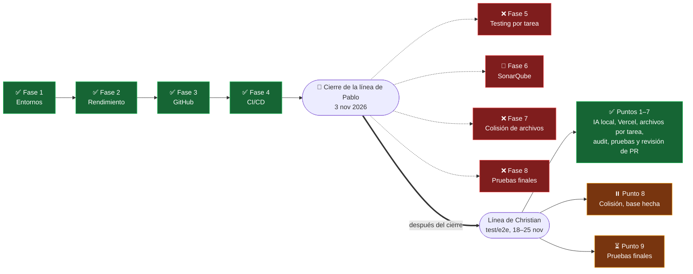

# Cierre de la línea de Pablo y estado de TaskMate

**En una frase:** la línea de Pablo cerró el 3 nov 2026 con las Fases 1–4 entregadas (1960 pruebas en verde el 5 nov, con las correcciones del cierre); la de Christian siguió y al 25 nov 2026 suma en `test/e2e` el monitoreo de Vercel, los archivos por tarea, la IA sobre el código y el chat con modelo local (2087 pruebas, 29 tablas, migraciones 001–011). Esta página dice qué quedó, qué no se hizo, qué limitaciones tiene y cómo retomarlo.



**Última actualización:** 25 nov 2026 — después del cierre (línea de Christian en `test/e2e`)  
**Responsables:** Pablo Pineda (Fases 1–4) · Christian Martínez (su línea) · **Base:** el cierre describe `master` en `56f7136` (merge del PR #5, 22 oct 2026) más las [correcciones del cierre](#correcciones-del-cierre-3-nov-2026) (PR #6, `ea25733`, 5 nov); lo de [después del cierre](#después-del-cierre-línea-de-christian-hasta-el-25-nov-2026) describe `test/e2e` en `50f77da`

Este es el reporte único de cierre. Las **limitaciones conocidas** y los **pendientes** del proyecto, también los de la línea de Christian, viven solo aquí: los capítulos de cada fase, el [índice de la documentación](../README.md) y la [calendarización](calendarizacion.md) enlazan a esta página en lugar de repetir las listas.

**Contenido:** [Decisión y fecha](#decisión-y-fecha) · [Qué se entregó por fase](#qué-se-entregó-por-fase) · [Inventario funcional](#inventario-funcional) · [Correcciones del cierre](#correcciones-del-cierre-3-nov-2026) · [Estado verificado al 3 nov 2026](#estado-verificado-al-3-nov-2026) · [Qué no se hizo](#qué-no-se-hizo) · [Después del cierre](#después-del-cierre-línea-de-christian-hasta-el-25-nov-2026) · [Limitaciones conocidas](#limitaciones-conocidas) · [Pendientes (TODO)](#pendientes-todo) · [Recursos de la demostración](#recursos-de-la-demostración) · [Cómo retomar el proyecto](#cómo-retomar-el-proyecto)

---

## Decisión y fecha

El **3 de noviembre de 2026** Pablo Pineda cerró su línea de trabajo al terminar la Fase 4: **en su línea no se implementa nada más**. La línea de Christian Martínez siguió con sus fechas corridas ([después del cierre](#después-del-cierre-línea-de-christian-hasta-el-25-nov-2026)).

- **Terminadas y fusionadas en `master`:** Fases 1, 2, 3 y 4.
- **No se realizarán en la línea de Pablo:** Fases 5, 7 y 8. La colisión de archivos (Fase 7) sigue en la línea de Christian como punto 8, pospuesto con la base hecha.
- **Cancelada en la etapa de plan:** Fase 6 (SonarQube Cloud), sin código.
- **Fechas:** las planificadas en la tabla oficial de la línea de trabajo no cambian; las reales quedan como están registradas en cada capítulo.

| # | Fase | Fechas planificadas | Fechas reales | Estado |
|---|------|---------------------|---------------|--------|
| 1 | Preparación de entornos, repositorio y CI inicial | 14 ago – 21 ago | Antes de la calendarización: setup y limpieza del repositorio el 10–12 mar 2026; documentada el 31 ago | ✅ Fusionada (PR #2) |
| 2 | Optimización y mejora del rendimiento | 21 ago – 4 sep | Código del 10–12 mar 2026; pruebas de rendimiento el 28 ago | ✅ Fusionada (PR #2) |
| 3 | Integración con GitHub | 4 sep – 18 sep | 10–11 sep; E2E con GitHub real 5–6 oct | ✅ Fusionada (PR #4) |
| 4 | Pipeline CI/CD completo (build, pruebas, análisis estático, deploy y actualización automática) | 18 sep – 9 oct | 9–22 oct | ✅ Fusionada (PR #5) |
| 5 | Testing automático (ciclo de pruebas por tarea) | 9 oct – 23 oct | — | ❌ No se realizará (línea de Pablo cerrada el 3 nov 2026) |
| 6 | Integración con SonarQube | 23 oct – 6 nov | Alcance y plan de la Parte 1 el 23 oct | 🚫 Cancelada en la etapa de plan (SonarQube Cloud), sin código |
| 7 | Algoritmo de colisión de archivos (junto con Christian) | 6 nov – 20 nov | — | ❌ No se realizará en la línea de Pablo; en la de Christian, ⏸️ pospuesta |
| 8 | Pruebas finales | 20 nov – 27 nov | — | ❌ No se realizará (línea de Pablo cerrada el 3 nov 2026) |

---

## Qué se entregó por fase

| Fase | Qué quedó funcionando | Capítulo | Integración en `master` |
|------|-----------------------|----------|-------------------------|
| 1 | Monorepo de tres capas (frontend React en `:3000`, API Express en `:9000`, servicio Python del chat con FastAPI en `:8001` por defecto, configurable con `MCP_PORT`), variables de entorno con plantilla (`taskmate-api/.env.example`), scripts de desarrollo y de pruebas, Git saneado. El «CI inicial» son los scripts de pruebas (`npm test`, `test:db`, `test:performance`): el repositorio de TaskMate no tiene un workflow de CI propio | [Fase 1](../08-fases/fase-01-entornos-repositorio-ci/README.md) | [PR #2](https://github.com/PabloP150/proyecto-is-cc6/pull/2), merge `7e1610f` (6 oct 2026) |
| 2 | 7 optimizaciones: borrados en lote, comprobación e `INSERT` en una sola sentencia (`INSERT … WHERE NOT EXISTS`, que estrecha la ventana de carrera sin cerrarla: no hay índice único ni `UPDLOCK, HOLDLOCK`), operaciones independientes en paralelo (`Promise.all`), consultas sin N+1, corrección de filas multiplicadas en `UserMetrics`, code-splitting del frontend y menos logging. Las mejoras (-71% latencia, -97.5% operaciones de BD, -65% bundle) son **estimaciones, no mediciones**: el 28 ago solo se midieron tiempos absolutos, sin medición «antes». La Fase 3 reemplazó después los borrados en lote y las inserciones en paralelo por transacciones ACID | [Fase 2](../08-fases/fase-02-optimizacion-rendimiento/README.md) | PR #2, merge `7e1610f` (6 oct 2026) |
| 3 | GitHub dentro de TaskMate con una GitHub App: conectar el repositorio del grupo, explorador (archivos, README, commits), rama por tarea con limpieza segura, progreso automático por PR (webhooks firmados) y la IA analiza el repositorio y propone tareas. Además se corrigieron los problemas existentes: transacciones ACID y 3FN, JWT en todas las rutas, autorización por grupo, servicio Python del chat autenticado, XSS del chat y migraciones versionadas | [Fase 3](../08-fases/fase-03-integracion-github/README.md) · [Guía de la App](../07-guias/guia-github-app.md) | [PR #4](https://github.com/PabloP150/proyecto-is-cc6/pull/4), merge `183f1cb` (6 oct 2026) |
| 4 | CI/CD del repositorio del grupo desde la pestaña CI/CD de `/github`: TaskMate (o la IA) propone el pipeline y lo sube, ejecuciones en vivo (WebSocket `/events`), logs y anotaciones, ejecutar / re-ejecutar fallidos / cancelar, staging automático y producción en GitHub Pages con aprobación del admin, rollback y notificaciones | [Fase 4](../08-fases/fase-04-pipeline-cicd/README.md) · [Guía de uso](../07-guias/guia-cicd.md) | [PR #5](https://github.com/PabloP150/proyecto-is-cc6/pull/5), merge `56f7136` (22 oct 2026) |

Commits de cada PR y de lo que vino después (los rangos siguen funcionando aunque se borren las ramas):

```bash
git log --oneline 7e1610f^1..7e1610f^2   # PR #2, Fases 1 y 2 (45 commits de refactor/cleanup)
git log --oneline 183f1cb^1..183f1cb^2   # PR #4, Fase 3 (24 commits)
git log --oneline 56f7136^1..56f7136^2   # PR #5, Fase 4 (18 commits)
git log --oneline ea25733..origin/test/e2e   # después del cierre: línea de Christian (21 commits)
```

---

## Inventario funcional

Lo que puede hacer un usuario hoy, sacado del código el 25 nov 2026 (`test/e2e`, `50f77da`), con la prueba que cubre cada cosa. Las filas «(línea de Christian)» llegaron después del cierre y todavía no están en `master`. La lista por módulo, con quién puede hacer qué y en qué pantalla, está en [funcionalidades](funcionalidades.md). «FE» son las pruebas del frontend (`src/**/__tests__`), «API» las de Jest (`taskmate-api/tests`), «BD» las de SQL Server (`taskmate-api/tests/db`) y «Python» las de pytest (`taskmate-api/mcp/tests`). La interfaz está en inglés desde el 19 nov (`d148763`): los textos se citan como se ven ahora.

| Funcionalidad | Qué hace | Dónde | Cómo se prueba |
|---------------|----------|-------|----------------|
| Iniciar sesión | Entrar con usuario y contraseña; la sesión dura 24 h (JWT) | `/` · `Login.jsx` → `POST /api/users/login` | API `api/auth`, `api/rateLimit`; FE `AppGitHubRoute`, `AppUnknownRoute`, `AppLegacyRoutes` |
| Registrarse | Crear una cuenta; se crea también un grupo personal. Con la sesión iniciada, `/register` lleva a `/home` | `/register` · `Register.jsx` → `POST /api/users` | API `api/auth`; BD `unicode`; FE `AppLegacyRoutes` (la ruta; el formulario `Register.jsx` no tiene prueba) |
| Inicio y navegación | Tarjetas de acceso a Tareas, Calendario, Hitos y Grupos; menú (Home, Tasks, Calendar, Milestones, Groups, Analytics, GitHub, AI Bot) y cerrar sesión. El grupo activo se elige en el selector junto al logo (o con un clic en su tarjeta en Groups) y vale para todas las páginas | `/home` · `HomePage.jsx`, `Navbar.jsx`, `NavGroupSelector.jsx`, `GroupContext.jsx` | FE `AppUnknownRoute`, `GroupContext`, `NavGroupSelector`; `Navbar` sin prueba propia |
| Tareas | Listas de tareas del grupo: crear, editar, completar, mandar a la papelera, borrar una lista, ver y vaciar completadas y papelera, asignar personas | `/tasks` · `Recordatorios.jsx`; `/api/tasks`, `/api/completados`, `/api/delete`, `/api/usertask` | FE `Recordatorios`, `RecordatoriosGitHub`, `formLimits`; API `api/authorization`, `api/validation`, `api/modelErrors`, `api/taskBranchCleanup`; BD `tasks` |
| Calendario | Calendario mensual con las fechas de tareas e hitos | `/calendar` · `CalendarView.jsx` → `GET /api/nodes/tasks/:gid` | Solo el acceso, en API `api/authorization`; sin prueba de FE |
| Hitos | Diagrama de hitos (React Flow): crear, conectar como prerrequisito o progresor, mover, % de avance, completar, editar y borrar; el avance se propaga con triggers de la BD. La dirección antigua `/flow` lleva aquí | `/block-diagram` · `BlockDiagram.jsx`, `flow/*`; `/api/nodes`, `/api/edges`; migración 006 | FE `FlowFitView`, `formLimits`, `AppLegacyRoutes`; API `api/authorization`, `api/validation`; BD `migrations` (triggers), `groups` |
| Grupos y roles | Crear grupo, ver miembros, agregar por usuario (admin), quitar, salir y eliminar; roles con color e icono y su asignación. Un clic en el grupo lo vuelve el activo (ya no hay botón «Use»). La dirección antigua `/create-group` lleva aquí | `/groups` · `GroupsView.jsx`, `GroupRolesPanel.jsx`, `AssignRolesDialog.jsx`; `/api/groups`, `/api/grouproles`, `/api/usergrouproles` | FE `GroupsView`, `formLimits`, `AppLegacyRoutes`; API `api/authorization`, `api/validation`, `api/modelErrors`; BD `groups` |
| Analytics del equipo | Solo líderes: resumen, carga de trabajo, experiencia por categoría, filtro por rol y recomendaciones de asignación por IA. Un miembro ve «Team leaders only» | `/analytics` · `AnalyticsDashboard.jsx` → `GET /api/analytics/dashboard/:gid` y WebSocket `/insights` | FE `AnalyticsDashboard`; API `analytics-api`, `AnalyticsService`, `analyticsContext`; BD `analytics`; Python `test_analytics_agent` |
| Chat con IA: asistente y plan de proyecto | Conversar con la IA, con respuestas en streaming. El chat sigue al grupo del navbar y responde con sus tareas, hitos, equipo y asignaciones (y un resumen del repositorio si el grupo dio el permiso de IA). Solo arma un plan si se pide: sin grupo, un plan de proyecto nuevo (al menos 8 tareas) que se guarda al confirmar. El modelo es Groq (`openai/gpt-oss-20b`, por defecto) u Ollama local (`gemma4:e2b-it-qat`) según `LLM_PROVIDER` (cambios de la línea de Christian) | `/chat` · `ChatPage.jsx`, `github/ChatProjectInfo.jsx`; WebSocket `/chat`; `UserSession.js`, `ProjectService.js`, `mcp/agents/orchestrator.py`, `mcp/knowledge.py` | FE `ChatPage`, `ChatPageStreaming`, `ChatProjectInfo`; API `UserSession`, `SessionManager`, `api/websocket`, `ProjectService`, `llm-fallback`; BD `project`; Python `test_orchestrator`, `test_server`, `test_llm_service`, `test_local_provider`, `test_knowledge` |
| Chat con IA: análisis del repositorio | Con un grupo que tiene repositorio y permiso de IA, el botón «Propose tasks» (o pedir un plan en el chat) analiza el repositorio y propone tareas que se guardan o descartan (el permiso lo da el admin con «Allow AI analysis») | `/chat` · `github/ChatProjectInfo.jsx`, `github/RepoPlanCard.jsx` | FE `ChatPageGitHub`, `ChatProjectInfo`, `RepoPlanCard`; API `github/repoPlan`, `github/repoSnapshot`, `UserSession`; Python `test_repo_analysis` |
| GitHub › Repositorio | Conectar la GitHub App (admin), elegir y vincular el repositorio, desvincularlo, permitir el análisis con IA («Allow AI analysis») y sincronizar PRs («Sync PRs») | `/github` · `GitHubPage.jsx`, `RepositoryPanel.jsx`, `RepoSelection.jsx` | FE `GitHubPage`, `RepoSelection`, `AppGitHubRoute`; API `github/github.controller`, `github/installFlow`, `github/githubApp`, `github/githubModel`; BD `github` |
| GitHub › Archivos y Commits | Explorar el árbol, ver archivos, README renderizado de forma segura y últimos commits | `/github` · `RepoExplorer.jsx`, `FileViewer.jsx`, `CommitList.jsx` | FE `RepoExplorer`, `GitHubPage`; API `github/repoService`, `github/repoSnapshot` |
| Rama por tarea y progreso por PR | Crear la rama de una tarea («Create branch on GitHub»), ver el estado de su PR; la tarea se completa al fusionar el PR y la rama se limpia de forma segura | `/tasks` · `TaskGitHubActions.jsx`, `useTaskLinks.js`; webhook `POST /api/github/webhook` | FE `TaskGitHubActions`, `useTaskLinks`, `BranchToastMessage`, `RecordatoriosGitHub`; API `github/branchService`, `github/branchName`, `github/syncService`, `github/webhookHandler`, `github/webhookSignature`; BD `github`, `tasks` |
| Archivos de la tarea (línea de Christian) | En una tarea con rama, el icono «View task files» abre «Task files»: los archivos del PR con su estado, +/− y «Open on GitHub», y en ámbar las rutas que otra tarea activa también toca («Also changed by») | `/tasks` · `github/TaskFilesDialog.jsx`; `GET /api/github/tasks/:tid/files` y `/overlaps`; `taskFileService.js`; tabla `TaskFiles` (migración 010) | API `github/taskFileService`, `github/repoService`; `TaskFilesDialog` sin prueba de FE; rutas sin prueba HTTP |
| IA sobre la rama de la tarea (línea de Christian) | En «Task files», el panel «AI on the branch»: «Audit» (veredicto «No issues», «Needs review» o «Serious issues», con hallazgos), «Generate tests» (propone pruebas, no las ejecuta ni las sube) y «Review PR» (con el PR abierto). Lo hace el servidor de IA local y requiere el permiso «Allow AI analysis» del grupo | `github/TaskAiPanel.jsx`; `POST /api/github/tasks/:tid/audit`, `/generate-tests` y `/review`, `GET …/review`; `services/aiServer/*` | FE `TaskAiPanel`; API `aiServer/client`, `aiServer/taskAi`, `aiServer/prReview`; BD `aiReview` |
| Revisión automática del PR (línea de Christian) | Al abrir o actualizar el PR de una rama de tarea (no borrador, con «Allow AI analysis» en el grupo), la IA lo revisa en segundo plano y lo publica en GitHub como comentario (COMMENT, nunca aprueba ni bloquea); una revisión por commit en `AiReviews` (migración 011) | webhook `pull_request` → `services/aiServer/prReview.js` | API `aiServer/prReview`; BD `aiReview` (la llamada desde `webhookHandler` no tiene prueba) |
| CI/CD › Pipeline | Propuesta del pipeline (detectada del repositorio o con IA), vista previa del YAML y subirlo al repositorio; Node.js (npm), Python y sitios estáticos; deploy a GitHub Pages | `/github?tab=cicd` · `cicd/PipelineCard.jsx`, `cicd/PipelineSetup.jsx`; `pipelineService`, `pipelineSpec`, `pipelineAi` | FE `PipelineSetup`, `CicdPanel`; API `github/pipelineService`, `github/pipelineSpec`, `github/pipelineSpec.scripts`, `github/pipelineAi`, `github/cicd.controller`; BD `cicd`; Python `test_pipeline_agent` |
| CI/CD › Ejecuciones y logs | Lista de ejecuciones con filtros, ejecutar el CI en una rama, re-ejecutar fallidos, cancelar y ver cada job con su log y sus anotaciones (archivo y línea) | `cicd/RunList.jsx`, `cicd/RunDetail.jsx`, `cicd/JobLog.jsx`; `actionsService` | FE `RunList`, `RunControls`; API `github/actionsService`, `github/cicd.controller` |
| CI/CD › Despliegues | Staging automático; en producción el admin publica o hace rollback, un miembro solicita, el admin aprueba o rechaza y el solicitante cancela | `cicd/DeployPanel.jsx`; `deployService`; tabla `DeployRequests` | FE `DeployPanel`; API `github/deployService`, `github/cicd.controller`; BD `cicd` |
| Monitoreo de Vercel (línea de Christian) | Pestaña «Vercel (monitoring)» de `/github`: el admin vincula el «Vercel Project ID»; todos ven los últimos 20 despliegues (estado, production/preview, rama, SHA, URL y error) y los recargan con «Refresh» (sin tiempo real) | `deploy/DeploymentPanel.jsx`, `src/api/deploy.js`; `/api/deploy/groups/:gid/target` y `/deployments`; webhook `POST /api/deploy/webhook/vercel`; migración 009 | API `deploy/deploySignature`, `deploy/vercelEvents`, `deploy/deployWebhookHandler`; `DeploymentPanel` sin prueba de FE; rutas `/api/deploy` sin prueba HTTP |
| Notificaciones de CI/CD en vivo | Avisos en cualquier pantalla y refresco en vivo de ejecuciones y despliegues de GitHub | `realtime/RealtimeContext.jsx`, `realtime/CicdNotifications.jsx`; WebSocket `/events` | FE `Realtime`; API `realtime`, `api/websocket`, `github/webhookHandler` |

**Piezas internas:**
- **API REST:** 110 rutas (108 en `taskmate-api/controllers/` más los 2 webhooks de `app.js`, el de GitHub y el de Vercel), todas con JWT salvo registro, login, el callback de GitHub (estado firmado) y los dos webhooks (firma HMAC: SHA-256 en el de GitHub, SHA-1 en el de Vercel). Al cierre eran 99; las nuevas son 6 por tarea en `/api/github/tasks/:tid`, 4 en `/api/deploy` y el webhook de Vercel. 20 no tienen llamada desde la interfaz ([limitaciones](#api-y-código)).
- **WebSockets:** `/chat`, `/insights` y `/events`, con JWT en `?token=` y control de `Origin` (con `ALLOW_LAN_ORIGINS=true` también acepta orígenes `http` de IPv4 privada; solo para desarrollo).
- **Webhook de GitHub:** `installation`, `installation_repositories`, `pull_request`, `workflow_run`, `workflow_job` y `deployment_status`. Desde la línea de Christian, `pull_request` también lanza la revisión de PR con IA y el registro de los archivos del PR (que, según el código, no se guarda: [limitación](#archivos-por-tarea)).
- **Webhook de Vercel:** eventos `deployment.*` (solo monitoreo; se guardan en `Deployments`).
- **Servicio Python del chat** (`taskmate-api/mcp`): FastAPI en `127.0.0.1:8001` con WebSocket `/ws` y secreto compartido (`X-MCP-Secret`); agentes de chat y plan de proyecto, análisis de repositorio, pipeline y analytics. El modelo se elige con `LLM_PROVIDER`: `groq` (por defecto en el código) u `ollama` (lo que pone `scripts/local-up.sh`).
- **Servidor de IA local** (repo aparte de Christian, `taskmate-ai-server`): FastAPI en `127.0.0.1:8000` con `X-AI-Server-Secret`, Ollama (`gemma4:e2b-it-qat` y `embeddinggemma:300m`) y su propia Postgres 17 + pgvector (7 tablas, fuera de las 29). La API usa sus comandos `audit`, `generate-tests` y `review-pr`; el chat, su `/search` (solo sin grupo seleccionado). Es opcional: sin `AI_SERVER_URL` esas funciones se apagan.
- **BD:** 29 tablas (11 del núcleo, 4 de analytics, 6 de GitHub, 2 de CI/CD, 3 de despliegues, `TaskFiles`, `AiReviews` y `SchemaMigrations`), migraciones 001–011 con reversa y los 2 triggers de la 006. Al cierre eran 24 tablas y 001–008.
- **Tareas en segundo plano:** recálculo de métricas de analytics (solo con `ANALYTICS_BATCH_ENABLED=true`), purga diaria de las entregas de webhooks de GitHub (las de Vercel no se purgan) y, tras el webhook de PR, el registro de archivos y la revisión de IA.

---

## Correcciones del cierre (3 nov 2026)

La verificación del cierre encontró tres rutas con problemas. Se corrigieron en `src/App.js`, sobre `56f7136`, y ya no son limitaciones:

| Ruta | Antes | Ahora |
|------|-------|-------|
| `/register` | Con la sesión iniciada mostraba el formulario de registro debajo del navbar | Con sesión lleva a `/home`; sin sesión muestra el registro |
| `/flow` | Ruta sin enlace, con el lienzo de React Flow en 0 px de alto | Lleva a `/block-diagram`, donde vive el diagrama de hitos (sin sesión, a `/`) |
| `/create-group` | Ruta sin enlace con una pantalla aparte para crear grupos | Lleva a `/groups`, donde se crean los grupos (sin sesión, a `/`). Se borró `CreateGroup.jsx` |

- **Pruebas:** 5 nuevas en `src/__tests__/AppLegacyRoutes.test.jsx` (registro sin sesión, registro con sesión, `/flow`, `/create-group` y las dos direcciones sin sesión). El frontend pasó de 404 a 409 pruebas.

### Panel de analytics (4 nov 2026)

Se corrigió la limitación «El panel deja fuera a quien no tiene rol y mezcla grupos». Ahora todo el panel cuenta solo el grupo activo:

| Qué | Antes | Ahora |
|-----|-------|-------|
| Miembros en «Team Workload Distribution» | Solo los que tenían al menos un rol en el grupo (`INNER JOIN dbo.UserGroupRoles`), y de cada uno un solo rol (`MIN(gr_name)`) | Todos los miembros del grupo (`UserGroups`), con todos sus roles en el grupo; quien no tiene ninguno sale como «No role» |
| Tareas y capacidad de las barras | Las tareas de la persona en todos sus grupos, divididas entre su capacidad de `UserMetrics`, que también mezcla todos sus grupos | Solo las tareas del grupo, divididas entre lo máximo que la persona tuvo abierto a la vez en el grupo (3 sin historial). La `historical_capacity` del resumen del equipo y del `team_context` de la IA se calcula igual |
| «Category Expertise» | Leída de `UserExpertise`, que suma todos los grupos de la persona | Calculada con la misma fórmula, solo con los registros cerrados de `TaskAnalytics` del grupo. `UserExpertise` queda para los analytics propios de cada persona |
| Filtro de rol | 6 nombres fijos, comparados con un solo rol del miembro | «All Roles», los roles que tienen los miembros y «No role» si alguien no tiene ninguno. Coincide cualquiera de sus roles, y vuelve a «All Roles» al cambiar de grupo o si el rol deja de existir |

- **Respaldo local:** como ahora aparecen miembros sin rol, las recomendaciones que arma el navegador ya no les ponen «Their No role expertise…» ni «Expertise: No role».
- **Código:** `taskmate-api/services/AnalyticsService.js` (`getWorkloadDistribution`, `getTeamAnalyticsSummary`, `getCategoryExpertiseRankings`), `taskmate-api/services/analyticsContext.js` (`GROUP_CAPACITY_SQL`, la capacidad por grupo) y `src/components/AnalyticsDashboard.jsx`. `/workload` sigue mandando `role` como texto («N/A» sin rol) y agrega `roles`, la lista de roles.
- **Pruebas:** 8 nuevas de la API (`tests/AnalyticsService.test.js` y `tests/analyticsContext.test.js`), 8 del frontend (`AnalyticsDashboard.test.jsx`: filtro de rol y respaldo local) y 1 de BD (`tests/db/analytics.dbtest.js`: dos grupos y un miembro sin rol). Todas pasan (5 nov 2026).

### Orden de las tareas (4 nov 2026)

Se corrigió la limitación «Tareas: al entrar, el orden dice “Priority” sin estar ordenado». Ahora la etiqueta siempre dice el orden que siguen las tarjetas:

| Qué | Antes | Ahora |
|-----|-------|-------|
| Orden al entrar a `/tasks` | Empezaba en `'fechaCreacion'`, que no es ninguna opción del menú: la etiqueta caía en «Priority» y las tarjetas no se ordenaban | Empieza en «Creation Date». Una clave desconocida se ordena y se rotula como «Creation Date», así que la etiqueta no puede nombrar otro orden |
| Fecha de creación | No existía: las tareas llegaban en el orden en que SQL Server devolvía las filas (`getTasksByGroupId` no tenía `ORDER BY`) | `created_at` y `created_seq` en `Tasks`, `Complete` y `DeleteTask` (migración 008). La API manda `created_at` como `createdAt` y las tres listas se leen con `ORDER BY created_at, created_seq` |
| «Creation Date» | Dejaba el orden de la API | La más antigua primero; una tarea recién agregada va al final hasta que la lista se recarga |
| «Deadline» y «Priority» | Una tarea sin fecha límite válida quedaba primero (`null` contaba como 1970) o dejaba el orden sin definir (`NaN`) | Los mismos criterios, y una tarea sin fecha límite va al final |
| «Completed» y «Deleted» | Mostraban la etiqueta de orden, pero las filas llegaban como las devolvía SQL Server (sin `ORDER BY`; en la práctica, por `tid`, un GUID aleatorio) | La tarea completada o borrada conserva su `created_at`, y esas vistas se ordenan igual que las tareas activas |

- **Migración 008 (`taskmate-api/migrations/008_task_created_at.sql`):** agrega a las tres tablas `created_at DATETIMEOFFSET(7) NOT NULL DEFAULT SYSDATETIMEOFFSET()` y `created_seq` (`BIGINT IDENTITY` en `Tasks`; las otras dos copian el de la tarea). A las filas que ya había les pone la primera asignación de la tarea en `TaskAnalytics` si la tiene; si no, la hora de la migración. Las tareas de un plan de la IA se insertan en la misma transacción y su `created_at` puede empatar: `created_seq` desempata en el orden de inserción.
- **En `taskmate-sql` ya está aplicada** (5 nov 2026, con respaldo previo). **Otra BD que ya existía** necesita aplicarla desde el host antes de arrancar la API nueva: `cd taskmate-api && MIGRATION_DB_USERNAME=sa MIGRATION_DB_PASSWORD=<contraseña de SA> npm run db:migrate` (entonces solo corría la 008; hoy aplica todas las que falten, hasta la 011). El contenedor no la aplica solo: su imagen trae las migraciones que había al construirla, y `./start.sh` solo hace `docker start taskmate-sql`. Sin la 008, `/api/tasks` responde 500 («Invalid column name 'created_at'») y la pantalla de tareas no carga. Un contenedor nuevo ya la trae. Detalle: [guía de la BD en Docker, §5](../07-guias/base-de-datos-docker.md#5-migrar-una-bd-que-ya-existía).
- **Código:** `taskmate-api/models/tasks.model.js` (`getTask`, `getTasksByGroupId`, `completeTask`, `trashTask`), `models/complete.model.js`, `models/delete.model.js`, `src/components/Recordatorios.jsx` y `src/components/ListaRecordatorios.jsx` (`ordenarRecordatorios`).
- **Pruebas:** 10 nuevas de la API (`tests/tasks.model.test.js`, `tests/api/tasksCreatedAt.test.js`, `tests/complete.model.test.js` y `tests/delete.model.test.js`), 6 del frontend (`Recordatorios.test.jsx`: los tres órdenes, una tarea recién creada, «Completed» y «Deleted») y 8 de BD (`tests/db/tasks.dbtest.js`: columna, orden, completar y borrar, empate en el mismo instante (`created_seq`), filas del flujo viejo y relleno de la 008; `tests/db/project.dbtest.js`: las tareas de un plan salen en el orden del plan). Todas pasan (5 nov 2026).

---

## Estado verificado al 3 nov 2026

Foto del cierre de la línea de Pablo (`master`). El estado de `test/e2e` está en [Estado verificado al 25 nov 2026](#estado-verificado-al-25-nov-2026).

| Verificación | Resultado | Cómo reproducirlo |
|--------------|-----------|-------------------|
| Pruebas de la API (Jest, GitHub simulado) | **1246/1246**, 46 suites | `cd taskmate-api && npm test` |
| Pruebas del frontend (CRA + Testing Library) | **423/423**, 33 suites (incluye las pruebas nuevas del 3 y 4 nov) | `CI=true npm test -- --watchAll=false` (desde la raíz) |
| Pruebas de Python (pytest, sin red) | **177/177** | `cd taskmate-api/mcp && source venv/bin/activate && python -m pytest` |
| Pruebas de BD | **114/114**, 9 suites, en un contenedor de SQL Server desechable | `cd taskmate-api && TEST_DB_ENV_FILE=<archivo con TEST_DB_*> npm run test:db` |
| ESLint | 0 problemas | `npx eslint src --ext .js,.jsx` (desde la raíz) |
| Build de producción (CRA) | Compila | `npm run build` (desde la raíz) |
| **Total de pruebas** | **1960 pasando, 0 fallando** | |
| App en marcha, solo lectura | 0 respuestas HTTP 5xx en 50 llamadas GET | API, servicio Python del chat y frontend levantados (`./start.sh` y `npm start`) |
| Smoke de UI | Chrome *headless* renderizó las rutas de `src/App.js` como admin y como miembro, sin excepciones no capturadas | Iniciar sesión como un admin y como `demo-miembro` y abrir cada ruta |

Notas:
- **Fechas:** las cuatro suites, ESLint y el build se volvieron a correr el 5 nov 2026, con las correcciones del 4 nov. La app en marcha y el smoke de UI son del 3 nov.
- **Comparación:** antes de la Fase 3 había 155 pruebas en dos capas (API y frontend) y 52 fallaban; al cerrar la Fase 3 (6 oct 2026) pasaban 1353; al cerrar la Fase 4 (22 oct 2026), 1914; al cierre de la línea, con las 5 pruebas nuevas de rutas, 1919; con las correcciones del 4 nov, 1960 (5 nov 2026). El 25 nov, en `test/e2e`, 2087.
- **Pruebas de BD:** el archivo de `TEST_DB_ENV_FILE` define `TEST_DB_SERVER`, `TEST_DB_PORT`, `TEST_DB_NAME`, `TEST_DB_USERNAME`, `TEST_DB_PASSWORD` y `TEST_DB_SA_PASSWORD` (o `TEST_DB_MIGRATION_*`). Corren migraciones arriba y abajo y escriben datos: **nunca** contra el contenedor de desarrollo `taskmate-sql`. Cómo levantar el contenedor desechable: [guía de la BD en Docker, sección 6](../07-guias/base-de-datos-docker.md#6-bd-desechable-para-pruebas) (también en el [capítulo de la Fase 3](../08-fases/fase-03-integracion-github/README.md#cómo-reproducir--verificar)).
- **De las 1246 pruebas de la API, 10 no comprueban nada** si no se corren con `NODE_ENV=integration-test` y una BD: las 5 de `performance.test.js` y las 5 de `integration/analytics-integration.test.js` terminan con `return` antes de su primera aserción.
- Los scripts del smoke de UI y de las llamadas de solo lectura no forman parte del repositorio. Los defectos que encontraron están en [Limitaciones conocidas](#limitaciones-conocidas).

---

## Qué no se hizo

En la línea de Pablo:

| Fase | Fechas planificadas | Qué pasó |
|------|---------------------|----------|
| 5 — Testing automático (ciclo de pruebas por tarea) | 9 oct – 23 oct | No se realizará; no se empezó. Tampoco se hará la idea 8 de la Fase 4 (estado del CI en el chip de cada tarea), que dependía de esta fase. El «Generate tests» de la línea de Christian propone pruebas pero no las corre: no es este ciclo |
| 6 — Integración con SonarQube | 23 oct – 6 nov | **Cancelada en la etapa de plan (SonarQube Cloud), sin código.** El 23 oct se definió el alcance y se escribió y revisó el plan de la Parte 1; Pablo decidió dejarlo en plan y el 3 nov canceló la fase. El plan quedó **fuera del repositorio** ([dónde](#cómo-retomar-el-proyecto)) |
| 7 — Algoritmo de colisión de archivos (junto con Christian Martínez) | 6 nov – 20 nov | No se realizará en la línea de Pablo. En la de Christian (punto 8) está ⏸️ pospuesta con la base hecha: la tabla `TaskFiles` (migración 010), `findTasksTouchingPaths` y `GET /api/github/tasks/:tid/overlaps` |
| 8 — Pruebas finales | 20 nov – 27 nov | No se realizará como fase de Pablo. Las pruebas finales de la línea de Christian (punto 9, 20–27 nov) están ⏳ pendientes; la última medición es la del [25 nov](#estado-verificado-al-25-nov-2026) |

La línea de Pablo tampoco implementará las funcionalidades que las fases terminadas dejaron para después: de la Fase 3, sincronizar tareas e issues (4), analytics con datos de GitHub (9), feed de actividad (10) y que la IA abra PRs (11); de la Fase 4, que la IA explique fallos del CI (7), el CI en el chip de la tarea (8), métricas DORA (11) y Dependabot (12). Dos de la Fase 3 llegaron después por la línea de Christian: la **revisión de PR con IA (8)**, con el comando `review-pr`, el webhook de PR y el botón «Review PR» (`c2a6833`), y en parte el **chat con el repositorio (7)**: el chat responde sobre el grupo con un resumen de su repositorio si hay permiso, sin leer el código fuente (`f152a9e`).

**Ramas:** `feature/fase-5-testing-automatico`, `feature/fase-6-sonarqube` y `feature/fase-7-colision-archivos` estaban vacías (se crearon desde `master` el 6 oct 2026, `fe9d87d`, sin commits propios) y ya se borraron; tampoco existe ya `feature/fase-4-cicd-github-actions`, fusionada con el PR #5 (comprobado el 25 nov 2026, en local y en `origin`). La Fase 8 nunca tuvo rama.

---

## Después del cierre (línea de Christian, hasta el 25 nov 2026)

El cierre del 3 nov aplica solo a la línea de Pablo. La línea de Christian Martínez siguió con sus fechas corridas: su tabla, con fechas planificadas y reales, está en la [calendarización](calendarizacion.md#línea-de-trabajo-de-christian-martínez). Detalle técnico: [09-linea-christian](../09-linea-christian/README.md) y el módulo [10 · IA sobre el código](../02-arquitectura/10-ia-sobre-el-codigo.md).

### Qué entró

Los 21 commits de `ea25733..origin/test/e2e` son de Christian (usuario `Sirk02`):

| Fecha | Qué | Commits |
|-------|-----|---------|
| 9 oct | Monitoreo de despliegues de Vercel (webhook firmado, pestaña «Vercel (monitoring)», migración 009) y archivos por tarea (diálogo «Task files», migración 010) | `602b1d8`, `c0d28e2` |
| 9 oct | Chat sobre el modelo local (Ollama) con streaming, y `scripts/local-up.sh` para Linux con Podman | `921f8ed`, `beb1e9c` |
| 18 nov | Todo lo anterior entra en `test/e2e`; sus migraciones 007 y 008 pasan a ser la 009 y la 010 | `fea7541` |
| 18 nov | `start.sh` usa Podman si está; carga inicial más chica y el modelo local sigue cargado | `d529af6`, `a502406` |
| 18 nov | TaskMate llama al servidor de IA local: «Audit» (respeta el permiso de IA del grupo), «Generate tests» y la revisión de PR con IA, por webhook y con «Review PR» (migración 011) | `f5c1359`, `efba978`, `7d83cdf`, `c2a6833` |
| 19 nov | La lista de archivos del PR pide el permiso `pull_requests:read` | `ebbedfa`, `913c71a` |
| 19 nov | Chat como asistente del proyecto: conversa normal, responde con el contexto del grupo y solo arma un plan si se pide | `f152a9e`, `1074adc`, `ce49a94` |
| 19 nov | Interfaz en inglés, selector de grupo en el navbar y chat que sigue a ese grupo | `d148763` |
| 25 nov | `ALLOW_LAN_ORIGINS` (opcional) para probar la app desde otros equipos de la red local | `50f77da` |
| 25 nov | Servidor de IA local: PRs #4–#8 (audit, perf, app-link, generate-tests y review-pr) fusionados en su `main` | `19ea7ef` |

### Dónde vive

- **TaskMate:** en `origin/test/e2e` (`50f77da`), la rama con lo más actualizado. **Todavía no está en `master`:** `origin/master` sigue en `ea25733` (PR #6, 5 nov) aunque el merge `fea7541` diga «into master», y el `master` local está en `56f7136`. Falta fusionarla.
- **Ramas de Christian en `origin`** (su contenido está en `test/e2e`): `feature/linea-christian`, `perf/app`, `feature/ai-server-link`, `feature/generate-tests`, `feature/ai-pr-review` y `feature/chat-assistant`. Los 3 últimos commits de `feature/chat-assistant` no son los mismos: entraron en `test/e2e` como `1074adc`, `ce49a94` y `d148763`.
- **Servidor de IA local:** repo privado `taskmate-ai-server` (usuario `Sirk02`), `main` en `19ea7ef`.

### Cifras al 25 nov 2026

| Qué | Al cierre (3–5 nov, `master`) | Al 25 nov (`test/e2e`) |
|-----|-------------------------------|------------------------|
| Pruebas en verde | 1960 | **2087** |
| Rutas REST | 99 | **110**: 6 nuevas por tarea en `/api/github/tasks/:tid`, 4 en `/api/deploy` y el webhook de Vercel |
| WebSockets | 3 | 3 (`/chat`, `/insights` y `/events`) |
| Tablas de SQL Server | 24 | **29**: `Deployments`, `DeploymentWebhookDeliveries` y `GroupDeployTargets` (009), `TaskFiles` (010) y `AiReviews` (011) |
| Migraciones | 001–008 | **001–011**, todas con `.down.sql`; siguen los 2 triggers de la 006 |
| BD del servidor de IA local | — | Postgres 17 + pgvector con 7 tablas propias (no cuentan en las 29) |

### Estado verificado al 25 nov 2026

| Verificación | Resultado | Cómo reproducirlo |
|--------------|-----------|-------------------|
| Pruebas de la API (Jest, GitHub simulado) | **1322/1322**, 54 suites (nuevas: `deploy/*`, `aiServer/*`, `middleware/cors` y `github/taskFileService`) | `cd taskmate-api && npm test` |
| Pruebas del frontend | **438/438**, 36 suites (nuevas: `ChatPageStreaming`, `TaskAiPanel`, `ChatProjectInfo` y `NavGroupSelector`; se borró `ChatProjectSelector`) | `CI=true npm test -- --watchAll=false` (desde la raíz) |
| Pruebas del servicio Python del chat (pytest, sin red) | **210/210**, 8 archivos (nuevos: `test_local_provider` y `test_knowledge`) | `cd taskmate-api/mcp && source venv/bin/activate && python -m pytest` |
| Pruebas de BD | **117/117**, 10 suites (nueva: `aiReview.dbtest.js`, migración 011) | `cd taskmate-api && TEST_DB_ENV_FILE=<archivo con TEST_DB_*> npm run test:db` |
| **Total de pruebas** | **2087 pasando, 0 fallando** | |
| ESLint | **1 problema**: `testing-library/render-result-naming-convention` en `src/components/__tests__/NavGroupSelector.test.jsx:30` (al cierre, 0) | `npx eslint src --ext .js,.jsx` (desde la raíz) |
| Build, app en marcha y smoke de UI | No se volvieron a correr el 25 nov | |
| Pruebas del servidor de IA local | 87 funciones `test_` en su repo; no se corrieron (el clon no tiene venv) | En el repo `taskmate-ai-server` |
| Con servicios reales | No probado: el webhook con una cuenta real de Vercel ni la publicación de la revisión con una App que tenga «Pull requests: Read and write» | |

Notas:
- **Frente a `ea25733`:** API +76 pruebas, frontend +15, Python +33 y BD +3.
- **Sin red:** `mcp/tests/conftest.py` fija `LLM_PROVIDER=groq`, `AI_SERVER_URL` vacío y `LLM_STREAM_CHAT=1` para que un `.env` local no se meta en las pruebas. Ninguna prueba llama de verdad a Groq, Ollama, GitHub ni al servidor de IA local; dos de Python conectan a `127.0.0.1:9` para simular un servicio caído.
- **Como en el cierre, 10 de las 1322 pruebas de la API no comprueban nada** fuera de integración.
- Lo nuevo que no tiene prueba está en [Limitaciones › Pruebas](#pruebas).

### Estado de la línea de Christian

| Punto | Qué | Estado al 25 nov |
|-------|-----|------------------|
| 1–2 | Servidor de IA local, modelo de datos y comandos | ✅ Completo |
| 3 | Integración con Vercel / AWS | ✅ Solo monitoreo de Vercel; AWS sin implementar |
| 4 | Interfaz de tareas más detallada (archivos por tarea) | ✅ Completo |
| 5–7 | `audit`, generar pruebas y revisar PRs con IA | ✅ Completo |
| 8 | Algoritmo de colisión de archivos | ⏸️ Pospuesto, con la base hecha |
| 9 | Pruebas finales (20–27 nov) | ⏳ Pendiente |

Los fallos y límites de lo nuevo están en [Limitaciones conocidas](#limitaciones-conocidas), marcados con 🆕.

---

## Limitaciones conocidas

Las del cierre se verificaron contra el código el 3 nov 2026 (archivo y línea de `master`, `56f7136`) y se revisaron otra vez el 25 nov 2026 contra `test/e2e` (`50f77da`), con las líneas actualizadas. Las filas 🆕 son de lo que entró después del cierre (línea de Christian). «Según el código» marca lo que se dedujo leyendo el código y no se reprodujo. La línea de Pablo no las corregirá; cada una tiene su entrada en [Pendientes (TODO)](#pendientes-todo).

Ya no están aquí las que se arreglaron: las tres rutas del cierre, el panel de analytics y el orden de las tareas (4 nov), en [Correcciones del cierre](#correcciones-del-cierre-3-nov-2026). Con la línea de Christian (`d148763`, `f152a9e`) también se resolvieron «Grupos: el grupo seleccionado no muestra sus datos» (ya no hay botón «Use»: el grupo guardado carga sus miembros y roles) y el `generate_stream` sin uso (el chat ahora responde en streaming).

### Interfaz

| Limitación | Qué pasa | Cómo se resolvería |
|------------|----------|--------------------|
| Chat: el avatar del bot es invisible y el botón de enviar es ovalado | Según el código (el 25 nov no se volvió a ver renderizado): el tema define `background.default: 'transparent'` (`src/theme/theme.js:38`) y los Avatar del bot (`ChatPage.jsx:778-787` y `872-880`) solo fijan `bgcolor`, así que el ícono se pinta transparente. El formulario (`ChatPage.jsx:909-919`) es una fila flex sin `alignItems` y el botón (`962-980`) se estira a 40×80 px | `color: 'white'` en los Avatar; `alignItems: 'center'` en el formulario o un alto fijo en el botón |
| Quedan textos en español 🆕 | La interfaz pasó al inglés el 19 nov (`d148763`), pero quedan «Vincular»/«Vinculando…» (`deploy/DeploymentPanel.jsx:128`), «Desplegando…» y «Publicando `<sha>`…» (`cicd/DeployPanel.jsx:100`, `:143`), «Omitido» en los pasos saltados (`cicd/RunDetail.jsx:53`), «N coincidencia(s).» (`RepoExplorer.jsx:265`), «[Imagen: …]»/«[Imagen externa]» (`FileViewer.jsx:59`), «para `<archivo>`» y «N casos» (`TaskAiPanel.jsx:91`, `:94`), la etapa y el paso «Pruebas» del workflow (`pipelineSpec.js:553`, `:669`) y el aviso del chat «Proyecto "X" creado» (`UserSession.js:695`); el servidor del chat también manda «Plan guardado: …» y «Plan descartado.» (`:583`, `:598`) | Traducirlos (o i18n) |
| Detalles menores | Dos avisos de React Router v7 en la consola en cada página (el `<Router>` de `App.js` no pasa `future`); la pestaña del navegador dice «React App» (`public/index.html:27`, y `manifest.json`) | `future={{ v7_startTransition: true, v7_relativeSplatPath: true }}`; título y manifest «TaskMate» |

### Chat con IA

| Limitación | Qué pasa | Cómo se resolvería |
|------------|----------|--------------------|
| El contexto del proyecto no se refresca 🆕 | Se arma con el primer mensaje tras elegir el grupo y queda en caché (`UserSession.js:346-359`): las tareas, hitos, asignaciones, el repositorio o el permiso de IA que lleguen después no los ve el chat hasta cambiar de grupo (volver a elegir el mismo no lo reinicia) | Reconstruirlo cuando cambian los datos o cada cierto tiempo |
| No se puede volver a «sin grupo» 🆕 | `NavGroupSelector` no tiene opción vacía y el login elige el primer grupo: el plan de proyecto nuevo (y la búsqueda en el servidor de IA local) solo ocurre si el usuario no tiene grupos o salió del seleccionado | Una opción «New project» en el selector o en el chat |
| Plan pedido sin grupo: el navegador espera 100 s 🆕 | Según el código: si llega un `plan_request` cuando ya no hay grupo, Node borra el pedido sin responder (`UserSession.js:628-637`) y el navegador espera hasta «No answer arrived in time…»; si se cambió de grupo en ese tiempo, el análisis corre sobre el grupo nuevo | Responder con un error y atar el pedido al grupo con que se hizo |
| Reintentar tras `SAVE_FAILED` deja al usuario esperando | Según el código: Python vuelve a dejar el plan esperando confirmación (`orchestrator.py:415-416`), pero la API ya cerró su compuerta (`UserSession.js:681`). Un «sí» da `PLAN_NOT_EXPECTED` sin respuesta al navegador (`UserSession.js:676-679`) y a los 100 s sale «No answer arrived in time…»; hay que pedir el plan de nuevo | Reabrir la compuerta o responder con un error |
| El grupo creado desde el chat no queda seleccionado 🆕 | Tras `project_created` el navegador solo recarga los grupos (`ChatPage.jsx:411-414`); el chat sigue sin proyecto hasta elegirlo en el navbar | Seleccionar el grupo nuevo |
| Datos del equipo al modelo sin el permiso de IA 🆕 | «Allow AI analysis» solo controla el resumen del repositorio: tareas, hitos, nombres de usuario y asignaciones van siempre en el contexto (`UserSession.js:379-419`), y con `LLM_PROVIDER=groq` (por defecto) salen a Groq | Decidirlo como política y avisarlo en la interfaz, o pedir el permiso también para esos datos |
| Dos llamadas al modelo por mensaje 🆕 | Cada mensaje sin frase disparadora pasa por la clasificación PLAN/CHAT/OFF (`orchestrator.py:553-577`) y luego por la respuesta. Según el código (no comprobado), con `openai/gpt-oss-20b`, que razona, y `max_tokens=3` la clasificación podría volver vacía y todo caería en CHAT | Clasificar sin LLM cuando se pueda, o con más tokens |
| Errores del modelo local sin detalle 🆕 | «is Ollama running?» u «ollama pull …» solo quedan en el log de Python; el usuario ve el genérico «The AI assistant is temporarily unavailable…». Con Ollama se ignora `REPO_ANALYSIS_MODEL` (siempre `OLLAMA_MODEL`) | Mensajes propios para Ollama caído o sin el modelo |
| Streaming con Groq sin plazo propio 🆕 | Según el código: `generate_stream` no tiene un plazo global (`llm_service.py:383-402`) y los chunks no reinician los 90 s de Node; si se pasa, se vería la burbuja a medias, el error `LLM_TIMEOUT` y luego la respuesta completa como burbuja nueva | Plazo global en el stream, o reiniciar el de Node con cada chunk |
| El plan de proyecto nuevo pide 8 tareas con cualquier proveedor 🆕 | `MIN_TASKS = 8` (`recommendations_agent.py:5-6`) se bajó pensando en el modelo local, pero también aplica con Groq (antes pedía 50) | Un mínimo por proveedor, si se quiere |

### Analytics

| Limitación | Qué pasa | Cómo se resolvería |
|------------|----------|--------------------|
| Las recomendaciones de respaldo parecen de la IA | Si el agente de `/insights` falla o no responde en 30 s, `AnalyticsDashboard.jsx` (`66-117`, `556-559`) arma «recomendaciones» en el navegador con la tabla de carga de trabajo y texto fijo («estimated 1-2 weeks…») y las muestra bajo «AI Task Assignment Recommendations» (`:571`) sin decir que no vienen de la IA | Etiquetarlas como estimación local (o quitarlas) |
| `AnalyticsConfig` se guarda pero no tiene efecto | `GET/PUT /api/analytics/config/:groupId` guarda en `dbo.AnalyticsConfig` (`analytics.controller.js`), pero nada lo lee: el seguimiento depende solo de `ANALYTICS_ENABLED` (`services/AnalyticsIntegration.js:40`), el acceso siempre es solo para líderes y no hay purga por retención. Ninguna pantalla llama esas rutas | Aplicar la configuración (privacidad, retención, interruptores) o quitar las rutas |
| Un hecho «pending» duplicado sigue siendo posible | `recordTaskAssignment` comprueba e inserta en una sola sentencia (`INSERT … WHERE NOT EXISTS`, `services/AnalyticsService.js:37-45`), pero `TaskAnalytics` no tiene índice único sobre los hechos pendientes de `(tid, uid)` (solo índices normales, `migrations/001_schema_fixes.sql:29-34`) ni la sentencia usa `UPDLOCK, HOLDLOCK`: dos asignaciones simultáneas de la misma persona a la misma tarea pueden insertar las dos | Índice único filtrado `(tid, uid) WHERE success_status = 'pending'`, o `WITH (UPDLOCK, HOLDLOCK)` en la subconsulta |
| Borrar una tarea asignada cuenta como fallo | Por diseño, mandar a la papelera cierra los registros pendientes como `failed` (`models/tasks.model.js:212`), lo que baja la tasa de éxito de la persona asignada; desasignar la cierra como `reassigned` | Cerrar como `reassigned` o excluirla del cálculo |
| Restos de demo en el agente | `record_task_assignment` y `record_task_completion` solo responden «(mock)» (`analytics_agent.py:707`), `_test_recommendations` es inalcanzable (Node lo rechaza) y los datos `DEMO_TEAMS` solo se usan con ids `test-group-*` | Quitarlos |

### API y código

| Limitación | Qué pasa | Cómo se resolvería |
|------------|----------|--------------------|
| 20 rutas REST sin llamada desde la interfaz | `GET /api/tasks/:id`, `GET /api/nodes/:id`, `GET /api/edges/:eid`, `GET /api/groups/:gid/roles` (duplica `GET /api/grouproles/groups/:gid/roles`), 5 de `/api/usergrouproles`, 10 de `/api/analytics` (todas salvo `dashboard`) y `POST /api/utils/populate-assignments/:groupId` (siembra asignaciones aleatorias de demo). La mayoría tiene pruebas de API. Las 10 rutas autenticadas nuevas sí tienen llamada | Marcarlas como «solo API» en una referencia de la API, o quitarlas; quitar la duplicada |
| Cualquier miembro vacía completadas y papelera | `DELETE /api/completados/:gid` y `DELETE /api/delete/:gid` solo exigen ser miembro (`complete.controller.js:17`, `delete.controller.js:17`) | Restringirlo al admin |
| Código muerto | `publishToRepo` (`services/realtime.js:172`) solo lo usa su prueba; la UI manda `?uid=` a `/api/groups/user-groups` (`GroupContext.jsx:54`) y el servidor lo ignora; 🆕 `LIMITS.analysisInstructions` (500, `src/constants/limits.js:9`) ya no lo usa el chat | Quitarlo |
| Comentarios del código que ya no son ciertos 🆕 | `deployWebhookHandler.js:81-82` (la clave es primero `body.id`, no el hash) y `:94-95` («Vercel retries on a non-2xx», pero tras reclamar siempre responde 200); `pullRequestProcessor.js:66-67` (los archivos se registran después de limpiar la rama); `github.controller.js:161-162`, `taskFileService.js:7-8` y `TaskFilesDialog.jsx:204-205` prometen el registro automático al fusionar | Corregirlos |
| Dos `getDeployments` distintos 🆕 | `src/api/deploy.js` (Vercel) y `src/api/github.js` (GitHub Pages, Fase 4) exportan el mismo nombre para cosas distintas | Renombrar uno |

### Base de datos

| Limitación | Qué pasa | Cómo se resolvería |
|------------|----------|--------------------|
| `Deployments.repo_id` sin `ON DELETE` 🆕 | Según el código: es la única FK hacia `GitHubRepositories` sin cascada (`009_deployments.sql:20`). Si un despliegue apunta al repositorio, borrar la instalación o quitar el repositorio da el error 547; `inTransaction` lo toma como `ignored` y la instalación y el repositorio se quedan en la BD sin aviso | `ON DELETE SET NULL`, o vaciar `repo_id` antes de borrar |
| FK sin índice 🆕 | `Deployments.repo_id` y `GroupDeployTargets.connected_by` no tienen índice; hasta la 007 todas las FK lo tenían | Agregar los dos índices |
| `DeploymentWebhookDeliveries` no se purga 🆕 | La purga diaria solo borra `GitHubWebhookDeliveries` (`server.js:40-46`); ninguna consulta usa `IX_DeploymentDeliveries_ReceivedAt` | Sumarla a la purga |
| Bases creadas antes del 18 nov 🆕 | La imagen del contenedor trae las migraciones de cuando se construyó y `start.sh` no migra: según el código, sin 009–011 fallan las rutas nuevas. No se confirmó si `taskmate-sql` (desarrollo) ya tiene 009–011 | `npm run db:migrate` como SA (`scripts/local-up.sh` ya lo corre al arrancar) |

### Operación y seguridad

| Limitación | Qué pasa | Cómo se resolvería |
|------------|----------|--------------------|
| `start-mcp-server.sh` fija el puerto 8001 | `taskmate-api/start-mcp-server.sh:4` usa `--port 8001 --reload` e ignora `MCP_PORT`; si `.env` usa otro puerto (en la máquina de desarrollo, 8011), la API no encuentra al servicio Python del chat. `start.sh` sí lee `MCP_PORT` y `LLM_WEBSOCKET_URL` | Usar `start.sh` o `scripts/local-up.sh` (los lanzadores soportados), o leer `MCP_PORT` en el script y quitar `--reload` |
| El servicio Python del chat carga todo el `.env` | `mcp/llm_service.py:14-17` carga `mcp/.env`, `taskmate-api/.env` y el `.env` de la raíz, así que el proceso de Python tiene en su entorno todos los secretos de la API (BD, `JWT_SECRET`, llave y secretos de la GitHub App) aunque solo usa `GROQ_API_KEY`/`LLM_*`, `OLLAMA_*`, `MCP_*`, `AI_SERVER_*`, `PIPELINE_AGENT_*` y `REPO_ANALYSIS_*`. Mitigación actual: escucha en `127.0.0.1`, exige `X-MCP-Secret` y no ejecuta subprocesos | Un `mcp/.env` propio, o cargar solo esas claves (`dotenv_values` con lista blanca) |
| El JWT viaja en la query string del WebSocket | `src/hooks/useWebSocket.js:86` manda el token como `?token=` a `/chat`, `/insights` y `/events`; el servidor lo valida antes del upgrade junto con el `Origin` (`WebSocketServer.js:60-66`). Proxies y logs de acceso pueden guardar la URL | Mandarlo en el primer mensaje o en `Sec-WebSocket-Protocol`, o usar un ticket de un solo uso y vida corta |
| Estado en memoria: una sola instancia | Nonces y selecciones del flujo de instalación, planes pendientes, límites del chat, de analytics y de análisis, contadores de `express-rate-limit`, tokens de GitHub, sesiones del chat, 🆕 la caché del contexto del chat y suscripciones de `/events` viven en memoria. TaskMate debe correr como **una sola instancia**, y reiniciar la API invalida flujos de conexión a medias | Mover ese estado a Redis o a la BD |
| Dependencia de los servicios de IA y arranque manual | Sin el servicio Python del chat, el chat responde `LLM_ERROR` y el análisis del repositorio, la propuesta del pipeline con IA y las recomendaciones fallan (el dashboard usa el respaldo local). Con Groq, el plan gratuito puede responder `LLM_RATE_LIMIT`; con Ollama hace falta el modelo descargado. 🆕 Sin el servidor de IA local (`AI_SERVER_URL`), «Audit», «Generate tests» y «Review PR» fallan con un mensaje genérico y no hay revisión automática de PR. `start.sh` (macOS) no levanta Ollama ni el servidor de IA local ni migra la BD; smee y el frontend se arrancan a mano. `scripts/local-up.sh` levanta todo, pero solo en Linux con Podman (systemd, `ss`, `setsid`, `sed -i` de GNU) | Un supervisor de procesos (o contenedores) para todos los servicios; plan de pago de Groq si hace falta |
| Docs automáticas de FastAPI abiertas | `/docs` y `/openapi.json` del servicio Python del chat responden sin el secreto (`mcp/server.py:177`); 🆕 el servidor de IA local también deja `/docs`, `/redoc` y `/openapi.json` sin secreto. Los dos escuchan solo en `127.0.0.1` | `FastAPI(docs_url=None, redoc_url=None, openapi_url=None)` |
| Membresía sin invitación | El admin agrega usuarios a su grupo directamente, sin que acepten; mitigado porque todos los datos se acotan por grupo | Flujo de invitación y aceptación |
| `ALLOW_LAN_ORIGINS` abre la red local 🆕 | Con `ALLOW_LAN_ORIGINS=true`, CORS y el handshake de los WebSockets aceptan cualquier origen `http` de IPv4 privada (`middleware/cors.js:11-17`), y la API y el servidor de CRA escuchan en todas las interfaces. Es opcional y solo para desarrollo (`.env.example` pide no usarlo en producción) | Dejarlo apagado fuera de desarrollo |
| Variables que faltan en `.env.example` 🆕 | `VERCEL_WEBHOOK_SECRET` solo lo genera `scripts/local-up.sh`; sin él, todo webhook de Vercel responde 401. Tampoco están `AI_SERVER_TOP_K` ni `AI_SERVER_TIMEOUT_SEC`, que lee el servicio Python | Agregarlas a `taskmate-api/.env.example` |
| Detalles de los lanzadores 🆕 | Un `LLM_PROVIDER` que no sea `groq` ni `ollama` solo deja un aviso en el log y usa Groq, y `local-up.sh` no corrige un valor que ya exista. El precalentamiento de `local-up.sh` llama a `/search` sin el secreto y recibe 401 (no afecta: `up.sh` ya cargó los modelos) | Fallar con un valor desconocido; mandar el secreto al precalentar |

### GitHub y CI/CD

| Limitación | Qué pasa | Cómo se resolvería |
|------------|----------|--------------------|
| Repositorios privados en GitHub Free: CI sí, Pages no | GitHub Pages en repositorios privados exige GitHub Pro, Team o Enterprise. TaskMate responde `PAGES_UNAVAILABLE` (`pipelineService.js:118`) y el pipeline queda solo con CI. Caso real: `taskmate-fase3-demo` | Repositorio público, plan de pago u otro destino de deploy |
| Una rama principal protegida bloquea subir el workflow | Si la rama principal solo acepta cambios por PR, TaskMate responde `BRANCH_PROTECTED` (`pipelineService.js:197`) y no intenta saltarse la regla | Abrir un PR con el archivo del workflow |
| La aprobación de producción solo gobierna TaskMate | Quien tiene permiso de escritura en el repositorio puede lanzar el workflow con `environment: production` desde GitHub o editar el YAML | Reglas de protección en el entorno `github-pages` o en la rama principal (configuración del grupo en GitHub) |
| Workflows de la plantilla v1 | Los repositorios que subieron el pipeline antes de `00bdf5a` siguen con el comportamiento anterior (sin cola de deploys, `always()`, reconstrucción de los dos entornos) hasta que un admin lo vuelva a subir; la pestaña CI/CD lo avisa. Caso real: `taskmate-fase3-demo` (`# taskmate-pipeline: 1`) | Volver a subir el pipeline desde la pestaña CI/CD |
| Workflows subidos antes del 19 nov 🆕 | Desde `d148763` el workflow se genera en inglés («Deploy to production from TaskMate», «Deploy build»). Según el código, los ya subidos conservan sus nombres en español hasta que el admin vuelva a subir el pipeline; la API reconoce los dos títulos de deploy (`/^Deploy (a\|to) /`) | Volver a subir el pipeline |
| Solo sitios estáticos y npm | Solo se despliegan sitios HTML, Vite y CRA a GitHub Pages; las APIs tienen CI pero no deploy, y `yarn`/`pnpm` se instalan con npm | Otros destinos de deploy y gestores nativos |
| Detalles de la integración con GitHub | La creación de rama no es atómica entre GitHub y la BD (se compensa borrando el ref en la misma petición); `GitHubInstallations.account_login` solo se actualiza al instalar; las ramas huérfanas de antes de la limpieza segura no se limpian hacia atrás; cuando un webhook completa una tarea la UI no recibe aviso en vivo (`/events` solo lleva eventos de CI/CD), se ve al recargar | Manejar `installation_target`; panel «ramas sin tarea»; publicar la tarea completada por `/events` |

### Archivos por tarea

| Limitación | Qué pasa | Cómo se resolvería |
|------------|----------|--------------------|
| La lista de archivos no se guarda al fusionar el PR 🆕 | Según el código, por dos motivos: el repositorio que pasa el webhook no trae `owner` (`webhookHandler.js:21-27`), así que GitHub recibe `/repos/undefined/…`; y aunque lo trajera, la tarea ya se borró de `dbo.Tasks` al completarse (`tasks.model.js:178`) y el `INSERT` choca con la FK de `TaskFiles` (o la lista se borra en cascada). Solo queda un `console.warn`, y el diálogo promete «They are recorded automatically when the pull request of its branch is merged.» | Pasar el repositorio de `getGroupRepository` y guardar la lista antes de completar la tarea (o colgarla de algo que sobreviva) |
| Solo se ve en tareas activas con PR, y no se refresca 🆕 | La lista se llena al abrir «Task files» (recuperación bajo demanda de `GET /api/github/tasks/:tid/files`). Una vez guardada no se actualiza aunque el PR reciba commits (y queda sin `head_sha`); un PR sin archivos consulta GitHub cada vez. Una tarea completada da 404 y en «Completed» o «Deleted» no hay icono | Refrescar con el `head_sha` del PR |
| Tope de 100 archivos y sin renombres 🆕 | Se pide una sola página de `GET /pulls/{n}/files` (`MAX_PR_FILES = 100`, `repoService.js:14`); `previousPath` se calcula pero no se guarda ni se muestra | Paginar; columna para la ruta anterior |
| La sincronización manual no registra archivos 🆕 | `syncService` llama a `notifyCompletion` sin repositorio (`syncService.js:55`), y completar a mano tampoco los registra | Registrar también por esos caminos |

### IA sobre el código

| Limitación | Qué pasa | Cómo se resolvería |
|------------|----------|--------------------|
| Una revisión fallida bloquea ese commit 🆕 | `AiReviews` tiene `UNIQUE (tid, head_sha)` y no hay reintento ni caducidad (`aiReview.model.js:9-26`): una revisión `failed`, o `pending` porque el proceso se cayó, no se repite ni con «Review PR». La ruta manual no comprueba `AI_SERVER_URL` antes de reclamar, así que con el servidor apagado o caído deja una fila `failed` (según el código). Solo un commit nuevo vuelve a revisar | Permitir reintentar las `failed` y vencer las `pending`; comprobar el servidor antes de reclamar |
| Códigos de error sin traducir 🆕 | `githubUtils.js` no tiene `AI_SERVER_*`, `TASK_NO_BRANCH`, `NOTHING_TO_REVIEW` ni `NO_OPEN_PR`: el panel solo dice «Could not audit the branch.», «Could not generate the tests.» o «Could not review the pull request.», y una revisión guardada que falló muestra el código crudo («The last review failed (AI_SERVER_UNAVAILABLE).») | Agregar esos mensajes a `ERROR_MESSAGES` |
| Un solo límite para las tres acciones 🆕 | «Audit», «Generate tests» y «Review PR» comparten 5 peticiones por minuto por usuario (`github.controller.js:92`) | Límites separados, si hace falta |
| Diffs grandes dan un error genérico 🆕 | Según el código: Node no recorta los parches y el servidor de IA local rechaza (422) más de 200 000 caracteres o 300 archivos; la API responde `AI_SERVER_BAD_REQUEST` con «The AI server rejected the request.» | Recortar o avisar antes de mandar |
| El texto del permiso no menciona el código 🆕 | El texto de «Allow AI analysis» dice «The source code is NEVER read» (`RepositoryPanel.jsx:39-40`), pero ese mismo permiso habilita «Audit», «Generate tests» y «Review PR» (`taskAi.js:26`, `:57`; `prReview.js:87`), que mandan el diff (el código) al servidor de IA local | Cambiar el texto o pedir un permiso aparte para estas acciones |
| Solo la revisión de PR tapa secretos 🆕 | La API manda los parches sin redactar al servidor de IA local. La revisión publicada tapa con `***` los secretos que encuentran las reglas, pero la salida de «Audit» (hallazgos «other» del modelo) y de «Generate tests» no pasa por ese filtro y la ven los miembros del grupo | Aplicar el mismo filtro a esas salidas |
| Comentarios en línea que se pierden 🆕 | Si GitHub rechaza (422) un comentario en línea, la revisión se publica sin ellos y esos hallazgos quedan solo en `result_json` | Pasarlos al cuerpo de la revisión |
| Publicar exige «Pull requests: Read and write» 🆕 | Es opcional en la GitHub App; sin él la revisión se guarda como `no_permission`. No se confirmó si la App de desarrollo (`taskmate-dev-pablop150`) lo tiene, ni se probó la publicación de punta a punta | Aceptar el permiso en la instalación y probarlo |
| Las revisiones se pierden al completar la tarea 🆕 | `AiReviews` cuelga de `Tasks` con cascada: al fusionar el PR (que completa la tarea), al mandarla a la papelera o al borrar su lista se borran | Guardarlas en algo que sobreviva a la tarea |
| El conocimiento del chat depende de una carga a mano 🆕 | TaskMate nunca llama a `/ingest` ni a `ingest-repo`: `/search` solo encuentra lo que alguien indexó en el servidor de IA local, y el proyecto (`AI_SERVER_PROJECT`) es el mismo para todos los grupos | Indexar desde TaskMate, por grupo |
| Documentación del servidor de IA local desactualizada 🆕 | Su README y sus `docs/` dicen «sin autenticación», «audit no implementado», resumen «en español» y «MariaDB»; manda su código (`src/api.py`, `src/commands.py`) | Avisar a Christian |

### Monitoreo de Vercel

| Limitación | Qué pasa | Cómo se resolvería |
|------------|----------|--------------------|
| El webhook puede tumbar la API 🆕 | El handler de Vercel no envuelve `beginDelivery` en try/catch (`deployWebhookHandler.js:87-91`), a diferencia del de GitHub. Express 4 no atrapa la promesa rechazada y no hay `unhandledRejection`: un error de BD al reclamar la entrega deja la petición sin respuesta y, con Node 24, termina el proceso (reproducido en una prueba aislada con el modelo simulado, no contra la API real) | Un try/catch como el de `createWebhookHandler` |
| Una entrega fallida no se reintenta 🆕 | Tras reclamar la entrega siempre responde 200 (también `failed` y `timeout`), así que Vercel no reintenta, y un reenvío con el mismo id responde `duplicate` aunque haya fallado. El fallo solo queda en `DeploymentWebhookDeliveries` | Responder 5xx al fallar y dejar reclamar de nuevo las `failed`, como en GitHub |
| No probado con una cuenta real de Vercel 🆕 | El código supone la forma del payload (`body.id`, `createdAt`, `project.id`, `meta.githubCommitRef`…) y los eventos `deployment.building` y `deployment.ready`; solo hay pruebas con payloads simulados | E2E con un proyecto real (túnel público a `:9000`) |
| No se comprueba que el proyecto sea del grupo 🆕 | Vincular no consulta a Vercel: cualquier admin puede vincular un Project ID libre con formato válido y desde entonces recibe sus despliegues (el secreto del webhook es uno global). Solo se impide que un proyecto esté en dos grupos | Validar el proyecto con un token de Vercel del grupo |
| AWS aceptado pero no implementado 🆕 | Las rutas aceptan `provider: 'aws'`, pero no hay webhook ni traductor de AWS; el comando `deploy` del servidor de IA local responde `not_configured` (o 501 con token) y TaskMate no lo llama. Desplegar desde la app tampoco existe | Implementarlo o quitar `aws` |
| Sin tiempo real 🆕 | Los despliegues de Vercel no van por `/events`: el panel se actualiza al abrir la pestaña o con «Refresh» | Publicarlos por `/events` |
| Desvincular deja los despliegues 🆕 | «Unlink» (sin confirmación) solo borra `GroupDeployTargets`; al vincular otro proyecto siguen apareciendo los despliegues del anterior | Pedir confirmación, y filtrar o borrar por proyecto |
| La pestaña necesita un repositorio de GitHub 🆕 | «Vercel (monitoring)» no está deshabilitada, pero sin repositorio conectado (o con la instalación suspendida) la página vuelve a «Repository» (`GitHubPage.jsx:192-194`) | Permitirla sin repositorio |

### Dependencias y entorno

| Limitación | Qué pasa | Cómo se resolvería |
|------------|----------|--------------------|
| Avisos de `npm audit` | 75 avisos (3 críticos, 33 altos, 20 moderados, 19 bajos; medidos el 3 nov, y las dependencias no cambiaron desde entonces), la mayoría en la cadena de build de CRA (`react-scripts` 5.0.1). En tiempo de ejecución: `body-parser` 1.20.8 (alto) y `qs` 6.16.0 (moderado) vía `express` 4.22.2, y `uuid` 8.3.2 anidado bajo `@azure/msal-node` y `node-cron` (moderado); en el frontend, `react-router` 6.30.6 (el arreglo exige la v7) y `moment` 2.30.1 | Actualizar `express`/`body-parser`, pasar a `react-router` 7, reemplazar `moment` y migrar de CRA a Vite |
| Python 3.9 ya no tiene soporte | El venv del servicio Python del chat (`taskmate-api/mcp`) usa Python 3.9.6 (`venv/pyvenv.cfg`), sin soporte desde oct 2025. Las versiones de `requirements.txt` son las instaladas y probadas (210 pruebas) | Recrear el venv con Python 3.12 o 3.13 y volver a correr pytest |
| Dependencias sin uso | `@testing-library/user-event` y `web-vitals` (`package.json:15` y `:27`) no se importan en ningún archivo | Quitarlas |
| Huecos en `.gitignore` | Ya ignora `/.local/` (estado de `local-up.sh`), pero no `taskmate-api/coverage/` (Jest la genera), `*.key` ni los entregables PDF/DOCX de la raíz, que no están versionados: un `git add -A` los subiría | Agregarlos a `.gitignore` o a `.git/info/exclude` |

### Pruebas

| Limitación | Qué pasa | Cómo se resolvería |
|------------|----------|--------------------|
| Componentes sin pruebas de frontend | `CalendarView.jsx`, `BlockDiagram.jsx`, `flow/CustomNode.jsx`, `flow/FloatingEdge.jsx`, `Register.jsx`, `Navbar.jsx` (su `NavGroupSelector` sí tiene), `AssignRolesDialog.jsx`, `hooks/useGroupRoles.js` y 🆕 `deploy/DeploymentPanel.jsx` y `github/TaskFilesDialog.jsx` no tienen una prueba que los renderice (`staticGuards.test.js` solo revisa el texto de `BlockDiagram.jsx`; `AppLegacyRoutes.test.jsx` prueba las rutas de registro e hitos con esas pantallas simuladas). El calendario y las interacciones de los hitos solo se prueban a nivel de acceso en la API, y las pruebas de `AnalyticsDashboard` cubren el aviso, el filtro de rol y el respaldo local, pero no las recomendaciones que llegan de la IA | Pruebas con Testing Library para cada uno |
| Lo nuevo sin pruebas de rutas ni de BD 🆕 | No hay pruebas HTTP ni de autorización de `/api/deploy` ni de las 6 rutas nuevas de `/api/github/tasks/:tid` (`github.controller.test.js` solo prueba `/branch`); `webhookHandler.test.js` no prueba la llamada a la revisión de PR; ninguna prueba de BD ejecuta el SQL de `deployment.model.js` ni el de `TaskFiles`, y `migrations.dbtest.js` recorre 001–011 sin comprobar las tablas nuevas | Pruebas con supertest y de BD para cada una |
| Pruebas del servidor de IA local sin correr 🆕 | Su repo tiene 87 funciones de prueba; el 25 nov no se corrieron | Correrlas en su venv |
| ESLint ya no da 0 🆕 | 1 error en `NavGroupSelector.test.jsx:30` (`testing-library/render-result-naming-convention`) | Desestructurar el resultado de `render` |
| 10 pruebas de API que no comprueban nada fuera de integración | Ver [Estado verificado](#estado-verificado-al-3-nov-2026) | Convertirlas en `describe.skip` / `it.skip` condicionales y documentar cómo correrlas |
| Rendimiento sin medir | Las mejoras de la Fase 2 son estimaciones; no hay medición «antes», ni Lighthouse del bundle, ni pruebas de carga (por ejemplo, del *heartbeat* del WebSocket con clientes colgados) | Medir antes y después con la misma carga |

---

## Pendientes (TODO)

Lista única y priorizada, que junta los pendientes de los capítulos de las Fases 1–4, lo que encontró la verificación del cierre y, con 🆕, lo que vino después del cierre (revisado el 25 nov 2026). **La línea de Pablo no hará ninguno.** «(opcional)» marca lo que no corrige un defecto.

### Prioridad alta: seguridad y operación
- [x] Aplicar la migración 008 en `taskmate-sql` antes de arrancar la API con el orden de tareas del 4 nov: `npm run db:migrate` como SA ([cómo](#orden-de-las-tareas-4-nov-2026)). Aplicada el 5 nov 2026, con respaldo previo.
- [ ] Servicio Python del chat: cargar solo las variables que usa (`mcp/llm_service.py:14-17`).
- [ ] Actualizar las dependencias de tiempo de ejecución con avisos (`express`/`body-parser`/`qs`, `react-router` 7, `moment`).
- [ ] Recrear el venv del servicio Python del chat con un Python con soporte.
- [ ] Sacar el JWT de la query string de los WebSockets.
- [ ] Protección de producción para quien tiene escritura directa en GitHub (reglas del entorno `github-pages` o de la rama; configuración de cada grupo).
- [ ] Contenedor de desarrollo `taskmate-sql`: aplicar el login de mínimo privilegio y el `DENY` sobre `dbo.SchemaMigrations`, que solo tienen los contenedores creados con el `setup-db.sh` actual (pendiente de la Fase 3; no se reverificó al cierre).
- [ ] 🆕 Confirmar que `taskmate-sql` tiene las migraciones 009–011, o aplicarlas con `npm run db:migrate`.
- [ ] 🆕 Webhook de Vercel: atrapar los errores de `beginDelivery` para que un fallo de BD no tumbe la API.
- [ ] 🆕 `Deployments.repo_id`: `ON DELETE SET NULL` (o vaciarlo antes de borrar) para que desinstalar la App o quitar un repositorio no quede `ignored`.
- [ ] 🆕 Vercel: comprobar que el proyecto es del grupo al vincularlo.
- [ ] 🆕 Tapar secretos también en la salida de «Audit» y «Generate tests».
- [ ] 🆕 Que el texto de «Allow AI analysis» diga que «Audit», «Generate tests» y «Review PR» mandan el código, o pedir un permiso aparte.
- [ ] 🆕 Agregar `VERCEL_WEBHOOK_SECRET`, `AI_SERVER_TOP_K` y `AI_SERVER_TIMEOUT_SEC` a `taskmate-api/.env.example`.

### Prioridad media: defectos visibles
- [ ] Avatar del bot y botón de enviar del chat.
- [ ] Etiquetar (o quitar) las recomendaciones de respaldo de analytics.
- [ ] Aplicar `AnalyticsConfig` o quitar sus rutas.
- [ ] Traducir los textos que quedan en español ([Interfaz](#interfaz)).
- [x] Mostrar los datos del grupo ya seleccionado en `/groups` (resuelto por la línea de Christian, `d148763`).
- [x] Empezar `/tasks` con el orden «Creation Date» (la etiqueta dice «Priority» sin ordenar) ([corregido el 4 nov 2026](#orden-de-las-tareas-4-nov-2026)).
- [x] Panel de analytics: incluir a los miembros sin rol, acotar la carga y la experiencia al grupo y usar los roles del grupo en el filtro ([corregido el 4 nov 2026](#panel-de-analytics-4-nov-2026)).
- [ ] Restringir al admin el vaciado de completadas y papelera.
- [ ] Volver a subir el pipeline en `taskmate-fase3-demo` (plantilla v1) y en cualquier repositorio con v1.
- [ ] 🆕 Guardar la lista de archivos al fusionar el PR y refrescarla con commits nuevos ([Archivos por tarea](#archivos-por-tarea)).
- [ ] 🆕 Poder volver a revisar un commit cuya revisión falló o quedó `pending`.
- [ ] 🆕 Mensajes para `AI_SERVER_*`, `TASK_NO_BRANCH`, `NOTHING_TO_REVIEW`, `NO_OPEN_PR` y el `CONFLICT` de Vercel.
- [ ] Chat: reabrir la compuerta (o responder con un error) al reintentar tras `SAVE_FAILED`.
- [ ] 🆕 Chat: refrescar el contexto del proyecto, opción «sin grupo», responder al `plan_request` sin grupo y seleccionar el grupo creado.
- [ ] 🆕 Vercel: tiempo real, confirmación al desvincular, ocultar los despliegues del proyecto anterior, pestaña sin repositorio y reintento de las entregas `failed`.
- [ ] 🆕 Probar con una cuenta real de Vercel y la publicación de la revisión con «Pull requests: Read and write».

### Prioridad media: pruebas y medición
- [ ] Pruebas de frontend para los componentes sin prueba (sección [Pruebas](#pruebas)).
- [ ] Convertir las 10 pruebas sin aserciones en *skips* explícitos.
- [ ] Medir el rendimiento con línea base: `npm run test:performance` contra SQL Server, Lighthouse del bundle y prueba de carga del *heartbeat* (Fase 2) (opcional).
- [ ] Confirmar que nada dependía de los conteos inflados que corrigió `getTeamAnalyticsSummary` (Fase 2) (opcional).
- [ ] Pruebas de carga en un entorno de staging de TaskMate (Fase 1) (opcional).
- [ ] 🆕 Pruebas HTTP y de autorización de `/api/deploy` y de las 6 rutas nuevas de tareas; de BD para `deployment.model` y `TaskFiles`; de `webhookHandler` → revisión de PR; y que `migrations.dbtest.js` compruebe las tablas de 009–011.
- [ ] 🆕 Correr las 87 pruebas del servidor de IA local.
- [ ] 🆕 Dejar ESLint en 0 (`NavGroupSelector.test.jsx:30`).
- [ ] 🆕 Pruebas finales de la línea de Christian (punto 9, 20–27 nov).

### Prioridad baja: limpieza
- [ ] Quitar `@testing-library/user-event` y `web-vitals`.
- [ ] Quitar el código muerto y los restos de demo de analytics.
- [ ] Cerrar la ventana de carrera de `recordTaskAssignment` con un índice único filtrado sobre los hechos pendientes (Fase 2).
- [ ] Marcar como «solo API» o quitar las 20 rutas sin interfaz; quitar la duplicada `GET /api/groups/:gid/roles`.
- [ ] `start-mcp-server.sh`: leer `MCP_PORT` o marcarlo como heredado.
- [ ] Flags `future` de React Router, título y manifest «TaskMate», desactivar `/docs` de FastAPI (servicio Python del chat y servidor de IA local).
- [ ] `.gitignore`: `taskmate-api/coverage/`, `*.key` y los entregables PDF/DOCX.
- [x] Borrar las ramas vacías `feature/fase-5-testing-automatico`, `feature/fase-6-sonarqube` y `feature/fase-7-colision-archivos`, y la ya fusionada `feature/fase-4-cicd-github-actions`: ya no existen ni en local ni en `origin` (25 nov 2026).
- [ ] Manejar el evento `installation_target` para que `account_login` no quede viejo (Fase 3).
- [ ] Columna `completed_at` en `Tasks` en lugar de mover las tareas completadas a `Complete` (Fase 3) (opcional).
- [ ] Datos de desarrollo (Fase 3; estado de la BD no reverificado al cierre): 7 grupos vacíos de la creación de grupos anterior, hitos encimados en «E-Component» por planes de IA anteriores al arreglo B1.
- [ ] Datos de la demostración: rastros del E2E en «Demo CI/CD» ([detalle](#recursos-de-la-demostración)), si se quiere una demo limpia (opcional).
- [ ] 🆕 Purga de `DeploymentWebhookDeliveries`; índices para `Deployments.repo_id` y `GroupDeployTargets.connected_by`.
- [ ] 🆕 Corregir los comentarios desactualizados del código, quitar `LIMITS.analysisInstructions` y renombrar uno de los dos `getDeployments`.
- [ ] 🆕 Archivos por tarea: guardar `previousPath`, paginar más de 100 archivos y registrar también desde la sincronización manual.
- [ ] 🆕 Lanzadores: fallar con un `LLM_PROVIDER` desconocido y mandar el secreto al precalentar `/search`.
- [ ] 🆕 Avisar a Christian de lo desactualizado en la documentación del servidor de IA local.

### Opcional: funcionalidades nuevas
- [ ] Fases 5, 6 y 8 de la línea de Pablo ([cómo retomar](#cómo-retomar-el-proyecto)); la colisión de archivos (Fase 7, punto 8 de Christian) ya tiene la base hecha.
- [ ] Funcionalidades pospuestas de la Fase 3: 4, 9, 10 y 11 (la 8 y, en parte, la 7 llegaron con la línea de Christian); ideas de la Fase 4: 7, 8, 11 y 12.
- [ ] Aviso en vivo a la UI cuando un webhook completa una tarea (Fase 3).
- [ ] Panel «ramas sin tarea» en `/github` para las ramas huérfanas (Fase 3).
- [ ] Flujo de invitación y aceptación a un grupo (Fase 3).
- [ ] Estado compartido (Redis o BD) para correr varias instancias (Fases 3 y 4).
- [ ] Abrir un PR con el workflow cuando la rama principal está protegida (Fase 4).
- [ ] Otros destinos de deploy (APIs, contenedores) y `yarn`/`pnpm` nativos (Fase 4).
- [ ] Revisar el workflow con actionlint cuando conozca `concurrency.queue` (hoy lo marca como falso positivo) (Fase 4).
- [ ] CI propio para el repositorio de TaskMate (Fase 1: se había pensado como parte de la Fase 4, que terminó siendo CI/CD para los repositorios de los grupos).
- [ ] 🆕 Fusionar `test/e2e` en `master`.
- [ ] 🆕 AWS (hoy solo se acepta el proveedor) y desplegar desde la app.
- [ ] 🆕 Indexar el repositorio de cada grupo en el servidor de IA local desde TaskMate.
- [ ] 🆕 Chat: un mínimo de tareas por proveedor y menos llamadas al modelo por mensaje.

### Pendientes de las fases que ya no aplican
- Código muerto de la Fase 2 (`deleteAllByTid`, `deleteEdgesByNode`): ya se quitó en `2c9673e`.
- La guía de la BD con el setup anterior (Fase 3; entonces `db-setup.md`, hoy [base-de-datos-docker.md](../07-guias/base-de-datos-docker.md)): ya se reescribió para `setup-db.sh` (`d7d2070`).
- Paso 4 del checklist E2E de la Fase 3 (miembro no admin): el smoke de UI del 3 nov, con `demo-miembro`, confirmó que un miembro ve el repositorio sin «Desconectar» ni el interruptor de IA; el E2E de la Fase 4 (22 oct) probó con `e2e-miembro` los rechazos de la API a un miembro, y el 403 a quien no es miembro lo cubren las pruebas de API.
- Archivos de cada PR para la Fase 7: ya existe la tabla `TaskFiles` (migración 010) de la línea de Christian.
- Agregar `PabloP150/taskmate-fase4-vivo` a la instalación (Fase 4): el grupo «CI/CD en vivo» usa `taskmate-fase4-demo`; el repositorio `taskmate-fase4-vivo` nunca se configuró.

---

## Recursos de la demostración

### Repositorios de GitHub

| Repositorio | Visibilidad | Para qué | Estado al cierre |
|-------------|-------------|----------|------------------|
| [`PabloP150/taskmate-fase4-demo`](https://github.com/PabloP150/taskmate-fase4-demo) | Público (Vite + Vitest + ESLint, rama `main`) | E2E y demostración de la Fase 4 | Pipeline de la plantilla v2. Staging en <https://pablop150.github.io/taskmate-fase4-demo/staging/> (versión `367320b`) y producción en <https://pablop150.github.io/taskmate-fase4-demo/> (versión `403757e`, tras un rollback el 23 oct) |
| `PabloP150/taskmate-fase3-demo` | Privado (API Express, rama `main`) | E2E de la Fase 3 (rama por tarea, PRs, análisis con IA) | Tiene CI (plantilla v1) pero no Pages, por ser privado en GitHub Free. Su pipeline está en rojo porque una prueba de ese repositorio de demo está mal escrita (falla el paso «Pruebas»); no es un defecto de TaskMate |
| `PabloP150/taskmate-fase4-vivo` | Público | Se creó el 9 oct para una demostración en vivo | Nunca se agregó a la instalación ni se configuró; no se usa |

La App de desarrollo es `taskmate-dev-pablop150` (privada, cuenta PabloP150); los webhooks de GitHub llegan a la API local con smee ([guía](../07-guias/guia-github-app.md)). Para la revisión de PR con IA, la App necesita además «Pull requests: Read and write» (opcional; no se confirmó si esta App lo tiene). Los de Vercel necesitan un túnel público a `:9000` ([entorno local de Christian](../09-linea-christian/ENTORNO-LOCAL.md)).

### Grupos de TaskMate (BD de desarrollo)

| Grupo | Repositorio | Notas |
|-------|-------------|-------|
| «Demo CI/CD» | `taskmate-fase4-demo` | Grupo del E2E de la Fase 4. Conserva sus rastros a propósito, para mostrar un fallo y una solicitud: la rama `e2e/prueba-falla` con su ejecución fallida, ejecuciones canceladas y una solicitud de producción de `e2e-miembro` aprobada. Las ejecuciones viejas se llaman «Deploy a production desde TaskMate» porque son anteriores a `67dd910`; las del 22 oct, «Deploy a producción…»; con un workflow subido desde el 19 nov, «Deploy to production from TaskMate» |
| «CI/CD en vivo» | `taskmate-fase4-demo` (el mismo de la demo) | Para la demostración en vivo |
| «E-Component» | `taskmate-fase3-demo` | Grupo del E2E de la Fase 3. Su pipeline está en rojo por la prueba mal escrita del repositorio de demo (no es un defecto de TaskMate) |

### Usuarios de prueba

| Usuario | Rol en «Demo CI/CD» | Para qué |
|---------|---------------------|----------|
| `demo-miembro` | Miembro (no admin) | Ver la app como miembro; se usó en el smoke de UI del 3 nov |
| `e2e-miembro` | Miembro (no admin) | Creado con la API local para el E2E de la Fase 4 (22 oct): pidió producción y probó los controles de miembro |

El admin de «Demo CI/CD» y de «CI/CD en vivo» es el usuario **Admin** de Pablo. Las contraseñas no están en el repositorio ni en la documentación: las guarda el responsable.

---

## Cómo retomar el proyecto

1. **Leer el estado:** esta página (sobre todo [después del cierre](#después-del-cierre-línea-de-christian-hasta-el-25-nov-2026)), el [índice de la documentación](../README.md), la [calendarización](calendarizacion.md), [09-linea-christian](../09-linea-christian/README.md) y el [README de la raíz](../../README.md) (instalación y puertos). Para GitHub y CI/CD, las guías de la [GitHub App](../07-guias/guia-github-app.md) y de [CI/CD](../07-guias/guia-cicd.md).
2. **Levantar el entorno:** partir de `test/e2e` (lo más actualizado; `master` no tiene la línea de Christian). `npm install` en la raíz (instala también `taskmate-api`); crear el venv del servicio Python del chat en `taskmate-api/mcp` e instalar `requirements.txt` (con un Python con soporte, ver [limitaciones](#dependencias-y-entorno)); copiar `taskmate-api/.env.example` al `.env` de la **raíz**, llenarlo y agregar `VERCEL_WEBHOOK_SECRET` si se usa Vercel; crear el contenedor `taskmate-sql` con la [guía de la BD en Docker](../07-guias/base-de-datos-docker.md) y aplicar las migraciones que falten con `npm run db:migrate` (una imagen anterior al 18 nov no trae 009–011; [§5 de la guía](../07-guias/base-de-datos-docker.md#5-migrar-una-bd-que-ya-existía)). En macOS, `./start.sh` levanta SQL Server (Docker o Podman), el servicio Python del chat y la API; el frontend se levanta con `npm start` y los webhooks de GitHub llegan con smee. En Linux con Podman, `scripts/local-up.sh` levanta todo, también Ollama, el servidor de IA local (si está en `../ai-server`) y las migraciones; `scripts/local-down.sh` lo detiene. Sin `AI_SERVER_URL` la IA sobre el código queda apagada.
3. **Confirmar la línea base:** correr las cuatro suites y ESLint ([Estado verificado al 25 nov](#estado-verificado-al-25-nov-2026)); en `test/e2e` deben dar 2087 pruebas en verde (en `master`, 1960).
4. **Elegir el trabajo:** empezar por la prioridad alta de [Pendientes (TODO)](#pendientes-todo). Para cada fase nueva, seguir el flujo de siempre (ideas → plan → código), la [plantilla de capítulo](../08-fases/_plantilla-fase.md) y una rama nueva desde `test/e2e` (o desde `master` cuando se fusione); las ramas vacías de las fases ya se borraron. Las fechas planificadas de la tabla oficial no se modifican: las nuevas fechas se registran como fechas reales.
5. **Fase 6 (SonarQube):** el plan cancelado está **fuera del repositorio**, en la máquina del responsable: `~/taskmate-planes/fase-6/` (`LEEME.md`, el plan de la Parte 1 con sus pasos y su E2E, y la investigación de SonarQube Cloud). Es del 23 oct 2026: hay que volver a verificar los planes y la API de SonarQube Cloud antes de usarlo. Ese plan también incluía corregir la carga de todo el `.env` en el servicio Python del chat.
6. **Fase 7 (colisión de archivos):** la base ya está en la línea de Christian: `TaskFiles` (migración 010), `findTasksTouchingPaths` y `GET /api/github/tasks/:tid/overlaps`, con «Also changed by» en «Task files». La idea anterior de no guardar los archivos (se descartó `PullRequestFiles`) quedó reemplazada por `TaskFiles`. Antes hay que arreglar que la lista no se guarda al fusionar el PR ([limitación](#archivos-por-tarea)).
7. **Fase 5 (testing por tarea):** puede partir de las ejecuciones y eventos de la Fase 4 (`/events`, `RepoPipelines`) para mostrar el CI en el chip de cada tarea (idea 8 de la Fase 4), y del «Generate tests» de la línea de Christian, que hoy solo propone las pruebas.

---

**Documento generado:** 3 nov 2026 · **Actualizado:** 25 nov 2026 (después del cierre) · **Autor:** Pablo Pineda
