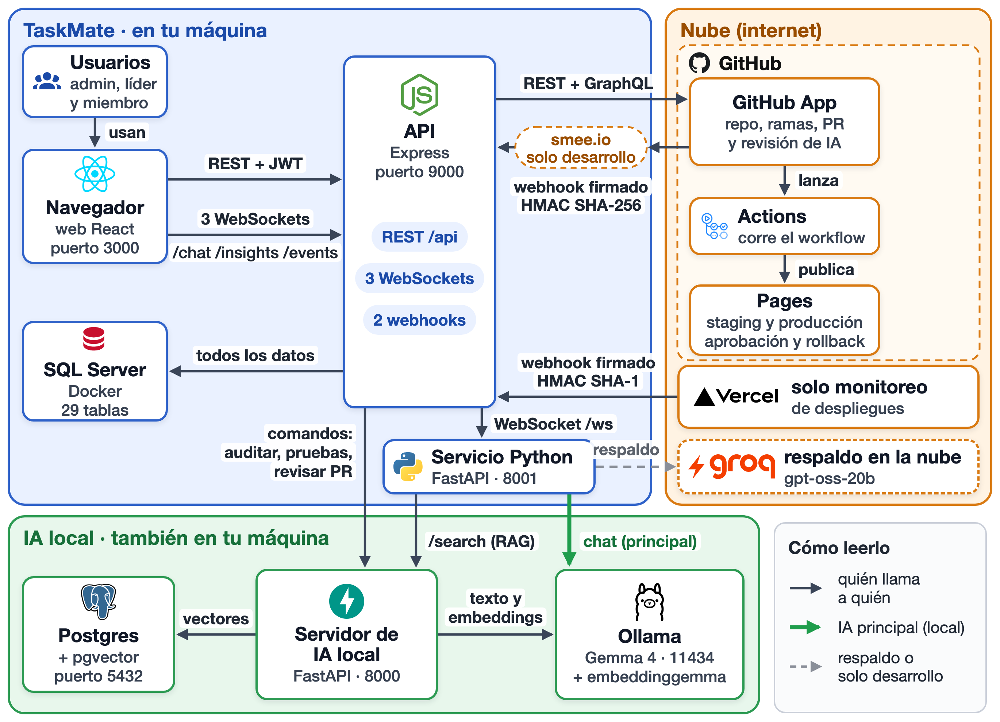

# TaskMate: Plataforma Colaborativa de Gestión de Tareas para Equipos de Desarrollo

**En una frase:** el documento formal del proyecto (objetivos, problema, marco teórico, solución, resultados y conclusiones), actualizado al 26 nov 2026 con las dos líneas de trabajo: la de Pablo, que cerró el 3 nov 2026, y la de Christian, que siguió después.

Qué conecta cada flecha: [arquitectura general](../02-arquitectura/00-general.md).

> **Estado del documento:** actualizado el 26 nov 2026 y contrastado con el código de la rama `test/e2e` (`50f77da`) más los arreglos del 26 nov. La línea de trabajo de Pablo Pineda cerró el 3 nov 2026 al terminar la Fase 4; sus Fases 5–8 no se realizarán. La línea de Christian Martínez siguió con sus fechas corridas: agregó el monitoreo de despliegues en Vercel, los archivos por tarea, el servidor de IA local con la IA sobre el código (auditoría de la rama, pruebas propuestas y revisión de PR), el chat como asistente del proyecto con modelo local y la interfaz en inglés. Ese trabajo entró por la rama `test/e2e` y está en `master` desde el 26 nov 2026, junto con tres arreglos de ese día (el webhook de Vercel ya no puede tumbar la API, una revisión de PR fallida se puede reintentar y ESLint vuelve a 0) y las correcciones del chat de proyecto nuevo del mismo día. Los entregables oficiales (el documento del proyecto y el estudio de factibilidad en PDF/DOCX) se mantienen por separado y no forman parte del control de versiones; esta versión en Markdown es la que acompaña al código. Las limitaciones conocidas y lo que quedó pendiente están en el [cierre de la línea de Pablo y estado](cierre-del-proyecto.md); el detalle de la línea de Christian, en [09-linea-christian](../09-linea-christian/README.md). Resumen de una página: [qué es TaskMate](que-es-taskmate.md).

## Tabla de Contenidos

1. [Objetivos](#objetivos)
2. [Problema](#problema)
3. [Estudio de Factibilidad](#estudio-de-factibilidad)
4. [Marco Teórico](#marco-teórico)
5. [Conceptos](#conceptos)
6. [Solución](#solución)
7. [Diagramas](#diagramas)
8. [Resultados](#resultados)
9. [Conclusiones](#conclusiones)
10. [Recomendaciones](#recomendaciones)
11. [Referencias](#referencias)
12. [Anexos](#anexos)

---

## Objetivos

### Objetivo General

Desarrollar una plataforma web colaborativa de gestión de tareas que integre inteligencia artificial para optimizar la planificación, asignación y seguimiento de proyectos en equipos de desarrollo de software, proporcionando múltiples vistas de visualización, análisis de rendimiento del equipo, la integración con el repositorio, el CI/CD y los despliegues del grupo, y la revisión del código asistida por IA.

### Objetivos Específicos

**Objetivos Funcionales:**
- Implementar un sistema de gestión de tareas con múltiples vistas de visualización (listas de tareas, calendario y diagrama de hitos)
- Desarrollar un sistema de colaboración grupal con gestión de roles y permisos personalizables
- Integrar capacidades de inteligencia artificial para la generación automática de planes de proyecto y recomendaciones de asignación de tareas
- Crear un sistema de análisis y métricas de rendimiento para equipos e individuos
- Establecer comunicación en tiempo real mediante WebSockets para la interacción con el asistente de IA
- Conectar el repositorio de GitHub de cada grupo con sus tareas (agregado en la Fase 3)
- Permitir que el grupo configure y opere el CI/CD de su repositorio sin salir de la plataforma (agregado en la Fase 4)
- Monitorear el ciclo de vida de los despliegues del grupo en Vercel (línea de Christian)
- Mostrar en cada tarea los archivos de código que cambió y las otras tareas que tocan los mismos archivos (línea de Christian)
- Aplicar IA local sobre el código de cada tarea: auditar su rama, proponer pruebas unitarias y revisar su pull request (línea de Christian)
- Convertir el chat en un asistente que responde sobre el proyecto del grupo y arma un plan solo cuando se le pide (línea de Christian)

**Objetivos Técnicos:**
- Diseñar una arquitectura por servicios con separación clara entre frontend, backend, servicio Python del chat y servidor de IA local
- Implementar una base de datos relacional robusta con triggers automáticos para mantener consistencia de datos
- Desarrollar una interfaz de usuario moderna y responsiva utilizando tecnologías web actuales
- Coordinar agentes de IA especializados mediante un servicio propio en Python que se comunica con el backend por WebSocket
- Hacer que la IA de TaskMate funcione con un modelo local (Gemma 4 en Ollama), con un proveedor en la nube (Groq) como respaldo, elegido con una variable de entorno (línea de Christian)
- Establecer un sistema de autenticación y autorización seguro basado en JWT

**Objetivos de Usabilidad:**
- Proporcionar una experiencia de usuario intuitiva que reduzca la curva de aprendizaje
- Ofrecer visualizaciones claras del progreso del proyecto y dependencias entre tareas
- Facilitar la colaboración efectiva entre miembros del equipo con diferentes roles
- Minimizar el tiempo requerido para la planificación y asignación de tareas mediante IA

**Alcance al 26 nov 2026:** la línea de trabajo de Pablo Pineda tenía ocho fases (Anexo A). Se cumplieron las Fases 1–4; los objetivos de las Fases 5–8 (pruebas automáticas por tarea, análisis con SonarQube, algoritmo de colisión de archivos y pruebas finales) no se alcanzaron en esa línea, que cerró el 3 nov 2026. La línea de Christian Martínez tenía nueve puntos: los puntos 1–7 están completos, el 8 (colisión de archivos) está pospuesto con la base hecha y el 9 (pruebas finales, 20–27 nov) está pendiente. Las pruebas que propone la IA no se ejecutan, así que no cubren el objetivo de la Fase 5.

---

## Problema

### Contexto del Problema

En el entorno actual del desarrollo de software, los equipos enfrentan desafíos significativos en la gestión eficiente de proyectos y tareas. La complejidad creciente de los proyectos de software, combinada con la necesidad de colaboración remota y la gestión de equipos multidisciplinarios, ha creado una brecha entre las herramientas tradicionales de gestión de proyectos y las necesidades específicas de los equipos de desarrollo.

### Problemática Identificada

**Fragmentación de Herramientas:**
Los equipos de desarrollo típicamente utilizan múltiples herramientas desconectadas para diferentes aspectos de la gestión de proyectos: tableros Kanban para seguimiento de tareas, calendarios para planificación temporal, diagramas de Gantt para visualización de dependencias, el repositorio, su sistema de CI/CD y la plataforma donde se despliega para el código, y sistemas separados para análisis de rendimiento. Esta fragmentación resulta en pérdida de tiempo, inconsistencias de datos y dificultades para mantener una visión holística del proyecto.

**Planificación Manual Ineficiente:**
La planificación de proyectos tradicionalmente requiere experiencia significativa y tiempo considerable para descomponer ideas de alto nivel en tareas ejecutables. Los gerentes de proyecto deben manualmente analizar requisitos, estimar tiempos, identificar dependencias y asignar recursos, proceso que es propenso a errores humanos y sesgos cognitivos.

**Asignación Subóptima de Tareas:**
La asignación de tareas frecuentemente se basa en disponibilidad inmediata o preferencias personales, sin considerar objetivamente las competencias específicas, historial de rendimiento o carga de trabajo actual de los miembros del equipo. Esto resulta en distribución desigual del trabajo, subutilización de talentos especializados y potencial burnout de ciertos miembros.

**Falta de Visibilidad en Tiempo Real:**
Los sistemas tradicionales proporcionan snapshots estáticos del estado del proyecto, dificultando la identificación temprana de problemas, cuellos de botella o desviaciones del plan original. La falta de métricas en tiempo real impide la toma de decisiones informadas y la adaptación ágil a cambios en los requisitos.

**Limitaciones en Análisis de Rendimiento:**
Las herramientas existentes raramente proporcionan análisis profundos sobre patrones de productividad, áreas de mejora individual o tendencias de equipo. Sin estos insights, es difícil implementar mejoras continuas o identificar oportunidades de desarrollo profesional para los miembros del equipo.

### Justificación del Desarrollo

La necesidad de una solución integrada que aborde estos problemas de manera holística motivó el desarrollo de TaskMate. La convergencia de tecnologías de inteligencia artificial, arquitecturas por servicios e interfaces de usuario modernas presenta una oportunidad para crear una plataforma que no solo consolide las funcionalidades dispersas, sino que también introduzca capacidades inteligentes que superen las limitaciones de los enfoques tradicionales.

La integración de IA en la gestión de proyectos puede transformar la planificación reactiva en planificación asistida, la asignación manual en asignación sugerida por datos, y el seguimiento pasivo en análisis proactivo. TaskMate fue concebido para explorar esta visión, proporcionando a los equipos de desarrollo una herramienta que reúne la planificación, el código y su entrega en un mismo lugar.

---

## Estudio de Factibilidad

El estudio de factibilidad (factibilidad económica, técnica, operativa y de tiempo) se entregó como documento aparte (Entrega 03). Igual que los demás entregables oficiales en PDF/DOCX, se mantiene por separado y no forma parte del repositorio.

---

## Marco Teórico

### Tecnologías Frontend

**React 18**

React representa el framework de JavaScript más ampliamente adoptado para el desarrollo de interfaces de usuario modernas. Su arquitectura basada en componentes y el sistema de hooks proporcionan una base sólida para aplicaciones complejas. TaskMate usa React 18.3 sobre Create React App, con carga diferida de cada vista y de los paneles más pesados (`React.lazy`).

*Ventajas:*
- Ecosistema maduro con amplia documentación y soporte comunitario
- Rendimiento optimizado mediante Virtual DOM y reconciliación eficiente
- Reutilización de componentes que facilita el mantenimiento y escalabilidad
- Integración nativa con herramientas de desarrollo y testing

*Desventajas:*
- Curva de aprendizaje pronunciada para desarrolladores nuevos en el ecosistema
- Requiere configuración adicional para funcionalidades avanzadas
- Actualizaciones frecuentes pueden introducir breaking changes

*Alternativas Consideradas:*
- **Vue.js**: Ofrece sintaxis más simple pero ecosistema menos maduro
- **Angular**: Framework completo pero más pesado y con mayor complejidad
- **Svelte**: Mejor rendimiento pero comunidad y recursos limitados

**Material-UI (MUI)**

Material-UI proporciona componentes pre-construidos siguiendo las directrices de Material Design de Google, acelerando significativamente el desarrollo de interfaces consistentes. TaskMate usa MUI 6 con un tema propio.

*Ventajas:*
- Componentes accesibles y responsivos por defecto
- Theming avanzado y personalización flexible
- Integración perfecta con React y TypeScript
- Documentación exhaustiva y ejemplos prácticos

*Desventajas:*
- Tamaño del bundle puede ser considerable sin tree-shaking apropiado
- Estilo visual puede parecer genérico sin personalización extensa
- Dependencia de JavaScript para estilos puede afectar rendimiento inicial

**React Flow**

React Flow (paquete `@xyflow/react`, versión 12) se especializa en la creación de diagramas interactivos y editores de nodos; en TaskMate sostiene el diagrama de hitos, donde los nodos se conectan como prerrequisito o como progresor.

*Ventajas:*
- Pensado para grafos interactivos con muchos nodos
- API intuitiva para manipulación de nodos y conexiones
- Soporte nativo para diferentes tipos de nodos y edges personalizados
- Integración fluida con React y gestión de estado

*Desventajas:*
- Funcionalidad limitada comparada con bibliotecas especializadas como D3.js
- Personalización avanzada requiere conocimiento profundo de la API
- Documentación limitada para casos de uso complejos

### Tecnologías Backend

**Node.js con Express**

Node.js proporciona un runtime de JavaScript del lado del servidor que permite compartir código y conocimiento entre frontend y backend. La API de TaskMate usa Express 4 con helmet, CORS y límites de solicitudes.

*Ventajas:*
- Ecosistema NPM extenso con paquetes para prácticamente cualquier funcionalidad
- Rendimiento excelente para aplicaciones I/O intensivas
- Desarrollo rápido mediante reutilización de código JavaScript
- Soporte nativo para JSON y APIs RESTful

*Desventajas:*
- Single-threaded puede ser limitante para operaciones CPU-intensivas
- Gestión de memoria requiere atención especial en aplicaciones de larga duración
- Ecosistema en constante cambio puede introducir inestabilidad

*Alternativas Consideradas:*
- **Python con Django/FastAPI**: Mejor para IA pero requiere contexto switching de lenguaje (FastAPI se usó solo para el servicio Python del chat y para el servidor de IA local)
- **Java con Spring Boot**: Más robusto pero desarrollo más lento
- **Go**: Excelente rendimiento pero ecosistema menos maduro

**WebSockets**

La implementación de WebSockets permite comunicación bidireccional en tiempo real. En TaskMate se usa en tres canales: el chat con la IA, las recomendaciones de asignación del panel de analytics y los eventos de CI/CD (ejecuciones, jobs, deploys y solicitudes de producción). En el chat, las respuestas del modelo llegan en streaming, por fragmentos, mientras se generan.

*Ventajas:*
- Latencia mínima para comunicación en tiempo real
- Soporte nativo en navegadores modernos
- Protocolo eficiente para intercambio frecuente de mensajes
- Integración directa con arquitecturas event-driven

*Desventajas:*
- Complejidad adicional en manejo de conexiones y reconexión automática
- Escalabilidad horizontal requiere consideraciones especiales
- Debugging más complejo comparado con HTTP tradicional

### Base de Datos

**SQL Server**

SQL Server fue seleccionado como sistema de gestión de base de datos relacional por su robustez y características empresariales. En desarrollo corre como SQL Server 2019 en un contenedor (Docker o Podman), y el esquema se versiona con migraciones numeradas (001–011).

*Ventajas:*
- ACID compliance garantiza consistencia e integridad de datos
- Triggers y stored procedures permiten lógica de negocio a nivel de base de datos
- Herramientas de administración y monitoreo avanzadas
- Soporte para análisis complejos y reporting

*Desventajas:*
- Licenciamiento puede ser costoso en entornos de producción
- Curva de aprendizaje para optimización de rendimiento
- Menor flexibilidad comparado con bases de datos NoSQL

*Alternativas Consideradas:*
- **PostgreSQL**: Open source pero con menos herramientas empresariales (se usa, con pgvector, solo en el servidor de IA local)
- **MongoDB**: Mayor flexibilidad pero pérdida de consistencia ACID
- **MySQL**: Más ligero pero funcionalidades limitadas para análisis complejos

**PostgreSQL con pgvector (servidor de IA local)**

El servidor de IA local guarda sus documentos, fragmentos y embeddings en su propia base PostgreSQL 17 con la extensión pgvector: 7 tablas, con un índice HNSW por distancia coseno sobre los embeddings. Es una base separada de la de TaskMate y corre en un contenedor de Podman publicado solo en `127.0.0.1`.

*Ventajas:*
- Búsqueda por similitud dentro de una base relacional, sin un servicio vectorial aparte
- Open source y fácil de levantar en un contenedor local
- Los vectores conviven con los metadatos de cada documento y fragmento

*Desventajas:*
- Una segunda base que arrancar, migrar y respaldar
- Dos motores de base de datos distintos dentro del mismo sistema

### Inteligencia Artificial

**Modelo local (Gemma 4 en Ollama)**

Es el modelo que usa TaskMate. Con `LLM_PROVIDER=ollama`, todo lo generativo del servicio Python del chat pasa por Ollama (`127.0.0.1:11434`) con el modelo `gemma4:e2b-it-qat`: el chat, los planes, el análisis del repositorio, el pipeline y analytics. El razonamiento del modelo va desactivado, con un contexto de 8192 tokens, y el modelo queda cargado 30 minutos entre usos. Es el mismo modelo que usa el servidor de IA local, de modo que ambos comparten una sola copia en la GPU. Lo activa `scripts/local-up.sh`, que agrega `LLM_PROVIDER=ollama` al `.env` si la variable no existe; el valor por defecto del código sigue siendo Groq (el respaldo, ver el punto siguiente) para que un checkout sin Ollama siga funcionando.

*Ventajas:*
- Los datos del proyecto no salen de la máquina
- Sin cuotas de tokens ni costo por uso
- El chat funciona sin conexión a internet

*Desventajas:*
- Exige hardware propio (la configuración se dimensionó para una GPU de 4 GB)
- Un modelo pequeño rinde menos que uno grande; por eso el plan de proyecto nuevo pide al menos 8 tareas, con cualquier proveedor
- Los scripts que lo levantan están pensados para Linux

**Groq (respaldo en la nube, modelo openai/gpt-oss-20b)**

Groq queda como respaldo en la nube: es el valor por defecto de `LLM_PROVIDER` en el código, para que un checkout sin Ollama siga funcionando, y requiere `GROQ_API_KEY`. Solo si se usa (`LLM_PROVIDER=groq`), el servicio Python del chat llama a su API con el modelo `openai/gpt-oss-20b` (SDK `groq`, con esfuerzo de razonamiento bajo) para lo mismo que el modelo local: el chat, la clasificación de cada mensaje, la generación de planes de proyecto, las recomendaciones de asignación, el análisis del repositorio y la propuesta del pipeline. En el primer ciclo del proyecto se usó la API de Google Gemini; en marzo de 2026 se migró a Groq.

*Ventajas:*
- Modelos pre-entrenados de alta calidad sin necesidad de entrenamiento propio
- Inferencia rápida y API compatible con el estilo de chat habitual
- No requiere infraestructura propia de GPU
- Se puede cambiar de modelo (`LLM_MODEL`) o de proveedor (`LLM_PROVIDER`) con una variable de entorno

*Desventajas:*
- Dependencia de servicios externos puede introducir puntos de falla
- Cuotas de tokens por minuto que obligan a limitar las solicitudes
- El catálogo de modelos cambia: Groq retiró los modelos Llama 3.x y hubo que cambiar de modelo
- Limitaciones de privacidad para datos sensibles: lo que se manda al modelo sale de la máquina (por eso el análisis del repositorio exige el permiso del admin del grupo)

*Alternativas Consideradas:*
- **Google Gemini**: usado en el primer ciclo
- **API de OpenAI**: modelos similares con costo por uso
- **Modelos locales**: sin dependencia externa pero con exigencias de hardware; se adoptaron en la línea de Christian y hoy son el modelo de TaskMate (ver el punto anterior)

**Servicio Python del chat con agentes especializados**

El servicio Python del chat es un servicio propio (FastAPI, `127.0.0.1:8001`) con un único endpoint WebSocket (`/ws`), autenticado con un secreto compartido (`X-MCP-Secret`). Recibe mensajes JSON propios (`sessionId`, `method`, `params`). Un orquestador clasifica cada mensaje del chat (plan, conversación o fuera de tema) y reparte el trabajo entre cuatro agentes: recomendaciones (planes de proyecto), analytics (asignaciones), análisis del repositorio (Fase 3) y pipeline (Fase 4). Las respuestas de conversación salen en streaming y, cuando no hay un proyecto seleccionado (o el grupo está sin usar) y el servidor de IA local está configurado, se apoyan en su búsqueda de documentos. La carpeta y el servicio se llaman `mcp` por el diseño inicial, inspirado en el Model Context Protocol (MCP), pero el servicio **no implementa ese protocolo**: no usa su SDK, ni JSON-RPC, ni el descubrimiento de herramientas.

*Ventajas:*
- Separación clara de responsabilidades entre agentes
- Un protocolo pequeño y propio, fácil de probar (238 pruebas en Python)
- Las respuestas del modelo se validan antes de llegar al backend (por ejemplo, el pipeline se renderiza desde una plantilla fija)
- El proveedor del modelo se cambia en un solo módulo (`llm_service.py`), sin tocar los agentes

*Desventajas:*
- Un proceso más que arrancar y monitorear
- Al no seguir un estándar, no se integra directamente con herramientas externas compatibles con MCP
- Overhead de comunicación entre el backend y el servicio Python

**Servidor de IA local (taskmate-ai-server)**

El servidor de IA local es un repositorio aparte de Christian Martínez (`taskmate-ai-server`, privado): una API FastAPI en `127.0.0.1:8000` que usa Ollama con `gemma4:e2b-it-qat` para generar y `embeddinggemma:300m` para los embeddings, y que guarda sus datos en PostgreSQL 17 con pgvector. Exige la cabecera `X-AI-Server-Secret` con un secreto de al menos 32 caracteres, y no arranca sin él (salvo que se active a propósito `AI_SERVER_ALLOW_NO_SECRET=1`). Registra diez comandos; TaskMate usa tres desde la API (`audit`, `generate-tests` y `review-pr`, con `POST /commands/{nombre}`), y el servicio Python del chat usa la búsqueda `POST /search` para fundar sus respuestas en documentos del proyecto.

*Ventajas:*
- El código del grupo se analiza sin salir de la máquina
- Combina reglas deterministas con el modelo: la auditoría detecta credenciales, llaves y otros patrones sin depender de la IA
- Las respuestas del chat se apoyan en documentos indexados y no solo en lo que sabe el modelo
- Cada comando deja su ejecución registrada, con argumentos, resultado y duración

*Desventajas:*
- Otro servicio, otra base y otro secreto que operar
- Sus scripts suponen Linux con systemd y Podman
- Los documentos se indexan aparte: TaskMate no llama a la ingesta
- El tiempo de respuesta depende del hardware local

### Integración con GitHub, CI/CD y Despliegues

**GitHub App, GitHub Actions y GitHub Pages**

Desde la Fase 3 TaskMate se conecta al repositorio de cada grupo mediante una GitHub App, y desde la Fase 4 escribe en ese repositorio un workflow de GitHub Actions y publica el sitio en GitHub Pages (staging y producción). En la línea de Christian, además, publica en el PR de cada tarea la revisión hecha por la IA, como comentario y con el permiso opcional *Pull requests: write*.

*Ventajas:*
- La GitHub App pide permisos por repositorio y usa tokens de instalación de corta duración
- Los webhooks firmados permiten reaccionar a PRs abiertos, actualizados y fusionados, y a ejecuciones del CI
- Actions y Pages no requieren servidores propios para el CI/CD del grupo

*Desventajas:*
- Dependencia de las cuotas y del plan de GitHub (por ejemplo, Pages en repositorios privados requiere un plan de pago)
- En desarrollo los webhooks necesitan un relevo (smee) para llegar a la máquina local
- El registro de la App y sus permisos es un paso manual

*Alternativas Consideradas:*
- **Token personal (PAT)**: más simple, pero con permisos amplios ligados a una persona
- **Jenkins o GitLab CI**: más flexibles, pero exigen infraestructura o mover el repositorio

**Vercel (monitoreo de despliegues)**

En la línea de Christian, TaskMate recibe por un webhook firmado (HMAC-SHA1 en la cabecera `x-vercel-signature`) los eventos de despliegue del proyecto de Vercel que el admin vinculó al grupo, y los muestra en la pestaña «Vercel (monitoring)». Solo monitorea: no despliega en Vercel. El esquema admite AWS como proveedor, pero AWS no está implementado.

*Ventajas:*
- Un único endpoint firmado, sin credenciales de Vercel dentro de TaskMate (solo el Project ID y el secreto del webhook)
- Cada evento se registra una sola vez, aunque Vercel lo reenvíe
- Los eventos que llegan fuera de orden no pisan un estado más reciente

*Desventajas:*
- En desarrollo, el webhook necesita un túnel público para llegar a la máquina local
- Los despliegues no se actualizan en vivo en la interfaz
- Falta probarlo con una cuenta real de Vercel ([limitaciones conocidas](cierre-del-proyecto.md#limitaciones-conocidas))

---

## Conceptos

### Gestión de Proyectos Ágiles

La gestión de proyectos ágiles se fundamenta en principios de iteración rápida, colaboración continua y adaptabilidad al cambio. TaskMate incorpora estos principios mediante funcionalidades que facilitan la planificación iterativa, seguimiento continuo del progreso y adaptación rápida a nuevos requisitos.

### Arquitectura por Servicios

TaskMate separa las responsabilidades en tres procesos propios: el frontend de presentación, la API con la lógica de negocio y el servicio Python del chat, más la base de datos SQL Server. El servidor de IA local es un servicio opcional, en un repositorio aparte y con su propia base PostgreSQL: sin él, la IA sobre el código no está disponible y el chat funciona sin la búsqueda de documentos. No es una arquitectura de microservicios completa: la API concentra la lógica de negocio y, como guarda estado en memoria (sesiones de chat con el contexto del proyecto, flujos de instalación de GitHub, límites de solicitudes), debe correr como una sola instancia.

### Inteligencia Artificial Aplicada

La IA aplicada en TaskMate se manifiesta en ocho áreas. Las cuatro primeras vienen de la línea de Pablo: generación automática de planes de proyecto mediante procesamiento de lenguaje natural, recomendaciones de asignación de tareas basadas en competencias y rendimiento histórico, propuesta de las siguientes tareas a partir del repositorio real del grupo, y propuesta del pipeline de CI/CD a partir de lo detectado en el repositorio. Las otras cuatro vienen de la línea de Christian: el chat como asistente que responde con los datos del proyecto, la auditoría de la rama de cada tarea, la propuesta de pruebas unitarias y la revisión de sus pull requests.

### Generación Aumentada por Recuperación (RAG)

La generación aumentada por recuperación combina un modelo de lenguaje con una búsqueda en documentos propios: antes de responder, se recuperan los fragmentos más parecidos a la pregunta y se agregan al prompt como datos. En TaskMate la implementa el servidor de IA local, que divide los documentos en fragmentos y guarda sus embeddings en pgvector. Cuando el chat no tiene un proyecto seleccionado, el servicio Python pide los fragmentos más cercanos al mensaje (hasta 4, con una similitud mínima de 0.3) y le indica al modelo que los trate como datos y no como instrucciones. Si la búsqueda falla, el chat responde sin ella.

### Revisión de Código Asistida por IA

La revisión asistida combina verificaciones deterministas sobre el diff con un modelo que señala problemas de diseño o de mantenimiento. En TaskMate la IA solo aconseja: la auditoría separa los hallazgos de las reglas de los del modelo (marcados «AI, advisory»), las pruebas propuestas no se ejecutan ni se suben al repositorio, y la revisión del PR se publica en GitHub como comentario, nunca como aprobación ni como bloqueo.

### Visualización de Datos Interactiva

La visualización interactiva permite a los usuarios explorar y manipular representaciones gráficas de información compleja. TaskMate implementa varios paradigmas de visualización: listas para gestión detallada, calendario para planificación temporal, diagrama de hitos para comprensión de dependencias y un panel analítico para insights de rendimiento.

### Colaboración en Tiempo Real

La colaboración en tiempo real facilita la coordinación entre miembros de equipo distribuidos. En TaskMate se limita a tres canales WebSocket: el chat con el asistente de IA (con respuestas en streaming), las recomendaciones del panel de analytics y los eventos de CI/CD, que se notifican al instante a los miembros del grupo. Los cambios de tareas, hitos y conexiones no se difunden a los demás clientes, ni tampoco los despliegues de Vercel ni las revisiones de IA: cada vista los lee de la API al cargarse.

### Integración y Entrega Continuas (CI/CD)

La integración continua ejecuta el build, las pruebas y el análisis estático en cada cambio; la entrega continua publica automáticamente las versiones que pasan esas verificaciones. En TaskMate el CI/CD es una funcionalidad del producto para el repositorio de cada grupo: cada cambio en la rama principal que pasa el CI se publica en staging, y producción se actualiza con la aprobación del admin del grupo. Si el grupo despliega en Vercel, TaskMate además registra y muestra el estado de esos despliegues, sin intervenir en ellos.

---

## Solución

TaskMate constituye una plataforma web que unifica la gestión de tareas, la colaboración de equipo, la inteligencia artificial y el trabajo con el repositorio del grupo en una experiencia cohesiva. La solución aborda los problemas identificados mediante una arquitectura modular que separa claramente las preocupaciones mientras mantiene integración entre componentes.

### Componentes Principales

**Frontend Interactivo:**
La interfaz ofrece las vistas Home, Tasks (listas), Calendar, Milestones (diagrama con React Flow), Groups (miembros y roles), Analytics (solo para líderes del equipo), AI Bot (chat con el asistente) y GitHub, con las pestañas Repository, Files, Commits, CI/CD y Vercel (monitoring). Todas trabajan sobre el grupo activo, que el usuario elige con el selector de grupo de la barra de navegación o con un clic en Groups; el chat sigue ese mismo grupo. Cada tarea con rama abre el diálogo «Task files», con sus archivos y el panel «AI on the branch». Desde el 19 nov 2026 los textos de la interfaz están en inglés.

**Backend de Servicios:**
El servidor backend expone 110 rutas REST para las operaciones CRUD y mantiene tres canales WebSocket para el chat, las recomendaciones y los eventos de CI/CD. Incluye autenticación JWT en todas las rutas salvo el registro, el login, el retorno de la instalación de GitHub (autenticado con un `state` firmado) y los webhooks; autorización por grupo (miembro, admin o líder); límites de solicitudes; validación de datos; transacciones para las operaciones de varios pasos y manejo centralizado de errores con códigos estables. Recibe dos webhooks firmados, el de GitHub (HMAC SHA-256) y el de Vercel (HMAC SHA-1), y llama al servidor de IA local para auditar ramas, generar pruebas y revisar PRs.

**Servicios de Inteligencia Artificial:**
La IA se reparte en dos servicios. El servicio Python del chat coordina agentes especializados con un orquestador: el agente de recomendaciones genera planes de proyecto a partir de descripciones de alto nivel; el agente de análisis sugiere asignaciones con los datos reales del equipo; el agente de análisis del repositorio propone las siguientes tareas a partir del código del grupo; y el agente de pipeline elige la configuración del CI/CD entre las opciones que TaskMate detectó. Todos usan el mismo modelo: el local (Gemma 4 en Ollama), o Groq como respaldo en la nube, según `LLM_PROVIDER`. El servidor de IA local, en un repositorio aparte, audita la rama de una tarea, propone pruebas unitarias, revisa pull requests y responde búsquedas sobre los documentos indexados.

**Integración con GitHub, CI/CD y Vercel:**
La API actúa como una GitHub App: conecta el repositorio del grupo, lo explora, crea una rama por tarea y completa la tarea cuando su PR se fusiona. Muestra los archivos que cambió el PR de cada tarea activa y qué otras tareas tocan los mismos. Cuando se abre o se actualiza el PR de una tarea, y el grupo permitió el análisis con IA, lo revisa en segundo plano con el servidor de IA local y publica la revisión como comentario. Para el CI/CD, escribe en el repositorio un workflow generado desde una plantilla fija, consulta las ejecuciones y sus logs en GitHub y lanza los deploys a GitHub Pages. Además, registra los despliegues que Vercel le avisa por webhook para el proyecto vinculado al grupo.

**Capa de Persistencia:**
La base de datos relacional mantiene integridad referencial mediante constraints y triggers automáticos. El esquema tiene 29 tablas: 11 del núcleo de negocio (incluidos los historiales de tareas completadas y eliminadas), 4 de análisis de rendimiento, 6 de GitHub (con el registro de entregas de webhooks), 2 de CI/CD, 3 de despliegues, 1 de archivos por tarea, 1 de revisiones de IA y la tabla de control de migraciones. El servidor de IA local tiene aparte su propia base PostgreSQL con pgvector (7 tablas), que no forma parte de esas 29.

### Flujo de Trabajo Típico

Un usuario inicia sesión y elige su grupo activo en la barra de navegación. Puede crear tareas manualmente o conversar con el asistente de IA, que responde con los datos del grupo: tareas, hitos, equipo, asignaciones y, si el admin lo permitió, el resumen del repositorio. El asistente arma un plan solo cuando el usuario lo pide. Con un grupo seleccionado, el pedido se convierte en un análisis del repositorio que propone las siguientes tareas e hitos (si el grupo no conectó su repositorio o no permitió el análisis con IA, el chat avisa del error); con «New project», sin grupo o con un grupo todavía sin usar (como el grupo personal de una cuenta nueva), genera un plan de proyecto nuevo (grupo, roles, tareas e hitos con fechas), que se guarda como grupo nuevo o, si el usuario es admin del grupo sin usar, en ese grupo. En ambos casos el plan se guarda en una sola transacción y solo al confirmarlo, y queda disponible en las diferentes vistas de la aplicación.

Si el grupo conectó su repositorio, cada miembro puede crear la rama de su tarea desde TaskMate. Al abrir o actualizar el PR de esa rama, la IA local lo revisa y deja su revisión como comentario en GitHub (si el grupo lo permitió y el servidor de IA local está configurado). Desde el diálogo «Task files», el miembro ve los archivos que cambió y qué otras tareas tocan los mismos, y puede pedir una auditoría de la rama o una propuesta de pruebas. Al fusionarse el PR en la rama principal, la tarea se completa sola. Cada cambio que pasa el CI se publica en staging, y un miembro puede solicitar que esa versión pase a producción; el admin la aprueba o la rechaza desde TaskMate, y todo el grupo recibe los avisos en vivo. Si el grupo vinculó su proyecto de Vercel, sus despliegues aparecen en la pestaña «Vercel (monitoring)».

### Despliegue y Arranque

TaskMate se ejecuta en una sola máquina de desarrollo y tiene dos lanzadores:

- **`start.sh`** (pensado para macOS): usa Podman si está disponible y, si no, Docker; inicia el contenedor existente de SQL Server, el servicio Python del chat (`127.0.0.1:8001`) y la API (`:9000`). El frontend se arranca aparte con `npm start` (`:3000`). No aplica migraciones nuevas ni levanta la IA local.
- **`scripts/local-up.sh`** (Linux con Podman, probado en Fedora): levanta en orden la IA local (Ollama en `127.0.0.1:11434` y el servidor de IA local en `127.0.0.1:8000`, con PostgreSQL y pgvector en `127.0.0.1:5432`), SQL Server en `127.0.0.1:1433` con las migraciones pendientes, el servicio Python del chat, la API y el frontend. Si falta el `.env`, lo genera con secretos aleatorios, y agrega `LLM_PROVIDER=ollama` y la URL del servidor de IA local si no están. `scripts/local-down.sh` detiene todo sin borrar datos.

Por defecto, el frontend llama a la API en el mismo host de la página (puerto 9000). Para probar desde otro equipo de la red local existe la opción `ALLOW_LAN_ORIGINS=true`, solo para desarrollo. El detalle de procesos y puertos está en [despliegue](../02-arquitectura/00-despliegue.md), y los pasos, en el [primer arranque](../07-guias/primer-arranque.md).

---

## Diagramas

Los diagramas técnicos están en la carpeta `documentacion/`, versionados junto al código: en Mermaid dentro de cada página y, los de arquitectura, también como imagen generada desde su fuente (`02-arquitectura/fuentes/`). Cada sección tiene una página general y una por módulo; el módulo 10 (IA sobre el código) cubre el servidor de IA local, la auditoría, las pruebas propuestas y la revisión de PR.

### Diagramas generales del sistema

| Diagrama | Página |
|---|---|
| Arquitectura general | [Arquitectura: visión general](../02-arquitectura/00-general.md) |
| Procesos y puertos | [Arquitectura: despliegue](../02-arquitectura/00-despliegue.md) |
| Modelo de datos (ERD) | [Base de datos: visión general](../03-base-de-datos/00-general.md) |
| Casos de uso | [Casos de uso: visión general](../04-casos-de-uso/00-general.md) |
| Mapa de pantallas | [Interfaz: visión general](../05-interfaz/00-general.md) |
| Secuencias de los flujos (por ejemplo, el chat con IA) | [Flujos: visión general](../06-flujos/00-general.md) y [chat con IA](../06-flujos/05-chat-ia.md) |
| IA sobre el código: servidor de IA local, auditoría y revisión de PR | [Arquitectura](../02-arquitectura/10-ia-sobre-el-codigo.md) y [flujos](../06-flujos/10-ia-sobre-el-codigo.md) |

### Diagramas por fase de trabajo

Cada capítulo de fase de la línea de Pablo (carpeta `08-fases/`; ver el [índice de la documentación](../README.md)) incluye los diagramas de esa fase:

| Fase | Diagramas | Capítulo |
|---|---|---|
| 1 | Arquitectura de tres capas | [Fase 1](../08-fases/fase-01-entornos-repositorio-ci/README.md) |
| 2 | Secuencia `deleteTask` antes vs. después; `getWorkloadDistribution()` con el patrón N+1 corregido (estado de marzo de 2026; la Fase 3 reemplazó los borrados por transacciones) | [Fase 2](../08-fases/fase-02-optimizacion-rendimiento/README.md) |
| 3 | Arquitectura con la GitHub App, webhooks y smee; flujo de instalación y vínculo; webhook de PR fusionado → tarea completada; análisis del repositorio con IA en el chat; modelo entidad-relación de las tablas de GitHub | [Fase 3](../08-fases/fase-03-integracion-github/README.md) |
| 4 | TaskMate ↔ GitHub App ↔ Actions ↔ Pages ↔ webhooks ↔ `/events`; solicitud y aprobación de producción; estados de una solicitud de producción; modelo entidad-relación de la migración 007 | [Fase 4](../08-fases/fase-04-pipeline-cicd/README.md) |

La línea de Christian no tiene capítulo en `08-fases/`: su detalle está en [09-linea-christian](../09-linea-christian/README.md), y sus diagramas, en las páginas de los módulos 5 (chat con IA), 7 (GitHub), 8 (CI/CD) y 10 (IA sobre el código) de cada sección.

---

## Resultados

### Resultados por Fase (línea de Pablo Pineda)

| Fase | Resultado | Integración en `master` |
|---|---|---|
| 1. Entornos, repositorio y CI inicial | Monorepo (frontend React, API Express, servicio Python del chat), variables de entorno, scripts de desarrollo y de pruebas, repositorio saneado. El «CI inicial» son scripts de prueba locales: el repositorio de TaskMate no tiene un workflow de CI propio | PR #2 (`7e1610f`, 6 oct 2026) |
| 2. Optimización del rendimiento | Carga diferida de las vistas, menos viajes a la base de datos, consultas en paralelo, corrección de consultas N+1 y heartbeat de WebSocket. Sus mejoras son **estimaciones, no mediciones** | PR #2 (`7e1610f`, 6 oct 2026) |
| 3. Integración con GitHub | GitHub App: conectar el repositorio, explorador, rama por tarea, PR fusionado → tarea completada, tareas propuestas por la IA desde el repositorio. Además: JWT en todas las rutas, autorización por grupo, transacciones y migraciones versionadas | PR #4 (`183f1cb`, 6 oct 2026) |
| 4. Pipeline CI/CD completo | CI/CD del repositorio del grupo desde TaskMate: pipeline propuesto (o por la IA) y subido, ejecuciones y logs en vivo, ejecutar / re-ejecutar / cancelar, staging automático, producción con aprobación del admin en GitHub Pages, rollback y notificaciones | PR #5 (`56f7136`, 22 oct 2026) |
| 5–8 | No se realizaron: la línea de Pablo cerró el 3 nov 2026, y la Fase 6 se canceló en la etapa de plan. La colisión de archivos (Fase 7) sigue en la línea de Christian, pospuesta y con la base hecha | — |

### Resultados de la Línea de Christian Martínez

| # | Punto | Resultado | Dónde está |
|---|---|---|---|
| 1 | Servidor de IA local y modelo de datos | Servicio aparte `taskmate-ai-server`: FastAPI, Ollama y PostgreSQL con pgvector | Repositorio del servidor de IA, `main` (28 ago 2026) |
| 2 | Entrenamiento de IA local y comandos del proyecto | Búsqueda sobre documentos indexados (RAG) y comandos del proyecto (`ask`, `plan`, `ingest-repo`, `changelog`, entre otros) con su historial de ejecuciones; el modelo no se reentrena | Servidor de IA, PR #3 (9 oct 2026) |
| 3 | Integración con Vercel / AWS | Solo monitoreo de Vercel: webhook firmado, migración 009 y pestaña «Vercel (monitoring)». AWS no está implementado | TaskMate `602b1d8` (9 oct 2026), en `test/e2e` desde el 18 nov y en `master` desde el 26 nov |
| 4 | Interfaz de tareas más detallada | Diálogo «Task files»: archivos del PR de la tarea, enlaces a GitHub y otras tareas que tocan los mismos archivos (migración 010) | TaskMate `602b1d8`, en `test/e2e` desde el 18 nov y en `master` desde el 26 nov |
| 5 | Comando `audit` con verificación automática | «Audit» sobre la rama de la tarea: reglas deterministas más el modelo, con veredicto pass, warn o fail | Servidor de IA PR #4; TaskMate `f5c1359` (18 nov 2026) |
| 6 | IA para generar pruebas | «Generate tests»: propone pruebas pytest o Jest para los archivos cambiados; no las ejecuta ni las sube | Servidor de IA PR #7; TaskMate `7d83cdf` (18 nov 2026) |
| 7 | IA revisando pull requests | Revisión automática del PR de cada tarea (webhook) y botón «Review PR»; se guarda en `AiReviews` (migración 011) y se publica como comentario | Servidor de IA PR #8; TaskMate `c2a6833` (18 nov 2026) |
| 8 | Algoritmo de colisión de archivos | Pospuesto. Queda la base: `TaskFiles`, `findTasksTouchingPaths` y `GET /api/github/tasks/:tid/overlaps` | — |
| 9 | Pruebas finales | Pendiente (20–27 nov 2026) | — |

Además de esos puntos, la línea de Christian agregó el chat con el modelo local y streaming (`921f8ed`, 9 oct 2026), el chat como asistente del proyecto (`f152a9e`, 19 nov), la interfaz en inglés con el selector de grupo en la barra de navegación (`d148763`, 19 nov) y la opción `ALLOW_LAN_ORIGINS` (`50f77da`, 25 nov). Del lado de TaskMate todo entró por `test/e2e`, que se fusionó en `master` el 26 nov 2026; los PRs #4–#8 del servidor de IA se fusionaron en su `main` el 25 nov 2026.

### Funcionalidades Implementadas

**Sistema de Autenticación y Autorización:**
Los usuarios se registran (con un grupo personal creado en la misma transacción), inician sesión con un JWT de 24 horas y lo envían en cada solicitud. Desde la Fase 3 todas las rutas REST, salvo el registro, el login, el retorno de la instalación de GitHub y los webhooks firmados, exigen el token; el usuario que actúa siempre sale del token y cada ruta verifica si es miembro, admin o líder del grupo. El sistema de roles personalizables por grupo permite distintos niveles de acceso: por ejemplo, el panel de analytics es solo para líderes del equipo.

**Gestión de Tareas Multivista:**
Las listas de tareas, el calendario y el diagrama de hitos se implementaron sobre los mismos datos del grupo. Los usuarios pueden crear, editar, completar, mandar a la papelera y asignar tareas; completar y mandar a la papelera son operaciones atómicas. En el diagrama de hitos los nodos se conectan como prerrequisito o como progresor, y el avance de un hito se propaga a los que dependen de él. Si la tarea tiene rama, su tarjeta abre el diálogo «Task files» (línea de Christian).

**Sistema de Grupos Colaborativos:**
La funcionalidad de grupos permite crear espacios de trabajo compartidos, agregar miembros, salir del grupo (con sucesión automática del admin) y gestionar proyectos colaborativamente. El sistema de roles personalizables con colores e iconos proporciona flexibilidad organizacional. El grupo activo se cambia desde el selector de la barra de navegación, que también lleva a Groups («Manage groups»).

**Integración de Base de Datos:**
El esquema relacional tiene 29 tablas: 11 del núcleo, 4 de analytics, 6 de GitHub, 2 de CI/CD, 3 de despliegues (`Deployments`, `DeploymentWebhookDeliveries` y `GroupDeployTargets`), 1 de archivos por tarea (`TaskFiles`), 1 de revisiones de IA (`AiReviews`) y la tabla de control de migraciones. Se administra con las migraciones 001–011, cada una con su reversión (`.down.sql`), y con texto Unicode. Los 2 triggers de propagación del porcentaje de los hitos recorren la cadena de dependencias en anchura (hasta 20 niveles). La API se conecta con un login de mínimo privilegio y usa transacciones para toda operación de varios pasos.

**Interfaz de Usuario Moderna:**
La implementación con Material-UI resultó en una interfaz consistente y responsiva, con un tema propio y componentes reutilizables (botón, tarjeta, campo de texto). Desde el 19 nov 2026 la interfaz está en inglés; quedan pocos textos en español (por ejemplo, el botón para vincular el proyecto de Vercel).

**Sistema de Inteligencia Artificial:**
El chat funciona con el modelo local (Gemma 4 en Ollama, `LLM_PROVIDER=ollama`, lo que pone `scripts/local-up.sh`); Groq (`openai/gpt-oss-20b`) queda como respaldo en la nube y es el valor por defecto del código. Desde la línea de Christian es un asistente del proyecto: conversa con normalidad, responde con los datos del grupo elegido en la barra de navegación, muestra la respuesta mientras se escribe y arma un plan solo cuando se le pide. Con un grupo seleccionado, el plan sale del análisis del repositorio (exige el repositorio conectado y «Allow AI analysis»), que también se lanza con el botón «Propose tasks». Con «New project», sin grupo o con un grupo sin usar, la conversación puede apoyarse en los documentos del servidor de IA local, y el plan propone un proyecto nuevo (grupo, roles, al menos 8 tareas e hitos con fechas). En los dos casos el plan se guarda solo al confirmarlo. Cada proyecto conserva su propia conversación. El servicio Python coordina a cuatro agentes especializados, y sus errores llegan al usuario como mensajes claros (por ejemplo, cuando el servicio está ocupado o tarda demasiado).

**Análisis de Rendimiento:**
El panel de analytics muestra, a los líderes del equipo, el resumen del grupo, la carga de trabajo por miembro y la experiencia por categoría de tarea. Las recomendaciones de asignación las genera el agente de IA con los datos reales del equipo (competencias históricas, carga actual y tasa de éxito); su precisión no se midió. Las métricas de experiencia por categoría se actualizan al completar tareas.

**Comunicación en Tiempo Real:**
Tres canales WebSocket, todos autenticados con el token y con el origen verificado: `/chat` (chat con la IA, con respuestas en streaming y una conversación por proyecto que se restaura al reconectar o al volver a ese proyecto), `/insights` (recomendaciones del panel) y `/events` (eventos de CI/CD por grupo). El heartbeat cada 30 segundos, la reconexión automática con espera creciente y el cierre de la conexión al vencer el token mantienen estables las conexiones. Las ediciones de tareas e hitos, los despliegues de Vercel y las revisiones de IA no se difunden en vivo.

**Integración con GitHub (Fase 3):**
El admin conecta el repositorio del grupo instalando la GitHub App; los miembros exploran el árbol, los archivos, el README y los commits; cada tarea puede tener su rama; un PR fusionado en la rama principal completa la tarea de forma atómica y limpia la rama; y, si el admin lo permite («Allow AI analysis»), la IA analiza el repositorio y propone las siguientes tareas e hitos, que se guardan solo al confirmarlos.

**Pipeline CI/CD (Fase 4):**
TaskMate detecta el tipo de proyecto (Node.js, Python o sitio estático) y propone un pipeline con build, pruebas, análisis estático y deploy, que el admin revisa y sube al repositorio; si el grupo lo permite, la propuesta la hace la IA. Los miembros ven las ejecuciones, los logs y las anotaciones con archivo y línea; ejecutan el CI en una rama, re-ejecutan los jobs fallidos y cancelan. Cada cambio que pasa el CI se publica en staging; producción se actualiza cuando el admin despliega o aprueba una solicitud, y admite rollback. El grupo recibe avisos en vivo de pipelines fallidos, deploys y solicitudes.

**Monitoreo de Despliegues en Vercel (línea de Christian):**
El admin del grupo vincula el Project ID de Vercel en la pestaña «Vercel (monitoring)» y agrega en Vercel el webhook de TaskMate. Cada evento firmado (HMAC-SHA1) se registra una sola vez y actualiza el estado del despliegue (Queued, Building, Deployed, Failed o Cancelled), con su rama, commit, URL y, si falló, el mensaje de error. Con el proyecto vinculado, todos los miembros ven los últimos 20 despliegues; la lista se actualiza al abrir la pestaña o con «Refresh».

**Archivos por Tarea (línea de Christian):**
En la tarjeta de una tarea con rama, «View task files» abre el diálogo «Task files»: la lista de archivos del PR de la rama, con su estado, las líneas agregadas y borradas, un enlace a GitHub y el aviso «Also changed by» cuando otra tarea activa del grupo toca el mismo archivo. Es la base del algoritmo de colisión de archivos, que quedó pospuesto. Hoy la lista no se conserva cuando la tarea se completa ([limitaciones conocidas](cierre-del-proyecto.md#limitaciones-conocidas)).

**IA sobre el Código (línea de Christian):**
En el panel «AI on the branch» del mismo diálogo, cualquier miembro puede auditar la rama de la tarea («Audit»), pedir pruebas unitarias propuestas («Generate tests») y, con el PR abierto, pedir su revisión («Review PR»). Además, cada PR abierto o actualizado de una rama de tarea, si no es borrador, se revisa solo en segundo plano. Todo exige que el admin haya activado «Allow AI analysis», y las tres acciones comparten un límite de 5 por minuto por usuario. La API manda al servidor de IA local los cambios de la rama (el diff contra la base del PR o, sin PR, contra la rama por defecto). La revisión se guarda una vez por commit en `AiReviews` (si falla, o queda a medias más de 15 minutos, se puede reintentar con «Review PR» o con el siguiente aviso del mismo commit) y se publica en GitHub como comentario (`COMMENT`), para lo cual la App necesita el permiso *Pull requests: write*.

### Calidad y Verificación

Estado verificado el 26 nov 2026 sobre `master` (`test/e2e` con los arreglos de ese día y las correcciones del chat):

| Verificación | Resultado |
|---|---|
| Pruebas de la API (Jest) | 1355/1355, 54 suites |
| Pruebas del frontend | 448/448, 37 suites |
| Pruebas del servicio Python del chat (pytest) | 238/238, 8 archivos |
| Pruebas de base de datos | 122/122, 10 suites, en un contenedor SQL Server desechable |
| Total | **2163 pruebas**, 0 fallando; eran 1353 al cerrar la Fase 3, 1914 al cerrar la Fase 4, 1960 al cierre de la línea de Pablo (5 nov), 2087 contadas el 25 nov, antes de los arreglos, y 2091 al fusionar en `master` el 26 nov |
| ESLint | 0 problemas (el 25 nov había 1, en `NavGroupSelector.test.jsx`; se corrigió el 26 nov) |
| Build de producción (CRA) | Compilaba el 5 nov, sobre `master`; no se volvió a correr |
| Comprobaciones de solo lectura con la app corriendo | 0 respuestas HTTP 5xx en 50 llamadas GET (3 nov, sobre `master`; no se repitió) |
| Smoke test de UI con Chrome headless | Las rutas se renderizaban como admin y como miembro, sin excepciones no capturadas (3 nov, sobre `master`; no se repitió) |

Las pruebas no llaman de verdad a Groq, Ollama, GitHub, Vercel ni al servidor de IA local: todos se simulan. El servidor de IA local tiene sus propias pruebas en su repositorio, que no se cuentan aquí.

### Optimizaciones Implementadas Durante el Desarrollo

**Rendimiento del Frontend (Fase 2 y línea de Christian):**
Cada vista se carga de forma diferida (`React.lazy` y `Suspense`), de modo que el navegador solo descarga el código de la vista que se abre. En la línea de Christian también se cargan bajo demanda los avisos de CI/CD y los paneles de CI/CD y de Vercel; según la medición de Christian, el paquete inicial bajó de 119.4 a 96.5 kB comprimido.

**Gestión de Conexiones WebSocket y del Modelo:**
El heartbeat agregado en la Fase 2 detecta y cierra las conexiones muertas. Las sesiones de chat desconectadas se conservan una hora para poder retomarlas y después se liberan. Con el modelo local, el servicio Python reutiliza un solo cliente HTTP hacia Ollama y mantiene el modelo cargado 30 minutos.

**Optimización de Base de Datos (Fases 2 y 3):**
La Fase 2 eliminó consultas N+1 y agrupó operaciones; la Fase 3 agregó un índice en cada clave foránea, restricciones UNIQUE y FKs compuestas, y reemplazó los borrados en lote por transacciones (más atómicas, a cambio de más viajes a la base de datos). Las transacciones reintentan en caso de deadlock y responden «base de datos ocupada» si un bloqueo no se libera en 5 segundos. La API usa un pool de conexiones (mínimo 2, máximo 10).

Las mejoras de la Fase 2 son **estimaciones, no mediciones**: no se midió una línea base antes de los cambios.

### Metas de Rendimiento (no medidas)

Estas cifras fueron metas de diseño; ninguna se midió en el proyecto:
- Carga inicial de la aplicación en menos de 2 segundos en una conexión de banda ancha.
- Operaciones CRUD de tareas en menos de 300 ms en promedio.

Tampoco se midió la precisión de las recomendaciones de la IA, la calidad de los planes generados, la de las auditorías, pruebas propuestas y revisiones de PR, ni el ahorro de tiempo de planificación.

### Cambios Realizados Durante el Desarrollo

**Cambio de Proveedor y Arquitectura de IA:**
El primer ciclo usó Google Gemini; en marzo de 2026 se migró a Groq, y en septiembre de 2026 se cambió al modelo `openai/gpt-oss-20b` porque Groq retiró los modelos Llama 3.x. La IA se organizó como agentes especializados detrás de un orquestador, en un servicio propio con un protocolo JSON sobre WebSocket. En la línea de Christian se agregó el modelo local (Gemma 4 en Ollama) como alternativa a Groq, elegida con `LLM_PROVIDER`, y un segundo servicio, el servidor de IA local, para el trabajo sobre el código y la búsqueda de documentos.

**Seguridad y Consistencia (Fase 3):**
Al investigar la integración con GitHub se encontró que la mayoría de las rutas no pedían token y confiaban en el usuario enviado por el cliente, y que varias operaciones de varios pasos no eran atómicas. La Fase 3 corrigió esos problemas: JWT en todas las rutas, autorización por grupo, servicio Python del chat autenticado, transacciones y migraciones versionadas.

**Optimización de Esquema de Base de Datos:**
Se añadieron índices en todas las claves foráneas y restricciones de unicidad (migración 001), texto Unicode (migración 005) y triggers de propagación en anchura (migración 006). La línea de Christian agregó las tablas de despliegues (009), de archivos por tarea (010) y de revisiones de IA (011), sin triggers nuevos.

**Alcance de la Fase 4:**
El primer planteamiento era un pipeline para el repositorio de TaskMate; se corrigió para que el CI/CD fuera una funcionalidad del producto, operada por cada grupo sobre su propio repositorio.

**Del Planificador al Asistente del Proyecto:**
El chat empezó como un planificador que hacía preguntas hasta tener datos para un plan. En la línea de Christian (19 nov 2026) pasó a conversar con normalidad sobre el proyecto y a armar el plan solo cuando se le pide. El mínimo de tareas del plan de proyecto nuevo bajó de 50 a 8, pensando en el modelo local. El 26 nov se agregó «New project», el plan de una cuenta nueva pasó a guardarse en su grupo personal todavía sin usar, cada proyecto conservó su propia conversación y el plan con el modelo local, que fallaba la mitad de las veces, pasó a salir bien en 12 de 12 pruebas con una penalización de repetición, más un reintento.

**Refinamiento de Interfaz de Usuario:**
Se iteró en el diseño de la navegación principal hasta la estructura actual de pestañas horizontales con indicador de estado activo. El 19 nov 2026 la interfaz pasó al inglés, el grupo activo pasó a elegirse desde la barra de navegación y el chat dejó de tener su propio selector de proyecto.

---

## Conclusiones

### Logros Principales

TaskMate logró integrar en una sola plataforma la gestión de tareas en varias vistas, la colaboración por grupos con roles, un asistente de IA que conversa sobre el proyecto y convierte una idea en un plan guardable, el trabajo con el repositorio del grupo y la operación de su CI/CD. La línea de Pablo entregó las Fases 1–4 y cerró el 3 nov 2026; la de Christian agregó el monitoreo de Vercel, los archivos por tarea, el modelo local y la IA sobre el código. Al 26 nov 2026 pasan 2163 pruebas automáticas en las cuatro suites.

La arquitectura modular implementada demostró ser acertada, permitiendo desarrollo independiente de componentes mientras mantiene integración fluida. La separación clara entre frontend, backend, servicio Python del chat y servidor de IA local facilitó el mantenimiento y las pruebas, y permitió que las dos líneas avanzaran sobre el mismo código.

### Validación de Hipótesis Iniciales

La hipótesis de que la integración de IA puede mejorar la eficiencia de la planificación de proyectos se apoya de forma cualitativa: el asistente genera planes estructurados (grupo, roles, tareas e hitos con fechas) a partir de una descripción de alto nivel, y el agente de analytics sugiere asignaciones con datos reales del equipo. No se hizo una medición controlada, así que el ahorro de tiempo y la precisión de las sugerencias quedan sin cuantificar. Lo mismo vale para la IA sobre el código: la utilidad de las auditorías, de las pruebas propuestas y de las revisiones de PR no se midió, ni se comparó la calidad de Groq con la del modelo local.

La suposición de que múltiples vistas mejorarían la comprensión del proyecto no se evaluó con usuarios; las vistas existen y trabajan sobre los mismos datos, pero su efecto en la toma de decisiones queda como hipótesis.

### Impacto en Gestión de Proyectos

TaskMate muestra la viabilidad de una gestión de proyectos asistida por IA y conectada al código: la capacidad de generar planes estructurados automáticamente reduce el trabajo manual de la planificación inicial, y la integración con GitHub hace que el avance de las tareas refleje el trabajo real (un PR fusionado completa la tarea) y que el estado del CI/CD esté a la vista de todo el grupo. La revisión automática de cada PR de tarea lleva una primera lectura del código al mismo lugar donde el equipo ya revisa, sin reemplazar la revisión humana.

La integración de análisis de competencias individuales con recomendaciones de asignación tiene el potencial de optimizar la utilización de recursos humanos y mejorar la satisfacción laboral mediante asignaciones más alineadas con las fortalezas individuales.

### Limitaciones Identificadas

La dependencia de servicios externos introduce puntos de falla y consideraciones de privacidad. GitHub y Vercel siempre son externos; el modelo de IA solo lo es si se usa el respaldo en la nube (Groq), que es el valor por defecto del código cuando falta `LLM_PROVIDER`. Con el modelo local, lo que se manda al modelo no sale de la máquina y el chat funciona sin internet, a cambio de exigir hardware propio y unos scripts pensados para Linux; la IA sobre el código igual necesita GitHub para leer los cambios de la rama. La API debe correr como una sola instancia porque guarda estado en memoria. La lista completa de limitaciones conocidas está en el [cierre de la línea de Pablo y estado](cierre-del-proyecto.md#limitaciones-conocidas).

La curva de aprendizaje para usuarios no familiarizados con herramientas de gestión de proyectos avanzadas puede ser pronunciada, requiriendo inversión en entrenamiento y documentación de usuario.

### Contribuciones Técnicas

El proyecto aporta un ejemplo práctico de coordinación de agentes de IA especializados detrás de un servicio propio, con respuestas validadas antes de afectar los datos: los planes se guardan solo tras la confirmación del usuario, y el pipeline propuesto por la IA se renderiza desde una plantilla fija, de modo que nada de lo que devuelve el modelo se ejecuta como comando. El mismo servicio cambia de proveedor (nube o local) sin tocar los agentes.

También muestra cómo llevar el CI/CD de un equipo dentro de su herramienta de planificación, con control de quién publica en producción (solicitud del miembro y aprobación del admin) y avisos en vivo para todo el grupo.

Por último, la IA sobre el código combina reglas deterministas con un modelo local y se mantiene como asesora: la revisión se publica en GitHub solo como comentario, con el texto escapado y los secretos que detectan las reglas reemplazados por `***`, y las pruebas que propone el modelo nunca se ejecutan.

### Estado de las Líneas de Trabajo

El 3 de noviembre de 2026 el responsable, Pablo Pineda, cerró su línea de trabajo al terminar la Fase 4. Las Fases 5 (testing automático por tarea), 6 (SonarQube, cancelada en la etapa de plan), 7 (algoritmo de colisión de archivos, con Christian Martínez) y 8 (pruebas finales) no se realizarán en esa línea.

La línea de Christian Martínez siguió con sus fechas corridas. Al 26 nov 2026 tiene completos los puntos 1–7, la colisión de archivos pospuesta con la base hecha y las pruebas finales (20–27 nov) pendientes. Su trabajo en TaskMate entró por la rama `test/e2e`, que se fusionó en `master` el 26 nov 2026.

---

## Recomendaciones

### Mejoras Inmediatas

**Completar lo que Quedó Pendiente:**
El trabajo futuro más directo es retomar lo que no se hizo: el ciclo de pruebas automáticas por tarea (Fase 5), que puede partir de las pruebas que hoy la IA solo propone; el análisis estático con SonarQube (Fase 6, con su plan sobre SonarQube Cloud ya definido); el algoritmo de colisión de archivos (Fase 7 de Pablo, punto 8 de Christian), que ya tiene la base en `TaskFiles` y en la consulta de solapes, pero necesita que la lista de archivos se conserve al completarse la tarea; y las pruebas finales (Fase 8 de Pablo, punto 9 de Christian). La lista de pendientes está en el [cierre de la línea de Pablo y estado](cierre-del-proyecto.md#pendientes-todo).

**Expansión de Capacidades de IA:**
Se recomienda medir primero la calidad de las recomendaciones, de los planes generados y de las auditorías y revisiones de PR, comparando el modelo local con el respaldo en la nube (Groq). Luego conviene expandir las capacidades para incluir predicción de riesgos de proyecto, optimización automática de cronogramas y detección temprana de cuellos de botella basándose en patrones históricos de rendimiento.

**Implementación de Modo Offline:**
Con el modelo local, el chat ya funciona sin internet; la IA sobre el código lee los cambios desde GitHub, y el resto de la aplicación depende de la API y de GitHub. Para mejorar la robustez del sistema, se sugiere desarrollar capacidades offline que permitan funcionalidad básica sin conectividad, con sincronización automática cuando la conexión se restablezca.

**Sistema de Notificaciones Avanzado:**
Hoy las notificaciones en la app cubren solo el CI/CD: los despliegues de Vercel y las revisiones de IA no generan avisos en vivo. Se recomienda extenderlas a tareas, plazos, despliegues y revisiones, e integrarlas con notificaciones push del navegador y con el correo.

### Expansiones Funcionales

**Integración con Herramientas Externas:**
GitHub, su CI/CD y el monitoreo de Vercel ya están integrados; AWS está previsto en el esquema, pero sin implementar. Se recomienda agregar conectores para herramientas como Jira y Slack, con sincronización bidireccional de datos.

**Análisis Predictivo Avanzado:**
La implementación de modelos de machine learning para predicción de retrasos, identificación de riesgos de proyecto y optimización de recursos representaría un valor agregado significativo para equipos de gestión.

**Personalización de Flujos de Trabajo:**
Permitir a los equipos definir flujos de trabajo personalizados con estados, transiciones y reglas de negocio específicas aumentaría la adaptabilidad de la plataforma a diferentes metodologías de desarrollo.

### Consideraciones de Escalabilidad

**Estado Compartido y Varias Instancias:**
Para correr más de una instancia de la API hay que mover a un almacén compartido el estado que hoy vive en memoria (sesiones de chat y su contexto del proyecto, flujos de instalación de GitHub, contadores de límites, suscripciones de eventos). Es el paso previo a cualquier escalamiento horizontal.

**Arquitectura de Microservicios Completa:**
Para soportar organizaciones grandes, se recomienda evaluar una arquitectura de microservicios con servicios independientes para autenticación, gestión de tareas, análisis y comunicación.

**Implementación de Caching Distribuido:**
La integración de sistemas de cache como Redis mejoraría el rendimiento para consultas frecuentes, reduciría la carga en la base de datos principal y serviría también como el almacén compartido del punto anterior.

**Monitoreo y Observabilidad:**
La implementación de sistemas de logging estructurado, métricas de aplicación y tracing distribuido es esencial para mantener calidad de servicio en entornos de producción, y permitiría medir las metas de rendimiento que hoy no están verificadas.

### Mejoras de Experiencia de Usuario

**Onboarding Interactivo:**
Se sugiere desarrollar un sistema de tutorial interactivo que guíe a nuevos usuarios a través de las funcionalidades principales, reduciendo la barrera de entrada y acelerando la adopción.

**Personalización de Interfaz:**
Permitir a los usuarios personalizar layouts, temas y configuraciones de vista mejoraría la satisfacción de usuario y productividad individual. El idioma ya se unificó en inglés el 19 nov 2026, salvo unos pocos textos; el paso siguiente sería ofrecer la interfaz en varios idiomas.

**Accesibilidad Mejorada:**
Se recomienda una auditoría completa de accesibilidad y mejoras para soportar usuarios con diferentes capacidades.

### Consideraciones de Seguridad

**Auditoría de Seguridad Completa:**
Se recomienda realizar una auditoría de seguridad profesional que incluya testing de penetración, revisión de código y análisis de vulnerabilidades antes del despliegue en producción, incluidos el webhook de Vercel y los datos que se mandan al servidor de IA local ([limitaciones conocidas](cierre-del-proyecto.md#limitaciones-conocidas)).

**Implementación de RBAC Granular:**
El sistema actual de roles puede expandirse hacia un modelo de control de acceso basado en roles más granular que permita permisos específicos por funcionalidad.

**Encriptación de Datos Sensibles:**
La implementación de encriptación end-to-end para datos sensibles de proyecto y comunicaciones de equipo sería apropiada para entornos corporativos con requisitos de compliance estrictos.

---

## Referencias

Agile Alliance. (2001). *Manifesto for Agile Software Development*. https://agilemanifesto.org/

Anthropic. (2024). *Model Context Protocol*. https://modelcontextprotocol.io/

Atlassian. (2023). *Project Management Best Practices Guide*. Atlassian Documentation.

Fowler, M. (2014). *Microservices: A definition of this new architectural term*. Martin Fowler's Blog. https://martinfowler.com/articles/microservices.html

GitHub. (s. f.). *GitHub Actions documentation*. GitHub Docs. https://docs.github.com/en/actions

GitHub. (s. f.). *GitHub Apps documentation*. GitHub Docs. https://docs.github.com/en/apps

GitHub. (s. f.). *GitHub Pages documentation*. GitHub Docs. https://docs.github.com/en/pages

Google. (2024). *Gemini API Documentation*. Google AI Platform. https://ai.google.dev/docs

Google. (s. f.). *Gemma documentation*. Google AI for Developers. https://ai.google.dev/gemma/docs

Groq. (s. f.). *GroqCloud Documentation*. https://console.groq.com/docs

IEEE Computer Society. (2017). *IEEE Standard for Software Engineering - Software Life Cycle Processes*. IEEE Std 12207-2017.

Lewis, P., Perez, E., Piktus, A., Petroni, F., Karpukhin, V., Goyal, N., Küttler, H., Lewis, M., Yih, W., Rocktäschel, T., Riedel, S., & Kiela, D. (2020). *Retrieval-Augmented Generation for Knowledge-Intensive NLP Tasks*. Advances in Neural Information Processing Systems 33 (NeurIPS 2020).

Meta. (2024). *React Documentation*. React Official Documentation. https://react.dev/

Microsoft. (2023). *SQL Server Documentation*. Microsoft Docs. https://docs.microsoft.com/en-us/sql/

Mozilla Developer Network. (2024). *WebSocket API*. MDN Web Docs. https://developer.mozilla.org/en-US/docs/Web/API/WebSocket

Node.js Foundation. (2024). *Node.js Documentation*. Node.js Official Documentation. https://nodejs.org/docs/

Ollama. (s. f.). *Ollama API documentation*. https://github.com/ollama/ollama/blob/main/docs/api.md

pgvector. (s. f.). *pgvector: Open-source vector similarity search for Postgres*. https://github.com/pgvector/pgvector

PostgreSQL Global Development Group. (s. f.). *PostgreSQL Documentation*. https://www.postgresql.org/docs/

Project Management Institute. (2021). *A Guide to the Project Management Body of Knowledge (PMBOK Guide)*. 7th Edition. PMI Publications.

Ramírez, S. (s. f.). *FastAPI Documentation*. https://fastapi.tiangolo.com/

Richardson, C. (2018). *Microservices Patterns: With Examples in Java*. Manning Publications.

Schwaber, K., & Sutherland, J. (2020). *The Scrum Guide*. Scrum.org.

Vercel. (s. f.). *Webhooks*. Vercel Documentation. https://vercel.com/docs/webhooks

W3C. (2023). *Web Content Accessibility Guidelines (WCAG) 2.2*. World Wide Web Consortium.

xyflow. (s. f.). *React Flow Documentation*. https://reactflow.dev/

---

## Anexos

### Anexo A: Calendarización Original del Proyecto

La planificación temporal de las dos líneas se encuentra en la [calendarización](calendarizacion.md): la de Pablo Pineda (ocho fases, con la Fase 7 junto con Christian Martínez) y la de Christian Martínez (nueve puntos).

### Anexo B: Calendarización Final del Proyecto

La línea de Pablo cerró el 3 nov 2026, al terminar la Fase 4; la de Christian siguió con sus fechas corridas. Las fechas planificadas son las de la calendarización (Anexo A) y no se modifican; las fechas reales de la línea de Pablo son las que registra cada capítulo de fase, y las de la línea de Christian salen de sus commits.

**Línea de Pablo Pineda:**

| Fase | Fechas planificadas (2026) | Fechas reales | Estado final |
|---|---|---|---|
| 1. Entornos, repositorio y CI inicial | 14–21 ago | Antes de la calendarización: setup y limpieza del repositorio el 10–12 mar 2026; documentada de forma retroactiva el 31 ago 2026 | ✅ Hecha · PR #2 (`7e1610f`, 6 oct 2026) |
| 2. Optimización del rendimiento | 21 ago – 4 sep | Código del 10–12 mar 2026; documentada de forma retroactiva | ✅ Hecha · PR #2 (`7e1610f`, 6 oct 2026) |
| 3. Integración con GitHub | 4–18 sep | 10–11 sep 2026; E2E con GitHub real y correcciones el 5–6 oct 2026 | ✅ Hecha · PR #4 (`183f1cb`, 6 oct 2026) |
| 4. Pipeline CI/CD completo | 18 sep – 9 oct | 9–22 oct 2026 | ✅ Hecha · PR #5 (`56f7136`, 22 oct 2026) |
| 5. Testing automático | 9–23 oct | — | No se realizará (la línea de Pablo cerró el 3 nov 2026) |
| 6. Integración con SonarQube | 23 oct – 6 nov | — | Cancelada en la etapa de plan (plan aprobado con SonarQube Cloud, sin código) |
| 7. Algoritmo de colisión de archivos (con Christian Martínez) | 6–20 nov | — | No se realizará en la línea de Pablo; en la de Christian está pospuesta, con la base hecha |
| 8. Pruebas finales | 20–27 nov | — | No se realizará (la línea de Pablo cerró el 3 nov 2026) |

**Desviaciones respecto al Anexo A (línea de Pablo):**
- Las Fases 1 y 2 se hicieron antes de que existiera la calendarización y se mapearon a sus ventanas después.
- La Fase 3 se implementó dentro de su ventana (10–11 sep), pero se fusionó el 6 oct, después de las pruebas E2E con GitHub real.
- La Fase 4 empezó el último día de su ventana (9 oct) y terminó el 22 oct, 13 días después de la fecha planificada.
- La línea de Pablo cerró el 3 nov 2026, dentro de la ventana de la Fase 6; las Fases 5–8 no se realizaron. La Fase 8 no se hizo como fase: al cierre de la línea pasaban 1960 pruebas automáticas (5 nov), y al 26 nov pasan 2163.

**Línea de Christian Martínez:**

| # | Punto | Fechas planificadas (2026) | Fechas reales | Estado al 26 nov 2026 |
|---|---|---|---|---|
| 1 | Servidor de IA local y modelo de datos | 14–21 ago | 28 ago 2026 | ✅ Completo |
| 2 | Entrenamiento de IA local y comandos del proyecto | 21 ago – 11 sep | Fusionado el 9 oct 2026 (PR #3 del servidor de IA) | ✅ Completo |
| 3 | Integración con Vercel / AWS | 11–18 sep | 9 oct 2026; en `test/e2e` el 18 nov y en `master` el 26 nov | ✅ Solo monitoreo de Vercel |
| 4 | Interfaz de tareas más detallada | 18–25 sep | 9 oct 2026; en `test/e2e` el 18 nov y en `master` el 26 nov | ✅ Completo |
| 5 | Comando `audit` con verificación automática | 25 sep – 9 oct | Comando el 9 oct 2026; conexión con TaskMate el 18 nov | ✅ Completo |
| 6 | IA para generar pruebas | 9–23 oct | 18 nov 2026 | ✅ Completo (propone, no ejecuta) |
| 7 | IA revisando pull requests | 23 oct – 6 nov | 18–19 nov 2026 | ✅ Completo |
| 8 | Algoritmo de colisión de archivos | 6–20 nov | — | ⏸️ Pospuesto, con la base hecha |
| 9 | Pruebas finales | 20–27 nov | — | ⏳ Pendiente |

El detalle de cada fase de Pablo está en el [índice de la documentación](../README.md), el de la línea de Christian en [09-linea-christian](../09-linea-christian/README.md) y el estado actual en el [cierre de la línea de Pablo y estado](cierre-del-proyecto.md).
