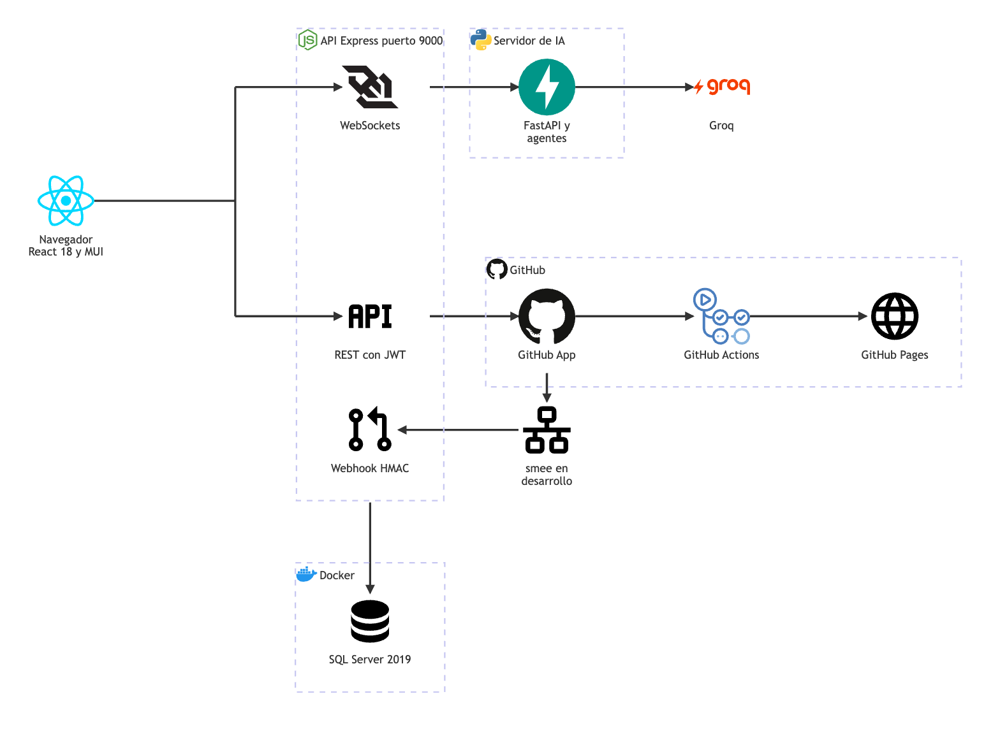

# TaskMate: Plataforma Colaborativa de Gestión de Tareas para Equipos de Desarrollo

**En una frase:** el documento formal del proyecto (objetivos, problema, marco teórico, solución, resultados y conclusiones), actualizado al cierre del 3 nov 2026.

Qué conecta cada flecha: [arquitectura general](../02-arquitectura/00-general.md).

> **Estado del documento:** actualizado al cierre del proyecto (3 nov 2026). El proyecto se cerró al terminar la Fase 4; las Fases 5–8 no se realizarán. Los entregables oficiales (el documento del proyecto y el estudio de factibilidad en PDF/DOCX) se mantienen por separado y no forman parte del control de versiones; esta versión en Markdown es la que acompaña al código. Las limitaciones conocidas y lo que quedó pendiente están en el [cierre del proyecto](cierre-del-proyecto.md). Resumen de una página: [qué es TaskMate](que-es-taskmate.md).

## Tabla de Contenidos

1. [Objetivos](#objetivos)
2. [Problema](#problema)
3. [Estudio de Factibilidad](#estudio-de-factibilidad)
4. [Marco Teórico](#marco-teórico)
5. [Conceptos](#conceptos)
6. [Solución](#solución)
7. [Diagramas](#diagramas)
8. [Resultados](#resultados)
9. [Conclusiones](#conclusiones)
10. [Recomendaciones](#recomendaciones)
11. [Referencias](#referencias)
12. [Anexos](#anexos)

---

## Objetivos

### Objetivo General

Desarrollar una plataforma web colaborativa de gestión de tareas que integre inteligencia artificial para optimizar la planificación, asignación y seguimiento de proyectos en equipos de desarrollo de software, proporcionando múltiples vistas de visualización, análisis de rendimiento del equipo y la integración con el repositorio y el CI/CD del grupo.

### Objetivos Específicos

**Objetivos Funcionales:**
- Implementar un sistema de gestión de tareas con múltiples vistas de visualización (listas de tareas, calendario y diagrama de hitos)
- Desarrollar un sistema de colaboración grupal con gestión de roles y permisos personalizables
- Integrar capacidades de inteligencia artificial para la generación automática de planes de proyecto y recomendaciones de asignación de tareas
- Crear un sistema de análisis y métricas de rendimiento para equipos e individuos
- Establecer comunicación en tiempo real mediante WebSockets para la interacción con el asistente de IA
- Conectar el repositorio de GitHub de cada grupo con sus tareas (agregado en la Fase 3)
- Permitir que el grupo configure y opere el CI/CD de su repositorio sin salir de la plataforma (agregado en la Fase 4)

**Objetivos Técnicos:**
- Diseñar una arquitectura por servicios con separación clara entre frontend, backend y servidor de IA
- Implementar una base de datos relacional robusta con triggers automáticos para mantener consistencia de datos
- Desarrollar una interfaz de usuario moderna y responsiva utilizando tecnologías web actuales
- Coordinar agentes de IA especializados mediante un servidor propio que se comunica con el backend por WebSocket
- Establecer un sistema de autenticación y autorización seguro basado en JWT

**Objetivos de Usabilidad:**
- Proporcionar una experiencia de usuario intuitiva que reduzca la curva de aprendizaje
- Ofrecer visualizaciones claras del progreso del proyecto y dependencias entre tareas
- Facilitar la colaboración efectiva entre miembros del equipo con diferentes roles
- Minimizar el tiempo requerido para la planificación y asignación de tareas mediante IA

**Alcance al cierre:** la línea de trabajo de 2026 tenía ocho fases (Anexo A). Se cumplieron las Fases 1–4. Los objetivos de las Fases 5–8 (pruebas automáticas por tarea, análisis con SonarQube, algoritmo de colisión de archivos y pruebas finales) no se alcanzaron porque el proyecto se cerró el 3 nov 2026.

---

## Problema

### Contexto del Problema

En el entorno actual del desarrollo de software, los equipos enfrentan desafíos significativos en la gestión eficiente de proyectos y tareas. La complejidad creciente de los proyectos de software, combinada con la necesidad de colaboración remota y la gestión de equipos multidisciplinarios, ha creado una brecha entre las herramientas tradicionales de gestión de proyectos y las necesidades específicas de los equipos de desarrollo.

### Problemática Identificada

**Fragmentación de Herramientas:**
Los equipos de desarrollo típicamente utilizan múltiples herramientas desconectadas para diferentes aspectos de la gestión de proyectos: tableros Kanban para seguimiento de tareas, calendarios para planificación temporal, diagramas de Gantt para visualización de dependencias, el repositorio y su sistema de CI/CD para el código, y sistemas separados para análisis de rendimiento. Esta fragmentación resulta en pérdida de tiempo, inconsistencias de datos y dificultades para mantener una visión holística del proyecto.

**Planificación Manual Ineficiente:**
La planificación de proyectos tradicionalmente requiere experiencia significativa y tiempo considerable para descomponer ideas de alto nivel en tareas ejecutables. Los gerentes de proyecto deben manualmente analizar requisitos, estimar tiempos, identificar dependencias y asignar recursos, proceso que es propenso a errores humanos y sesgos cognitivos.

**Asignación Subóptima de Tareas:**
La asignación de tareas frecuentemente se basa en disponibilidad inmediata o preferencias personales, sin considerar objetivamente las competencias específicas, historial de rendimiento o carga de trabajo actual de los miembros del equipo. Esto resulta en distribución desigual del trabajo, subutilización de talentos especializados y potencial burnout de ciertos miembros.

**Falta de Visibilidad en Tiempo Real:**
Los sistemas tradicionales proporcionan snapshots estáticos del estado del proyecto, dificultando la identificación temprana de problemas, cuellos de botella o desviaciones del plan original. La falta de métricas en tiempo real impide la toma de decisiones informadas y la adaptación ágil a cambios en los requisitos.

**Limitaciones en Análisis de Rendimiento:**
Las herramientas existentes raramente proporcionan análisis profundos sobre patrones de productividad, áreas de mejora individual o tendencias de equipo. Sin estos insights, es difícil implementar mejoras continuas o identificar oportunidades de desarrollo profesional para los miembros del equipo.

### Justificación del Desarrollo

La necesidad de una solución integrada que aborde estos problemas de manera holística motivó el desarrollo de TaskMate. La convergencia de tecnologías de inteligencia artificial, arquitecturas por servicios e interfaces de usuario modernas presenta una oportunidad para crear una plataforma que no solo consolide las funcionalidades dispersas, sino que también introduzca capacidades inteligentes que superen las limitaciones de los enfoques tradicionales.

La integración de IA en la gestión de proyectos puede transformar la planificación reactiva en planificación asistida, la asignación manual en asignación sugerida por datos, y el seguimiento pasivo en análisis proactivo. TaskMate fue concebido para explorar esta visión, proporcionando a los equipos de desarrollo una herramienta que reúne la planificación, el código y su entrega en un mismo lugar.

---

## Estudio de Factibilidad

El estudio de factibilidad (factibilidad económica, técnica, operativa y de tiempo) se entregó como documento aparte (Entrega 03). Igual que los demás entregables oficiales en PDF/DOCX, se mantiene por separado y no forma parte del repositorio.

---

## Marco Teórico

### Tecnologías Frontend

**React 18**

React representa el framework de JavaScript más ampliamente adoptado para el desarrollo de interfaces de usuario modernas. Su arquitectura basada en componentes y el sistema de hooks proporcionan una base sólida para aplicaciones complejas. TaskMate usa React 18.3 sobre Create React App, con carga diferida de cada vista (`React.lazy`).

*Ventajas:*
- Ecosistema maduro con amplia documentación y soporte comunitario
- Rendimiento optimizado mediante Virtual DOM y reconciliación eficiente
- Reutilización de componentes que facilita el mantenimiento y escalabilidad
- Integración nativa con herramientas de desarrollo y testing

*Desventajas:*
- Curva de aprendizaje pronunciada para desarrolladores nuevos en el ecosistema
- Requiere configuración adicional para funcionalidades avanzadas
- Actualizaciones frecuentes pueden introducir breaking changes

*Alternativas Consideradas:*
- **Vue.js**: Ofrece sintaxis más simple pero ecosistema menos maduro
- **Angular**: Framework completo pero más pesado y con mayor complejidad
- **Svelte**: Mejor rendimiento pero comunidad y recursos limitados

**Material-UI (MUI)**

Material-UI proporciona componentes pre-construidos siguiendo las directrices de Material Design de Google, acelerando significativamente el desarrollo de interfaces consistentes. TaskMate usa MUI 6 con un tema propio.

*Ventajas:*
- Componentes accesibles y responsivos por defecto
- Theming avanzado y personalización flexible
- Integración perfecta con React y TypeScript
- Documentación exhaustiva y ejemplos prácticos

*Desventajas:*
- Tamaño del bundle puede ser considerable sin tree-shaking apropiado
- Estilo visual puede parecer genérico sin personalización extensa
- Dependencia de JavaScript para estilos puede afectar rendimiento inicial

**React Flow**

React Flow (paquete `@xyflow/react`, versión 12) se especializa en la creación de diagramas interactivos y editores de nodos; en TaskMate sostiene el diagrama de hitos, donde los nodos se conectan como prerrequisito o como progresor.

*Ventajas:*
- Pensado para grafos interactivos con muchos nodos
- API intuitiva para manipulación de nodos y conexiones
- Soporte nativo para diferentes tipos de nodos y edges personalizados
- Integración fluida con React y gestión de estado

*Desventajas:*
- Funcionalidad limitada comparada con bibliotecas especializadas como D3.js
- Personalización avanzada requiere conocimiento profundo de la API
- Documentación limitada para casos de uso complejos

### Tecnologías Backend

**Node.js con Express**

Node.js proporciona un runtime de JavaScript del lado del servidor que permite compartir código y conocimiento entre frontend y backend. La API de TaskMate usa Express 4 con helmet, CORS y límites de solicitudes.

*Ventajas:*
- Ecosistema NPM extenso con paquetes para prácticamente cualquier funcionalidad
- Rendimiento excelente para aplicaciones I/O intensivas
- Desarrollo rápido mediante reutilización de código JavaScript
- Soporte nativo para JSON y APIs RESTful

*Desventajas:*
- Single-threaded puede ser limitante para operaciones CPU-intensivas
- Gestión de memoria requiere atención especial en aplicaciones de larga duración
- Ecosistema en constante cambio puede introducir inestabilidad

*Alternativas Consideradas:*
- **Python con Django/FastAPI**: Mejor para IA pero requiere contexto switching de lenguaje (FastAPI se usó solo para el servidor de IA)
- **Java con Spring Boot**: Más robusto pero desarrollo más lento
- **Go**: Excelente rendimiento pero ecosistema menos maduro

**WebSockets**

La implementación de WebSockets permite comunicación bidireccional en tiempo real. En TaskMate se usa en tres canales: el chat con la IA, las recomendaciones de asignación del panel de analytics y los eventos de CI/CD (ejecuciones, jobs, deploys y solicitudes de producción).

*Ventajas:*
- Latencia mínima para comunicación en tiempo real
- Soporte nativo en navegadores modernos
- Protocolo eficiente para intercambio frecuente de mensajes
- Integración directa con arquitecturas event-driven

*Desventajas:*
- Complejidad adicional en manejo de conexiones y reconexión automática
- Escalabilidad horizontal requiere consideraciones especiales
- Debugging más complejo comparado con HTTP tradicional

### Base de Datos

**SQL Server**

SQL Server fue seleccionado como sistema de gestión de base de datos relacional por su robustez y características empresariales. En desarrollo corre como SQL Server 2019 en un contenedor Docker, y el esquema se versiona con migraciones numeradas.

*Ventajas:*
- ACID compliance garantiza consistencia e integridad de datos
- Triggers y stored procedures permiten lógica de negocio a nivel de base de datos
- Herramientas de administración y monitoreo avanzadas
- Soporte para análisis complejos y reporting

*Desventajas:*
- Licenciamiento puede ser costoso en entornos de producción
- Curva de aprendizaje para optimización de rendimiento
- Menor flexibilidad comparado con bases de datos NoSQL

*Alternativas Consideradas:*
- **PostgreSQL**: Open source pero con menos herramientas empresariales
- **MongoDB**: Mayor flexibilidad pero pérdida de consistencia ACID
- **MySQL**: Más ligero pero funcionalidades limitadas para análisis complejos

### Inteligencia Artificial

**Groq (modelo openai/gpt-oss-20b)**

TaskMate usa la API de Groq con el modelo `openai/gpt-oss-20b` (SDK `groq`, con esfuerzo de razonamiento bajo) para el chat, la generación de planes de proyecto, las recomendaciones de asignación, el análisis del repositorio y la propuesta del pipeline. En el primer ciclo del proyecto se usó la API de Google Gemini; en marzo de 2026 se migró a Groq.

*Ventajas:*
- Modelos pre-entrenados de alta calidad sin necesidad de entrenamiento propio
- Inferencia rápida y API compatible con el estilo de chat habitual
- No requiere infraestructura propia de GPU
- Se puede cambiar de modelo con una variable de entorno (`LLM_MODEL`)

*Desventajas:*
- Dependencia de servicios externos puede introducir puntos de falla
- Cuotas de tokens por minuto que obligan a limitar las solicitudes
- El catálogo de modelos cambia: Groq retiró los modelos Llama 3.x y hubo que cambiar de modelo
- Limitaciones de privacidad para datos sensibles (por eso el análisis del repositorio exige el permiso del admin del grupo)

*Alternativas Consideradas:*
- **Google Gemini**: usado en el primer ciclo
- **API de OpenAI**: modelos similares con costo por uso
- **Modelos locales**: sin dependencia externa pero con exigencias de hardware

**Servidor de IA con agentes especializados**

El servidor de IA es un servicio propio en Python (FastAPI) con un único endpoint WebSocket (`/ws`), autenticado con un secreto compartido. Recibe mensajes JSON propios (`sessionId`, `method`, `params`) y un orquestador los reparte entre cuatro agentes: recomendaciones (planes de proyecto), analytics (asignaciones), análisis del repositorio (Fase 3) y pipeline (Fase 4). La carpeta y el servicio se llaman `mcp` por el diseño inicial, inspirado en el Model Context Protocol (MCP), pero el servidor **no implementa ese protocolo**: no usa su SDK, ni JSON-RPC, ni el descubrimiento de herramientas.

*Ventajas:*
- Separación clara de responsabilidades entre agentes
- Un protocolo pequeño y propio, fácil de probar (177 pruebas en Python)
- Las respuestas del modelo se validan antes de llegar al backend (por ejemplo, el pipeline se renderiza desde una plantilla fija)

*Desventajas:*
- Un proceso más que arrancar y monitorear
- Al no seguir un estándar, no se integra directamente con herramientas externas compatibles con MCP
- Overhead de comunicación entre el backend y el servidor de IA

### Integración con GitHub y CI/CD

**GitHub App, GitHub Actions y GitHub Pages**

Desde la Fase 3 TaskMate se conecta al repositorio de cada grupo mediante una GitHub App, y desde la Fase 4 escribe en ese repositorio un workflow de GitHub Actions y publica el sitio en GitHub Pages (staging y producción).

*Ventajas:*
- La GitHub App pide permisos por repositorio y usa tokens de instalación de corta duración
- Los webhooks firmados permiten reaccionar a PRs fusionados y a ejecuciones del CI
- Actions y Pages no requieren servidores propios para el CI/CD del grupo

*Desventajas:*
- Dependencia de las cuotas y del plan de GitHub (por ejemplo, Pages en repositorios privados requiere un plan de pago)
- En desarrollo los webhooks necesitan un relevo (smee) para llegar a la máquina local
- El registro de la App y sus permisos es un paso manual

*Alternativas Consideradas:*
- **Token personal (PAT)**: más simple, pero con permisos amplios ligados a una persona
- **Jenkins o GitLab CI**: más flexibles, pero exigen infraestructura o mover el repositorio

---

## Conceptos

### Gestión de Proyectos Ágiles

La gestión de proyectos ágiles se fundamenta en principios de iteración rápida, colaboración continua y adaptabilidad al cambio. TaskMate incorpora estos principios mediante funcionalidades que facilitan la planificación iterativa, seguimiento continuo del progreso y adaptación rápida a nuevos requisitos.

### Arquitectura por Servicios

TaskMate separa las responsabilidades en tres procesos propios: el frontend de presentación, la API con la lógica de negocio y el servidor de IA, más la base de datos. No es una arquitectura de microservicios completa: la API concentra la lógica de negocio y, como guarda estado en memoria (sesiones de chat, flujos de instalación de GitHub, límites de solicitudes), debe correr como una sola instancia.

### Inteligencia Artificial Aplicada

La IA aplicada en TaskMate se manifiesta en cuatro áreas: generación automática de planes de proyecto mediante procesamiento de lenguaje natural, recomendaciones de asignación de tareas basadas en competencias y rendimiento histórico, propuesta de las siguientes tareas a partir del repositorio real del grupo, y propuesta del pipeline de CI/CD a partir de lo detectado en el repositorio.

### Visualización de Datos Interactiva

La visualización interactiva permite a los usuarios explorar y manipular representaciones gráficas de información compleja. TaskMate implementa varios paradigmas de visualización: listas para gestión detallada, calendario para planificación temporal, diagrama de hitos para comprensión de dependencias y un panel analítico para insights de rendimiento.

### Colaboración en Tiempo Real

La colaboración en tiempo real facilita la coordinación entre miembros de equipo distribuidos. En TaskMate se limita a tres canales WebSocket: el chat con el asistente de IA, las recomendaciones del panel de analytics y los eventos de CI/CD, que se notifican al instante a los miembros del grupo. Los cambios de tareas, hitos y conexiones no se difunden a los demás clientes: cada vista los lee de la API al cargarse.

### Integración y Entrega Continuas (CI/CD)

La integración continua ejecuta el build, las pruebas y el análisis estático en cada cambio; la entrega continua publica automáticamente las versiones que pasan esas verificaciones. En TaskMate el CI/CD es una funcionalidad del producto para el repositorio de cada grupo: cada cambio en la rama principal que pasa el CI se publica en staging, y producción se actualiza con la aprobación del admin del grupo.

---

## Solución

TaskMate constituye una plataforma web que unifica la gestión de tareas, la colaboración de equipo, la inteligencia artificial y el trabajo con el repositorio del grupo en una experiencia cohesiva. La solución aborda los problemas identificados mediante una arquitectura modular que separa claramente las preocupaciones mientras mantiene integración entre componentes.

### Componentes Principales

**Frontend Interactivo:**
La interfaz ofrece las vistas Inicio, Tareas (listas), Calendario, Hitos (diagrama con React Flow), Grupos (miembros y roles), Analytics (solo para líderes del equipo), AI Bot (chat con el asistente) y GitHub, con las pestañas Repositorio, Archivos, Commits y CI/CD. Todas trabajan sobre el grupo activo que el usuario elige en la barra de navegación.

**Backend de Servicios:**
El servidor backend expone APIs RESTful para las operaciones CRUD y mantiene conexiones WebSocket para el chat, las recomendaciones y los eventos de CI/CD. Incluye autenticación JWT en todas las rutas salvo registro y login, autorización por grupo (miembro, admin o líder), límites de solicitudes, validación de datos, transacciones para las operaciones de varios pasos y manejo centralizado de errores con códigos estables. También recibe los webhooks firmados de GitHub.

**Servicios de Inteligencia Artificial:**
Los servicios de IA operan como agentes especializados coordinados por un orquestador en el servidor de IA propio. El agente de recomendaciones genera planes de proyecto a partir de descripciones de alto nivel; el agente de análisis sugiere asignaciones con los datos reales del equipo; el agente de análisis del repositorio propone las siguientes tareas a partir del código del grupo; y el agente de pipeline elige la configuración del CI/CD entre las opciones que TaskMate detectó.

**Integración con GitHub y CI/CD:**
La API actúa como una GitHub App: conecta el repositorio del grupo, lo explora, crea una rama por tarea y completa la tarea cuando su PR se fusiona. Para el CI/CD, escribe en el repositorio un workflow generado desde una plantilla fija, consulta las ejecuciones y sus logs en GitHub y lanza los deploys a GitHub Pages.

**Capa de Persistencia:**
La base de datos relacional mantiene integridad referencial mediante constraints y triggers automáticos. El esquema tiene 24 tablas: las tablas principales de negocio, las de análisis de rendimiento, las de GitHub y CI/CD, los historiales de tareas completadas y eliminadas, el registro de entregas de webhooks y la tabla de control de migraciones.

### Flujo de Trabajo Típico

Un usuario inicia sesión y selecciona un grupo de trabajo activo. Puede crear nuevas tareas manualmente o solicitar al asistente de IA que genere un plan completo a partir de una idea de proyecto. El sistema analiza la descripción, genera tareas estructuradas con fechas e hitos, y presenta el plan para aprobación. Una vez confirmado, el grupo, sus roles, tareas e hitos se guardan en una sola transacción y quedan disponibles en las diferentes vistas de la aplicación.

Si el grupo conectó su repositorio, cada miembro puede crear la rama de su tarea desde TaskMate; al fusionarse el PR en la rama principal, la tarea se completa sola. Cada cambio que pasa el CI se publica en staging, y un miembro puede solicitar que esa versión pase a producción; el admin la aprueba o la rechaza desde TaskMate, y todo el grupo recibe los avisos en vivo.

---

## Diagramas

Los diagramas técnicos están en la carpeta `documentacion/`, versionados junto al código: en Mermaid dentro de cada página y, los de arquitectura, también como imagen generada desde su fuente (`02-arquitectura/fuentes/`). Cada sección tiene una página general y una por módulo.

### Diagramas generales del sistema

| Diagrama | Página |
|---|---|
| Arquitectura general | [Arquitectura: visión general](../02-arquitectura/00-general.md) |
| Modelo de datos (ERD) | [Base de datos: visión general](../03-base-de-datos/00-general.md) |
| Casos de uso | [Casos de uso: visión general](../04-casos-de-uso/00-general.md) |
| Mapa de pantallas | [Interfaz: visión general](../05-interfaz/00-general.md) |
| Secuencias de los flujos (por ejemplo, el chat con IA) | [Flujos: visión general](../06-flujos/00-general.md) y [chat con IA](../06-flujos/05-chat-ia.md) |

### Diagramas por fase de trabajo

Cada capítulo de fase (carpeta `08-fases/`; ver el [índice de la documentación](../README.md)) incluye los diagramas de esa fase:

| Fase | Diagramas | Capítulo |
|---|---|---|
| 1 | Arquitectura de tres capas | [Fase 1](../08-fases/fase-01-entornos-repositorio-ci/README.md) |
| 2 | Secuencia `deleteTask` antes vs. después; `getWorkloadDistribution()` con el patrón N+1 corregido (estado de marzo de 2026; la Fase 3 reemplazó los borrados por transacciones) | [Fase 2](../08-fases/fase-02-optimizacion-rendimiento/README.md) |
| 3 | Arquitectura con la GitHub App, webhooks y smee; flujo de instalación y vínculo; webhook de PR fusionado → tarea completada; análisis del repositorio con IA en el chat; modelo entidad-relación de las tablas de GitHub | [Fase 3](../08-fases/fase-03-integracion-github/README.md) |
| 4 | TaskMate ↔ GitHub App ↔ Actions ↔ Pages ↔ webhooks ↔ `/events`; solicitud y aprobación de producción; estados de una solicitud de producción; modelo entidad-relación de la migración 007 | [Fase 4](../08-fases/fase-04-pipeline-cicd/README.md) |

---

## Resultados

### Resultados por Fase

| Fase | Resultado | Integración en `master` |
|---|---|---|
| 1. Entornos, repositorio y CI inicial | Monorepo (frontend React, API Express, servidor de IA en Python), variables de entorno, scripts de desarrollo y de pruebas, repositorio saneado. El «CI inicial» son scripts de prueba locales: el repositorio de TaskMate no tiene un workflow de CI propio | PR #2 (`7e1610f`, 6 oct 2026) |
| 2. Optimización del rendimiento | Carga diferida de las vistas, menos viajes a la base de datos, consultas en paralelo, corrección de consultas N+1 y heartbeat de WebSocket. Sus mejoras son **estimaciones, no mediciones** | PR #2 (`7e1610f`, 6 oct 2026) |
| 3. Integración con GitHub | GitHub App: conectar el repositorio, explorador, rama por tarea, PR fusionado → tarea completada, tareas propuestas por la IA desde el repositorio. Además: JWT en todas las rutas, autorización por grupo, transacciones y migraciones versionadas | PR #4 (`183f1cb`, 6 oct 2026) |
| 4. Pipeline CI/CD completo | CI/CD del repositorio del grupo desde TaskMate: pipeline propuesto (o por la IA) y subido, ejecuciones y logs en vivo, ejecutar / re-ejecutar / cancelar, staging automático, producción con aprobación del admin en GitHub Pages, rollback y notificaciones | PR #5 (`56f7136`, 22 oct 2026) |
| 5–8 | No se realizaron (proyecto cerrado el 3 nov 2026); la Fase 6 se canceló en la etapa de plan | — |

### Funcionalidades Implementadas

**Sistema de Autenticación y Autorización:**
Los usuarios se registran (con un grupo personal creado en la misma transacción), inician sesión con un JWT de 24 horas y lo envían en cada solicitud. Desde la Fase 3 todas las rutas REST salvo registro y login exigen el token, el usuario que actúa siempre sale del token y cada ruta verifica si es miembro, admin o líder del grupo. El sistema de roles personalizables por grupo permite distintos niveles de acceso: por ejemplo, el panel de analytics es solo para líderes del equipo.

**Gestión de Tareas Multivista:**
Las listas de tareas, el calendario y el diagrama de hitos se implementaron sobre los mismos datos del grupo. Los usuarios pueden crear, editar, completar, mandar a la papelera y asignar tareas; completar y mandar a la papelera son operaciones atómicas. En el diagrama de hitos los nodos se conectan como prerrequisito o como progresor, y el avance de un hito se propaga a los que dependen de él.

**Sistema de Grupos Colaborativos:**
La funcionalidad de grupos permite crear espacios de trabajo compartidos, agregar miembros, salir del grupo (con sucesión automática del admin) y gestionar proyectos colaborativamente. El sistema de roles personalizables con colores e iconos proporciona flexibilidad organizacional.

**Integración de Base de Datos:**
El esquema relacional tiene 24 tablas: 14 del esquema base, `AnalyticsConfig`, 6 tablas de GitHub, 2 de CI/CD y la tabla de control de migraciones, administradas con las migraciones 001–008 y con texto Unicode. Los triggers de propagación del porcentaje de los hitos recorren la cadena de dependencias en anchura (hasta 20 niveles). La API se conecta con un login de mínimo privilegio y usa transacciones para toda operación de varios pasos.

**Interfaz de Usuario Moderna:**
La implementación con Material-UI resultó en una interfaz consistente y responsiva, con un tema propio y componentes reutilizables (botón, tarjeta, campo de texto). Al cierre la interfaz mezcla textos en inglés y en español.

**Sistema de Inteligencia Artificial:**
La integración con Groq (`openai/gpt-oss-20b`) opera para el chat interactivo y para la generación de planes de proyecto: el asistente reúne la información, propone el plan (grupo, roles, tareas e hitos con fechas) y lo guarda solo al confirmarlo. El servidor de IA propio coordina a cuatro agentes especializados, y sus errores llegan al usuario como mensajes claros (por ejemplo, cuando el servicio está ocupado o tarda demasiado).

**Análisis de Rendimiento:**
El panel de analytics muestra, a los líderes del equipo, el resumen del grupo, la carga de trabajo por miembro y la experiencia por categoría de tarea. Las recomendaciones de asignación las genera el agente de IA con los datos reales del equipo (competencias históricas, carga actual y tasa de éxito); su precisión no se midió. Las métricas de experiencia por categoría se actualizan al completar tareas.

**Comunicación en Tiempo Real:**
Tres canales WebSocket, todos autenticados con el token y con el origen verificado: `/chat` (chat con la IA, con historial que se restaura al reconectar), `/insights` (recomendaciones del panel) y `/events` (eventos de CI/CD por grupo). El heartbeat cada 30 segundos, la reconexión automática con espera creciente y el cierre de la conexión al vencer el token mantienen estables las conexiones. Las ediciones de tareas e hitos no se difunden en vivo.

**Integración con GitHub (Fase 3):**
El admin conecta el repositorio del grupo instalando la GitHub App; los miembros exploran el árbol, los archivos, el README y los commits; cada tarea puede tener su rama; un PR fusionado en la rama principal completa la tarea de forma atómica y limpia la rama; y, si el admin lo permite, la IA analiza el repositorio y propone las siguientes tareas e hitos, que se guardan solo al confirmarlos.

**Pipeline CI/CD (Fase 4):**
TaskMate detecta el tipo de proyecto (Node.js, Python o sitio estático) y propone un pipeline con build, pruebas, análisis estático y deploy, que el admin revisa y sube al repositorio; si el grupo lo permite, la propuesta la hace la IA. Los miembros ven las ejecuciones, los logs y las anotaciones con archivo y línea; ejecutan el CI en una rama, re-ejecutan los jobs fallidos y cancelan. Cada cambio que pasa el CI se publica en staging; producción se actualiza cuando el admin despliega o aprueba una solicitud, y admite rollback. El grupo recibe avisos en vivo de pipelines fallidos, deploys y solicitudes.

### Calidad y Verificación al Cierre

Estado verificado el 5 nov 2026, con las correcciones del cierre:

| Verificación | Resultado |
|---|---|
| Pruebas de la API (Jest) | 1246/1246, 46 suites |
| Pruebas del frontend | 423/423, 33 suites (incluye las pruebas nuevas del 3 y 4 nov) |
| Pruebas del servidor de IA (pytest) | 177/177 |
| Pruebas de base de datos | 114/114, 9 suites, en un contenedor SQL Server desechable |
| Total | **1960 pruebas**, frente a 1353 al cerrar la Fase 3 y 1914 al cerrar la Fase 4 |
| ESLint | 0 problemas |
| Build de producción (CRA) | Compila |
| Comprobaciones de solo lectura con la app corriendo | 0 respuestas HTTP 5xx en 50 llamadas GET |
| Smoke test de UI con Chrome headless | Las rutas se renderizan como admin y como miembro, sin excepciones no capturadas |

### Optimizaciones Implementadas Durante el Desarrollo

**Rendimiento del Frontend (Fase 2):**
Cada vista se carga de forma diferida (`React.lazy` y `Suspense`), de modo que el navegador solo descarga el código de la vista que se abre.

**Gestión de Conexiones WebSocket:**
El heartbeat agregado en la Fase 2 detecta y cierra las conexiones muertas. Las sesiones de chat desconectadas se conservan una hora para poder retomarlas y después se liberan.

**Optimización de Base de Datos (Fases 2 y 3):**
La Fase 2 eliminó consultas N+1 y agrupó operaciones; la Fase 3 agregó un índice en cada clave foránea, restricciones UNIQUE y FKs compuestas, y reemplazó los borrados en lote por transacciones (más atómicas, a cambio de más viajes a la base de datos). Las transacciones reintentan en caso de deadlock y responden «base de datos ocupada» si un bloqueo no se libera en 5 segundos. La API usa un pool de conexiones (mínimo 2, máximo 10).

Las mejoras de la Fase 2 son **estimaciones, no mediciones**: no se midió una línea base antes de los cambios.

### Metas de Rendimiento (no medidas)

Estas cifras fueron metas de diseño; ninguna se midió en el proyecto:
- Carga inicial de la aplicación en menos de 2 segundos en una conexión de banda ancha.
- Operaciones CRUD de tareas en menos de 300 ms en promedio.

Tampoco se midió la precisión de las recomendaciones de la IA, la calidad de los planes generados ni el ahorro de tiempo de planificación.

### Cambios Realizados Durante el Desarrollo

**Cambio de Proveedor y Arquitectura de IA:**
El primer ciclo usó Google Gemini; en marzo de 2026 se migró a Groq, y en septiembre de 2026 se cambió al modelo `openai/gpt-oss-20b` porque Groq retiró los modelos Llama 3.x. La IA se organizó como agentes especializados detrás de un orquestador, en un servidor propio con un protocolo JSON sobre WebSocket.

**Seguridad y Consistencia (Fase 3):**
Al investigar la integración con GitHub se encontró que la mayoría de las rutas no pedían token y confiaban en el usuario enviado por el cliente, y que varias operaciones de varios pasos no eran atómicas. La Fase 3 corrigió esos problemas: JWT en todas las rutas, autorización por grupo, servidor de IA autenticado, transacciones y migraciones versionadas.

**Optimización de Esquema de Base de Datos:**
Se añadieron índices en todas las claves foráneas y restricciones de unicidad (migración 001), texto Unicode (migración 005) y triggers de propagación en anchura (migración 006).

**Alcance de la Fase 4:**
El primer planteamiento era un pipeline para el repositorio de TaskMate; se corrigió para que el CI/CD fuera una funcionalidad del producto, operada por cada grupo sobre su propio repositorio.

**Refinamiento de Interfaz de Usuario:**
Se iteró en el diseño de la navegación principal hasta la estructura actual de pestañas horizontales con indicador de estado activo.

---

## Conclusiones

### Logros Principales

TaskMate logró integrar en una sola plataforma la gestión de tareas en varias vistas, la colaboración por grupos con roles, un asistente de IA que convierte una idea en un plan guardable, el trabajo con el repositorio del grupo y la operación de su CI/CD. Al cierre funcionan las Fases 1–4, con 1960 pruebas automáticas pasando en las cuatro capas.

La arquitectura modular implementada demostró ser acertada, permitiendo desarrollo independiente de componentes mientras mantiene integración fluida. La separación clara entre frontend, backend y servidor de IA facilitó el mantenimiento y las pruebas.

### Validación de Hipótesis Iniciales

La hipótesis de que la integración de IA puede mejorar la eficiencia de la planificación de proyectos se apoya de forma cualitativa: el asistente genera planes estructurados (grupo, roles, tareas e hitos con fechas) a partir de una descripción de alto nivel, y el agente de analytics sugiere asignaciones con datos reales del equipo. No se hizo una medición controlada, así que el ahorro de tiempo y la precisión de las sugerencias quedan sin cuantificar.

La suposición de que múltiples vistas mejorarían la comprensión del proyecto no se evaluó con usuarios; las vistas existen y trabajan sobre los mismos datos, pero su efecto en la toma de decisiones queda como hipótesis.

### Impacto en Gestión de Proyectos

TaskMate muestra la viabilidad de una gestión de proyectos asistida por IA y conectada al código: la capacidad de generar planes estructurados automáticamente reduce el trabajo manual de la planificación inicial, y la integración con GitHub hace que el avance de las tareas refleje el trabajo real (un PR fusionado completa la tarea) y que el estado del CI/CD esté a la vista de todo el grupo.

La integración de análisis de competencias individuales con recomendaciones de asignación tiene el potencial de optimizar la utilización de recursos humanos y mejorar la satisfacción laboral mediante asignaciones más alineadas con las fortalezas individuales.

### Limitaciones Identificadas

La dependencia de servicios externos (Groq y GitHub) introduce puntos de falla y consideraciones de privacidad; la implementación actual requiere conectividad constante a internet para funcionalidad completa. La API debe correr como una sola instancia porque guarda estado en memoria. La lista completa de limitaciones conocidas al cierre está en el [cierre del proyecto](cierre-del-proyecto.md#limitaciones-conocidas).

La curva de aprendizaje para usuarios no familiarizados con herramientas de gestión de proyectos avanzadas puede ser pronunciada, requiriendo inversión en entrenamiento y documentación de usuario.

### Contribuciones Técnicas

El proyecto aporta un ejemplo práctico de coordinación de agentes de IA especializados detrás de un servidor propio, con respuestas validadas antes de afectar los datos: los planes se guardan solo tras la confirmación del usuario, y el pipeline propuesto por la IA se renderiza desde una plantilla fija, de modo que nada de lo que devuelve el modelo se ejecuta como comando.

También muestra cómo llevar el CI/CD de un equipo dentro de su herramienta de planificación, con control de quién publica en producción (solicitud del miembro y aprobación del admin) y avisos en vivo para todo el grupo.

### Cierre del Proyecto

El 3 de noviembre de 2026 el responsable, Pablo Pineda, decidió cerrar el proyecto al terminar la Fase 4. Las Fases 5 (testing automático por tarea), 6 (SonarQube, cancelada en la etapa de plan), 7 (algoritmo de colisión de archivos, con Christian Martínez) y 8 (pruebas finales) no se realizarán.

---

## Recomendaciones

### Mejoras Inmediatas

**Completar las Fases No Realizadas:**
Las fases que quedaron fuera son el trabajo futuro más directo: el ciclo de pruebas automáticas por tarea (Fase 5), el análisis estático con SonarQube (Fase 6, con su plan sobre SonarQube Cloud ya definido), el algoritmo de colisión de archivos (Fase 7), que puede apoyarse en los datos de ramas y PRs de la Fase 3, y las pruebas finales (Fase 8). La lista de pendientes está en el [cierre del proyecto](cierre-del-proyecto.md#pendientes-todo).

**Expansión de Capacidades de IA:**
Se recomienda medir primero la calidad de las recomendaciones y de los planes generados, y luego expandir las capacidades para incluir predicción de riesgos de proyecto, optimización automática de cronogramas y detección temprana de cuellos de botella basándose en patrones históricos de rendimiento.

**Implementación de Modo Offline:**
Para mejorar la robustez del sistema, se sugiere desarrollar capacidades offline que permitan funcionalidad básica sin conectividad a internet. Esto incluiría sincronización automática cuando la conexión se restablezca.

**Sistema de Notificaciones Avanzado:**
Hoy las notificaciones en la app cubren solo el CI/CD. Se recomienda extenderlas a tareas y plazos, e integrarlas con notificaciones push del navegador y con el correo.

### Expansiones Funcionales

**Integración con Herramientas Externas:**
GitHub y su CI/CD ya están integrados. Se recomienda agregar conectores para herramientas como Jira y Slack, con sincronización bidireccional de datos.

**Análisis Predictivo Avanzado:**
La implementación de modelos de machine learning para predicción de retrasos, identificación de riesgos de proyecto y optimización de recursos representaría un valor agregado significativo para equipos de gestión.

**Personalización de Flujos de Trabajo:**
Permitir a los equipos definir flujos de trabajo personalizados con estados, transiciones y reglas de negocio específicas aumentaría la adaptabilidad de la plataforma a diferentes metodologías de desarrollo.

### Consideraciones de Escalabilidad

**Estado Compartido y Varias Instancias:**
Para correr más de una instancia de la API hay que mover a un almacén compartido el estado que hoy vive en memoria (sesiones de chat, flujos de instalación de GitHub, contadores de límites, suscripciones de eventos). Es el paso previo a cualquier escalamiento horizontal.

**Arquitectura de Microservicios Completa:**
Para soportar organizaciones grandes, se recomienda evaluar una arquitectura de microservicios con servicios independientes para autenticación, gestión de tareas, análisis y comunicación.

**Implementación de Caching Distribuido:**
La integración de sistemas de cache como Redis mejoraría el rendimiento para consultas frecuentes, reduciría la carga en la base de datos principal y serviría también como el almacén compartido del punto anterior.

**Monitoreo y Observabilidad:**
La implementación de sistemas de logging estructurado, métricas de aplicación y tracing distribuido es esencial para mantener calidad de servicio en entornos de producción, y permitiría medir las metas de rendimiento que hoy no están verificadas.

### Mejoras de Experiencia de Usuario

**Onboarding Interactivo:**
Se sugiere desarrollar un sistema de tutorial interactivo que guíe a nuevos usuarios a través de las funcionalidades principales, reduciendo la barrera de entrada y acelerando la adopción.

**Personalización de Interfaz:**
Permitir a los usuarios personalizar layouts, temas y configuraciones de vista mejoraría la satisfacción de usuario y productividad individual. Un primer paso es unificar el idioma de la interfaz.

**Accesibilidad Mejorada:**
Se recomienda una auditoría completa de accesibilidad y mejoras para soportar usuarios con diferentes capacidades.

### Consideraciones de Seguridad

**Auditoría de Seguridad Completa:**
Se recomienda realizar una auditoría de seguridad profesional que incluya testing de penetración, revisión de código y análisis de vulnerabilidades antes del despliegue en producción.

**Implementación de RBAC Granular:**
El sistema actual de roles puede expandirse hacia un modelo de control de acceso basado en roles más granular que permita permisos específicos por funcionalidad.

**Encriptación de Datos Sensibles:**
La implementación de encriptación end-to-end para datos sensibles de proyecto y comunicaciones de equipo sería apropiada para entornos corporativos con requisitos de compliance estrictos.

---

## Referencias

Agile Alliance. (2001). *Manifesto for Agile Software Development*. https://agilemanifesto.org/

Anthropic. (2024). *Model Context Protocol*. https://modelcontextprotocol.io/

Atlassian. (2023). *Project Management Best Practices Guide*. Atlassian Documentation.

Fowler, M. (2014). *Microservices: A definition of this new architectural term*. Martin Fowler's Blog. https://martinfowler.com/articles/microservices.html

GitHub. (s. f.). *GitHub Actions documentation*. GitHub Docs. https://docs.github.com/en/actions

GitHub. (s. f.). *GitHub Apps documentation*. GitHub Docs. https://docs.github.com/en/apps

GitHub. (s. f.). *GitHub Pages documentation*. GitHub Docs. https://docs.github.com/en/pages

Google. (2024). *Gemini API Documentation*. Google AI Platform. https://ai.google.dev/docs

Groq. (s. f.). *GroqCloud Documentation*. https://console.groq.com/docs

IEEE Computer Society. (2017). *IEEE Standard for Software Engineering - Software Life Cycle Processes*. IEEE Std 12207-2017.

Meta. (2024). *React Documentation*. React Official Documentation. https://react.dev/

Microsoft. (2023). *SQL Server Documentation*. Microsoft Docs. https://docs.microsoft.com/en-us/sql/

Mozilla Developer Network. (2024). *WebSocket API*. MDN Web Docs. https://developer.mozilla.org/en-US/docs/Web/API/WebSocket

Node.js Foundation. (2024). *Node.js Documentation*. Node.js Official Documentation. https://nodejs.org/docs/

Project Management Institute. (2021). *A Guide to the Project Management Body of Knowledge (PMBOK Guide)*. 7th Edition. PMI Publications.

Ramírez, S. (s. f.). *FastAPI Documentation*. https://fastapi.tiangolo.com/

Richardson, C. (2018). *Microservices Patterns: With Examples in Java*. Manning Publications.

Schwaber, K., & Sutherland, J. (2020). *The Scrum Guide*. Scrum.org.

W3C. (2023). *Web Content Accessibility Guidelines (WCAG) 2.2*. World Wide Web Consortium.

xyflow. (s. f.). *React Flow Documentation*. https://reactflow.dev/

---

## Anexos

### Anexo A: Calendarización Original del Proyecto

La planificación temporal (línea de trabajo de Pablo Pineda, con la Fase 7 junto con Christian Martínez) se encuentra en la [calendarización](calendarizacion.md).

### Anexo B: Calendarización Final del Proyecto

El proyecto se cerró el 3 nov 2026, al terminar la Fase 4. Las fechas planificadas son las de la tabla oficial (Anexo A) y no se modifican; las fechas reales son las que registra cada capítulo de fase.

| Fase | Fechas planificadas (2026) | Fechas reales | Estado final |
|---|---|---|---|
| 1. Entornos, repositorio y CI inicial | 14–21 ago | Antes de la calendarización: setup y limpieza del repositorio el 10–12 mar 2026; documentada de forma retroactiva el 31 ago 2026 | ✅ Hecha · PR #2 (`7e1610f`, 6 oct 2026) |
| 2. Optimización del rendimiento | 21 ago – 4 sep | Código del 10–12 mar 2026; documentada de forma retroactiva | ✅ Hecha · PR #2 (`7e1610f`, 6 oct 2026) |
| 3. Integración con GitHub | 4–18 sep | 10–11 sep 2026; E2E con GitHub real y correcciones el 5–6 oct 2026 | ✅ Hecha · PR #4 (`183f1cb`, 6 oct 2026) |
| 4. Pipeline CI/CD completo | 18 sep – 9 oct | 9–22 oct 2026 | ✅ Hecha · PR #5 (`56f7136`, 22 oct 2026) |
| 5. Testing automático | 9–23 oct | — | No se realizará (proyecto cerrado el 3 nov 2026) |
| 6. Integración con SonarQube | 23 oct – 6 nov | — | Cancelada en la etapa de plan (plan aprobado con SonarQube Cloud, sin código) |
| 7. Algoritmo de colisión de archivos (con Christian Martínez) | 6–20 nov | — | No se realizará (proyecto cerrado el 3 nov 2026) |
| 8. Pruebas finales | 20–27 nov | — | No se realizará (proyecto cerrado el 3 nov 2026) |

**Desviaciones respecto al Anexo A:**
- Las Fases 1 y 2 se hicieron antes de que existiera la calendarización y se mapearon a sus ventanas después.
- La Fase 3 se implementó dentro de su ventana (10–11 sep), pero se fusionó el 6 oct, después de las pruebas E2E con GitHub real.
- La Fase 4 empezó el último día de su ventana (9 oct) y terminó el 22 oct, 13 días después de la fecha planificada.
- El proyecto se cerró el 3 nov 2026, dentro de la ventana de la Fase 6; las Fases 5–8 no se realizaron. La Fase 8 no se hizo como fase, pero al cierre pasan las 1960 pruebas automáticas de las cuatro capas.

El detalle de cada fase está en el [índice de la documentación](../README.md) y el estado de cierre en el [cierre del proyecto](cierre-del-proyecto.md).
