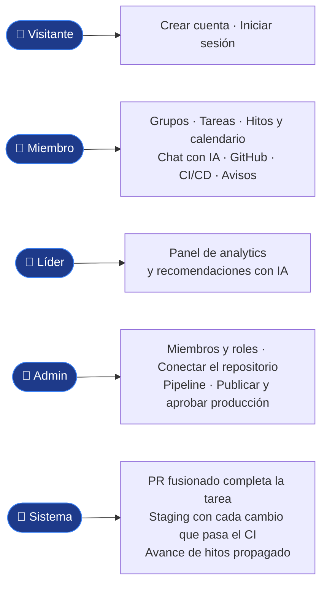

# Funcionalidades

**En una frase:** todo lo que un usuario puede hacer en TaskMate al cierre (3 nov 2026), por módulo, con quién puede hacerlo, en qué pantalla y dónde leer más.

Cada rol suma lo del anterior: el líder hace todo lo del miembro y el admin, todo lo del líder.

## Cómo leer la tabla
- **Visitante:** sin sesión. **Usuario:** con sesión, aunque no sea miembro del grupo.
- **Miembro:** pertenece al grupo activo. **Líder:** miembro con un rol cuyo nombre contiene «leader» (el admin también cuenta). **Admin:** el dueño del grupo.
- Lo que puede un miembro también lo pueden el líder y el admin. Detalle por acción: [permisos por rol](../04-casos-de-uso/00-permisos-por-rol.md).
- **Sistema:** pasa solo, sin que nadie pulse nada.

## Tabla de funcionalidades

| Módulo | Funcionalidad | Quién | Pantalla | Más |
|---|---|---|---|---|
| 1 · Usuarios y acceso | Crear una cuenta (también crea su grupo personal) | Visitante | `/register` | [Casos](../04-casos-de-uso/01-usuarios-y-acceso.md) · [UI](../05-interfaz/01-usuarios-y-acceso.md) |
| 1 · Usuarios y acceso | Iniciar sesión (JWT de 24 h) | Visitante | `/` | [Casos](../04-casos-de-uso/01-usuarios-y-acceso.md) · [UI](../05-interfaz/01-usuarios-y-acceso.md) |
| 1 · Usuarios y acceso | Inicio con accesos a Tasks, Calendar, Milestones y Groups | Usuario | `/home` | [UI](../05-interfaz/00-general.md) |
| 1 · Usuarios y acceso | Conservar la sesión al recargar la misma pestaña | Usuario | Todas | [Casos](../04-casos-de-uso/01-usuarios-y-acceso.md) |
| 1 · Usuarios y acceso | Cerrar sesión (menú con su nombre → «Logout») | Usuario | Navbar | [Casos](../04-casos-de-uso/01-usuarios-y-acceso.md) |
| 1 · Usuarios y acceso | Salir solo de la sesión cuando el token vence | Sistema | Todas | [Casos](../04-casos-de-uso/01-usuarios-y-acceso.md) |
| 2 · Grupos y roles | Crear un grupo (queda como su admin) | Usuario | `/groups` | [Casos](../04-casos-de-uso/02-grupos-y-roles.md) · [UI](../05-interfaz/02-grupos-y-roles.md) |
| 2 · Grupos y roles | Ver sus grupos y elegir el activo (botón «Use») | Usuario | `/groups` | [Casos](../04-casos-de-uso/02-grupos-y-roles.md) · [UI](../05-interfaz/02-grupos-y-roles.md) |
| 2 · Grupos y roles | Ver miembros, roles y quién tiene cada rol | Miembro | `/groups` | [Casos](../04-casos-de-uso/02-grupos-y-roles.md) · [UI](../05-interfaz/02-grupos-y-roles.md) |
| 2 · Grupos y roles | Salir del grupo (si sale el admin, pasa al miembro más antiguo) | Miembro | `/groups` | [Casos](../04-casos-de-uso/02-grupos-y-roles.md) · [UI](../05-interfaz/02-grupos-y-roles.md) |
| 2 · Grupos y roles | Agregar un miembro por su nombre de usuario («Add User») | Admin | `/groups` | [Casos](../04-casos-de-uso/02-grupos-y-roles.md) · [UI](../05-interfaz/02-grupos-y-roles.md) |
| 2 · Grupos y roles | Quitar un miembro | Admin | `/groups` | [Casos](../04-casos-de-uso/02-grupos-y-roles.md) · [UI](../05-interfaz/02-grupos-y-roles.md) |
| 2 · Grupos y roles | Eliminar el grupo (el botón aparece cuando el admin es el único miembro) | Admin | `/groups` | [Casos](../04-casos-de-uso/02-grupos-y-roles.md) · [UI](../05-interfaz/02-grupos-y-roles.md) |
| 2 · Grupos y roles | Crear, editar y borrar roles con color e icono | Admin | `/groups` | [Casos](../04-casos-de-uso/02-grupos-y-roles.md) · [UI](../05-interfaz/02-grupos-y-roles.md) |
| 2 · Grupos y roles | Asignar y quitar roles a un miembro | Admin | `/groups` | [Casos](../04-casos-de-uso/02-grupos-y-roles.md) · [UI](../05-interfaz/02-grupos-y-roles.md) |
| 3 · Tareas | Ver las listas, filtrar por hoy, semana o mes y ordenar | Miembro | `/tasks` | [Casos](../04-casos-de-uso/03-tareas.md) · [UI](../05-interfaz/03-tareas.md) |
| 3 · Tareas | Crear listas y tareas | Miembro | `/tasks` | [Casos](../04-casos-de-uso/03-tareas.md) · [UI](../05-interfaz/03-tareas.md) |
| 3 · Tareas | Editar una tarea: datos, avance y lista | Miembro | `/tasks` | [Casos](../04-casos-de-uso/03-tareas.md) · [UI](../05-interfaz/03-tareas.md) |
| 3 · Tareas | Completar una tarea o mandarla a la papelera | Miembro | `/tasks` | [Casos](../04-casos-de-uso/03-tareas.md) · [UI](../05-interfaz/03-tareas.md) |
| 3 · Tareas | Borrar una lista entera | Miembro | `/tasks` | [Casos](../04-casos-de-uso/03-tareas.md) · [UI](../05-interfaz/03-tareas.md) |
| 3 · Tareas | Asignar o quitar personas | Miembro | `/tasks` | [Casos](../04-casos-de-uso/03-tareas.md) · [UI](../05-interfaz/03-tareas.md) |
| 3 · Tareas | Ver y vaciar completadas y papelera | Miembro | `/tasks` | [Casos](../04-casos-de-uso/03-tareas.md) · [UI](../05-interfaz/03-tareas.md) |
| 4 · Hitos y calendario | Ver el diagrama de hitos (React Flow) | Miembro | `/block-diagram` | [Casos](../04-casos-de-uso/04-hitos-y-calendario.md) · [UI](../05-interfaz/04-hitos-y-calendario.md) |
| 4 · Hitos y calendario | Crear un hito o importar una tarea como hito | Miembro | `/block-diagram` | [Casos](../04-casos-de-uso/04-hitos-y-calendario.md) · [UI](../05-interfaz/04-hitos-y-calendario.md) |
| 4 · Hitos y calendario | Editar, mover y borrar hitos | Miembro | `/block-diagram` | [Casos](../04-casos-de-uso/04-hitos-y-calendario.md) · [UI](../05-interfaz/04-hitos-y-calendario.md) |
| 4 · Hitos y calendario | Fijar el % de avance o completar un hito | Miembro | `/block-diagram` | [Casos](../04-casos-de-uso/04-hitos-y-calendario.md) · [UI](../05-interfaz/04-hitos-y-calendario.md) |
| 4 · Hitos y calendario | Conectar hitos como prerrequisito o progresor | Miembro | `/block-diagram` | [Casos](../04-casos-de-uso/04-hitos-y-calendario.md) · [UI](../05-interfaz/04-hitos-y-calendario.md) |
| 4 · Hitos y calendario | Propagar el avance a los hitos que dependen (triggers de la BD) | Sistema | `/block-diagram` | [Casos](../04-casos-de-uso/04-hitos-y-calendario.md) · [BD](../03-base-de-datos/04-hitos-y-calendario.md) |
| 4 · Hitos y calendario | Calendario mensual con tareas e hitos | Miembro | `/calendar` | [Casos](../04-casos-de-uso/04-hitos-y-calendario.md) · [UI](../05-interfaz/04-hitos-y-calendario.md) |
| 5 · Chat con IA | Conversar con la IA y recuperar el historial | Usuario | `/chat` | [Casos](../04-casos-de-uso/05-chat-ia.md) · [UI](../05-interfaz/05-chat-ia.md) |
| 5 · Chat con IA | Pedir un plan (roles, tareas e hitos) y guardarlo como grupo nuevo al confirmar | Usuario | `/chat` | [Casos](../04-casos-de-uso/05-chat-ia.md) · [UI](../05-interfaz/05-chat-ia.md) |
| 5 · Chat con IA | Pedir cambios al plan o descartarlo | Usuario | `/chat` | [Casos](../04-casos-de-uso/05-chat-ia.md) · [UI](../05-interfaz/05-chat-ia.md) |
| 5 · Chat con IA | Elegir un proyecto como contexto (selector «Proyecto») | Miembro | `/chat` | [Casos](../04-casos-de-uso/05-chat-ia.md) · [UI](../05-interfaz/05-chat-ia.md) |
| 5 · Chat con IA | Analizar el repositorio y guardar o descartar las tareas propuestas (si el admin lo permite) | Miembro | `/chat` | [Casos](../04-casos-de-uso/05-chat-ia.md) · [UI](../05-interfaz/05-chat-ia.md) |
| 6 · Analytics | Panel del equipo: resumen, carga de trabajo y experiencia por categoría | Líder | `/analytics` | [Casos](../04-casos-de-uso/06-analytics.md) · [Arquitectura](../02-arquitectura/06-analytics.md) |
| 6 · Analytics | Filtrar la carga de trabajo por rol | Líder | `/analytics` | [Casos](../04-casos-de-uso/06-analytics.md) · [Arquitectura](../02-arquitectura/06-analytics.md) |
| 6 · Analytics | Recomendaciones de asignación con IA | Líder | `/analytics` | [Casos](../04-casos-de-uso/06-analytics.md) · [Arquitectura](../02-arquitectura/06-analytics.md) |
| 6 · Analytics | Ver el aviso «Solo líderes del equipo» | Miembro | `/analytics` | [Casos](../04-casos-de-uso/06-analytics.md) |
| 7 · GitHub | Conectar el repositorio: instalar la GitHub App y elegirlo (exige escritura en GitHub) | Admin | `/github` › Repositorio | [Casos](../04-casos-de-uso/07-github.md) · [UI](../05-interfaz/07-github.md) |
| 7 · GitHub | Desvincular el repositorio | Admin | `/github` › Repositorio | [Casos](../04-casos-de-uso/07-github.md) · [UI](../05-interfaz/07-github.md) |
| 7 · GitHub | Permitir o bloquear el análisis con IA | Admin | `/github` › Repositorio | [Casos](../04-casos-de-uso/07-github.md) · [UI](../05-interfaz/07-github.md) |
| 7 · GitHub | Ver el repositorio vinculado y sincronizar los PRs | Miembro | `/github` › Repositorio | [Casos](../04-casos-de-uso/07-github.md) · [UI](../05-interfaz/07-github.md) |
| 7 · GitHub | Ir al chat a analizar el repositorio («Analizar con IA») | Miembro | `/github` › Repositorio | [Casos](../04-casos-de-uso/07-github.md) · [UI](../05-interfaz/07-github.md) |
| 7 · GitHub | Explorar el árbol, ver archivos y el README | Miembro | `/github` › Archivos | [Casos](../04-casos-de-uso/07-github.md) · [UI](../05-interfaz/07-github.md) |
| 7 · GitHub | Ver los últimos commits | Miembro | `/github` › Commits | [Casos](../04-casos-de-uso/07-github.md) · [UI](../05-interfaz/07-github.md) |
| 7 · GitHub | Crear la rama de una tarea y ver el estado de su PR | Miembro | `/tasks` | [Casos](../04-casos-de-uso/07-github.md) · [UI](../05-interfaz/07-github.md) |
| 7 · GitHub | Completar la tarea al fusionar su PR y limpiar la rama | Sistema (webhook de GitHub) | — | [Casos](../04-casos-de-uso/07-github.md) · [Flujo](../06-flujos/07-github.md) |
| 8 · CI/CD | Configurar el pipeline: propuesta (detectada o con IA), vista previa del YAML y subirlo | Admin | `/github` › CI/CD | [Casos](../04-casos-de-uso/08-cicd.md) · [UI](../05-interfaz/08-cicd.md) |
| 8 · CI/CD | Ver las ejecuciones, con filtros | Miembro | `/github` › CI/CD | [Casos](../04-casos-de-uso/08-cicd.md) · [UI](../05-interfaz/08-cicd.md) |
| 8 · CI/CD | Ver cada job con su log y sus anotaciones (archivo y línea) | Miembro | `/github` › CI/CD | [Casos](../04-casos-de-uso/08-cicd.md) · [UI](../05-interfaz/08-cicd.md) |
| 8 · CI/CD | Ejecutar el CI en una rama | Miembro | `/github` › CI/CD | [Casos](../04-casos-de-uso/08-cicd.md) · [UI](../05-interfaz/08-cicd.md) |
| 8 · CI/CD | Re-ejecutar fallidos o cancelar (las ejecuciones de deploy, solo el admin) | Miembro | `/github` › CI/CD | [Casos](../04-casos-de-uso/08-cicd.md) · [UI](../05-interfaz/08-cicd.md) |
| 8 · CI/CD | Ver los entornos y el historial de deploys | Miembro | `/github` › CI/CD | [Casos](../04-casos-de-uso/08-cicd.md) · [UI](../05-interfaz/08-cicd.md) |
| 8 · CI/CD | Publicar en staging cada cambio de la rama principal que pasa el CI | Sistema | — | [Casos](../04-casos-de-uso/08-cicd.md) · [Flujo](../06-flujos/08-cicd.md) |
| 8 · CI/CD | Solicitar producción (la versión de staging) y cancelar su propia solicitud | Miembro | `/github` › CI/CD | [Casos](../04-casos-de-uso/08-cicd.md) · [UI](../05-interfaz/08-cicd.md) |
| 8 · CI/CD | Publicar en producción o hacer rollback | Admin | `/github` › CI/CD | [Casos](../04-casos-de-uso/08-cicd.md) · [UI](../05-interfaz/08-cicd.md) |
| 8 · CI/CD | Aprobar o rechazar solicitudes de producción | Admin | `/github` › CI/CD | [Casos](../04-casos-de-uso/08-cicd.md) · [UI](../05-interfaz/08-cicd.md) |
| 9 · Tiempo real y avisos | Ver en vivo las ejecuciones y los deploys | Miembro | `/github` › CI/CD | [Casos](../04-casos-de-uso/09-tiempo-real-y-avisos.md) · [UI](../05-interfaz/09-tiempo-real-y-avisos.md) |
| 9 · Tiempo real y avisos | Aviso de ejecución fallida o deploy terminado | Miembro | Todas | [Casos](../04-casos-de-uso/09-tiempo-real-y-avisos.md) · [UI](../05-interfaz/09-tiempo-real-y-avisos.md) |
| 9 · Tiempo real y avisos | Aviso de solicitud de producción nueva o deploy cancelado antes de publicar | Admin | Todas | [Casos](../04-casos-de-uso/09-tiempo-real-y-avisos.md) · [UI](../05-interfaz/09-tiempo-real-y-avisos.md) |
| 9 · Tiempo real y avisos | Aviso de que su solicitud se aprobó o se rechazó | Miembro (quien la pidió) | Todas | [Casos](../04-casos-de-uso/09-tiempo-real-y-avisos.md) · [UI](../05-interfaz/09-tiempo-real-y-avisos.md) |
| 9 · Tiempo real y avisos | «Ver» en un aviso: activa ese grupo y abre su pestaña CI/CD | Miembro | Todas | [Casos](../04-casos-de-uso/09-tiempo-real-y-avisos.md) · [UI](../05-interfaz/09-tiempo-real-y-avisos.md) |

## Qué no está en la tabla
- **Rutas solo de API:** 20 rutas REST no tienen pantalla (por ejemplo, casi todo `/api/analytics` salvo el panel). Lista: [cierre del proyecto](cierre-del-proyecto.md#api-y-código).
- **Direcciones antiguas:** `/flow` lleva a `/block-diagram` y `/create-group` a `/groups`; `/register` con sesión lleva a `/home` ([correcciones del 3 nov](cierre-del-proyecto.md#correcciones-del-cierre-3-nov-2026)).
- **Tareas en segundo plano:** recálculo de métricas de analytics (solo con `ANALYTICS_BATCH_ENABLED=true`) y purga diaria de entregas de webhooks.

## Dónde está en el código

| Archivo | Qué hace |
|---|---|
| `src/App.js` | Rutas de todas las pantallas y sus redirecciones |
| `src/components/Navbar.jsx` | Las 8 entradas del menú |
| `taskmate-api/middleware/groupAccess.js` | Controles de miembro y admin de cada ruta |
| `taskmate-api/models/access.model.js` | Quién es líder (`isGroupLeader`) |

## Para saber más
- [Qué es TaskMate](que-es-taskmate.md): visión de una página.
- [Recorridos de usuario](../04-casos-de-uso/00-recorridos-de-usuario.md): las funcionalidades en orden de uso.
- [Interfaz: visión general](../05-interfaz/00-general.md): mapa de pantallas.
- Limitaciones de cada funcionalidad: [cierre del proyecto](cierre-del-proyecto.md#limitaciones-conocidas).
