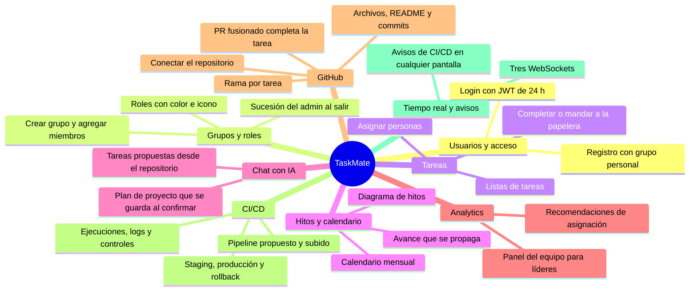
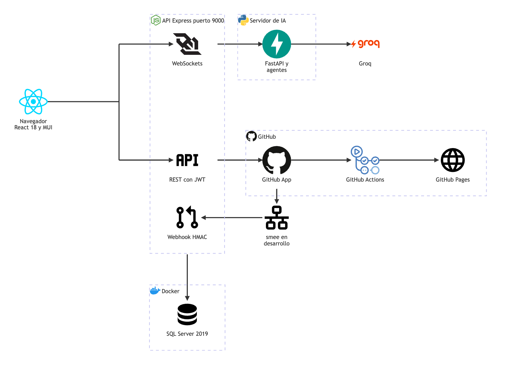

# Qué es TaskMate

**En una frase:** TaskMate es una aplicación web donde un equipo de desarrollo planifica su proyecto (tareas, hitos y calendario), lo arma con ayuda de una IA y lo conecta con su repositorio de GitHub y su CI/CD, todo en la misma app.

## Para quién
- **Equipos de desarrollo de software** que trabajan juntos sobre un repositorio de GitHub.
- Cada equipo es un **grupo**. Hay tres niveles:

| Rol | Quién es | Qué puede de más |
|---|---|---|
| Miembro | Pertenece al grupo | Tareas, hitos, chat, GitHub y CI (ejecutar, pedir producción) |
| Líder | Miembro con un rol cuyo nombre contiene «leader» (el admin también cuenta) | El panel de analytics |
| Admin | El dueño del grupo | Miembros, roles, conectar el repositorio, configurar el pipeline, publicar y aprobar producción |

Detalle por acción: [permisos por rol](../04-casos-de-uso/00-permisos-por-rol.md).

## El problema que resuelve
- **Herramientas sueltas:** tareas en un tablero, fechas en un calendario, código en GitHub y el CI/CD en otro lado.
- **Planificar a mano cuesta:** pasar de una idea a tareas con fechas e hitos lleva tiempo.
- **Asignar sin datos:** se reparte el trabajo sin mirar la carga ni la experiencia de cada persona.
- **El avance no refleja el código:** alguien tiene que marcar la tarea aunque su PR ya se fusionó.

## Qué hace: las 4 capacidades principales

| Capacidad | En la práctica |
|---|---|
| **Planificar en varias vistas** | Listas de tareas, calendario y diagrama de hitos sobre los mismos datos del grupo |
| **Planificar con IA** | El chat convierte una idea en un plan (grupo, roles, tareas e hitos) y lo guarda solo al confirmarlo; también propone las siguientes tareas a partir del repositorio |
| **Trabajar con GitHub** | Conectar el repositorio, explorarlo, crear la rama de cada tarea; al fusionarse el PR la tarea se completa sola |
| **Operar el CI/CD del grupo** | TaskMate (o la IA) propone el pipeline y lo sube; el grupo ve ejecuciones y logs en vivo y publica en staging y producción (GitHub Pages) con aprobación del admin |

Además: un panel de analytics para líderes y avisos de CI/CD en vivo. Lista completa: [funcionalidades](funcionalidades.md).

## Cómo funciona
1. El usuario se registra (se crea su grupo personal) e inicia sesión.
2. Elige el **grupo activo** en Groups (botón **Use**); todas las vistas trabajan sobre él.
3. Crea tareas e hitos a mano, o le pide un plan al chat con IA.
4. El admin conecta el repositorio del grupo con la GitHub App.
5. Cada miembro crea la rama de su tarea; al fusionar el PR, la tarea se completa.
6. El admin sube el pipeline; cada cambio que pasa el CI se publica en staging.
7. Un miembro pide producción; el admin aprueba y todo el grupo recibe el aviso.

## Stack

Qué conecta cada flecha: [arquitectura general](../02-arquitectura/00-general.md).

| Capa | Tecnología | Dónde corre |
|---|---|---|
| Frontend | React 18.3, MUI 6, React Router 6, React Flow (`@xyflow/react` 12), react-big-calendar; Create React App | `src/` · puerto 3000 |
| API | Node.js con Express 4; `tedious` (SQL Server), `ws` (WebSockets), `jsonwebtoken`, `helmet`, `express-rate-limit` | `taskmate-api/` · puerto 9000 |
| Servidor de IA | Python con FastAPI y uvicorn; WebSocket `/ws` con un protocolo JSON propio (**no** es el Model Context Protocol, aunque la carpeta se llame `mcp`); SDK `groq` | `taskmate-api/mcp/` · `MCP_PORT` (8001 por defecto) |
| Modelo de lenguaje | Groq, modelo `openai/gpt-oss-20b` | Servicio externo |
| Base de datos | SQL Server 2019 en Docker: 24 tablas, migraciones 001–008 | Contenedor `taskmate-sql` · puerto 1433 |
| GitHub | GitHub App (API y webhooks firmados; smee los reenvía en desarrollo); GitHub Actions y Pages para el CI/CD del grupo | Servicio externo |
| Pruebas | Jest y Testing Library (API y frontend), pytest (IA), pruebas de BD contra un SQL Server desechable | 1960 pruebas (5 nov 2026) |

## Dónde está en el código

| Carpeta | Qué tiene |
|---|---|
| `src/components/` | Pantallas y componentes de React (`github/`, `github/cicd/`, `flow/`, `realtime/`) |
| `taskmate-api/controllers/`, `models/` | Rutas REST y acceso a la BD |
| `taskmate-api/services/` | WebSockets, sesiones del chat, GitHub y CI/CD |
| `taskmate-api/mcp/agents/` | Agentes de IA: plan, analytics, análisis del repositorio y pipeline |
| `taskmate-api/migrations/` | Migraciones 001–008 de la BD |

## Estado
- **Cerrado el 3 nov 2026**, al terminar la Fase 4. Las Fases 1–4 están en `master`; las 5–8 no se realizarán.
- Qué quedó, limitaciones y pendientes: [cierre del proyecto](cierre-del-proyecto.md).

## Para saber más
- [Funcionalidades](funcionalidades.md): todo lo que puede hacer un usuario, por módulo.
- [Arquitectura general](../02-arquitectura/00-general.md) y [base de datos](../03-base-de-datos/00-general.md).
- [Casos de uso](../04-casos-de-uso/00-general.md) e [interfaz](../05-interfaz/00-general.md).
- [Calendarización](calendarizacion.md) y [documento del proyecto](documento-del-proyecto.md).
