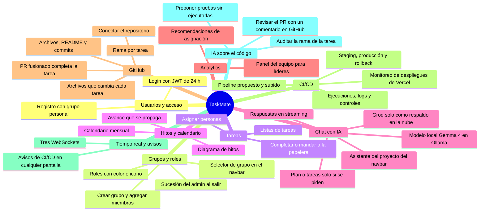
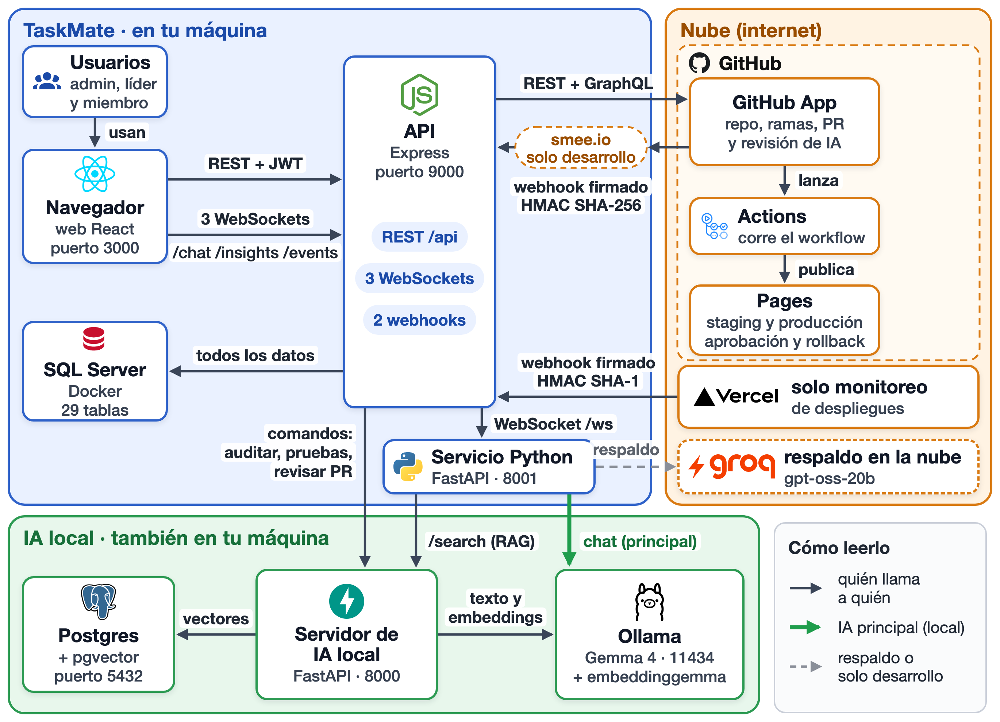

# Qué es TaskMate

**En una frase:** TaskMate es una aplicación web donde un equipo de desarrollo planifica su proyecto (tareas, hitos y calendario), conversa sobre él con un asistente de IA, lo conecta con su repositorio de GitHub, su CI/CD y sus despliegues de Vercel, y usa una IA local para revisar el código de cada tarea, todo en la misma app.

## Para quién
- **Equipos de desarrollo de software** que trabajan juntos sobre un repositorio de GitHub.
- Cada equipo es un **grupo**. Hay tres niveles:

| Rol | Quién es | Qué puede de más |
|---|---|---|
| Miembro | Pertenece al grupo | Tareas, hitos, chat, GitHub (con los archivos de cada tarea), CI (ejecutar, pedir producción), ver los despliegues de Vercel y usar la IA sobre el código si el admin la permite |
| Líder | Miembro con un rol cuyo nombre contiene «leader» (el admin también cuenta) | El panel de analytics |
| Admin | El dueño del grupo | Miembros, roles, conectar el repositorio, permitir el análisis con IA, configurar el pipeline, publicar y aprobar producción, vincular el proyecto de Vercel |

Detalle por acción: [permisos por rol](../04-casos-de-uso/00-permisos-por-rol.md).

## El problema que resuelve
- **Herramientas sueltas:** tareas en un tablero, fechas en un calendario, código en GitHub y el CI/CD y los despliegues en otro lado.
- **Planificar a mano cuesta:** pasar de una idea a tareas con fechas e hitos lleva tiempo.
- **Asignar sin datos:** se reparte el trabajo sin mirar la carga ni la experiencia de cada persona.
- **El avance no refleja el código:** alguien tiene que marcar la tarea aunque su PR ya se fusionó.
- **Revisar el código lleva tiempo:** auditar una rama, escribir pruebas o revisar un PR se hace a mano.

## Qué hace: las 5 capacidades principales

| Capacidad | En la práctica |
|---|---|
| **Planificar en varias vistas** | Listas de tareas, calendario y diagrama de hitos sobre los mismos datos del grupo |
| **Planificar y preguntar con IA** | El chat es un asistente del grupo elegido en el navbar: responde sobre su equipo, tareas, hitos, asignaciones y repositorio (si el admin lo permite) y propone tareas cuando se le piden. Sin grupo, convierte una idea en un plan (grupo, roles, tareas e hitos) que se guarda al confirmar. Usa el modelo local Gemma 4 en Ollama (Groq queda como respaldo en la nube), y la respuesta llega en streaming |
| **Trabajar con GitHub** | Conectar el repositorio, explorarlo, crear la rama de cada tarea y ver qué archivos cambia (y si otra tarea toca los mismos); al fusionarse el PR la tarea se completa sola |
| **Operar el CI/CD del grupo** | TaskMate (o la IA) propone el pipeline y lo sube; el grupo ve ejecuciones y logs en vivo y publica en staging y producción (GitHub Pages) con aprobación del admin. Si el grupo publica en Vercel, ve sus despliegues (solo monitoreo) |
| **Revisar el código con IA local** | Si el admin permite el análisis con IA, el servidor de IA local audita la rama de la tarea, propone pruebas (no las ejecuta) y revisa su PR; cada PR de tarea se revisa solo y la revisión queda como comentario en GitHub, sin aprobar ni bloquear |

Además: un panel de analytics para líderes y avisos de CI/CD en vivo. Lista completa: [funcionalidades](funcionalidades.md).

## Cómo funciona
1. El usuario se registra (se crea su grupo personal) e inicia sesión; queda activo su primer grupo.
2. Cambia el **grupo activo** con el selector del navbar (junto al logo) o con un clic en Groups; todas las vistas, el chat incluido, trabajan sobre él.
3. Crea tareas e hitos a mano, o le pregunta al asistente del chat por el proyecto y le pide tareas.
4. El admin conecta el repositorio del grupo con la GitHub App y decide si permite el análisis con IA («Allow AI analysis»).
5. Cada miembro crea la rama de su tarea; en «Task files» ve sus archivos y puede auditarla, generar pruebas o revisar su PR con la IA local.
6. Al abrir el PR, la IA local lo revisa (si el admin lo permite) y deja un comentario en GitHub; al fusionarlo, la tarea se completa.
7. El admin sube el pipeline; cada cambio que pasa el CI se publica en staging.
8. Un miembro pide producción; el admin aprueba y todo el grupo recibe el aviso.
9. Si el grupo publica en Vercel, el admin vincula el proyecto y todos ven sus despliegues.

**Idioma:** la interfaz está en inglés desde el 19 nov 2026 (quedan pocos textos en español). Esta documentación sigue en español y cita los botones tal como se ven.

## Stack

Qué conecta cada flecha: [arquitectura general](../02-arquitectura/00-general.md).

| Capa | Tecnología | Dónde corre |
|---|---|---|
| Frontend | React 18.3, MUI 6, React Router 6, React Flow (`@xyflow/react` 12), react-big-calendar; Create React App | `src/` · puerto 3000 |
| API | Node.js con Express 4; `tedious` (SQL Server), `ws` (WebSockets), `jsonwebtoken`, `helmet`, `express-rate-limit` | `taskmate-api/` · puerto 9000 |
| Servicio Python del chat | Python con FastAPI y uvicorn; WebSocket `/ws` con un protocolo JSON propio (**no** es el Model Context Protocol, aunque la carpeta se llame `mcp`); `httpx` para Ollama y SDK `groq` para el respaldo en la nube | `taskmate-api/mcp/` · `MCP_PORT` (8001 por defecto) |
| Modelo de lenguaje | Gemma 4 (`gemma4:e2b-it-qat`) en Ollama, el mismo que usa el servidor de IA local, para el chat y todos los agentes del servicio Python. Lo activa `LLM_PROVIDER=ollama`, que `scripts/local-up.sh` añade al `.env` si falta. Groq (`openai/gpt-oss-20b`, con `GROQ_API_KEY`) queda como respaldo en la nube y es el valor por defecto del código, para que funcione sin Ollama | Ollama: `127.0.0.1:11434` · Groq (respaldo): servicio externo |
| Servidor de IA local | Repo aparte de Christian (`taskmate-ai-server`): FastAPI con Ollama (`gemma4:e2b-it-qat` y `embeddinggemma:300m`) y Postgres 17 + pgvector (7 tablas propias); se autentica con `X-AI-Server-Secret`. Hace la IA sobre el código y, sin grupo seleccionado, da documentos al chat | `127.0.0.1:8000` |
| Base de datos | SQL Server 2019 en Docker: 29 tablas, migraciones 001–011 | Contenedor `taskmate-sql` · puerto 1433 |
| GitHub | GitHub App (API y webhooks firmados; smee los reenvía en desarrollo); GitHub Actions y Pages para el CI/CD del grupo. Con «Pull requests: write», la App también publica la revisión de PR con IA | Servicio externo |
| Vercel | Solo monitoreo: un webhook firmado (HMAC-SHA1) avisa de cada despliegue del proyecto vinculado | Servicio externo |
| Pruebas | Jest y Testing Library (API y frontend), pytest (servicio Python del chat), pruebas de BD contra un SQL Server desechable | 2091 en verde, 0 fallando (26 nov 2026): API 1324, frontend 438, Python 210 y BD 119 |

## Dónde está en el código

| Carpeta | Qué tiene |
|---|---|
| `src/components/` | Pantallas y componentes de React (`github/`, `github/cicd/`, `deploy/`, `flow/`, `realtime/`); el selector de grupo es `NavGroupSelector.jsx` |
| `taskmate-api/controllers/`, `models/` | Rutas REST y acceso a la BD |
| `taskmate-api/services/` | WebSockets, sesiones del chat, GitHub y CI/CD; monitoreo de Vercel (`deploy/`) y cliente del servidor de IA local (`aiServer/`) |
| `taskmate-api/mcp/` | Servicio Python del chat: proveedor del modelo (`llm_service.py`), documentos del servidor de IA local (`knowledge.py`) y agentes en `agents/` (asistente y plan, analytics y recomendaciones, análisis del repositorio y pipeline) |
| `taskmate-api/migrations/` | Migraciones 001–011 de la BD |
| `scripts/local-up.sh` | Levanta todo en local con el modelo local y el servidor de IA local (Linux + Podman) |

## Estado
- **La línea de Pablo cerró el 3 nov 2026** con las Fases 1–4, que están en `master`; sus Fases 5–8 no se realizarán.
- **La línea de Christian siguió** con sus fechas corridas. Los puntos 1–7 están completos: servidor de IA local, comandos, monitoreo de Vercel, archivos por tarea, `audit`, `generate-tests` y `review-pr`. Además llegaron el chat como asistente sobre el modelo local y la interfaz en inglés (19 nov).
- La colisión de archivos (punto 8) está pospuesta, con la base hecha (`findTasksTouchingPaths`); las pruebas finales (punto 9) están pendientes.
- Lo nuevo entró por la rama `test/e2e` y está en `master` desde el 26 nov 2026, con tres arreglos de ese día: el webhook de Vercel ya no puede tumbar la API, una revisión de PR fallida se puede reintentar y ESLint vuelve a 0. Pruebas al 26 nov 2026: 2091 en verde, 0 fallando.
- Qué entregó la línea de Pablo, limitaciones y pendientes: [cierre de la línea de Pablo y estado](cierre-del-proyecto.md). Detalle de la línea de Christian: [09-linea-christian](../09-linea-christian/README.md).

## Para saber más
- [Funcionalidades](funcionalidades.md): todo lo que puede hacer un usuario, por módulo.
- [Arquitectura general](../02-arquitectura/00-general.md), [IA sobre el código](../02-arquitectura/10-ia-sobre-el-codigo.md) y [base de datos](../03-base-de-datos/00-general.md).
- [Casos de uso](../04-casos-de-uso/00-general.md) e [interfaz](../05-interfaz/00-general.md).
- [Calendarización](calendarizacion.md) y [documento del proyecto](documento-del-proyecto.md).
