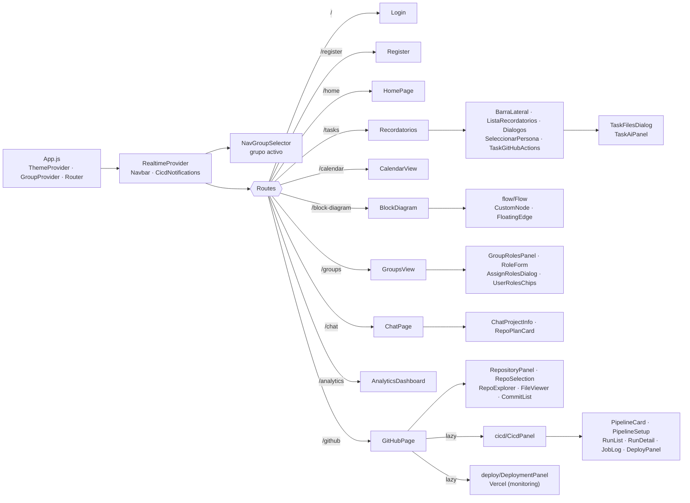
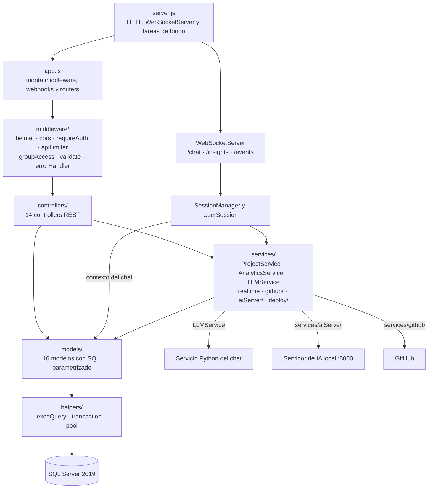
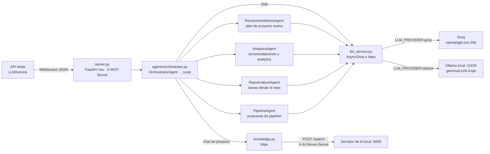

# Capas del código

**En una frase:** el frontend es un árbol de componentes React que cuelga de `App.js`; la API baja en capas de `app.js` a la base de datos y sale a GitHub, al servicio Python del chat y al servidor de IA local; y el servicio Python pasa de `server.py` al orquestador, a los agentes y al modelo (Groq u Ollama, según `LLM_PROVIDER`).

## Frontend: de `App.js` a los componentes

- Rutas viejas: `/flow` redirige a `/block-diagram`, `/create-group` a `/groups` y `/register` manda a `/home` a quien ya inició sesión. Cualquier otra ruta va a `/home` o a `/`.
- Todas las páginas se cargan con `React.lazy` (se descargan al entrar a cada ruta), y también `Navbar` y `CicdNotifications`. En `/github`, las pestañas CI/CD (`CicdPanel`) y «Vercel (monitoring)» (`DeploymentPanel`) se cargan al abrirlas, cada una con su `Suspense`. Sin sesión, cada ruta privada redirige a `/`.
- Grupo activo: `NavGroupSelector`, junto al logo de la `Navbar`, cambia el grupo de `GroupContext` para todas las páginas. El chat sigue ese grupo y `ChatProjectInfo` solo lo muestra.
- Tareas con rama: `TaskGitHubActions` abre `TaskFilesDialog` («Task files»), y dentro va `TaskAiPanel` («AI on the branch»: Audit, Generate tests y Review PR).
- Piezas compartidas: `src/api/client.js` (REST con el JWT), `src/api/github.js` (37 funciones: GitHub, CI/CD, archivos e IA de la tarea), `src/api/deploy.js` (Vercel), `src/hooks/useWebSocket.js` (lo usan `ChatPage`, `AnalyticsDashboard` y `RealtimeProvider`) y `src/components/ui/` (`Button`, `Card`, `TextField`).

## API: de `app.js` a la base de datos

| Capa | Qué hace |
|---|---|
| `server.js` | Carga `.env`, exige un `JWT_SECRET` fuerte, abre el pool, escucha en `API_PORT` y arranca la purga diaria de entregas del webhook de GitHub y el `AnalyticsBatchJob` (opcional) |
| `app.js` | `helmet`, CORS, los dos webhooks con el cuerpo crudo (`/api/github/webhook` y `/api/deploy/webhook/vercel`, antes de `express.json`), registro y login públicos en `/api/users`, y el resto (también `/api/deploy`) detrás de `requireAuth` + `apiLimiter` |
| `middleware/` | JWT, límites de peticiones, guardias de grupo (miembro o admin), validación de datos, el formato de error `{ success: false, error, code }` y `isAllowedOrigin` (CORS y WebSockets, con `ALLOW_LAN_ORIGINS` opcional) |
| `controllers/` | Un router por recurso: valida, revisa permisos y llama a modelos o servicios. El nuevo es `deploy.controller.js` (`/api/deploy`) |
| `services/` | Lógica que cruza varias tablas o sistemas: plan y contexto del chat, analytics, IA, avisos en vivo y todo GitHub (20 archivos en `services/github/`, entre ellos `taskFileService.js`). Además, `services/aiServer/` (`client`, `taskAi`, `prReview`) habla con el servidor de IA local y `services/deploy/` (`deploySignature`, `vercelEvents`, `deployWebhookHandler`) atiende el webhook de Vercel |
| `models/` | Una función por consulta, siempre con parámetros; las operaciones de varios pasos van en una transacción. Los nuevos son `deployment.model.js` y `aiReview.model.js` |
| `helpers/` | `execQuery` corre una consulta, `transaction` abre y cierra transacciones, `pool` reparte conexiones de `tedious` (mín. 2, máx. 10) |

Excepción: `analytics.controller.js` y `AnalyticsService.js` usan `helpers/execQuery` directamente, sin modelo.

## Servicio Python del chat: de `server.py` al modelo

- `server.py` acepta solo la conexión de Node: sin cabecera `Origin` y con `X-MCP-Secret` correcto.
- `orchestrator.py` reparte cada mensaje por su `method`: `handle_user_message`, `save_plan_result`, `analyze_repository`, `propose_pipeline`, o `type: analytics`.
- En `handle_user_message`, `_route` clasifica el mensaje en PLAN, CHAT o fuera de tema. CHAT responde en streaming (`response_chunk`). PLAN con proyecto devuelve `plan_request` a Node, que corre el análisis del repo. PLAN sin proyecto arma el plan con `RecommendationsAgent`.
- Los agentes arman el prompt y validan la respuesta; `schemas.py` define con Pydantic lo que aceptan el análisis del repo, el pipeline y el contexto del proyecto del chat (`ProjectContext`).
- `llm_service.py` elige el proveedor con `LLM_PROVIDER`: `groq` es el valor por defecto del código (`AsyncGroq`) y `ollama` es lo que pone `scripts/local-up.sh` (`httpx` a `POST /api/chat`, con un solo cliente reutilizado). Todos los agentes pasan por ahí.
- `knowledge.py` busca en los documentos del servidor de IA local (`POST /search`, 3 s de plazo) solo cuando el chat no tiene proyecto y `AI_SERVER_URL` está puesto. Si falla, el chat sigue sin ese contexto.
- El servicio Python no toca la base de datos: todo lo que guarda lo guarda la API.
- El servidor de IA local es un repo aparte (`taskmate-ai-server`, de Christian) con sus propias capas: ver [IA sobre el código](10-ia-sobre-el-codigo.md).

## Dónde está en el código

| Archivo | Qué hace |
|---|---|
| `src/App.js` | Proveedores, rutas y carga con `React.lazy` |
| `src/components/`, `src/components/github/`, `src/components/github/cicd/`, `src/components/deploy/`, `src/components/flow/` | Páginas y componentes |
| `src/components/NavGroupSelector.jsx` | Selector del grupo activo en la barra |
| `src/api/client.js`, `src/api/github.js`, `src/api/deploy.js` | Llamadas REST |
| `taskmate-api/server.js`, `taskmate-api/app.js` | Arranque y montaje de la API |
| `taskmate-api/middleware/`, `controllers/`, `services/`, `models/`, `helpers/` | Las capas de la API |
| `taskmate-api/services/aiServer/`, `taskmate-api/services/deploy/` | Cliente del servidor de IA local y webhook de Vercel |
| `taskmate-api/mcp/server.py`, `agents/`, `llm_service.py`, `knowledge.py`, `schemas.py` | Servicio Python del chat |

## Para saber más

- [Arquitectura general](00-general.md) · [Despliegue y puertos](00-despliegue.md) · [Seguridad](00-seguridad.md) · [IA sobre el código](10-ia-sobre-el-codigo.md)
- Componentes y archivos uno por uno: [guía técnica, módulos por capa](../07-guias/guia-tecnica.md#4-módulos-principales-por-capa)
- Rutas REST y WebSockets: [guía técnica, referencia de la API](../07-guias/guia-tecnica.md#5-referencia-de-la-api)
- Cómo viaja un mensaje del chat: [flujos del chat IA](../06-flujos/05-chat-ia.md)
