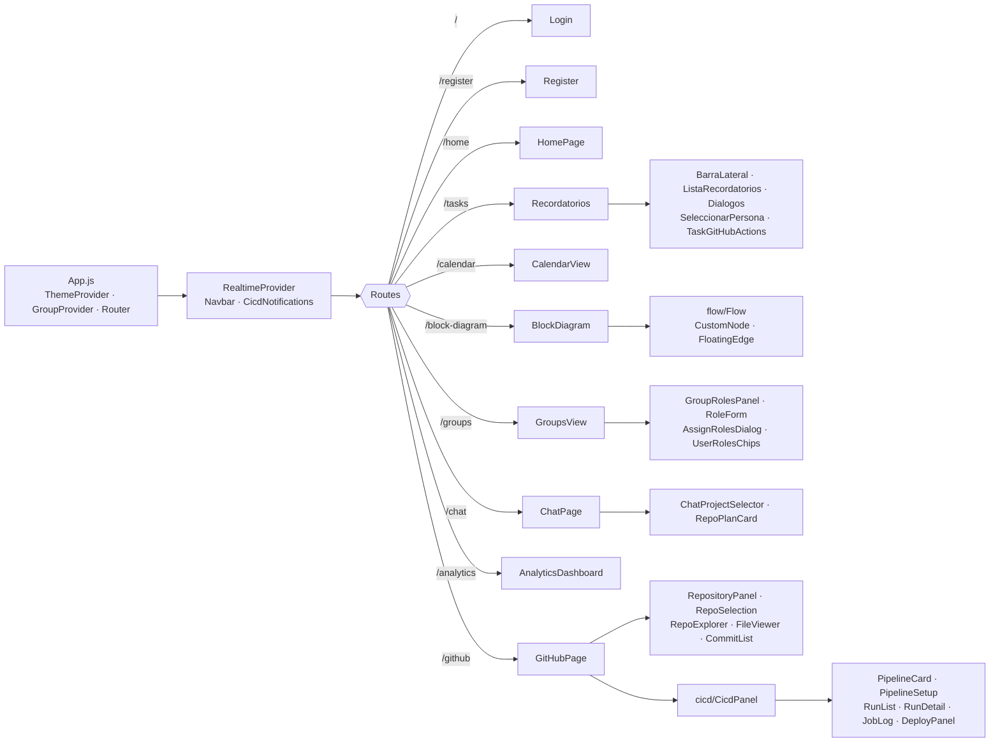
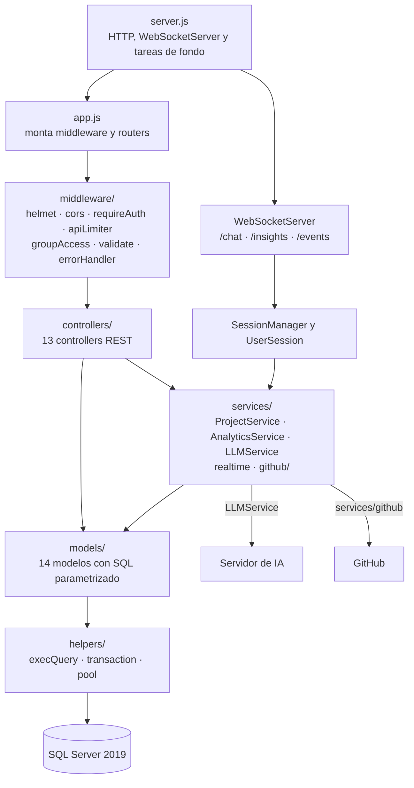
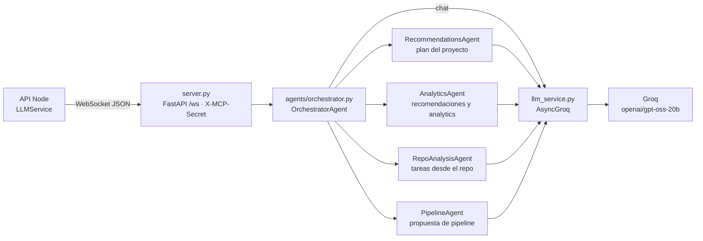

# Capas del código

**En una frase:** el frontend es un árbol de componentes React que cuelga de `App.js`; la API baja en capas de `app.js` a la base de datos; y el servidor de IA pasa de `server.py` al orquestador, a los agentes y a Groq.

## Frontend: de `App.js` a los componentes

- Rutas viejas: `/flow` redirige a `/block-diagram`, `/create-group` a `/groups` y `/register` manda a `/home` a quien ya inició sesión. Cualquier otra ruta va a `/home` o a `/`.
- Todas las páginas se cargan con `lazy` (se descargan al entrar a cada ruta). Sin sesión, cada ruta privada redirige a `/`.
- Piezas compartidas: `src/api/client.js` (REST con el JWT), `src/api/github.js` (rutas de GitHub y CI/CD), `src/hooks/useWebSocket.js` (lo usan `ChatPage`, `AnalyticsDashboard` y `RealtimeProvider`) y `src/components/ui/` (`Button`, `Card`, `TextField`).

## API: de `app.js` a la base de datos

| Capa | Qué hace |
|---|---|
| `server.js` | Carga `.env`, exige un `JWT_SECRET` fuerte, abre el pool, escucha en `API_PORT` y arranca la purga diaria de webhooks y el `AnalyticsBatchJob` (opcional) |
| `app.js` | `helmet`, CORS, el webhook con el cuerpo crudo (antes de `express.json`), registro y login públicos en `/api/users`, y el resto detrás de `requireAuth` + `apiLimiter` |
| `middleware/` | JWT, límites de peticiones, guardias de grupo (miembro o admin), validación de datos y el formato de error `{ success: false, error, code }` |
| `controllers/` | Un router por recurso: valida, revisa permisos y llama a modelos o servicios |
| `services/` | Lógica que cruza varias tablas o sistemas: plan del chat, analytics, IA, avisos en vivo y todo GitHub (19 archivos en `services/github/`) |
| `models/` | Una función por consulta, siempre con parámetros; las operaciones de varios pasos van en una transacción |
| `helpers/` | `execQuery` corre una consulta, `transaction` abre y cierra transacciones, `pool` reparte conexiones de `tedious` (mín. 2, máx. 10) |

Excepción: `analytics.controller.js` y `AnalyticsService.js` usan `helpers/execQuery` directamente, sin modelo.

## Servidor de IA: de `server.py` a Groq

- `server.py` acepta solo la conexión de Node: sin cabecera `Origin` y con `X-MCP-Secret` correcto.
- `orchestrator.py` reparte cada mensaje por su `method`: `handle_user_message`, `save_plan_result`, `analyze_repository`, `propose_pipeline`, o `type: analytics`.
- Los agentes arman el prompt y validan la respuesta; `schemas.py` define con Pydantic lo que aceptan el análisis del repo y el pipeline.
- El servidor de IA no toca la base de datos: todo lo que guarda lo guarda la API.

## Dónde está en el código

| Archivo | Qué hace |
|---|---|
| `src/App.js` | Proveedores y rutas |
| `src/components/`, `src/components/github/`, `src/components/github/cicd/`, `src/components/flow/` | Páginas y componentes |
| `taskmate-api/server.js`, `taskmate-api/app.js` | Arranque y montaje de la API |
| `taskmate-api/middleware/`, `controllers/`, `services/`, `models/`, `helpers/` | Las capas de la API |
| `taskmate-api/mcp/server.py`, `agents/`, `llm_service.py`, `schemas.py` | Servidor de IA |

## Para saber más

- [Arquitectura general](00-general.md) · [Despliegue y puertos](00-despliegue.md) · [Seguridad](00-seguridad.md)
- Componentes y archivos uno por uno: [guía técnica, módulos por capa](../07-guias/guia-tecnica.md#4-módulos-principales-por-capa)
- Rutas REST y WebSockets: [guía técnica, referencia de la API](../07-guias/guia-tecnica.md#5-referencia-de-la-api)
- Cómo viaja un mensaje del chat: [flujos del chat IA](../06-flujos/05-chat-ia.md)
