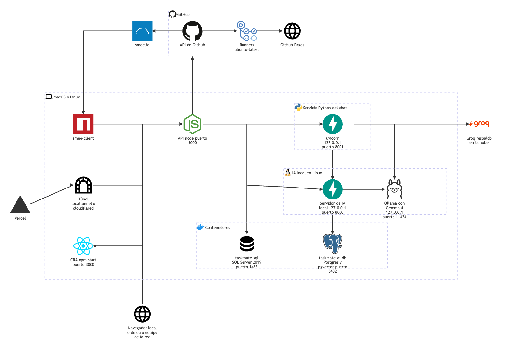

# Despliegue y puertos

**En una frase:** TaskMate corre entero en una máquina de desarrollo: en macOS con `start.sh` (SQL Server en Docker o Podman, el servicio Python y la API) o en Linux con `scripts/local-up.sh` (lo mismo más la IA local: Ollama con Gemma 4, el modelo del chat, y el servidor de IA local con Postgres y pgvector, todo con Podman); por internet usa GitHub, sus runners y Pages, Vercel y, solo como respaldo, Groq.

Fuente del diagrama: [fuentes/00-despliegue.mmd](fuentes/00-despliegue.mmd). El grupo «IA local en Linux» y el contenedor de Postgres solo los levanta `local-up.sh`.

| Conexión | Qué viaja |
|---|---|
| Navegador → CRA `:3000` | El navegador descarga la app de React (HTML y JavaScript) |
| Navegador → API `:9000` | REST con `Authorization: Bearer <JWT>` y los WebSockets `/chat`, `/insights` y `/events` con `?token=`. `src/config.js` usa el host de la página, en el puerto 9000 |
| Otro equipo de la red → CRA y API | Solo en desarrollo: CRA y la API escuchan en todas las interfaces, y con `ALLOW_LAN_ORIGINS=true` la API acepta orígenes `http://` con IPv4 privada |
| API → SQL Server `:1433` | Consultas SQL con `tedious`, con el login de mínimo privilegio de la app |
| API → Servicio Python `127.0.0.1:MCP_PORT` | Un solo WebSocket a `/ws` con la cabecera `X-MCP-Secret` |
| Servicio Python → Ollama `127.0.0.1:11434` | `POST /api/chat`, modelo `gemma4:e2b-it-qat` (el modelo del chat). Con `LLM_PROVIDER=ollama`, lo que escribe `local-up.sh` si la clave falta |
| Servicio Python → Groq (respaldo en la nube) | Solo si se usa Groq: HTTPS con el cliente `AsyncGroq`, modelo `openai/gpt-oss-20b`. Con `LLM_PROVIDER=groq`, el valor por defecto del código para un checkout sin Ollama |
| Servicio Python → Servidor de IA local `127.0.0.1:8000` | `POST /search` con `X-AI-Server-Secret`, solo en el chat sin proyecto seleccionado |
| API → Servidor de IA local `127.0.0.1:8000` | `POST /commands/{audit, generate-tests, review-pr}` con `X-AI-Server-Secret` y los parches de la rama |
| Servidor de IA local → Ollama y Postgres `127.0.0.1:5432` | Generar texto y embeddings; guardar y buscar fragmentos en pgvector |
| API → GitHub | REST y GraphQL con tokens de instalación de la GitHub App; incluye `POST /pulls/{n}/reviews` para publicar la revisión con IA |
| GitHub → runners → Pages | El workflow del repositorio del grupo corre en `ubuntu-latest` y publica el sitio en GitHub Pages |
| GitHub → smee.io → smee-client → API | Cada webhook firmado llega a `POST /api/github/webhook` |
| Vercel → túnel público → API | Cada evento `deployment.*`, firmado con HMAC SHA-1, llega a `POST /api/deploy/webhook/vercel` |

No se dibuja: al conectar un repositorio, el navegador va a github.com y GitHub lo devuelve a `GET /api/github/callback`.

## Qué hace

**Dos lanzadores**

| Lanzador | Sistema | Levanta | No levanta |
|---|---|---|---|
| `./start.sh` | macOS con Docker Desktop, o con Podman si está instalado y responde | SQL Server, servicio Python y API | Frontend, `smee-client`, túnel e IA local. No aplica las migraciones nuevas del repo |
| `./scripts/local-up.sh` | Linux con Podman (probado en Fedora) | IA local, SQL Server con las migraciones pendientes, servicio Python, API y web (`--no-web` la omite) | `smee-client` y túnel |
| `./scripts/local-down.sh` | Linux | Detiene lo que levantó `local-up.sh`; `--all` también la IA local | — |

**Procesos en la máquina de desarrollo**

| Proceso | Cómo se arranca | Puerto | Nota |
|---|---|---|---|
| SQL Server 2019 (contenedor `taskmate-sql`) | `start.sh` paso 2: `docker start taskmate-sql` (o `podman`). `local-up.sh` paso 2/5: crea o inicia el contenedor y corre `npm run db:migrate` | 1433 | Solo `127.0.0.1`. Con `start.sh` el contenedor se crea una vez a mano ([guía](../07-guias/base-de-datos-docker.md#2-crear-el-contenedor)) |
| Servicio Python (FastAPI + uvicorn) | Paso 3 de los dos lanzadores: `venv/bin/python -m uvicorn server:app --host 127.0.0.1 --port $MCP_PORT` | `MCP_PORT`: 8001 por defecto (lo que pone `local-up.sh`), 8011 en la Mac de desarrollo | Solo `127.0.0.1`. Log en `/tmp/taskmate-mcp.log` o `.local/logs/mcp.log` |
| API (Express + `ws`) | Paso 4 de los dos lanzadores: `node taskmate-api/server.js` | `API_PORT`: 9000 | REST, los 3 WebSockets y los 2 webhooks en el mismo puerto, en todas las interfaces. Log en `/tmp/taskmate-backend.log` o `.local/logs/api.log` |
| Frontend (CRA, `react-scripts start`) | A mano con `start.sh` (`npm start`); `local-up.sh` paso 5/5 | 3000 | Es el origen permitido por defecto (`FRONTEND_URL`). Escucha en todas las interfaces |
| Servidor de IA local (FastAPI, repo aparte en `../ai-server`) | `local-up.sh` paso 1/5, con `../ai-server/scripts/up.sh` | 8000 | Solo `127.0.0.1`. Exige `X-AI-Server-Secret` y no arranca sin un `AI_SERVER_SECRET` de 32 caracteres o más (salvo con `AI_SERVER_ALLOW_NO_SECRET=1`); `up.sh` lo genera si falta |
| Ollama | Lo arranca `up.sh` como servicio `systemctl --user` | 11434 | Solo `127.0.0.1`. Modelos `gemma4:e2b-it-qat` (texto) y `embeddinggemma:300m` (embeddings) |
| Postgres 17 + pgvector (contenedor `taskmate-ai-db`) | Lo arranca `up.sh` en Podman, con el volumen `taskmate-ai-pgdata` | 5432 | Solo `127.0.0.1`. Base del servidor de IA local (7 tablas), aparte de SQL Server |
| `smee-client` | A mano, solo si se usa GitHub: `npx smee-client --url https://smee.io/<canal> --target http://localhost:9000/api/github/webhook` | — | Solo abre conexiones de salida hacia smee.io |
| Túnel público | A mano, solo con una cuenta real de Vercel: `npx localtunnel --port 9000` o `cloudflared tunnel --url http://localhost:9000` | — | En Vercel, Settings → Webhooks apunta a `https://<túnel>/api/deploy/webhook/vercel` |

**Servicios externos**

| Servicio | Quién lo usa | Para qué |
|---|---|---|
| Groq (respaldo en la nube) | Servicio Python, solo si `LLM_PROVIDER=groq` | Lo mismo que el modelo local (chat, planes, analytics, análisis del repositorio y propuesta de pipeline) |
| GitHub (api.github.com y github.com) | API y navegador | Repositorio, ramas, PRs, ejecuciones y deploys; publicar la revisión con IA; instalar la App |
| Runners de GitHub Actions | El workflow `.github/workflows/taskmate-ci.yml` de cada repositorio | Build, pruebas, análisis estático y deploy |
| GitHub Pages | El job de deploy del workflow | Publica `staging` y `production` |
| Vercel | Su webhook, a través del túnel | Avisa los despliegues del proyecto vinculado al grupo (solo monitoreo). No se ha probado con una cuenta real ([limitaciones](../01-proyecto/cierre-del-proyecto.md#limitaciones-conocidas)) |
| smee.io | GitHub y `smee-client` | Lleva los webhooks de GitHub hasta `localhost` en desarrollo. El canal documentado solo reenvía a `/api/github/webhook` |

## Cómo funciona

**`./start.sh` (macOS)** hace cuatro pasos (los `[1/4]`…`[4/4]` que imprime):

1. **Docker o Podman.** Usa Podman si el comando existe y `podman info` responde. Si no, usa Docker; si Docker no responde, abre Docker Desktop y espera hasta 90 s. Sin el comando `open` (fuera de macOS), termina con error.
2. **SQL Server.** `docker start taskmate-sql` (o `podman start`) y espera a que el puerto 1433 conteste (`nc -z`). No crea el contenedor; al iniciar, el contenedor solo aplica las migraciones que trae su imagen. Después detiene solo los procesos viejos de TaskMate (`node … server.js` y `uvicorn server:app`); si `API_PORT` o `MCP_PORT` siguen ocupados por otro programa (`lsof`), se detiene sin matarlo.
3. **Servicio Python.** Lo arranca primero, para que la API lo encuentre al iniciar.
4. **API.** Arranca `node taskmate-api/server.js`.

Otros detalles de `start.sh`:
- Los puertos salen de `.env`: `API_PORT` y `MCP_PORT`. Avisa si `LLM_WEBSOCKET_URL` no usa el mismo `MCP_PORT`.
- Avisa si falta `MCP_SHARED_SECRET`: sin él, el servicio Python no arranca.
- Al final siempre imprime «✓ Todo listo». Si algo no responde, revisar los dos logs de `/tmp`.
- La imagen de SQL Server trae las migraciones con las que se construyó. Un contenedor de una imagen anterior a la 009 no tiene las tablas 009–011: aplicarlas con `npm run db:migrate --workspace=taskmate-api`.
- No levanta la IA local (ni Ollama). Con `AI_SERVER_URL` vacío (como en `.env.example`), auditar, proponer pruebas y revisar PR responden 503 `AI_SERVER_DISABLED`, y el chat usa el proveedor de `LLM_PROVIDER` sin los documentos del proyecto: Ollama si ya corre y la `.env` dice `ollama`, o Groq (respaldo, el valor de `.env.example`) con `GROQ_API_KEY`.

**`./scripts/local-up.sh` (Linux con Podman)** comprueba `podman`, `node`, `npm`, `python3`, `curl`, `ss`, `openssl` y Ollama (`~/.local/ollama/bin/ollama`), y después:

1. **`.env`.** Si no existe, la genera con secretos aleatorios (`chmod 600`). Si existe, solo agrega las claves que faltan (`MCP_PORT=8001`, `MCP_SHARED_SECRET`, `LLM_PROVIDER=ollama`, `OLLAMA_MODEL`, `AI_SERVER_URL=http://127.0.0.1:8000`, `AI_SERVER_PROJECT`, `VERCEL_WEBHOOK_SECRET`…). Solo reescribe `AI_SERVER_SECRET`, que copia de `../ai-server/.env`.
2. **IA local (1/5).** Corre `../ai-server/scripts/up.sh`: Ollama, Postgres + pgvector con sus migraciones y la API en `:8000`. Sin `../ai-server`, arranca solo Ollama: el chat funciona, pero sin los documentos del proyecto. Descarga el modelo si falta y lo precalienta.
3. **SQL Server (2/5).** Construye la imagen si falta, crea o inicia `taskmate-sql`, comprueba el login de la app y aplica las migraciones pendientes. Así un `git pull` no obliga a reconstruir la imagen.
4. **Servicio Python (3/5), API (4/5) y web (5/5).** Instala dependencias solo si cambiaron y espera a que cada uno responda; la API, además, a que conecte con el servicio Python.

Es idempotente: solo reinicia sus propios procesos (archivos pid en `.local/run/`) y se detiene con error si otro programa ocupa un puerto. Logs en `.local/logs/`. Usa comandos de Linux (`ss`, `setsid`, `systemctl --user`), así que en macOS se usa `start.sh`.

**`./scripts/local-down.sh`** detiene web, API y servicio Python, y para el contenedor `taskmate-sql` sin borrarlo. Con `--all` también detiene la IA local (`../ai-server/scripts/down.sh`: servidor de IA local, Postgres y Ollama), sin tocar el volumen.

**Desde otro equipo de la red** (solo desarrollo): abrir `http://<IP de la máquina>:3000` con `ALLOW_LAN_ORIGINS=true` en la `.env`. Acepta orígenes `http://` con IPv4 privada (10.x, 172.16–31.x, 192.168.x) y cualquier puerto, no https, IPv6 ni nombres de host. Aplica a REST y a los WebSockets. Nunca en producción.

Las pruebas de BD usan otro contenedor desechable en `127.0.0.1:14333` ([guía](../07-guias/base-de-datos-docker.md#6-bd-desechable-para-pruebas)).

## Dónde está en el código

| Archivo | Qué hace |
|---|---|
| `start.sh` | Lanzador para macOS: Docker o Podman, SQL Server, servicio Python y API |
| `scripts/local-up.sh` | Lanzador para Linux con Podman: IA local, SQL Server con migraciones, servicio Python, API y web; completa la `.env` |
| `scripts/local-down.sh` | Detiene lo anterior sin borrar datos; `--all` también la IA local |
| `taskmate-api/Dockerfile` | Imagen `mcr.microsoft.com/mssql/server:2019-latest` con `mssql-tools` |
| `taskmate-api/setup-db.sh` | Al arrancar el contenedor: crea la BD, el login de la app, el esquema base y aplica las migraciones que trae la imagen |
| `taskmate-api/server.js` | Escucha en `API_PORT` (9000 por defecto), en todas las interfaces |
| `taskmate-api/app.js` | Monta los webhooks de GitHub y de Vercel antes de `express.json()` |
| `taskmate-api/middleware/cors.js` | Orígenes permitidos: `FRONTEND_URL` y, con `ALLOW_LAN_ORIGINS=true`, la red local |
| `taskmate-api/mcp/server.py` | Servicio Python; por defecto `127.0.0.1` y puerto 8001 |
| `src/config.js` | URL de la API y de los WebSockets: `REACT_APP_API_URL` / `REACT_APP_WS_URL` o, si faltan, el host de la página en el puerto 9000 |
| `taskmate-api/services/github/pipelineSpec.js` | Genera el workflow con `runs-on: ubuntu-latest` |
| `../ai-server/scripts/up.sh` y `down.sh` (repo aparte) | Levantan y detienen Ollama, Postgres + pgvector y el servidor de IA local |

## Para saber más

- [Arquitectura general](00-general.md) · [Capas del código](00-capas-del-codigo.md) · [Seguridad](00-seguridad.md)
- Variables de entorno y puertos: [guía técnica](../07-guias/guia-tecnica.md#8-puertos)
- Crear el contenedor de SQL Server: [guía de la base de datos](../07-guias/base-de-datos-docker.md)
- Canal de smee y la GitHub App: [guía de la GitHub App](../07-guias/guia-github-app.md#2-crear-un-canal-de-smeeio)
- Levantar todo en Linux y probar el webhook de Vercel sin cuenta: [entorno local (línea de Christian)](../09-linea-christian/ENTORNO-LOCAL.md)
- Servidor de IA local: [IA sobre el código](10-ia-sobre-el-codigo.md)
- Pipeline del repositorio y monitoreo de Vercel: [arquitectura de CI/CD](08-cicd.md)
- Limitaciones de operación: [cierre de la línea de Pablo y estado](../01-proyecto/cierre-del-proyecto.md#operación-y-seguridad)
