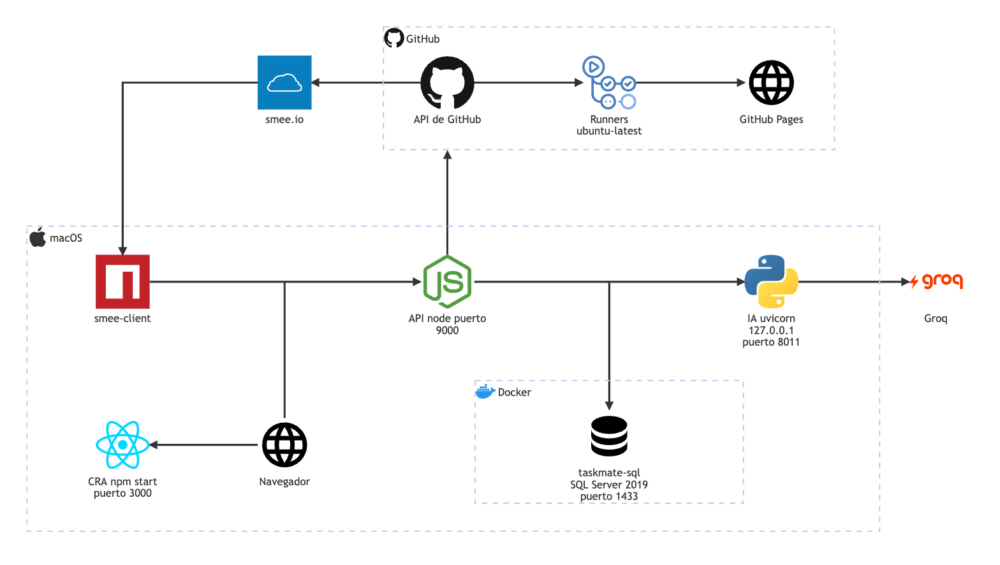

# Despliegue y puertos

**En una frase:** TaskMate corre entero en una Mac de desarrollo (SQL Server en Docker, la API en Node, el servidor de IA en Python, el frontend de CRA y `smee-client`) y usa por internet Groq, GitHub, los runners de GitHub Actions y GitHub Pages.

Fuente del diagrama: [fuentes/00-despliegue.mmd](fuentes/00-despliegue.mmd).

| Conexión | Qué viaja |
|---|---|
| Navegador → CRA `:3000` | El navegador descarga la app de React (HTML y JavaScript) |
| Navegador → API `:9000` | REST con `Authorization: Bearer <JWT>` y los WebSockets `/chat`, `/insights` y `/events` con `?token=` |
| API → SQL Server `:1433` | Consultas SQL con `tedious`, con el login de mínimo privilegio de la app |
| API → Servidor de IA `127.0.0.1:MCP_PORT` | Un solo WebSocket a `/ws` con la cabecera `X-MCP-Secret` |
| Servidor de IA → Groq | HTTPS con el cliente `AsyncGroq`, modelo `openai/gpt-oss-20b` |
| API → GitHub | REST y GraphQL con tokens de instalación de la GitHub App |
| GitHub → runners → Pages | El workflow del repositorio del grupo corre en `ubuntu-latest` y publica el sitio en GitHub Pages |
| GitHub → smee.io → smee-client → API | Cada webhook firmado llega a `POST /api/github/webhook` |

No se dibuja: al conectar un repositorio, el navegador va a github.com y GitHub lo devuelve a `GET /api/github/callback`.

## Qué hace

**Procesos en la Mac**

| Proceso | Cómo se arranca | Puerto | Nota |
|---|---|---|---|
| SQL Server 2019 (contenedor `taskmate-sql`) | `start.sh`, paso 2: `docker start taskmate-sql` | 1433 | La guía lo publica solo en `127.0.0.1`. El contenedor se crea una vez ([guía](../07-guias/base-de-datos-docker.md#2-crear-el-contenedor)) |
| Servidor de IA (FastAPI + uvicorn) | `start.sh`, paso 3: `venv/bin/python -m uvicorn server:app --host 127.0.0.1 --port $MCP_PORT` | `MCP_PORT`: 8001 por defecto, 8011 en esta máquina | Solo `127.0.0.1`. Log en `/tmp/taskmate-mcp.log` |
| API (Express + `ws`) | `start.sh`, paso 4: `node taskmate-api/server.js` | `API_PORT`: 9000 | REST y los 3 WebSockets en el mismo puerto. Log en `/tmp/taskmate-backend.log` |
| Frontend (CRA, `react-scripts start`) | A mano, en otra terminal: `npm start` | 3000 | Es el origen permitido por defecto (`FRONTEND_URL`) |
| `smee-client` | A mano, solo si se usa GitHub: `npx smee-client --url https://smee.io/<canal> --target http://localhost:9000/api/github/webhook` | — | Solo abre conexiones de salida hacia smee.io |

**Servicios externos**

| Servicio | Quién lo usa | Para qué |
|---|---|---|
| Groq | Servidor de IA | Chat, planes, análisis del repositorio y propuesta de pipeline |
| GitHub (api.github.com y github.com) | API y navegador | Repositorio, ramas, PRs, ejecuciones y deploys; instalar la App |
| Runners de GitHub Actions | El workflow `.github/workflows/taskmate-ci.yml` de cada repositorio | Build, pruebas, análisis estático y deploy |
| GitHub Pages | El job de deploy del workflow | Publica `staging` y `production` |
| smee.io | GitHub y `smee-client` | Lleva los webhooks hasta `localhost` en desarrollo |

## Cómo funciona

`./start.sh` (solo macOS) hace cuatro pasos:

1. **Docker.** Si no responde, abre Docker Desktop y espera hasta 90 s.
2. **SQL Server.** `docker start taskmate-sql` y espera a que el puerto 1433 conteste (`nc -z`).
3. **Limpieza y puertos.** Detiene solo los procesos viejos de TaskMate (`node … server.js` y `uvicorn server:app`). Si `API_PORT` o `MCP_PORT` siguen ocupados por otro programa, se detiene sin matarlo.
4. **Servidor de IA y API.** Arranca primero el servidor de IA, para que la API lo encuentre al iniciar, y después la API.

Otros detalles:
- Los puertos salen de `.env`: `API_PORT` y `MCP_PORT`. Avisa si `LLM_WEBSOCKET_URL` no usa el mismo `MCP_PORT`.
- Avisa si falta `MCP_SHARED_SECRET`: sin él, el servidor de IA no arranca.
- Al final siempre imprime «Todo listo». Si algo no responde, revisar los dos logs de `/tmp`.
- El frontend y `smee-client` no los arranca `start.sh`.
- Las pruebas de BD usan otro contenedor desechable en `127.0.0.1:14333` ([guía](../07-guias/base-de-datos-docker.md#6-bd-desechable-para-pruebas)).

## Dónde está en el código

| Archivo | Qué hace |
|---|---|
| `start.sh` | Lanzador de desarrollo: Docker, SQL Server, servidor de IA y API |
| `taskmate-api/Dockerfile` | Imagen `mcr.microsoft.com/mssql/server:2019-latest` con `mssql-tools` |
| `taskmate-api/setup-db.sh` | Al arrancar el contenedor: crea la BD, el login de la app, el esquema base y aplica las migraciones |
| `taskmate-api/server.js` | Escucha en `API_PORT` (9000 por defecto) |
| `taskmate-api/mcp/server.py` | Servidor de IA; por defecto `127.0.0.1` y puerto 8001 |
| `src/config.js` | URL de la API y de los WebSockets que usa el navegador (`localhost:9000` por defecto) |
| `taskmate-api/services/github/pipelineSpec.js` | Genera el workflow con `runs-on: ubuntu-latest` |

## Para saber más

- [Arquitectura general](00-general.md) · [Capas del código](00-capas-del-codigo.md) · [Seguridad](00-seguridad.md)
- Variables de entorno y puertos: [guía técnica](../07-guias/guia-tecnica.md#8-puertos)
- Crear el contenedor de SQL Server: [guía de la base de datos](../07-guias/base-de-datos-docker.md)
- Canal de smee y la GitHub App: [guía de la GitHub App](../07-guias/guia-github-app.md#2-crear-un-canal-de-smeeio)
- Pipeline del repositorio: [arquitectura de CI/CD](08-cicd.md)
- Limitaciones de operación: [cierre del proyecto](../01-proyecto/cierre-del-proyecto.md#operación-y-seguridad)
