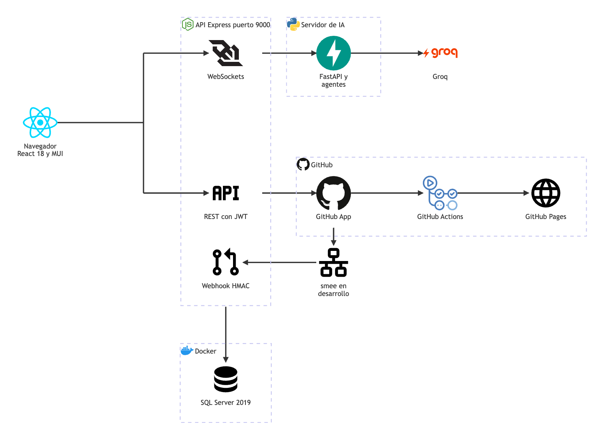
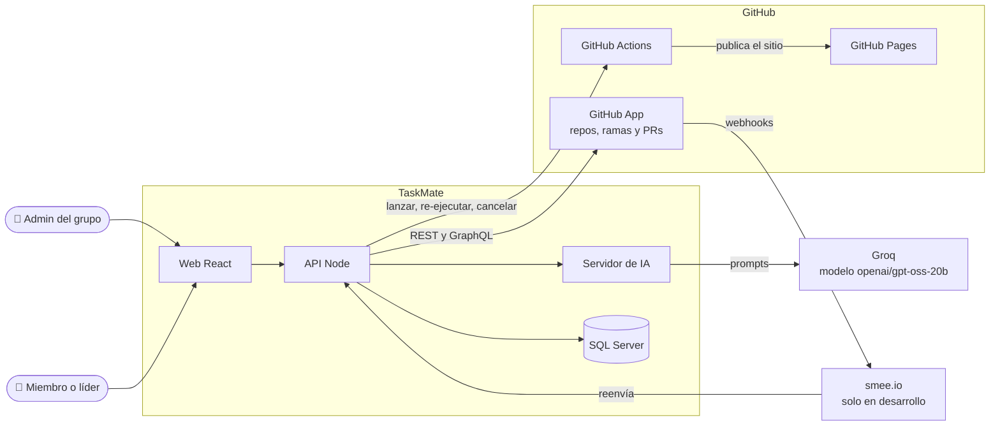

# Arquitectura general

**En una frase:** TaskMate es una web en React que habla con una API en Node; la API guarda todo en SQL Server, le pide la IA a un servidor en Python que usa Groq, y se conecta con GitHub para repositorios y CI/CD.

Fuente del diagrama: [fuentes/00-general.mmd](fuentes/00-general.mmd). Las flechas que salen del borde de la API o de GitHub parten del grupo entero, no del icono que tienen al lado.

| Conexión | Qué viaja | Cómo |
|---|---|---|
| Navegador → REST | Tareas, grupos, hitos, analytics y GitHub | HTTP con `Authorization: Bearer <JWT>` |
| Navegador → WebSockets | Chat (`/chat`), panel de analytics (`/insights`) y avisos de CI/CD (`/events`) | WebSocket con `?token=<JWT>` |
| API → Servidor de IA | Mensajes del chat, recomendaciones, análisis del repo y propuesta de pipeline | Un solo WebSocket a `/ws` con la cabecera `X-MCP-Secret` |
| Servidor de IA → Groq | Prompts y respuestas del modelo `openai/gpt-oss-20b` | HTTPS con el cliente `AsyncGroq` |
| API → GitHub App | Leer el repo, crear ramas, subir el workflow, lanzar y leer ejecuciones, deploys | REST y GraphQL con tokens de instalación de 1 h |
| GitHub App → Actions → Pages | El workflow del grupo corre en Actions y publica el sitio | Lo ejecuta GitHub |
| GitHub → smee → Webhook | Eventos de PRs, ejecuciones, jobs, deploys e instalaciones | `POST /api/github/webhook` con firma HMAC |
| API → SQL Server | Todos los datos | Driver `tedious` con un pool de conexiones |

No se dibujan dos conexiones internas: el webhook avisa a los navegadores por `/events`, y al instalar la App el navegador va a GitHub y GitHub lo devuelve a `GET /api/github/callback`.

## Contexto

Quién usa TaskMate y con qué sistemas externos habla.

## Qué hace cada capa

| Capa | Tecnología | Carpeta | Puerto | Qué hace |
|---|---|---|---|---|
| Frontend | React 18, MUI 6, React Router 6, `@xyflow/react` 12, react-big-calendar | `src/` | 3000 | Pantallas de la app (SPA: una sola página que cambia de vista sin recargar) |
| API | Node.js, Express 4, `ws`, `jsonwebtoken`, `tedious` | `taskmate-api/` | 9000 | REST, 3 WebSockets, webhook de GitHub y reglas de acceso |
| Servidor de IA | Python, FastAPI, uvicorn, Pydantic, cliente `groq` | `taskmate-api/mcp/` | `MCP_PORT` (8001 por defecto; 8011 en la máquina de desarrollo), solo `127.0.0.1` | Agentes que arman prompts para Groq y validan lo que responde |
| Base de datos | SQL Server 2019 en Docker (`taskmate-sql`) | `taskmate-api/taskmate_tables.sql` y `migrations/` | 1433 | 24 tablas y 2 triggers |
| Externos | Groq, GitHub App, GitHub Actions, GitHub Pages, smee.io | — | — | Modelo de IA, repositorio y CI/CD del grupo |

Términos:
- **JWT:** token firmado que prueba quién eres; dura 24 h.
- **WebSocket:** conexión que queda abierta y deja hablar en los dos sentidos.
- **Webhook:** aviso HTTP que GitHub manda cuando algo cambia en el repositorio.
- **HMAC:** firma calculada con un secreto compartido; prueba que el aviso viene de GitHub.
- **smee:** proxy público que reenvía los webhooks a `localhost` mientras se desarrolla.
- La carpeta `mcp/` **no** usa el Model Context Protocol: Node y Python hablan un JSON propio por WebSocket.

## Cómo funciona

Una acción típica, de la pantalla a la base de datos:

1. La pantalla llama a la API con el JWT (`src/api/client.js`).
2. Express aplica `helmet` y CORS; después `requireAuth` revisa el JWT y `apiLimiter` cuenta la petición.
3. Un guardia de grupo revisa que seas miembro o admin del grupo.
4. El controller valida los datos y llama a un modelo o a un servicio.
5. El modelo ejecuta SQL parametrizado con `tedious`; las operaciones de varios pasos van en una transacción.
6. Si hace falta IA, `LLMService` manda el pedido a Python por el WebSocket compartido.
7. Si hace falta GitHub, `services/github/` pide un token de instalación y llama a GitHub.
8. La respuesta vuelve como JSON; un error vuelve como `{ success: false, error, code }` y nunca trae el texto de la base de datos.

## Dónde está en el código

| Archivo | Qué hace |
|---|---|
| `src/App.js` | Rutas y proveedores del frontend |
| `taskmate-api/server.js` | Arranca HTTP, WebSockets y las tareas de fondo |
| `taskmate-api/app.js` | Monta middleware y routers de Express |
| `taskmate-api/services/WebSocketServer.js` | `/chat`, `/insights` y `/events` |
| `taskmate-api/services/LLMService.js` | Cliente del servidor de IA |
| `taskmate-api/services/github/` | GitHub App, webhook, ramas, pipeline y deploys |
| `taskmate-api/mcp/server.py` | Servidor de IA (`/ws`) |
| `start.sh` | Levanta SQL Server, el servidor de IA y la API |

## Para saber más

- [Despliegue y puertos](00-despliegue.md)
- [Capas del código](00-capas-del-codigo.md)
- [Seguridad](00-seguridad.md)
- [Modelo de datos](../03-base-de-datos/00-general.md)
- [Guía técnica: referencia de la API](../07-guias/guia-tecnica.md#5-referencia-de-la-api)
- Mini-arquitecturas por módulo: [usuarios y acceso](01-usuarios-y-acceso.md), [grupos y roles](02-grupos-y-roles.md), [tareas](03-tareas.md), [hitos y calendario](04-hitos-y-calendario.md), [chat IA](05-chat-ia.md), [analytics](06-analytics.md), [GitHub](07-github.md), [CI/CD](08-cicd.md), [tiempo real y avisos](09-tiempo-real-y-avisos.md)
- Limitaciones conocidas: [cierre del proyecto](../01-proyecto/cierre-del-proyecto.md#limitaciones-conocidas)
