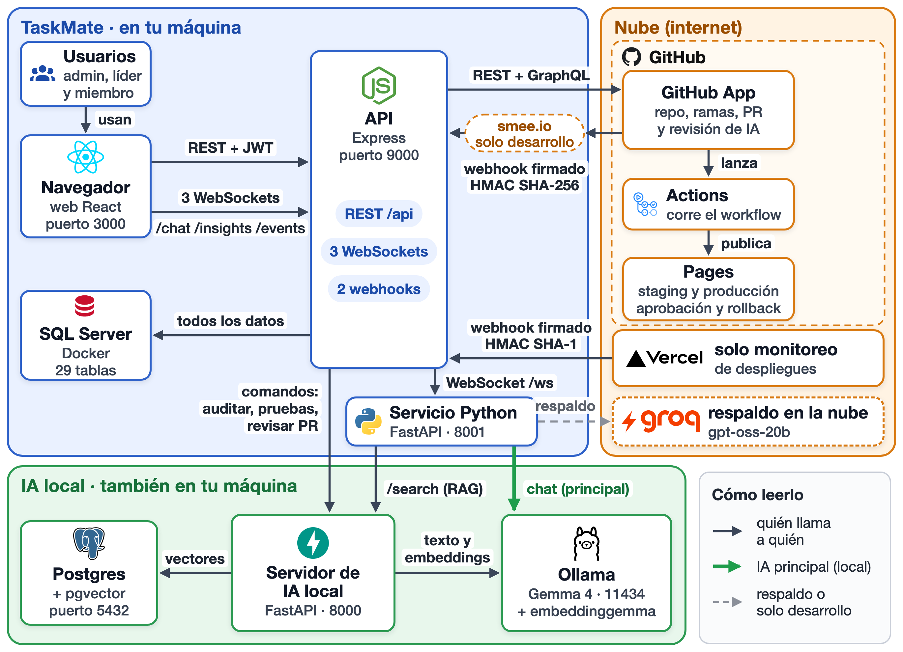
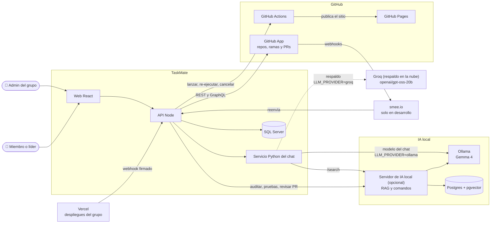

# Arquitectura general

**En una frase:** TaskMate es una web en React que habla con una API en Node; la API guarda todo en SQL Server, le pide el chat y los planes a un servicio Python que usa el modelo local Gemma 4 en Ollama (Groq queda como respaldo en la nube), le pide al servidor de IA local que audite ramas, proponga pruebas y revise PRs, y se conecta con GitHub (repositorios y CI/CD) y con Vercel (monitoreo de despliegues).

Fuente del diagrama: [fuentes/00-general.mmd](fuentes/00-general.mmd). Las flechas que salen del borde de un grupo (API, servicio Python o GitHub) parten del grupo entero, no del icono que tienen al lado. La línea de arriba junta las dos llamadas al servidor de IA local: la de la API y la del servicio Python.

| Conexión | Qué viaja | Cómo |
|---|---|---|
| Navegador → REST | Tareas, grupos, hitos, analytics, GitHub y despliegues de Vercel | HTTP con `Authorization: Bearer <JWT>` |
| Navegador → WebSockets | Chat (`/chat`), panel de analytics (`/insights`) y avisos de CI/CD (`/events`) | WebSocket con `?token=<JWT>` |
| API → Servicio Python | Mensajes del chat, recomendaciones, análisis del repo y propuesta de pipeline | Un solo WebSocket a `/ws` con la cabecera `X-MCP-Secret` |
| Servicio Python → Ollama (Gemma 4) | Prompts y respuestas del modelo; el chat responde en streaming | `POST /api/chat` a `127.0.0.1:11434`, modelo `gemma4:e2b-it-qat`. Lo activa `LLM_PROVIDER=ollama`, que pone `scripts/local-up.sh` |
| Servicio Python → Groq (respaldo en la nube) | Lo mismo, solo si se usa Groq | HTTPS con `AsyncGroq`, modelo `openai/gpt-oss-20b` y `GROQ_API_KEY`. Es el valor por defecto de `LLM_PROVIDER` en el código, para que un checkout sin Ollama siga funcionando |
| Servicio Python → Servidor de IA local | Documentos del proyecto para el chat sin proyecto seleccionado (RAG) | `POST /search` con `X-AI-Server-Secret`; si falla, el chat sigue sin ellos |
| API → Servidor de IA local | Los parches del diff de la rama de una tarea, para auditarla, proponer pruebas o revisar su PR | `POST /commands/{audit, generate-tests, review-pr}` con `X-AI-Server-Secret` |
| Servidor de IA local → Ollama y Postgres | Generar texto (`gemma4:e2b-it-qat`), embeddings (`embeddinggemma:300m`) y buscar por similitud | Ollama en `127.0.0.1:11434`; Postgres 17 + pgvector en `127.0.0.1:5432` |
| API → GitHub App | Leer el repo, crear ramas, subir el workflow, lanzar y leer ejecuciones, deploys y publicar la revisión de IA del PR | REST y GraphQL con tokens de instalación de 1 h |
| GitHub App → Actions → Pages | El workflow del grupo corre en Actions y publica el sitio | Lo ejecuta GitHub |
| GitHub → smee → Webhook | Eventos de PRs (también disparan la revisión con IA), ejecuciones, jobs, deploys e instalaciones | `POST /api/github/webhook` con firma HMAC SHA-256 |
| Vercel → Webhook | Eventos `deployment.*` del proyecto de Vercel vinculado al grupo (solo monitoreo) | `POST /api/deploy/webhook/vercel` con firma HMAC SHA-1 en `x-vercel-signature` |
| API → SQL Server | Todos los datos | Driver `tedious` con un pool de conexiones |

No se dibujan dos conexiones internas: el webhook de GitHub avisa a los navegadores por `/events`, y al instalar la App el navegador va a GitHub y GitHub lo devuelve a `GET /api/github/callback`.

El modelo del chat es el local (Ollama con Gemma 4). Lo opcional es el servidor de IA local: sin `AI_SERVER_URL`, auditar, proponer pruebas y revisar un PR responden 503 `AI_SERVER_DISABLED` («Review PR» lo comprueba antes de reservar el commit, así que no deja una revisión `failed`), el webhook no lanza la revisión automática y el chat funciona sin los documentos del proyecto. El servidor de IA local es un repo aparte de Christian; lo explica [IA sobre el código](10-ia-sobre-el-codigo.md).

## Contexto

Quién usa TaskMate y con qué sistemas habla.

## Qué hace cada capa

| Capa | Tecnología | Carpeta | Puerto | Qué hace |
|---|---|---|---|---|
| Frontend | React 18, MUI 6, React Router 6, `@xyflow/react` 12, react-big-calendar | `src/` | 3000 | Pantallas de la app (SPA: una sola página que cambia de vista sin recargar) |
| API | Node.js, Express 4, `ws`, `jsonwebtoken`, `tedious` | `taskmate-api/` | 9000 | REST, 3 WebSockets, webhooks de GitHub y de Vercel, llamadas al servidor de IA local y reglas de acceso |
| Servicio Python del chat | Python, FastAPI, uvicorn, Pydantic, `httpx` (Ollama) y cliente `groq` (respaldo) | `taskmate-api/mcp/` | `MCP_PORT` (8001 por defecto; 8011 en la Mac de desarrollo), solo `127.0.0.1` | Agentes que arman los prompts para el modelo local (o Groq, si se usa el respaldo), responden el chat en streaming y validan lo que responde el modelo |
| Servidor de IA local (opcional) | Python, FastAPI, Ollama, Postgres 17 + pgvector | Repo aparte `taskmate-ai-server` (se clona en `../ai-server`) | 8000 (Ollama 11434, Postgres 5432), solo `127.0.0.1` | RAG sobre los documentos del proyecto y los comandos `audit`, `generate-tests` y `review-pr` |
| Base de datos | SQL Server 2019 en un contenedor (`taskmate-sql`) de Docker o Podman | `taskmate-api/taskmate_tables.sql` y `migrations/` (001–011) | 1433 | 29 tablas y 2 triggers |
| Externos | Groq (respaldo en la nube, solo si `LLM_PROVIDER=groq`), GitHub App, GitHub Actions, GitHub Pages, Vercel, smee.io | — | — | Modelo de respaldo en la nube, repositorio, CI/CD y despliegues del grupo |

Términos:
- **JWT:** token firmado que prueba quién eres; dura 24 h.
- **WebSocket:** conexión que queda abierta y deja hablar en los dos sentidos.
- **Webhook:** aviso HTTP que GitHub o Vercel mandan cuando algo cambia.
- **HMAC:** firma calculada con un secreto compartido; prueba que el aviso viene de GitHub (SHA-256) o de Vercel (SHA-1).
- **smee:** proxy público que reenvía los webhooks de GitHub a `localhost` mientras se desarrolla.
- **Ollama:** programa que corre modelos de IA en la propia máquina. TaskMate usa Gemma 4 (`gemma4:e2b-it-qat`) para el chat, los planes, analytics, el análisis del repo y el pipeline, y el servidor de IA local usa el mismo.
- **RAG:** buscar en los documentos indexados los fragmentos más parecidos a la pregunta y dárselos al modelo como contexto. Los guarda Postgres con la extensión **pgvector**.
- **Nombres:** «servicio Python» es `taskmate-api/mcp/`; «servidor de IA local» es el repo aparte `taskmate-ai-server`. Antes estas páginas llamaban «servidor de IA» a `mcp/`.
- La carpeta `mcp/` **no** usa el Model Context Protocol: Node y Python hablan un JSON propio por WebSocket.

## Cómo funciona

Una acción típica, de la pantalla a la base de datos:

1. La pantalla llama a la API con el JWT (`src/api/client.js`), en el mismo host de la página y el puerto 9000.
2. Express aplica `helmet` y CORS (solo los orígenes de `FRONTEND_URL`; con `ALLOW_LAN_ORIGINS=true`, también `http://` con IPv4 privada; pensado solo para desarrollo, el código no lo impide en producción). Después `requireAuth` revisa el JWT y `apiLimiter` cuenta la petición.
3. Un guardia de grupo revisa que seas miembro o admin del grupo.
4. El controller valida los datos y llama a un modelo o a un servicio.
5. El modelo ejecuta SQL parametrizado con `tedious`; las operaciones de varios pasos van en una transacción.
6. Si hace falta el chat o un plan, `LLMService` manda el pedido al servicio Python por el WebSocket compartido.
7. Si hace falta auditar, proponer pruebas o revisar un PR, `services/aiServer/` llama al servidor de IA local con los parches de la rama.
8. Si hace falta GitHub, `services/github/` pide un token de instalación y llama a GitHub.
9. La respuesta vuelve como JSON; un error vuelve como `{ success: false, error, code }` y nunca trae el texto de la base de datos.

Los dos webhooks no llevan JWT: se montan antes de `express.json()` y cada uno comprueba su firma sobre los bytes exactos del cuerpo.

## Dónde está en el código

| Archivo | Qué hace |
|---|---|
| `src/App.js` | Rutas y proveedores del frontend |
| `src/config.js` | URL de la API y de los WebSockets: el host de la página en el puerto 9000 |
| `taskmate-api/server.js` | Arranca HTTP, WebSockets y las tareas de fondo |
| `taskmate-api/app.js` | Monta middleware, routers y los dos webhooks |
| `taskmate-api/middleware/cors.js` | Orígenes permitidos para REST y WebSockets (`FRONTEND_URL` y `ALLOW_LAN_ORIGINS`) |
| `taskmate-api/services/WebSocketServer.js` | `/chat`, `/insights` y `/events` |
| `taskmate-api/services/LLMService.js` | Cliente del servicio Python |
| `taskmate-api/services/aiServer/` | Cliente del servidor de IA local: auditar, proponer pruebas y revisar PRs |
| `taskmate-api/services/github/` | GitHub App, webhook, ramas, archivos de la tarea, pipeline y deploys |
| `taskmate-api/controllers/deploy.controller.js` y `services/deploy/` | Webhook de Vercel y rutas `/api/deploy` |
| `taskmate-api/mcp/server.py` | Servicio Python (`/ws`) |
| `taskmate-api/mcp/llm_service.py` | Llama al modelo: Ollama con `LLM_PROVIDER=ollama`, o Groq (respaldo) con `groq` |
| `taskmate-api/mcp/knowledge.py` | Consulta `/search` del servidor de IA local |
| `start.sh` | macOS: levanta SQL Server (Docker o Podman), el servicio Python y la API |
| `scripts/local-up.sh` y `scripts/local-down.sh` | Linux con Podman: levantan y detienen todo, IA local incluida |

## Para saber más

- [Despliegue y puertos](00-despliegue.md)
- [Capas del código](00-capas-del-codigo.md)
- [Seguridad](00-seguridad.md)
- [Modelo de datos](../03-base-de-datos/00-general.md)
- [Guía técnica: referencia de la API](../07-guias/guia-tecnica.md#5-referencia-de-la-api)
- Mini-arquitecturas por módulo: [usuarios y acceso](01-usuarios-y-acceso.md), [grupos y roles](02-grupos-y-roles.md), [tareas](03-tareas.md), [hitos y calendario](04-hitos-y-calendario.md), [chat IA](05-chat-ia.md), [analytics](06-analytics.md), [GitHub](07-github.md), [CI/CD](08-cicd.md), [tiempo real y avisos](09-tiempo-real-y-avisos.md), [IA sobre el código](10-ia-sobre-el-codigo.md)
- Línea de Christian (servidor de IA local, Vercel, chat con IA local): [09-linea-christian](../09-linea-christian/README.md)
- Limitaciones conocidas: [cierre de la línea de Pablo y estado](../01-proyecto/cierre-del-proyecto.md#limitaciones-conocidas)
