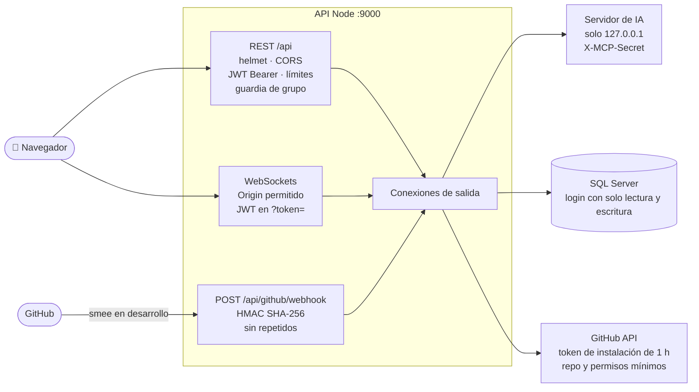

# Seguridad

**En una frase:** cada entrada a TaskMate tiene su propio control: JWT y límites en la API, `Origin` y JWT en los WebSockets, firma HMAC en los webhooks, `X-MCP-Secret` hacia el servidor de IA, tokens de GitHub cortos y con permisos mínimos, y un login de base de datos que solo lee y escribe datos.

## Qué hace

| Control | Dónde actúa | Detalle |
|---|---|---|
| JWT de sesión | REST y WebSockets | HS256, dura 24 h, solo tokens de tipo `access`. `JWT_SECRET` debe tener 32+ caracteres y no ser un marcador; si no, la API no arranca |
| JWT en WebSockets | `/chat`, `/insights`, `/events` | Se revisa antes del upgrade (`?token=`). Al vencer el token, el servidor cierra el socket |
| `Origin` | WebSockets y CORS | Solo los orígenes de `FRONTEND_URL` (por defecto `http://localhost:3000`). Un WebSocket de otro origen recibe 403; en REST, CORS hace que el navegador bloquee la respuesta |
| Cabeceras HTTP | Toda la API | `helmet` |
| Contraseñas | Registro y login | Hash bcrypt (costo 10); la base nunca guarda la contraseña |
| Errores | Toda la API | Formato `{ success: false, error, code }`, sin el texto de la base de datos |
| Webhook | `POST /api/github/webhook` | Firma `X-Hub-Signature-256` sobre los bytes exactos, comparada en tiempo constante. Cada entrega se registra por su id y por el SHA-256 del cuerpo: un repetido no se procesa dos veces |
| Servidor de IA | `ws://127.0.0.1:MCP_PORT/ws` | Exige `X-MCP-Secret` (32+ caracteres, comparación en tiempo constante) y rechaza cualquier conexión con `Origin` (o sea, de un navegador) |
| Tokens de GitHub | `services/github/githubApp.js` | La API firma un JWT RS256 con la llave de la App y pide tokens de instalación de 1 h, limitados al repositorio y al permiso de cada acción (`contents: read`, `actions: write`…). Viven solo en memoria |
| IA y repositorio | Análisis del repo | Solo si el admin activa «Permitir análisis con IA»; se manda un resumen con los secretos tapados, no el código |
| Base de datos | `setup-db.sh` | El login de la app solo tiene `db_datareader` y `db_datawriter`, y un `DENY` sobre `dbo.SchemaMigrations`. Las migraciones corren como `SA`. Un contenedor creado con una imagen anterior no lo tiene aplicado ([pendiente](../01-proyecto/cierre-del-proyecto.md#prioridad-alta-seguridad-y-operación)) |
| SQL | `models/` | Siempre consultas con parámetros |

**Límites de peticiones** (por usuario, salvo el de login)

| Qué | Límite |
|---|---|
| Registro y login | 10 cada 15 min por IP (`AUTH_RATE_LIMIT_MAX`) |
| Resto de la API REST | 300 por minuto (`API_RATE_LIMIT_MAX`) |
| Recomendaciones de IA | 10 por minuto |
| GitHub: instalar · explorar · crear rama · sincronizar | 10/min · 60/min y 600/h · 20/min · 1 cada 30 s |
| CI/CD: proponer o aplicar pipeline · vista previa · ejecutar, re-ejecutar o cancelar | 10/min · 60/min · 10/min |
| Chat | 20 mensajes por minuto y 4000 caracteres por mensaje; 1 análisis del repo por minuto |

**Roles**

| Rol | Quién es | Qué agrega |
|---|---|---|
| Miembro | Tiene fila en `UserGroups` | Ver y trabajar con los datos de su grupo; todo se acota por grupo |
| Admin | `Groups.adminId`, uno por grupo, y debe seguir siendo miembro | Miembros, roles, conectar el repositorio, pipeline, deploys y aprobar producción |
| Líder | El admin, o un miembro con un rol cuyo nombre contiene «leader» | Analytics del equipo |

## Cómo funciona

1. La petición REST pasa por `helmet` y CORS.
2. `requireAuth` valida el JWT y `apiLimiter` la cuenta.
3. El guardia de grupo revisa que seas miembro o admin del grupo del recurso; si el mismo id llega distinto en ruta, query y cuerpo, responde 400.
4. El controller valida los datos y el modelo ejecuta SQL con parámetros.
5. Si la acción toca GitHub, se pide un token de instalación solo para ese repositorio y ese permiso.

## Dónde está en el código

| Archivo | Qué hace |
|---|---|
| `taskmate-api/helpers/tokens.js` | Firma y valida los JWT |
| `taskmate-api/middleware/auth.middleware.js`, `rateLimit.js`, `cors.js` | JWT, límites y orígenes |
| `taskmate-api/middleware/groupAccess.js`, `models/access.model.js` | Miembro, admin y líder |
| `taskmate-api/services/WebSocketServer.js` | `Origin` y JWT en el upgrade |
| `taskmate-api/services/github/webhookSignature.js`, `webhookHandler.js` | HMAC y entregas repetidas |
| `taskmate-api/services/github/githubApp.js` | Tokens de instalación y permisos mínimos |
| `taskmate-api/mcp/server.py` | `X-MCP-Secret` y rechazo de `Origin` |
| `taskmate-api/setup-db.sh` | Login de mínimo privilegio |
| `.env` (no se sube a git) | `JWT_SECRET`, `MCP_SHARED_SECRET`, `GITHUB_WEBHOOK_SECRET`, `GITHUB_APP_PRIVATE_KEY`, `GITHUB_APP_CLIENT_SECRET`, `GROQ_API_KEY`, `DB_PASSWORD` |

## Para saber más

- Riesgos que quedan (JWT en la query del WebSocket, estado en memoria, `.env` completo en el servidor de IA): [cierre del proyecto, operación y seguridad](../01-proyecto/cierre-del-proyecto.md#operación-y-seguridad)
- Quién puede hacer qué, ruta por ruta: [permisos por rol](../04-casos-de-uso/00-permisos-por-rol.md)
- Seguridad de la integración con GitHub: [Fase 3, seguridad y base de datos](../08-fases/fase-03-integracion-github/SEGURIDAD-Y-BASE-DE-DATOS.md)
- Generar los secretos: [guía de la GitHub App](../07-guias/guia-github-app.md#3-generar-los-secretos)
- [Arquitectura general](00-general.md) · [Despliegue y puertos](00-despliegue.md)
