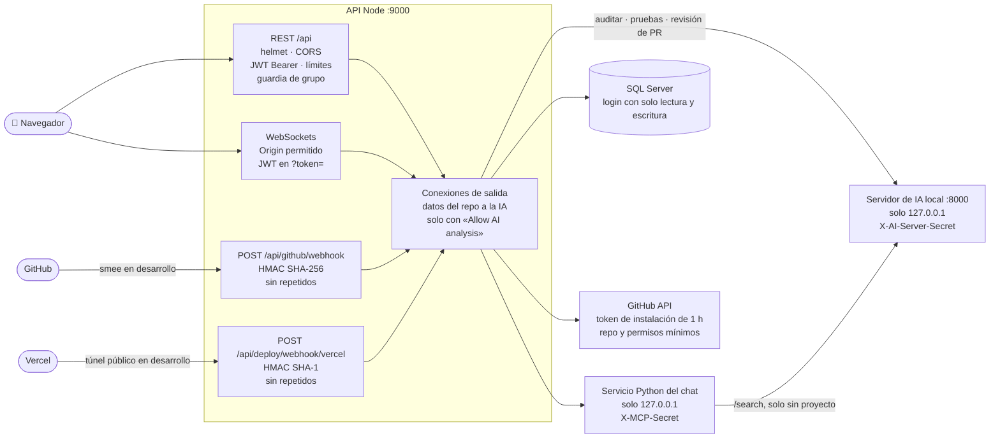

# Seguridad

**En una frase:** cada entrada a TaskMate tiene su propio control: JWT y límites en la API, `Origin` y JWT en los WebSockets, firma HMAC en los dos webhooks (GitHub con SHA-256 y Vercel con SHA-1), `X-MCP-Secret` hacia el servicio Python del chat, `X-AI-Server-Secret` hacia el servidor de IA local, el permiso «Allow AI analysis» antes de mandar datos del repositorio a la IA, tokens de GitHub cortos y con permisos mínimos, y un login de base de datos que solo lee y escribe datos.

## Qué hace

| Control | Dónde actúa | Detalle |
|---|---|---|
| JWT de sesión | REST y WebSockets | HS256, dura 24 h, solo tokens de tipo `access`. `JWT_SECRET` debe tener 32+ caracteres y no ser un marcador; si no, la API no arranca |
| JWT en WebSockets | `/chat`, `/insights`, `/events` | Se revisa antes del upgrade (`?token=`). Al vencer el token, el servidor cierra el socket |
| `Origin` | WebSockets y CORS | Solo los orígenes de `FRONTEND_URL` (por defecto `http://localhost:3000`; se relee en cada petición). Con `ALLOW_LAN_ORIGINS=true` (solo desarrollo, apagado por defecto) también pasan los `http://` con IPv4 privada (10.x, 172.16–31.x, 192.168.x) y cualquier puerto; no https, IPv6 ni nombres de host. Un WebSocket de otro origen recibe 403; en REST, CORS hace que el navegador bloquee la respuesta |
| Cabeceras HTTP | Toda la API | `helmet` |
| Contraseñas | Registro y login | Hash bcrypt (costo 10); la base nunca guarda la contraseña |
| Errores | Toda la API | Formato `{ success: false, error, code }`, sin el texto de la base de datos |
| Webhook de GitHub | `POST /api/github/webhook` | Firma `X-Hub-Signature-256` (`sha256=` + HMAC SHA-256) sobre los bytes exactos, comparada en tiempo constante. Cada entrega se registra por su id y por el SHA-256 del cuerpo: un repetido no se procesa dos veces (una entrega fallida sí se puede reenviar) |
| Webhook de Vercel | `POST /api/deploy/webhook/vercel` | Firma `x-vercel-signature`: HMAC SHA-1 en 40 caracteres hex sin prefijo (distinto del `sha256=` de GitHub), sobre los bytes exactos y en tiempo constante. Sin `VERCEL_WEBHOOK_SECRET` o con una firma mala, 401. Cada entrega se registra en `DeploymentWebhookDeliveries` por el `id` del evento (o el SHA-256 del cuerpo); un id ya visto responde `duplicate`, aunque haya fallado. Tras reclamar la entrega siempre responde 200 |
| Proyecto de Vercel | `PUT` y `DELETE /api/deploy/groups/:gid/target` | Solo el admin del grupo lo vincula o desvincula. Un proyecto no puede estar en dos grupos; TaskMate no consulta a Vercel quién es su dueño. Los eventos de un proyecto sin vincular se ignoran |
| Servicio Python del chat | `ws://127.0.0.1:MCP_PORT/ws` | Exige `X-MCP-Secret` (32+ caracteres, comparación en tiempo constante) y rechaza cualquier conexión con `Origin` (o sea, de un navegador) |
| Servidor de IA local | `http://127.0.0.1:8000` (repo `taskmate-ai-server`) | Exige `X-AI-Server-Secret` en todo salvo `/health`, `/docs`, `/redoc` y `/openapi.json`; compara con `hmac.compare_digest` y responde 401 si falta o no coincide. No arranca si `AI_SERVER_SECRET` tiene menos de 32 caracteres o es un marcador (ni vacío, salvo con `AI_SERVER_ALLOW_NO_SECRET=1`). Lo mandan la API (auditar, pruebas, revisión de PR) y el servicio Python (`/search`) |
| Tokens de GitHub | `services/github/githubApp.js` | La API firma un JWT RS256 con la llave de la App y pide tokens de instalación de 1 h, limitados al repositorio y al permiso de cada acción (`contents: read`, `actions: write`…). `pull_requests: read` sirve para sincronizar, leer el PR y la lista de archivos de la tarea; `pull_requests: write` se pide solo para publicar la revisión con IA (es opcional en la App: sin él la revisión se guarda con `posted = no_permission`). Los tokens viven solo en memoria |
| Permiso de IA | «Allow AI analysis» (solo el admin) | Sin él no hay análisis del repo, ni pipeline con IA, ni datos del repo en el chat, ni Audit, Generate tests o Review PR (409 `AI_ANALYSIS_DISABLED`), y el webhook no revisa el PR |
| Qué recibe el modelo del servicio Python | Chat, análisis del repo y pipeline | Con permiso, un resumen del repo (estructura, README, manifiestos, commits e issues) con los secretos tapados, nunca el código. Con proyecto van siempre, sin pedir el permiso, las tareas, los hitos, los nombres de usuario del equipo y las asignaciones. Con el modelo local (`LLM_PROVIDER=ollama`, lo que pone `scripts/local-up.sh`) eso se queda en la máquina; solo si se usa Groq (respaldo, el valor por defecto del código) va a la nube. Sin proyecto, hasta 2000 caracteres del mensaje van a `/search` del servidor de IA local |
| Qué recibe el servidor de IA local | Audit, Generate tests, Review PR | El parche de cada archivo del diff de la rama (API compare de GitHub), sin tapar secretos; en la revisión, también el título y la descripción del PR. Las pruebas propuestas no se ejecutan ni se suben al repositorio |
| Revisión de PR publicada | GitHub, review `COMMENT` | Nunca aprueba ni pide cambios. El servidor de IA local escapa el resumen, los riesgos, los hallazgos y las rutas (`md()`: sin enlaces, imágenes, HTML, código ni @menciones) y cambia por `***` los secretos que detectan sus reglas en todos los archivos. Un hallazgo de seguridad nunca repite la línea, y si el cambio trae una llave privada no se publica texto del modelo. Solo la revisión tapa secretos: la salida de Audit y Generate tests llega tal cual a los miembros del grupo, que la ven como texto (la interfaz no interpreta Markdown ni HTML) |
| Base de datos | `setup-db.sh` | El login de la app solo tiene `db_datareader` y `db_datawriter`, y un `DENY` sobre `dbo.SchemaMigrations`. Las migraciones corren como `SA`. Un contenedor creado con una imagen anterior no lo tiene aplicado ([pendiente](../01-proyecto/cierre-del-proyecto.md#prioridad-alta-seguridad-y-operación)) |
| SQL | `models/` | Siempre consultas con parámetros |

**Límites de peticiones** (por usuario, salvo el de login y los webhooks)

| Qué | Límite |
|---|---|
| Registro y login | 10 cada 15 min por IP (`AUTH_RATE_LIMIT_MAX`) |
| Resto de la API REST | 300 por minuto (`API_RATE_LIMIT_MAX`) |
| Recomendaciones de IA | 10 por minuto |
| GitHub: instalar · explorar y archivos de la tarea · crear rama · sincronizar | 10/min · 60/min y 600/h · 20/min · 1 cada 30 s |
| IA de la tarea: Audit, Generate tests y Review PR | 5 por minuto entre las tres (leer la última revisión no tiene límite propio) |
| CI/CD: proponer o aplicar pipeline · vista previa · ejecutar, re-ejecutar o cancelar | 10/min · 60/min · 10/min |
| Vincular el proyecto de Vercel | 10 por minuto |
| Chat | 20 mensajes por minuto y 4000 caracteres por mensaje; 1 análisis del repo por minuto (también si el plan se pide en el chat) |
| Webhooks de GitHub y Vercel | Sin límite: los protege la firma |

**Roles**

| Rol | Quién es | Qué agrega |
|---|---|---|
| Miembro | Tiene fila en `UserGroups` | Ver y trabajar con los datos de su grupo, incluidas las acciones de IA de la tarea si el admin dio permiso; todo se acota por grupo |
| Admin | `Groups.adminId`, uno por grupo, y debe seguir siendo miembro | Miembros, roles, conectar el repositorio, «Allow AI analysis», pipeline, deploys, aprobar producción y vincular el proyecto de Vercel |
| Líder | El admin, o un miembro con un rol cuyo nombre contiene «leader» | Analytics del equipo |

## Cómo funciona

1. La petición REST pasa por `helmet` y CORS.
2. `requireAuth` valida el JWT y `apiLimiter` la cuenta.
3. El guardia de grupo revisa que seas miembro o admin del grupo del recurso; si el mismo id llega distinto en ruta, query y cuerpo, responde 400.
4. El controller valida los datos y el modelo ejecuta SQL con parámetros.
5. Si la acción toca GitHub, se pide un token de instalación solo para ese repositorio y ese permiso.
6. Si la acción manda datos del repositorio a la IA, se revisa antes «Allow AI analysis»; la API llama al servicio Python (`X-MCP-Secret`) o al servidor de IA local (`X-AI-Server-Secret`).
7. Un webhook no lleva JWT: se verifica la firma sobre los bytes crudos, se reclama la entrega por su id y solo entonces se procesa.

## Dónde está en el código

| Archivo | Qué hace |
|---|---|
| `taskmate-api/helpers/tokens.js` | Firma y valida los JWT |
| `taskmate-api/middleware/auth.middleware.js`, `rateLimit.js`, `cors.js` | JWT, límites y orígenes (`isAllowedOrigin`, con `ALLOW_LAN_ORIGINS`) |
| `taskmate-api/middleware/groupAccess.js`, `models/access.model.js` | Miembro, admin y líder |
| `taskmate-api/services/WebSocketServer.js` | `Origin` y JWT en el upgrade |
| `taskmate-api/services/github/webhookSignature.js`, `webhookHandler.js` | HMAC SHA-256 y entregas repetidas de GitHub |
| `taskmate-api/services/deploy/deploySignature.js`, `deployWebhookHandler.js` | HMAC SHA-1 y entregas repetidas de Vercel |
| `taskmate-api/controllers/deploy.controller.js` | Solo el admin vincula el proyecto de Vercel |
| `taskmate-api/services/github/githubApp.js` | Tokens de instalación y permisos mínimos (`pullsWrite` para la revisión) |
| `taskmate-api/services/aiServer/client.js` | `X-AI-Server-Secret` y errores `AI_SERVER_*` |
| `taskmate-api/services/aiServer/taskAi.js`, `prReview.js` | Permiso de IA, diff de la rama y revisión `COMMENT` |
| `taskmate-api/mcp/server.py` | `X-MCP-Secret` y rechazo de `Origin` |
| `taskmate-api/mcp/knowledge.py` | `/search` con `X-AI-Server-Secret` |
| `taskmate-ai-server`: `src/api.py`, `src/review.py` | Secreto del servidor de IA local, escape (`md()`) y tapado de secretos (repo aparte de Christian) |
| `taskmate-api/setup-db.sh` | Login de mínimo privilegio |
| `.env` (no se sube a git) | `JWT_SECRET`, `MCP_SHARED_SECRET`, `AI_SERVER_SECRET` (el mismo valor que en el `.env` del servidor de IA local), `GITHUB_WEBHOOK_SECRET`, `VERCEL_WEBHOOK_SECRET` (lo genera `scripts/local-up.sh`; no está en `.env.example`), `GITHUB_APP_PRIVATE_KEY`, `GITHUB_APP_CLIENT_SECRET`, `GROQ_API_KEY` (solo si se usa Groq, el respaldo: `LLM_PROVIDER=groq`), `DB_PASSWORD` |

## Para saber más

- Riesgos que quedan (JWT en la query del WebSocket, estado en memoria, `.env` completo en el servicio Python del chat, el webhook de Vercel sin `try/catch` al reclamar la entrega, una revisión fallida que bloquea ese commit): [cierre de la línea de Pablo y estado, limitaciones conocidas](../01-proyecto/cierre-del-proyecto.md#limitaciones-conocidas)
- Quién puede hacer qué, ruta por ruta: [permisos por rol](../04-casos-de-uso/00-permisos-por-rol.md)
- Seguridad de la integración con GitHub: [Fase 3, seguridad y base de datos](../08-fases/fase-03-integracion-github/SEGURIDAD-Y-BASE-DE-DATOS.md)
- Auditoría, pruebas y revisión de PR con IA: [IA sobre el código](10-ia-sobre-el-codigo.md) · Monitoreo de Vercel: [CI/CD](08-cicd.md)
- Generar los secretos: [guía de la GitHub App](../07-guias/guia-github-app.md#3-generar-los-secretos)
- [Arquitectura general](00-general.md) · [Despliegue y puertos](00-despliegue.md)
