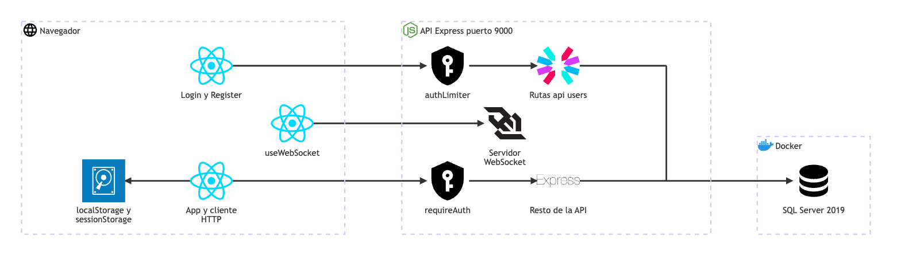

# Usuarios y acceso: arquitectura

**En una frase:** el navegador crea la cuenta o inicia sesión en `/api/users`, recibe un JWT de 24 h y lo manda en cada llamada a la API y al abrir cada WebSocket.

Las flechas del dibujo no llevan texto. Esto es lo que viaja por cada una:

| De → a | Qué viaja |
|---|---|
| Login y Register → authLimiter | `POST /api/users` (registro) y `POST /api/users/login`, sin token |
| authLimiter → Rutas `/api/users` | La petición pasa si la IP lleva menos de 10 intentos en 15 min; si no, responde 429 |
| Rutas `/api/users` → SQL Server | Registro: crea usuario, grupo personal y membresía en una transacción. Login: lee el hash de la contraseña |
| App y cliente HTTP → localStorage y sessionStorage | Guarda y lee `user`, `token` y `userId`; marca la pestaña con `sessionStarted` |
| App y cliente HTTP → requireAuth | Cada llamada lleva `Authorization: Bearer <JWT>` |
| requireAuth → Resto de la API | Solo deja pasar un JWT de acceso válido; si no, 401 |
| Resto de la API → SQL Server | Las consultas de cada módulo |
| useWebSocket → Servidor WebSocket | Upgrade a `/chat`, `/insights` o `/events` con `?token=JWT` |

Términos:
- **JWT** (JSON Web Token): texto firmado por la API que dice quién eres y cuándo vence.
- **bcrypt**: función lenta que convierte la contraseña en un hash; la contraseña nunca se guarda tal cual.
- **Rate limit**: número máximo de peticiones en una ventana de tiempo.
- **Upgrade**: el paso de una petición HTTP a una conexión WebSocket.

## Piezas

| Pieza | Tecnología | Archivo |
|---|---|---|
| Pantalla de inicio de sesión | React 18 + MUI | `src/components/Login.jsx` |
| Pantalla de registro | React 18 + MUI | `src/components/Register.jsx` |
| Sesión del navegador y rutas protegidas | React Router 6, `localStorage`, `sessionStorage` | `src/App.js` |
| Cliente HTTP (pone el Bearer, avisa los 401) | `fetch` | `src/api/client.js` |
| Cliente WebSocket (manda `?token=`, maneja el cierre 4001) | WebSocket del navegador | `src/hooks/useWebSocket.js` |
| Grupo activo, se limpia al salir | React Context | `src/components/GroupContext.jsx` |
| Menú de usuario con «Logout» | MUI | `src/components/Navbar.jsx` |
| Rutas de usuarios: registro, login, `getuid` | Express 4 | `taskmate-api/controllers/user.controller.js` |
| Hash de contraseñas (costo 10) | bcryptjs | `taskmate-api/controllers/user.controller.js` |
| Límites `authLimiter` y `apiLimiter` | express-rate-limit 8 | `taskmate-api/middleware/rateLimit.js` |
| Firmar y verificar tokens | jsonwebtoken, HS256 | `taskmate-api/helpers/tokens.js` |
| Guardia de las rutas REST | Middleware de Express | `taskmate-api/middleware/auth.middleware.js` |
| Orígenes permitidos (CORS y WebSocket) | cors | `taskmate-api/middleware/cors.js` |
| Servidor WebSocket con token y `Origin` | ws 8 | `taskmate-api/services/WebSocketServer.js` |
| Acceso a la tabla `Users` | tedious, transacción | `taskmate-api/models/user.model.js` |
| Arranque: exige `JWT_SECRET` | Node.js | `taskmate-api/server.js` |
| Base de datos | SQL Server 2019 en Docker | tablas `Users`, `Groups`, `UserGroups` |

## Cómo se conectan

- **Dos rutas públicas.** Registro y login son las únicas de `/api/users` sin token. Comparten el contador `authLimiter`: 10 intentos por IP cada 15 min (`AUTH_RATE_LIMIT_MAX`).
- **El token.** El login firma un JWT HS256 con `userId`, `username`, `typ: access` y vencimiento de 24 h. La API no arranca si `JWT_SECRET` falta, mide menos de 32 caracteres o parece un valor de ejemplo.
- **Rutas protegidas.** El resto de `/api/*` pasa por `requireAuth` y `apiLimiter` (300 peticiones por minuto por usuario, `API_RATE_LIMIT_MAX`). Solo quedan fuera el callback y el webhook de GitHub, que se autentican de otra forma ([GitHub](07-github.md)).
- **WebSockets.** Antes del upgrade el servidor revisa el `Origin` (403) y el token de `?token=` (401). Cuando el token vence, cierra el socket con el código 4001.
- **Cierre de sesión forzado.** Un 401 de la API o un cierre 4001 disparan el evento `taskmate:unauthorized`. `App.js` lo escucha, borra la sesión y vuelve a `/`.

## Para saber más

- Tablas: [03-base-de-datos/01-usuarios-y-acceso.md](../03-base-de-datos/01-usuarios-y-acceso.md)
- Quién puede hacer qué: [04-casos-de-uso/01-usuarios-y-acceso.md](../04-casos-de-uso/01-usuarios-y-acceso.md)
- Pantallas: [05-interfaz/01-usuarios-y-acceso.md](../05-interfaz/01-usuarios-y-acceso.md)
- Paso a paso y errores: [06-flujos/01-usuarios-y-acceso.md](../06-flujos/01-usuarios-y-acceso.md)
- Arquitectura completa: [00-general.md](00-general.md)
- Limitaciones conocidas (por ejemplo, el JWT en la URL del WebSocket): [cierre del proyecto](../01-proyecto/cierre-del-proyecto.md#limitaciones-conocidas)
- Fuente del diagrama: [fuentes/01-usuarios-y-acceso.mmd](fuentes/01-usuarios-y-acceso.mmd)
