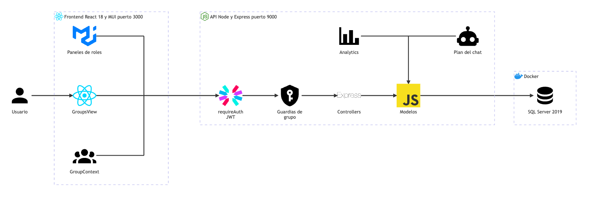

# Grupos y roles: arquitectura

**En una frase:** la pantalla `/groups` llama a la API con el JWT; la API revisa si quien llama es miembro o admin del grupo y solo entonces lee o cambia las 4 tablas del módulo en SQL Server.

Fuente del diagrama: [fuentes/02-grupos-y-roles.mmd](fuentes/02-grupos-y-roles.mmd).

| Desde | Hacia | Qué viaja |
|---|---|---|
| Usuario | GroupsView | Clics en la pantalla `/groups` |
| GroupsView, paneles de roles y GroupContext | requireAuth | HTTP con `Authorization: Bearer <JWT>` |
| requireAuth | Guardias de grupo | La petición con el usuario del token (`req.user.userId`) |
| Guardias de grupo | Controllers | La petición ya autorizada, con el grupo validado (`req.groupId`) |
| Controllers | Modelos | Llamadas como `leaveGroup(uid, gid)` o `assignRoleToUser(...)` |
| Analytics y Plan del chat | Modelos | Analytics pregunta quién es líder; el plan del chat crea un grupo con sus roles |
| Modelos | SQL Server 2019 | Consultas con parámetros (driver `tedious`); en transacción cuando cambian varias tablas |

## Piezas

| Pieza | Tecnología | Archivo |
|---|---|---|
| Pantalla de grupos | React 18 + MUI 6 | `src/components/GroupsView.jsx` |
| Paneles de roles | MUI (chips, diálogos, selector de icono) | `src/components/GroupRolesPanel.jsx`, `RoleForm.jsx`, `AssignRolesDialog.jsx`, `UserRolesChips.jsx` |
| Hook de roles | React hook (función que guarda estado y llama a la API) | `src/components/hooks/useGroupRoles.js` |
| Grupo activo | React Context + `localStorage` | `src/components/GroupContext.jsx` |
| Cliente HTTP | `fetch` con el JWT | `src/api/client.js` |
| requireAuth | JWT HS256 de 24 h (`jsonwebtoken`) | `taskmate-api/middleware/auth.middleware.js`, `helpers/tokens.js` |
| Guardias de grupo | Middleware de Express | `taskmate-api/middleware/groupAccess.js`, `models/access.model.js` |
| Controllers | Express 4 (`Router`) | `controllers/group.controller.js`, `groupRoles.controller.js`, `userGroupRoles.controller.js`; `user.controller.js` (`GET /getuid`) |
| Modelos | `tedious` + `withTransaction` | `models/group.model.js`, `userGroup.model.js`, `groupRoles.model.js`, `userGroupRoles.model.js`; `helpers/transaction.js` |
| Analytics | Regla de líder | `models/access.model.js` (`isGroupLeader`), `controllers/analytics.controller.js`, `services/UserSession.js` |
| Plan del chat | Crea grupo, membresía y roles | `services/ProjectService.js` |
| SQL Server 2019 | Contenedor Docker `taskmate-sql` | Tablas `Groups`, `UserGroups`, `GroupRoles` y `UserGroupRoles` |

**Términos:**
- **Middleware:** función de Express que corre antes del controller y puede cortar la petición.
- **Guardia:** middleware que revisa permisos. Aquí son `requireGroupMember` (exige ser miembro) y `requireGroupAdmin` (exige ser el admin).
- **Transacción:** varias escrituras que se guardan todas juntas o ninguna.

## Cómo se conectan

- **Tres llamadores en el navegador.** `GroupContext` pide los grupos del usuario. `GroupsView` maneja los miembros. `useGroupRoles` maneja los roles y sus asignaciones. Los tres usan `api/client.js`, que agrega el JWT.
- **Primero el JWT, luego el grupo.** `requireAuth` valida el token. Después, la guardia lee el `gid` de la ruta, la query o el cuerpo y consulta `access.model`. Si el mismo `gid` llega dos veces con valores distintos, responde 400.
- **Admin = `Groups.adminId`, y además debe seguir siendo miembro.** `isGroupAdmin` une `Groups` con `UserGroups`. Las acciones del admin responden 403 a cualquier otro.
- **Lo que cambia varias tablas va en una transacción.** Crear un grupo, salir de un grupo, quitar un miembro y borrar un rol o un grupo pasan por `withTransaction`. Salir, quitar y borrar bloquean primero la fila del grupo (`UPDLOCK, HOLDLOCK`), así dos de estas operaciones sobre el mismo grupo se ejecutan una después de la otra.
- **Otros módulos leen estos datos.** Analytics trata como **líder** al admin o a quien tenga un rol cuyo nombre contiene «leader». El plan del chat crea un grupo nuevo con sus roles. Todas las tablas con `gid` (tareas, hitos, repositorio…) cuelgan de `Groups`.

## Para saber más

- Tablas y campos: [03-base-de-datos/02-grupos-y-roles.md](../03-base-de-datos/02-grupos-y-roles.md)
- Quién puede hacer qué: [04-casos-de-uso/02-grupos-y-roles.md](../04-casos-de-uso/02-grupos-y-roles.md)
- Pantalla: [05-interfaz/02-grupos-y-roles.md](../05-interfaz/02-grupos-y-roles.md)
- Flujos y errores: [06-flujos/02-grupos-y-roles.md](../06-flujos/02-grupos-y-roles.md)
- Arquitectura de todo el sistema: [00-general.md](00-general.md)
- Limitaciones conocidas: [cierre del proyecto](../01-proyecto/cierre-del-proyecto.md#limitaciones-conocidas)
