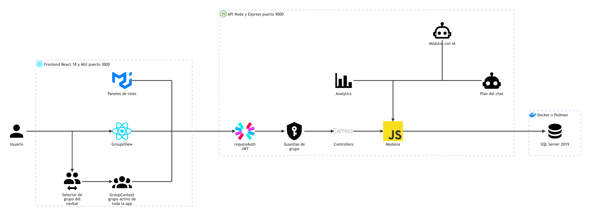

# Grupos y roles: arquitectura

**En una frase:** el grupo activo se elige en el selector del navbar o en `/groups` y se guarda en el navegador; la pantalla `/groups` llama a la API con el JWT, y la API revisa si quien llama es miembro o admin del grupo antes de leer o cambiar las 4 tablas del módulo en SQL Server.

Fuente del diagrama: [fuentes/02-grupos-y-roles.mmd](fuentes/02-grupos-y-roles.mmd).

| Desde | Hacia | Qué viaja |
|---|---|---|
| Usuario | GroupsView y selector de grupo del navbar | Clics en la pantalla `/groups` y en el menú junto al logo |
| Selector del navbar y GroupsView | GroupContext | El grupo elegido (`selectedGroupId` y `selectedGroupName`), que se guarda en `localStorage` |
| GroupContext | El resto de las pantallas | El grupo activo, que leen Tasks, Calendar, Milestones, Analytics, GitHub y AI Bot |
| GroupsView, paneles de roles y GroupContext | requireAuth | HTTP con `Authorization: Bearer <JWT>` |
| requireAuth | Guardias de grupo | La petición con el usuario del token (`req.user.userId`) |
| Guardias de grupo | Controllers | La petición ya autorizada, con el grupo validado (`req.groupId`) |
| Controllers | Modelos | Llamadas como `leaveGroup(uid, gid)` o `assignRoleToUser(...)` |
| Analytics, Plan del chat y módulos con IA | Modelos | Analytics pregunta quién es líder; el plan del chat crea un grupo con sus roles (o se los agrega a un grupo sin usar); el chat, GitHub, CI/CD y la IA sobre el código revisan la membresía y el permiso «análisis con IA» del grupo |
| Modelos | SQL Server 2019 | Consultas con parámetros (driver `tedious`); en transacción cuando cambian varias tablas |

## Piezas

| Pieza | Tecnología | Archivo |
|---|---|---|
| Pantalla de grupos | React 18 + MUI 6 | `src/components/GroupsView.jsx` |
| Selector de grupo del navbar | MUI (botón con menú) | `src/components/NavGroupSelector.jsx`; lo monta `src/components/Navbar.jsx` solo con sesión |
| Paneles de roles | MUI (chips, diálogos, selector de icono) | `src/components/GroupRolesPanel.jsx`, `RoleForm.jsx`, `AssignRolesDialog.jsx`, `UserRolesChips.jsx` |
| Hook de roles | React hook (función que guarda estado y llama a la API) | `src/components/hooks/useGroupRoles.js` |
| Grupo activo | React Context + `localStorage` | `src/components/GroupContext.jsx` |
| Cliente HTTP | `fetch` con el JWT | `src/api/client.js` |
| requireAuth | JWT HS256 de 24 h (`jsonwebtoken`) | `taskmate-api/middleware/auth.middleware.js`, `helpers/tokens.js` |
| Guardias de grupo | Middleware de Express | `taskmate-api/middleware/groupAccess.js`, `models/access.model.js` |
| Controllers | Express 4 (`Router`) | `controllers/group.controller.js`, `groupRoles.controller.js`, `userGroupRoles.controller.js`; `user.controller.js` (`GET /getuid`) |
| Modelos | `tedious` + `withTransaction` | `models/group.model.js`, `userGroup.model.js`, `groupRoles.model.js`, `userGroupRoles.model.js`; `helpers/transaction.js` |
| Analytics | Regla de líder | `models/access.model.js` (`isGroupLeader`), `controllers/analytics.controller.js`, `services/UserSession.js` |
| Plan del chat | Crea grupo, membresía y roles; en un grupo sin usar, le pone el nombre del proyecto y le agrega los roles | `services/ProjectService.js` |
| Permiso «análisis con IA» | Columna `BIT` del repositorio del grupo | `GroupRepositories.ai_analysis_enabled` (migración 005); ruta `PUT /api/github/groups/:gid/ai-analysis` en `controllers/github.controller.js`; `models/github.model.js` (`setAiAnalysisEnabled`) |
| SQL Server 2019 | Contenedor `taskmate-sql` (Docker, o Podman con `scripts/local-up.sh`) | Tablas `Groups`, `UserGroups`, `GroupRoles` y `UserGroupRoles` |

**Términos:**
- **Middleware:** función de Express que corre antes del controller y puede cortar la petición.
- **Guardia:** middleware que revisa permisos. Aquí son `requireGroupMember` (exige ser miembro) y `requireGroupAdmin` (exige ser el admin).
- **Transacción:** varias escrituras que se guardan todas juntas o ninguna.

## Cómo se conectan

- **Un grupo activo para toda la app.** `GroupContext` guarda el grupo elegido en `localStorage`.
  - Lo cambian el selector del navbar, un clic en un grupo de `/groups`, el inicio de sesión (queda el primero de tus grupos), el **View** de un aviso de CI/CD y la página de GitHub (al volver de instalar la App y en «Analyze with AI»).
  - Lo leen Tasks, Calendar, Milestones, Analytics y GitHub. El chat lo sigue: cuando cambia, manda `set_context` por WebSocket.
  - Si cambia desde el navbar, `/groups` abre los detalles de ese grupo.
  - Es solo del navegador y no da permisos: la API vuelve a revisar la membresía en cada petición.
- **Llamadores en el navegador.** `GroupContext.refreshGroups` pide los grupos del usuario (`GET /api/groups/user-groups`); lo llaman el selector del navbar (al montarse y cada vez que se abre), `/groups`, el login, el chat, la página de GitHub y la conexión de tiempo real (una vez por sesión si la lista está vacía). `GroupsView` maneja los miembros. `useGroupRoles` maneja los roles y sus asignaciones. Todos usan `api/client.js`, que agrega el JWT.
- **Primero el JWT, luego el grupo.** `requireAuth` valida el token. Después, la guardia lee el `gid` de la ruta, la query o el cuerpo y consulta `access.model`. Si el mismo `gid` llega dos veces con valores distintos, responde 400.
- **Admin = `Groups.adminId`, y además debe seguir siendo miembro.** `isGroupAdmin` une `Groups` con `UserGroups`. Las acciones del admin responden 403 a cualquier otro.
- **Lo que cambia varias tablas va en una transacción.** Crear un grupo, salir de un grupo, quitar un miembro y borrar un rol o un grupo pasan por `withTransaction`. Salir, quitar y borrar bloquean primero la fila del grupo (`UPDLOCK, HOLDLOCK`), así dos de estas operaciones sobre el mismo grupo se ejecutan una después de la otra.
- **El permiso «análisis con IA» es del grupo.**
  - Solo el admin lo cambia (`requireGroupAdmin`), con el interruptor «Allow AI analysis» de `/github`.
  - Vive en `GroupRepositories`, así que hace falta un repositorio conectado (si no, 409 `REPO_NOT_CONNECTED`). Vuelve a apagado si el grupo conecta otro repositorio.
  - Lo revisan el chat (el repositorio solo entra al contexto con permiso), el análisis del repositorio («Analyze with AI», «Propose tasks» o un plan pedido en el chat), «Propose with AI» del pipeline y la IA sobre el código (Audit, Generate tests, Review PR y la revisión automática del PR). Sin él, esas acciones fallan con `AI_ANALYSIS_DISABLED` (409 en las rutas) y la revisión automática no se hace.
- **Otros módulos leen estos datos.** Analytics trata como **líder** al admin o a quien tenga un rol cuyo nombre contiene «leader». El plan del chat crea un grupo nuevo con sus roles o, en un grupo sin usar del que el usuario es admin, le pone el nombre del proyecto y le agrega los roles. Todas las tablas con `gid` (tareas, hitos, repositorio, CI/CD, despliegues de Vercel…) cuelgan de `Groups`; al borrar el grupo, la base borra sola `AnalyticsConfig`, `GroupRepositories`, `DeployRequests`, `Deployments` y `GroupDeployTargets` ([detalle](../03-base-de-datos/02-grupos-y-roles.md#reglas)).

## Para saber más

- Tablas y campos: [03-base-de-datos/02-grupos-y-roles.md](../03-base-de-datos/02-grupos-y-roles.md)
- Quién puede hacer qué: [04-casos-de-uso/02-grupos-y-roles.md](../04-casos-de-uso/02-grupos-y-roles.md)
- Pantalla: [05-interfaz/02-grupos-y-roles.md](../05-interfaz/02-grupos-y-roles.md)
- Flujos y errores: [06-flujos/02-grupos-y-roles.md](../06-flujos/02-grupos-y-roles.md)
- Qué habilita el permiso de IA en el código: [10-ia-sobre-el-codigo.md](10-ia-sobre-el-codigo.md)
- Arquitectura de todo el sistema: [00-general.md](00-general.md)
- Limitaciones conocidas: [cierre de la línea de Pablo y estado](../01-proyecto/cierre-del-proyecto.md#limitaciones-conocidas)
