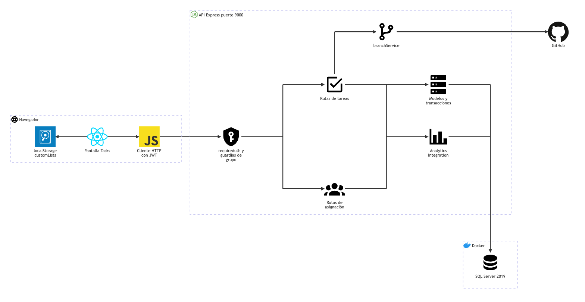

# Tareas: arquitectura

**En una frase:** la pantalla `/tasks` llama a la API con el JWT; la API revisa que quien llama sea miembro del grupo de la tarea, guarda el cambio en SQL Server (en una transacción cuando toca varias tablas) y después avisa a analytics y limpia la rama de GitHub de la tarea si la tenía.

Fuente del diagrama: [fuentes/03-tareas.mmd](fuentes/03-tareas.mmd).

| Desde | Hacia | Qué viaja |
|---|---|---|
| Pantalla Tasks | localStorage `customLists` | Nombres de las listas que todavía no tienen tareas, por grupo |
| Pantalla Tasks | Cliente HTTP | Crear, editar, completar, mandar a la papelera, borrar lista, asignar |
| Cliente HTTP | requireAuth y guardias | HTTP con `Authorization: Bearer <JWT>` |
| Guardias | Rutas de tareas y de asignación | La petición ya autorizada, con el grupo resuelto (`req.groupId`) |
| Rutas de tareas | branchService → GitHub | La rama de la tarea que se completó o se borró, para limpiarla |
| Rutas de tareas y de asignación | Modelos y transacciones | Llamadas como `completeTask(tid)` o `addUsertask(...)` |
| Rutas de tareas y de asignación | Analytics Integration | Avisos de asignación, completado y borrado (no bloquean la respuesta) |
| Modelos y Analytics Integration | SQL Server 2019 | Consultas con parámetros (driver `tedious`) |

## Piezas

| Pieza | Tecnología | Archivo |
|---|---|---|
| Pantalla Tasks | React 18 + MUI 6 | `src/components/Recordatorios.jsx` |
| Listas y tarjetas | MUI (tarjetas, barra de avance, menú de orden) | `src/components/ListaRecordatorios.jsx` |
| Diálogos (nueva lista, nueva tarea, editar) | MUI `Dialog` y `Slider` | `src/components/Dialogos.jsx`, `src/constants/limits.js` |
| Filtros | MUI `Drawer` (panel lateral) | `src/components/BarraLateral.jsx` |
| Asignar personas | MUI `Menu` con interruptores | `src/components/SeleccionarPersona.jsx` |
| Chips de GitHub de cada tarea | Módulo GitHub | `src/components/github/TaskGitHubActions.jsx`, `useTaskLinks.js` ([ver GitHub](07-github.md)) |
| Cliente HTTP | `fetch` con el JWT | `src/api/client.js` |
| requireAuth y límite de peticiones | JWT HS256 de 24 h; 300 peticiones por minuto por usuario | `taskmate-api/middleware/auth.middleware.js`, `middleware/rateLimit.js` |
| Guardias de grupo | Middleware de Express | `taskmate-api/middleware/groupAccess.js`, `models/access.model.js` |
| Validación de campos | Funciones propias | `taskmate-api/middleware/validate.js` |
| Rutas de tareas | Express 4 (`Router`) | `controllers/tasks.controller.js`, `complete.controller.js`, `delete.controller.js` |
| Rutas de asignación | Express 4 (`Router`) | `controllers/usertask.controller.js` |
| Modelos y transacciones | `tedious` + `withTransaction` | `models/tasks.model.js`, `complete.model.js`, `delete.model.js`, `usertask.model.js`; `helpers/transaction.js`, `helpers/execQuery.js` |
| Analytics Integration | Servicio de Node | `services/AnalyticsIntegration.js`, `services/AnalyticsService.js` |
| branchService | GitHub App (REST) | `services/github/branchService.js` |
| SQL Server 2019 | Contenedor Docker `taskmate-sql` | Tablas `Tasks`, `UserTask`, `Complete` y `DeleteTask` |

**Términos:**
- **Guardia:** middleware (función que corre antes de la ruta) que revisa permisos y corta la petición si no se cumplen.
- **Transacción:** varias escrituras que se guardan todas juntas o ninguna.
- **Lista:** no es una tabla. Es la columna `Tasks.list`; una lista sin tareas solo existe en el navegador.

## Cómo se conectan

- **Primero el JWT, luego el grupo.** `requireAuth` valida el token. La guardia saca el grupo del `gid` de la petición o, si llega un id de tarea, de la fila de la tarea (`access.model.resolveGroupId`). Solo pasa quien es miembro de ese grupo; aquí no hay acciones solo para el admin.
- **Completar y mandar a la papelera son atómicos.** `completeTask` y `trashTask` bloquean la fila de la tarea, la copian a `Complete` o `DeleteTask`, cierran sus registros pendientes de analytics, borran sus asignaciones y borran la tarea, todo en una transacción. Si dos personas completan a la vez, la segunda recibe `already_completed`.
- **Analytics: una parte dentro de la transacción, otra después.**
  - Asignar responde primero y después crea un registro `pending` en `TaskAnalytics`, con una categoría deducida del nombre, la descripción y la lista (frontend, backend, database, testing o general).
  - Completar, mandar a la papelera, borrar una lista y desasignar cierran ese registro dentro de su transacción: `completed`, `failed`, `failed` y `reassigned`.
  - Tras completar o mandar a la papelera, `AnalyticsIntegration` recalcula las métricas de la persona sin frenar la respuesta. Detalle en [Analytics](06-analytics.md).
- **La rama de GitHub se limpia después.** Si la tarea tenía rama, la transacción la desliga (`TaskBranches` cae por cascada) y, tras el commit, `branchService` la borra en GitHub cuando es seguro. La API espera hasta 5 s y responde el resultado en `branch`. Detalle en [GitHub](07-github.md).
- **Fechas sin zona horaria.** La API devuelve `datetime` como texto `YYYY-MM-DDTHH:mm`, igual en tareas activas, completadas y en la papelera, para que la hora no se corra.
- **Otros módulos también leen o crean tareas.** El [calendario](04-hitos-y-calendario.md) muestra sus fechas, el [plan del chat](05-chat-ia.md) las crea en una transacción y un PR fusionado las completa por el mismo `completeTask`.

## Para saber más

- Tablas y campos: [03-base-de-datos/03-tareas.md](../03-base-de-datos/03-tareas.md)
- Quién puede hacer qué: [04-casos-de-uso/03-tareas.md](../04-casos-de-uso/03-tareas.md)
- Pantalla: [05-interfaz/03-tareas.md](../05-interfaz/03-tareas.md)
- Flujos y errores: [06-flujos/03-tareas.md](../06-flujos/03-tareas.md)
- Arquitectura de todo el sistema: [00-general.md](00-general.md)
- Limitaciones conocidas: [cierre del proyecto](../01-proyecto/cierre-del-proyecto.md#limitaciones-conocidas)
