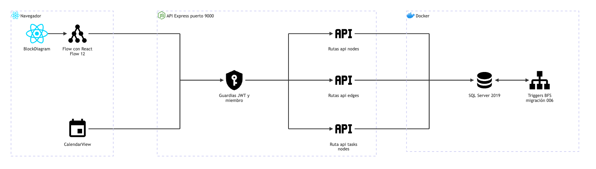

# Hitos y calendario: arquitectura

**En una frase:** el diagrama de hitos y el calendario leen y escriben las tablas `Nodes` (hitos) y `Edges` (conexiones) por la API REST, y dos triggers de SQL Server propagan el avance de un hito a otro.

| Desde | Hacia | Qué viaja |
|---|---|---|
| BlockDiagram | Flow | La página `/block-diagram` contiene el lienzo y la ventana «Edit Milestone» |
| Flow y BlockDiagram | Guardias | HTTP con `Authorization: Bearer <JWT>` a `/api/nodes`, `/api/edges` y `/api/tasks/nodes/:id` |
| CalendarView | Guardias | Solo `GET /api/nodes/tasks/:gid` (lectura) |
| Guardias | Rutas | Pasa solo si el usuario es miembro del grupo del hito o de la conexión |
| Rutas | SQL Server 2019 | Consultas con el driver `tedious` |
| SQL Server 2019 | Triggers BFS | Cada `UPDATE` de `Nodes.percentage` o de `Edges.prerequisite` dispara un trigger |

Fuente del diagrama: [fuentes/04-hitos-y-calendario.mmd](fuentes/04-hitos-y-calendario.mmd).

Términos:
- **JWT:** el token de sesión firmado que el navegador manda en cada pedido.
- **Guardia:** función de Express que corre antes de la ruta y la corta si no hay permiso.
- **Trigger:** código que SQL Server corre solo, justo después de un cambio en una tabla.
- **BFS:** recorrido «en anchura», nivel por nivel, de un grafo.

## Piezas

| Pieza | Tecnología | Archivo |
|---|---|---|
| Página de hitos | React 18 + MUI | `src/components/BlockDiagram.jsx` |
| Lienzo del grafo | React Flow (`@xyflow/react` 12), librería de grafos con nodos y aristas | `src/components/flow/Flow.jsx` |
| Tarjeta de hito | Nodo propio de React Flow | `src/components/flow/CustomNode.jsx` |
| Flecha entre hitos | Arista propia de React Flow | `src/components/flow/FloatingEdge.jsx`, `flow/utils.js`, `flow/CustomConnectionLine.jsx` |
| Calendario | react-big-calendar 1.15 + moment | `src/components/CalendarView.jsx` |
| Grupo activo | React Context | `src/components/GroupContext.jsx` |
| Cliente HTTP | `fetch` con el JWT | `src/api/client.js` |
| Guardias | Middleware de Express | `taskmate-api/middleware/auth.middleware.js`, `middleware/groupAccess.js` |
| Rutas de hitos | Express | `taskmate-api/controllers/nodes.controller.js` |
| Rutas de conexiones | Express | `taskmate-api/controllers/edges.controller.js` |
| Copia del hito a su tarea | Express | `taskmate-api/controllers/tasks.controller.js` (`PUT /api/tasks/nodes/:id`) |
| Acceso a datos | `tedious` | `taskmate-api/models/nodes.model.js`, `models/edges.model.js` |
| Tablas | SQL Server 2019 en Docker | `Nodes`, `Edges` (`taskmate_tables.sql` y migraciones 001 y 005) |
| Propagación del avance | Triggers T-SQL | `taskmate-api/migrations/006_bfs_progress_triggers.sql` |

## Cómo se conectan
- El navegador nunca habla con la base: todo pasa por la API REST en `:9000`, con el JWT.
- Cada ruta busca el grupo del hito o de la conexión y exige que el usuario sea miembro. No hay acciones solo para el admin.
- La API no calcula el avance. Guarda el porcentaje y SQL Server corre el trigger dentro de la misma sentencia. Después el frontend vuelve a pedir los hitos para mostrar el resultado.
- El calendario solo lee: una consulta une los hitos (`Nodes`) y las tareas activas (`Tasks`) del grupo.
- La IA también crea hitos: el plan del chat y el análisis del repositorio insertan filas en `Nodes` con `ProjectService`, sin conexiones. Ver [el flujo del chat](../06-flujos/05-chat-ia.md).
- No hay tiempo real en este módulo: otro miembro ve los cambios cuando vuelve a cargar la página.

## Para saber más
- Tablas, reglas y triggers: [03-base-de-datos/04-hitos-y-calendario.md](../03-base-de-datos/04-hitos-y-calendario.md)
- Quién puede hacer qué: [04-casos-de-uso/04-hitos-y-calendario.md](../04-casos-de-uso/04-hitos-y-calendario.md)
- Pantallas: [05-interfaz/04-hitos-y-calendario.md](../05-interfaz/04-hitos-y-calendario.md)
- Paso a paso y errores: [06-flujos/04-hitos-y-calendario.md](../06-flujos/04-hitos-y-calendario.md)
- Arquitectura de todo el sistema: [00-general.md](00-general.md)
- Limitaciones conocidas: [cierre del proyecto](../01-proyecto/cierre-del-proyecto.md#limitaciones-conocidas)
