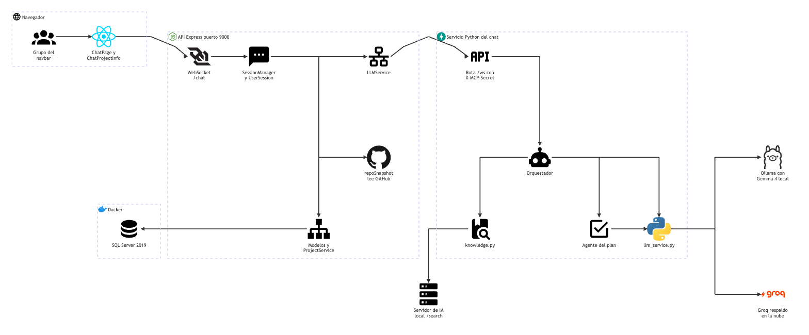

# Chat con IA: arquitectura

**En una frase:** el navegador conversa con la API por un WebSocket (`/chat`); la API le suma el contexto del grupo elegido en la barra de navegación y reenvía cada mensaje al servicio Python del chat, que responde en streaming con el modelo local (Gemma 4 en Ollama; Groq queda como respaldo en la nube); cuando el usuario confirma un plan, la API lo guarda en SQL Server.

Fuente del diagrama: [fuentes/05-chat-ia.mmd](fuentes/05-chat-ia.mmd).

| Desde | Hacia | Qué viaja |
|---|---|---|
| Grupo del navbar (`NavGroupSelector`) | ChatPage | el grupo activo de `GroupContext`; al cambiar, ChatPage manda `set_context` («New project» manda `set_context` sin grupo y deja la barra igual) |
| ChatPage | WebSocket `/chat` | `?token=<JWT>` al conectar; después, mensajes JSON (`user`, `set_context`, `repo_analysis`, `repo_plan_confirm`, `repo_plan_discard`, `analytics`, `ping`) |
| WebSocket `/chat` | SessionManager y UserSession | el socket ya autenticado; una sesión por usuario |
| UserSession | Modelos y SQL Server | el contexto del proyecto: membresía, nombre del grupo, repo, tareas, hitos, equipo, asignaciones y si el grupo está sin usar (`isGroupUnused`) |
| UserSession | `repoSnapshot` → GitHub | el resumen del repo (descripción, árbol, README, manifiestos, commits e issues; nunca código), solo con repo conectado, instalación activa y «Allow AI analysis» |
| UserSession | LLMService | `handle_user_message` con `sessionId`, `requestId` y `project` (el contexto, con `isEmpty` si el grupo está sin usar, o `null` sin proyecto) |
| LLMService | Ruta `/ws` | un solo WebSocket compartido por todos los usuarios, con el encabezado `X-MCP-Secret` |
| Ruta `/ws` | Orquestador | cada pedido; los de una misma sesión, en orden |
| Orquestador | llm_service.py | la clasificación PLAN / CHAT / fuera de tema (`_route`) y las respuestas de chat |
| Orquestador | knowledge.py → servidor de IA local | `POST /search` en `AI_SERVER_URL` (`127.0.0.1:8000`), con `X-AI-Server-Secret` si hay `AI_SERVER_SECRET`; **solo sin proyecto o en un grupo sin usar** |
| Orquestador | Agente del plan | la idea del proyecto acumulada en la conversación (solo sin proyecto o en un grupo sin usar) |
| Agente del plan | llm_service.py | el pedido del plan en modo JSON |
| llm_service.py | Ollama (modelo del chat) | `POST /api/chat` en `OLLAMA_HOST` (`127.0.0.1:11434`), modelo `gemma4:e2b-it-qat`, sin `think` (`LLM_PROVIDER=ollama`, lo que pone `scripts/local-up.sh`) |
| llm_service.py | Groq (respaldo en la nube) | Solo si se usa Groq: HTTPS con `GROQ_API_KEY`, modelo `openai/gpt-oss-20b` (`LLM_PROVIDER=groq`, el valor por defecto del código) |
| Orquestador | UserSession | `response_chunk` (trozos de la respuesta), `response`, `save_plan` (con `target_group_id` si el plan se armó en un grupo sin usar) o `plan_request` |
| UserSession | ChatPage | `assistant_chunk` por cada trozo y al final `assistant` con el texto completo, los dos con el mismo `requestId`; tras cada `set_context`, `context` (con `empty` y `fillable`) y `history_restore` con la conversación de ese proyecto (`chatOf`) |
| UserSession | ProjectService | sin proyecto o en un grupo sin usar, el plan confirmado (`save_plan`); con un grupo con datos, el plan del análisis del repo (`repo_plan_confirm`) |
| ProjectService | SQL Server 2019 | `createProjectFromPlan`: una transacción con `Groups`, `UserGroups`, `GroupRoles`, `Tasks` y `Nodes`; `fillEmptyGroupFromPlan`: una transacción que renombra el grupo sin usar y le agrega `GroupRoles`, `Tasks` y `Nodes`; `addPlanToGroup`: `Tasks` y `Nodes` en el grupo existente |

Términos:
- **WebSocket:** conexión que queda abierta y por la que ambos lados mandan mensajes cuando quieren.
- **JWT:** el token firmado que entrega el login; dura 24 h.
- **LLM:** modelo de lenguaje. Aquí, Gemma 4 en Ollama (en la misma máquina); Groq (en la nube) es el respaldo.
- **Streaming:** la respuesta llega en trozos mientras el modelo la escribe.
- **Transacción:** grupo de escrituras que se guarda completo o no se guarda nada.

## Piezas

| Pieza | Tecnología | Archivo |
|---|---|---|
| Pantalla del chat | React 18 + MUI, `react-markdown` con `rehype-sanitize` | `src/components/ChatPage.jsx` |
| Proyecto del chat (solo lectura) | MUI `Typography` y `Chip` | `src/components/github/ChatProjectInfo.jsx` |
| Selector de grupo de la barra | MUI `Menu` | `src/components/NavGroupSelector.jsx` |
| Conexión del navegador | WebSocket con reconexión y `ping` cada 30 s | `src/hooks/useWebSocket.js` |
| Servidor WebSocket | librería `ws`, en el mismo puerto que Express | `taskmate-api/services/WebSocketServer.js` |
| Sesiones y contexto del proyecto | Node.js, en memoria | `taskmate-api/services/SessionManager.js`, `taskmate-api/services/UserSession.js` |
| Resumen del repositorio | API de GitHub con la GitHub App | `taskmate-api/services/github/repoSnapshot.js` |
| Enlace con Python | cliente `ws` y `EventEmitter` | `taskmate-api/services/LLMService.js` |
| Guardar el plan | `tedious` y `withTransaction` | `taskmate-api/services/ProjectService.js`, `taskmate-api/helpers/transaction.js` |
| Grupo sin usar | SQL (`GROUP_USAGE_SQL`, `isGroupUnused`) | `taskmate-api/models/group.model.js` |
| Servicio Python del chat | FastAPI + uvicorn | `taskmate-api/mcp/server.py` |
| Orquestador | Python (`OrchestratorAgent`) | `taskmate-api/mcp/agents/orchestrator.py` |
| Agente del plan | Python (`RecommendationsAgent`, `MIN_TASKS = 8`; con Ollama, `repeat_penalty` 1.1) | `taskmate-api/mcp/agents/recommendations_agent.py` |
| Contexto del proyecto en Python | Pydantic (`ProjectContext`) y `project_context_json` | `taskmate-api/mcp/schemas.py`, `taskmate-api/mcp/agents/repo_analysis_agent.py` |
| Conocimiento del servidor de IA local | `httpx` | `taskmate-api/mcp/knowledge.py` |
| Cliente del modelo | `httpx` hacia Ollama, o SDK `groq` (`AsyncGroq`) si se usa el respaldo | `taskmate-api/mcp/llm_service.py` |
| Base de datos | SQL Server 2019 en Docker | `taskmate-api/taskmate_tables.sql` y `taskmate-api/migrations/` |

## Cómo se conectan
- El navegador abre `ws://<host de la página>:9000/chat?token=<JWT>` (`WS_BASE`; se cambia con `REACT_APP_WS_URL`). Antes de aceptar, la API revisa el `Origin` (el sitio que abre la conexión: si no está en `FRONTEND_URL`, responde 403; con `ALLOW_LAN_ORIGINS=true` también acepta `http` desde IPv4 privadas, solo para desarrollo) y el JWT (sin token o vencido, 401).
- Hay **una sesión por usuario**, no por pestaña. Vive en la memoria de la API y se conserva 60 min después de desconectarse. Dentro de ella, **cada proyecto tiene su conversación**: Node guarda las de hasta 20 proyectos además de la que se ve (`stashedChats`) y Python, su memoria de hasta 20 (`saved_groups`). Lo que llega para un proyecto que el usuario dejó (respuestas, `LLM_TIMEOUT`, análisis, el resultado del guardado) va al chat de ese proyecto, no a la pantalla.
- **El proyecto del chat es el grupo de la barra de navegación.** El chat no tiene selector propio: al cambiar de grupo (y en cada reconexión) ChatPage manda `set_context`; «New project» lo manda sin grupo. La API comprueba la membresía y responde `context` con el repo o `null`, `empty` (grupo sin usar: sin tareas activas, completadas ni borradas, sin hitos y sin repositorio) y `fillable` (además, el usuario es su admin), y `history_restore` con la conversación de ese proyecto y `chatOf`, para que el navegador solo la muestre bajo ese proyecto.
- **Grupo sin usar:** el grupo personal de toda cuenta nueva lo es. Python lo trata como proyecto nuevo (`is_empty_project`, con el `isEmpty` de Node) y, al confirmar el plan, Node lo guarda en ese grupo (`fillEmptyGroupFromPlan`, solo si el usuario es su admin y el grupo sigue sin usar; si no, como grupo nuevo).
- **El contexto se arma una sola vez.** Con el primer mensaje tras elegir el grupo, `UserSession` lee el equipo, las tareas, los hitos, las asignaciones y, si hay permiso, el resumen del repo, y lo guarda en caché. No se refresca mientras el grupo no cambie. En cada mensaje solo vuelve a comprobar la membresía y, si la caché tiene el resumen del repo, que siga conectado, sin suspender y con permiso. Si falla la lectura del repo, no se guarda en caché y se reintenta en el siguiente mensaje. Un grupo sin usar tampoco se guarda en caché: se rearma en cada mensaje, para ver lo que se le agregue.
- Todos los usuarios comparten **un solo WebSocket** de Node a Python (`LLMService`). Cada pedido lleva `sessionId` y `requestId`, y la respuesta vuelve a la sesión correcta por el `sessionId`.
- El servicio Python escucha solo en `127.0.0.1`, en `MCP_PORT` (8001 por defecto; esta máquina usa 8011). Rechaza conexiones sin `X-MCP-Secret` o que traen `Origin`. **No es el Model Context Protocol:** la carpeta se llama `mcp/` por historia, pero el protocolo es JSON propio.
- **Qué modelo responde:** el modelo local, Gemma 4 (`gemma4:e2b-it-qat`) en Ollama, el mismo que usa el servidor de IA local. Lo activa `LLM_PROVIDER=ollama`, que `scripts/local-up.sh` agrega al `.env` de la raíz si falta. Vale para todos los agentes de Python: chat, clasificación, plan, análisis del repo, pipeline y analytics. Con Ollama, el contexto del proyecto se queda en la máquina.
- **Variables del modelo local:** `LLM_PROVIDER=ollama`, `OLLAMA_HOST` (`http://127.0.0.1:11434`), `OLLAMA_MODEL`, `OLLAMA_NUM_CTX` (8192), `OLLAMA_KEEP_ALIVE` (`30m`) y `OLLAMA_THINK` (`0`, sin razonamiento).
- **Groq (respaldo en la nube):** `groq` es el valor por defecto de `LLM_PROVIDER` en el código y en `.env.example`, para que un checkout sin Ollama siga funcionando; un valor desconocido también usa Groq. Solo si se usa Groq hacen falta `GROQ_API_KEY`, `LLM_MODEL` (`openai/gpt-oss-20b`) y `LLM_REASONING_EFFORT`, y el contexto del proyecto sale a la nube.
- **Streaming:** con `LLM_STREAM_CHAT=1` (por defecto) las respuestas de chat salen en trozos. Los planes, la respuesta fija a lo que está fuera de tema y la clasificación llegan enteros.
- **Servidor de IA local:** solo sin proyecto o en un grupo sin usar, `knowledge.py` le pide a `taskmate-ai-server` los fragmentos de documentos más parecidos al mensaje (4 como máximo, similitud ≥ 0,3, 3 s de espera). Sin `AI_SERVER_URL`, o si falla, el chat sigue sin ellos.
- **Plan de proyecto nuevo:** con Ollama se pide con `repeat_penalty` 1.1, porque Gemma 4 se enciclaba escribiendo el JSON del plan la mitad de las veces (medido: 12 de 12 planes buenos contra 6 de 12). Si el plan sale inválido o el modelo falla, se reintenta una vez si quedan al menos 20 s de un presupuesto de 80 s (Node corta a los 90 s); un timeout o un límite de uso no se reintenta.
- **Python no toca la base de datos.** Sin proyecto o en un grupo sin usar, Python pide `save_plan` y Node escribe todo con `ProjectService` en una sola transacción. Con un grupo con datos, Python devuelve `plan_request` y Node lanza el análisis del repositorio por el mismo socket `/chat`: ver [07-github](07-github.md).

## Para saber más
- Paso a paso y errores: [06-flujos/05-chat-ia.md](../06-flujos/05-chat-ia.md)
- Tablas que lee y escribe: [03-base-de-datos/05-chat-ia.md](../03-base-de-datos/05-chat-ia.md)
- Quién puede hacer qué: [04-casos-de-uso/05-chat-ia.md](../04-casos-de-uso/05-chat-ia.md)
- La pantalla: [05-interfaz/05-chat-ia.md](../05-interfaz/05-chat-ia.md)
- El servidor de IA local (`taskmate-ai-server`): [10-ia-sobre-el-codigo](10-ia-sobre-el-codigo.md)
- Arquitectura de todo el sistema: [00-general.md](00-general.md)
- Limitaciones conocidas: [cierre de la línea de Pablo y estado](../01-proyecto/cierre-del-proyecto.md#limitaciones-conocidas)
