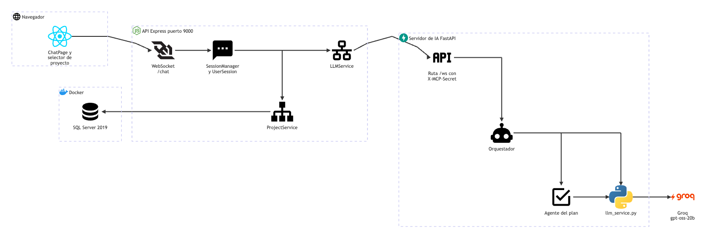

# Chat con IA: arquitectura

**En una frase:** el navegador conversa con la API por un WebSocket (`/chat`), la API reenvía cada mensaje al servidor de IA en Python, que llama a Groq, y cuando el usuario confirma un plan la API lo guarda en SQL Server.

Fuente del diagrama: [fuentes/05-chat-ia.mmd](fuentes/05-chat-ia.mmd).

| Desde | Hacia | Qué viaja |
|---|---|---|
| ChatPage | WebSocket `/chat` | `?token=<JWT>` al conectar; después, mensajes JSON (`user`, `set_context`, `repo_analysis`, `ping`) |
| WebSocket `/chat` | SessionManager y UserSession | el socket ya autenticado; una sesión por usuario |
| UserSession | LLMService | `handle_user_message` con `sessionId` y `requestId` |
| LLMService | Ruta `/ws` | un solo WebSocket compartido por todos los usuarios, con el encabezado `X-MCP-Secret` |
| Ruta `/ws` | Orquestador | cada pedido; los de una misma sesión, en orden |
| Orquestador | llm_service.py | respuestas de chat y la pregunta «¿ya hay datos para un plan?» |
| Orquestador | Agente del plan | la idea del proyecto acumulada en la conversación |
| Agente del plan | llm_service.py | el pedido del plan en modo JSON |
| llm_service.py | Groq | HTTPS con `GROQ_API_KEY`, modelo `openai/gpt-oss-20b` |
| UserSession | ProjectService | el plan que el usuario confirmó (`save_plan`) |
| ProjectService | SQL Server 2019 | una transacción con `Groups`, `UserGroups`, `GroupRoles`, `Tasks` y `Nodes` |

Términos:
- **WebSocket:** conexión que queda abierta y por la que ambos lados mandan mensajes cuando quieren.
- **JWT:** el token firmado que entrega el login; dura 24 h.
- **LLM:** modelo de lenguaje (aquí, el de Groq).
- **Transacción:** grupo de escrituras que se guarda completo o no se guarda nada.

## Piezas

| Pieza | Tecnología | Archivo |
|---|---|---|
| Pantalla del chat | React 18 + MUI, `react-markdown` con `rehype-sanitize` | `src/components/ChatPage.jsx` |
| Selector de proyecto | MUI `Select` | `src/components/github/ChatProjectSelector.jsx` |
| Conexión del navegador | WebSocket con reconexión y `ping` cada 30 s | `src/hooks/useWebSocket.js` |
| Servidor WebSocket | librería `ws`, en el mismo puerto que Express | `taskmate-api/services/WebSocketServer.js` |
| Sesiones del chat | Node.js, en memoria | `taskmate-api/services/SessionManager.js`, `taskmate-api/services/UserSession.js` |
| Enlace con Python | cliente `ws` y `EventEmitter` | `taskmate-api/services/LLMService.js` |
| Guardar el plan | `tedious` y `withTransaction` | `taskmate-api/services/ProjectService.js`, `taskmate-api/helpers/transaction.js` |
| Servidor de IA | FastAPI + uvicorn | `taskmate-api/mcp/server.py` |
| Orquestador | Python (`OrchestratorAgent`) | `taskmate-api/mcp/agents/orchestrator.py` |
| Agente del plan | Python (`RecommendationsAgent`) | `taskmate-api/mcp/agents/recommendations_agent.py` |
| Cliente de Groq | SDK `groq` (`AsyncGroq`) | `taskmate-api/mcp/llm_service.py` |
| Base de datos | SQL Server 2019 en Docker | `taskmate-api/taskmate_tables.sql` y `taskmate-api/migrations/` |

## Cómo se conectan
- El navegador abre `ws://localhost:9000/chat?token=<JWT>`. Antes de aceptar, la API revisa el `Origin` (el sitio que abre la conexión: si no está en `FRONTEND_URL`, responde 403) y el JWT (sin token o vencido, 401).
- Hay **una sesión por usuario**, no por pestaña. Vive en la memoria de la API y se conserva 60 min después de desconectarse.
- Todos los usuarios comparten **un solo WebSocket** de Node a Python (`LLMService`). Cada pedido lleva `sessionId` y `requestId`, y la respuesta vuelve a la sesión correcta por el `sessionId`.
- El servidor de IA escucha solo en `127.0.0.1`, en `MCP_PORT` (8001 por defecto en el código; esta máquina usa 8011). Rechaza conexiones sin `X-MCP-Secret` o que traen `Origin`. **No es el Model Context Protocol:** la carpeta se llama `mcp/` por historia, pero el protocolo es JSON propio.
- **Python no toca la base de datos.** Cuando el usuario confirma, Python pide `save_plan` y Node escribe todo con `ProjectService` en una sola transacción.
- El mismo socket `/chat` también lleva el análisis del repositorio con IA: ver [07-github](07-github.md).

## Para saber más
- Paso a paso y errores: [06-flujos/05-chat-ia.md](../06-flujos/05-chat-ia.md)
- Tablas que escribe: [03-base-de-datos/05-chat-ia.md](../03-base-de-datos/05-chat-ia.md)
- Quién puede hacer qué: [04-casos-de-uso/05-chat-ia.md](../04-casos-de-uso/05-chat-ia.md)
- La pantalla: [05-interfaz/05-chat-ia.md](../05-interfaz/05-chat-ia.md)
- Arquitectura de todo el sistema: [00-general.md](00-general.md)
- Limitaciones conocidas: [cierre del proyecto](../01-proyecto/cierre-del-proyecto.md#limitaciones-conocidas)
