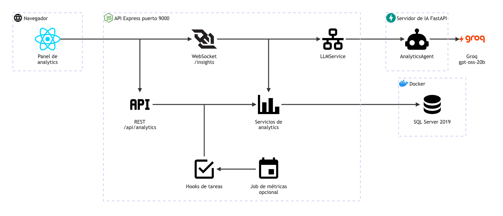

# Analytics: arquitectura

**En una frase:** el panel de analytics lee las métricas del equipo por REST y pide a la IA recomendaciones de asignación por el WebSocket `/insights`; las métricas se llenan solas cuando alguien asigna, completa o borra tareas.

Las flechas del dibujo no llevan texto. Esta tabla dice qué viaja por cada una:

| Desde | Hacia | Qué viaja |
|-------|-------|-----------|
| Panel de analytics | REST /api/analytics | `GET /api/analytics/dashboard/:groupId` con el JWT (el token de sesión) en `Authorization: Bearer` |
| Panel de analytics | WebSocket /insights | `type: analytics` con `action: get_task_assignment_recommendations`; el JWT va en `?token=` |
| REST /api/analytics | Servicios de analytics | resumen, carga de trabajo y experiencia del grupo (`AnalyticsService`) |
| WebSocket /insights | Servicios de analytics | `buildTeamContext`: los datos reales del equipo, solo si quien pide es líder |
| WebSocket /insights | LLMService | el pedido, ya con `team_context` |
| LLMService | AnalyticsAgent | un solo WebSocket compartido con Python, con el encabezado `X-MCP-Secret` |
| AnalyticsAgent | Groq | un prompt en modo JSON para ajustar los puntajes y proponer un plan |
| Hooks de tareas | Servicios de analytics | registrar una asignación y recalcular métricas después de completar o mandar a la papelera |
| Job de métricas opcional | Hooks de tareas | `runBatchUpdate`, que llama a `AnalyticsService.batchUpdateUserMetrics` |
| Servicios de analytics | SQL Server 2019 | lecturas y escrituras en `TaskAnalytics`, `UserMetrics` y `UserExpertise` |

Fuente del dibujo: [fuentes/06-analytics.mmd](fuentes/06-analytics.mmd).

## Piezas

| Pieza | Tecnología | Archivo |
|-------|------------|---------|
| Panel de analytics (`/analytics`) | React 18 | `src/components/AnalyticsDashboard.jsx` y `.css` |
| Conexión del panel a `/insights` | hook de React | `src/hooks/useWebSocket.js` |
| Rutas REST `/api/analytics/*` | Express | `taskmate-api/controllers/analytics.controller.js` |
| WebSocket `/insights` | librería `ws` | `taskmate-api/services/WebSocketServer.js` |
| Reglas y límite de los pedidos de analytics | Node | `taskmate-api/services/UserSession.js` (`prepareAnalyticsData`) |
| Regla de líder | SQL | `taskmate-api/models/access.model.js` (`isGroupLeader`) |
| Consultas y métricas | `tedious` (driver de SQL Server) | `taskmate-api/services/AnalyticsService.js` |
| Datos del equipo para la IA | `tedious` | `taskmate-api/services/analyticsContext.js` |
| Hooks de tareas | Node | `taskmate-api/services/AnalyticsIntegration.js` |
| Job de métricas | `node-cron` | `taskmate-api/services/AnalyticsBatchJob.js` (lo arranca `server.js`) |
| Enlace con Python | librería `ws` | `taskmate-api/services/LLMService.js` |
| Agente de analytics | Python 3, FastAPI | `taskmate-api/mcp/agents/analytics_agent.py` (lo llama `orchestrator.py`) |
| Cliente del modelo | Groq, `openai/gpt-oss-20b` | `taskmate-api/mcp/llm_service.py` |
| Tablas | SQL Server 2019 | `taskmate-api/taskmate_tables.sql` y `migrations/001_schema_fixes.sql` |

Términos:
- **Hook:** una función que la API llama después de una acción sobre tareas, sin hacer esperar al usuario.
- **`team_context`:** carga, capacidad y experiencia de cada miembro del grupo. Lo arma Node; Python no tiene acceso a la base de datos.
- **Líder:** el admin del grupo, o un miembro con un rol cuyo nombre contiene «leader».

## Cómo se conectan

- El panel hace dos cosas separadas: lee los números por REST y pide recomendaciones por `/insights`.
- Node aplica la regla de líder en los dos caminos. Python recibe el `team_context` ya armado; el que mande el navegador se descarta.
- El agente calcula un puntaje fijo por persona y le pide a Groq que lo ajuste. Si Groq falla, contesta solo con el puntaje fijo.
- Si `/insights` falla o no contesta en 30 s, el navegador arma una estimación local con la tabla de carga (ver [limitaciones](../01-proyecto/cierre-del-proyecto.md#analytics)).
- El panel no escribe métricas. Las escriben las acciones sobre tareas:
  - completar, mandar a la papelera, borrar una lista o quitar a una persona cierran el registro dentro de su propia transacción (`tasks.model.js`, `usertask.model.js`);
  - después, sin hacer esperar al usuario, los hooks registran la asignación o recalculan `UserMetrics` y `UserExpertise`;
  - un PR fusionado completa la tarea por el mismo camino;
  - si se activa, el job recalcula las métricas a la hora programada (2:00 por defecto).
- `AnalyticsConfig` la lee y la escribe directamente `analytics.controller.js`; nada más la usa.
- `POST /api/analytics/recommendations` (solo API, sin pantalla) hace lo mismo que `/insights`, pero por REST y para cualquier miembro.

## Variables de entorno

| Variable | Efecto | Valor por defecto |
|----------|--------|-------------------|
| `ANALYTICS_ENABLED` | `false` apaga los hooks de tareas | encendidos |
| `ANALYTICS_BATCH_ENABLED` | `true` arranca el job de métricas | apagado |
| `ANALYTICS_BATCH_SCHEDULE` | horario del job, en formato cron | `0 2 * * *` (2:00 en la zona `TZ`, o UTC) |
| `LLM_WEBSOCKET_URL` | dirección del servidor de IA | `ws://localhost:8001/ws` |
| `MCP_SHARED_SECRET` | secreto que Node manda en `X-MCP-Secret` | ninguno: Python no arranca sin él (salvo `MCP_ALLOW_NO_SECRET=1`, solo para pruebas) |

## Para saber más

- Tablas y reglas: [03-base-de-datos/06-analytics.md](../03-base-de-datos/06-analytics.md)
- Quién puede hacer qué: [04-casos-de-uso/06-analytics.md](../04-casos-de-uso/06-analytics.md)
- La pantalla: [05-interfaz/06-analytics.md](../05-interfaz/06-analytics.md)
- El flujo paso a paso y los errores: [06-flujos/06-analytics.md](../06-flujos/06-analytics.md)
- Arquitectura de todo el sistema: [00-general.md](00-general.md)
- Limitaciones y pendientes: [cierre del proyecto](../01-proyecto/cierre-del-proyecto.md#analytics)
