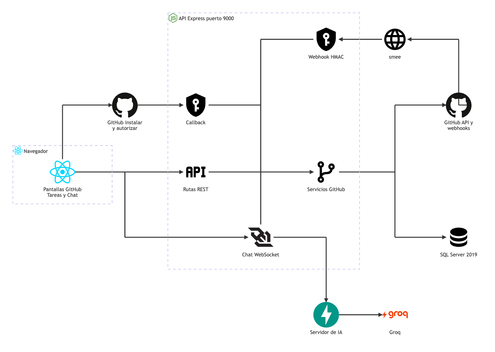

# GitHub: arquitectura

**En una frase:** el admin conecta el repositorio del grupo a través de la TaskMate GitHub App; desde ahí la API lee el código, crea una rama por tarea, sigue los pull requests por webhooks y completa la tarea cuando su PR se fusiona.

Fuente del diagrama: [fuentes/07-github.mmd](fuentes/07-github.mmd).

Las flechas del dibujo no llevan texto. Esto es lo que viaja por cada una:

| De → a | Qué viaja |
|---|---|
| Pantallas → GitHub instalar y autorizar | El navegador abre `installUrl` o `authorizeUrl` de github.com, con un `state` firmado |
| GitHub instalar y autorizar → Callback | `GET /api/github/callback` con `code`, `state`, `installation_id` y `setup_action` |
| Pantallas → Rutas REST | `/api/github/...` con `Authorization: Bearer <JWT>`: vincular, explorar, crear rama, sincronizar |
| Pantallas → Chat WebSocket | `/chat` con `?token=`: `repo_analysis`, `repo_plan_confirm` y `repo_plan_discard` |
| Callback, Rutas REST, Chat y Webhook → Servicios GitHub | Llamadas a `installFlow`, `repoService`, `branchService`, `syncService`, `repoSnapshot` y `pullRequestProcessor` |
| Servicios GitHub → GitHub API | HTTPS con un token de instalación de 1 h, limitado al repositorio y a los permisos mínimos |
| Servicios GitHub → SQL Server | Las 6 tablas del módulo, por `github.model.js` y `tasks.model.js` |
| GitHub → smee → Webhook HMAC | Cada evento de la App, firmado; `smee-client` lo reenvía a `POST /api/github/webhook` (solo en desarrollo) |
| Chat WebSocket → Servidor de IA → Groq | `analyze_repository` con un resumen del repositorio; el `RepoAnalysisAgent` llama a Groq |

Términos:
- **GitHub App**: una aplicación registrada en GitHub que se instala en una cuenta u organización y recibe acceso a repositorios concretos.
- **Token de instalación**: credencial de 1 h que la API pide a GitHub firmando un JWT con la llave privada de la App. Nunca se guarda en la BD.
- **Webhook**: aviso HTTP que GitHub manda a TaskMate cuando algo cambia (un PR, la instalación).
- **HMAC**: firma calculada con un secreto compartido; prueba que el aviso viene de GitHub y no se alteró.
- **smee**: proxy público que lleva los webhooks de GitHub a `localhost`.

## Piezas

| Pieza | Tecnología | Archivo |
|---|---|---|
| Página `/github`: pestañas Repositorio, Archivos y Commits | React 18 + MUI 6 | `src/components/github/GitHubPage.jsx`, `RepositoryPanel.jsx`, `RepoSelection.jsx`, `RepoExplorer.jsx`, `FileViewer.jsx`, `CommitList.jsx` |
| Rama y PR en cada tarea | React + MUI | `src/components/github/TaskGitHubActions.jsx`, `useTaskLinks.js`, `BranchToastMessage.jsx` |
| Plan de tareas propuesto por la IA | React + MUI | `src/components/ChatPage.jsx`, `src/components/github/RepoPlanCard.jsx` |
| Cliente HTTP del módulo | `fetch` con el JWT | `src/api/github.js` |
| Rutas REST, callback y montaje del webhook | Express 4 | `taskmate-api/controllers/github.controller.js`, `taskmate-api/app.js` |
| Flujo de instalación: `state`, nonce y selección | `jsonwebtoken` (token de propósito), memoria con caducidad | `taskmate-api/services/github/installFlow.js`, `oauth.js`, `ttlStore.js` |
| Cliente de GitHub: JWT de la App, tokens y presupuesto de peticiones por instalación (4000/h por defecto) | `jsonwebtoken` RS256, `fetch` | `taskmate-api/services/github/githubApp.js` |
| Explorador: árbol, archivo, README, commits | API REST de GitHub | `taskmate-api/services/github/repoService.js` |
| Rama por tarea y limpieza segura | API REST de GitHub | `taskmate-api/services/github/branchService.js`, `branchName.js` |
| PRs: aplicar cambios y sincronizar | API REST de GitHub | `taskmate-api/services/github/pullRequestProcessor.js`, `syncService.js` |
| Webhook: firma, deduplicación y reparto | `crypto` (HMAC SHA-256) | `taskmate-api/services/github/webhookHandler.js`, `webhookSignature.js` |
| Resumen del repositorio para la IA | Node.js | `taskmate-api/services/github/repoSnapshot.js`, `repoPlan.js`, `taskmate-api/services/UserSession.js` |
| Agente que propone tareas | Python, FastAPI, Groq (`openai/gpt-oss-20b`) | `taskmate-api/mcp/agents/repo_analysis_agent.py` |
| Acceso a datos | `tedious`, transacciones | `taskmate-api/models/github.model.js`, `tasks.model.js` |
| Purga diaria de entregas de webhooks | `setInterval` | `taskmate-api/server.js` |
| Base de datos | SQL Server 2019 en Docker | 6 tablas de la migración 002 ([detalle](../03-base-de-datos/07-github.md)) |

## Cómo se conectan

- **Conectar sin confiar en la URL.** El `state` firmado y de un solo uso ata el regreso de GitHub al admin y al grupo que empezaron. El callback canjea el `code` por un token de usuario, lo usa para listar solo los repos donde esa persona puede escribir (push, maintain o admin) y lo revoca al momento. El vínculo se hace después, con una llamada autenticada.
- **Una App, muchos tokens cortos.** Cada llamada a GitHub usa un token de instalación limitado al repositorio del grupo y al permiso que necesita (leer, crear o borrar ramas, leer PRs). Si GitHub responde 401, la API pide otro token una vez.
- **Webhooks idempotentes.** La ruta del webhook se monta antes de `express.json` para firmar los bytes exactos. Cada entrega se registra por su id y por el hash del cuerpo; un repetido responde `duplicate` sin volver a procesarse. Si el proceso tarda más de 8 s, responde 202 y sigue.
- **PR fusionado → tarea completada.** Si el PR viene del mismo repositorio, se fusiona en la rama por defecto y su rama es la de una tarea, la misma transacción guarda el PR y completa la tarea. Después del commit, la rama se borra en segundo plano solo si es seguro.
- **Sincronizar repara lo perdido.** GitHub no reintenta solo las entregas fallidas. «Sincronizar PRs» consulta los PRs de hasta 30 ramas del grupo y aplica lo que faltó.
- **IA solo con permiso.** El análisis del repositorio exige que el admin active «Permitir análisis con IA». A Groq va un resumen (árbol, README, dependencias, commits e issues) con los secretos tapados, nunca el código fuente.

## Para saber más

- Tablas: [03-base-de-datos/07-github.md](../03-base-de-datos/07-github.md)
- Quién puede hacer qué: [04-casos-de-uso/07-github.md](../04-casos-de-uso/07-github.md)
- Pantallas: [05-interfaz/07-github.md](../05-interfaz/07-github.md)
- Paso a paso y mensajes de error: [06-flujos/07-github.md](../06-flujos/07-github.md)
- Registrar la App, `.env` y smee: [guía de la GitHub App](../07-guias/guia-github-app.md)
- Seguridad en detalle: [Fase 3, seguridad y base de datos](../08-fases/fase-03-integracion-github/SEGURIDAD-Y-BASE-DE-DATOS.md)
- Arquitectura de todo TaskMate: [00-general.md](00-general.md)
- Limitaciones conocidas: [cierre del proyecto](../01-proyecto/cierre-del-proyecto.md#github-y-cicd)
