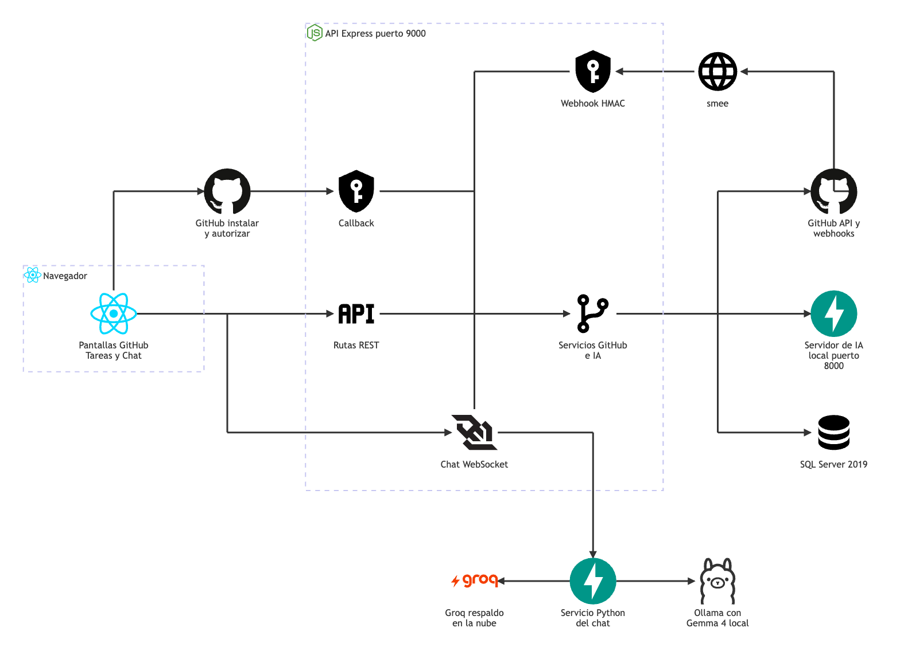

# GitHub: arquitectura

**En una frase:** el admin conecta el repositorio del grupo a través de la TaskMate GitHub App; desde ahí la API lee el código, crea una rama por tarea, sigue los pull requests por webhooks, completa la tarea cuando su PR se fusiona, guarda qué archivos tocó cada tarea y, con el servidor de IA local, revisa los PR de las tareas.

Fuente del diagrama: [fuentes/07-github.mmd](fuentes/07-github.mmd).

Las flechas del dibujo no llevan texto. Esto es lo que viaja por cada una:

| De → a | Qué viaja |
|---|---|
| Pantallas → GitHub instalar y autorizar | El navegador abre `installUrl` o `authorizeUrl` de github.com, con un `state` firmado |
| GitHub instalar y autorizar → Callback | `GET /api/github/callback` con `code`, `state`, `installation_id` y `setup_action` |
| Pantallas → Rutas REST | `/api/github/...` con `Authorization: Bearer <JWT>`: vincular, explorar, crear rama, sincronizar, ver los archivos de una tarea (`/tasks/:tid/files` y `/overlaps`) y la IA sobre su rama (`audit`, `generate-tests`, `review`) |
| Pantallas → Chat WebSocket | `/chat` con `?token=`: `repo_analysis`, `repo_plan_confirm` y `repo_plan_discard` |
| Callback, Rutas REST, Chat y Webhook → Servicios GitHub e IA | Llamadas a `installFlow`, `repoService`, `branchService`, `syncService`, `repoSnapshot`, `pullRequestProcessor`, `taskFileService` y, para la IA sobre el código, `services/aiServer/` (`taskAi`, `prReview`) |
| Servicios GitHub e IA → GitHub API | HTTPS con un token de instalación de 1 h, limitado al repositorio y a los permisos mínimos. Incluye los archivos de un PR (`pulls/{n}/files`), el diff entre ramas (`compare`) y la publicación de la revisión de IA (`pulls/{n}/reviews`, con `pull_requests: write`) |
| Servicios GitHub e IA → SQL Server | Las 6 tablas del módulo y `TaskFiles` (migración 010), por `github.model.js` y `tasks.model.js`; las revisiones van a `AiReviews` (011) por `aiReview.model.js` |
| Servicios GitHub e IA → Servidor de IA local | `POST /commands/{audit\|generate-tests\|review-pr}` a `127.0.0.1:8000` con `X-AI-Server-Secret` y los parches del diff por archivo. El servidor corre el modelo en el mismo Ollama (`127.0.0.1:11434`) que usa el chat |
| GitHub → smee → Webhook HMAC | Cada evento de la App, firmado; `smee-client` lo reenvía a `POST /api/github/webhook` (solo en desarrollo) |
| Chat WebSocket → Servicio Python del chat → Ollama (Groq de respaldo) | `analyze_repository` con un resumen del repositorio; el `RepoAnalysisAgent` llama al modelo del chat: Gemma 4 en Ollama (`gemma4:e2b-it-qat`, `LLM_PROVIDER=ollama`, lo que pone `scripts/local-up.sh`), o Groq (`openai/gpt-oss-20b`), el respaldo en la nube y valor por defecto del código. Si en el chat se pide un plan, Python responde `plan_request` y Node lanza el mismo análisis |

Términos:
- **GitHub App**: una aplicación registrada en GitHub que se instala en una cuenta u organización y recibe acceso a repositorios concretos.
- **Token de instalación**: credencial de 1 h que la API pide a GitHub firmando un JWT con la llave privada de la App. Nunca se guarda en la BD.
- **Webhook**: aviso HTTP que GitHub manda a TaskMate cuando algo cambia (un PR, la instalación).
- **HMAC**: firma calculada con un secreto compartido; prueba que el aviso viene de GitHub y no se alteró.
- **smee**: proxy público que lleva los webhooks de GitHub a `localhost`.
- **Servicio Python del chat**: `taskmate-api/mcp/`, FastAPI en `127.0.0.1:8001`. Habla con el modelo local (Gemma 4 en Ollama); Groq es el respaldo en la nube.
- **Servidor de IA local**: el repo aparte de Christian (`taskmate-ai-server`), FastAPI en `127.0.0.1:8000` con Ollama. Revisa el código de las ramas; su detalle está en [IA sobre el código](10-ia-sobre-el-codigo.md).

## Piezas

| Pieza | Tecnología | Archivo |
|---|---|---|
| Página `/github`: pestañas Repository, Files y Commits (CI/CD y «Vercel (monitoring)» son del [módulo CI/CD](08-cicd.md)) | React 18 + MUI 6 | `src/components/github/GitHubPage.jsx`, `RepositoryPanel.jsx`, `RepoSelection.jsx`, `RepoExplorer.jsx`, `FileViewer.jsx`, `CommitList.jsx` |
| Rama, PR y archivos en cada tarea | React + MUI | `src/components/github/TaskGitHubActions.jsx`, `TaskFilesDialog.jsx` («Task files»), `TaskAiPanel.jsx` («AI on the branch»), `useTaskLinks.js`, `BranchToastMessage.jsx` |
| Plan de tareas propuesto por la IA | React + MUI | `src/components/ChatPage.jsx`, `src/components/github/RepoPlanCard.jsx` |
| Cliente HTTP del módulo | `fetch` con el JWT | `src/api/github.js` |
| Rutas REST, callback y montaje del webhook | Express 4 | `taskmate-api/controllers/github.controller.js`, `taskmate-api/app.js` |
| Flujo de instalación: `state`, nonce y selección | `jsonwebtoken` (token de propósito), memoria con caducidad | `taskmate-api/services/github/installFlow.js`, `oauth.js`, `ttlStore.js` |
| Cliente de GitHub: JWT de la App, tokens y presupuesto de peticiones por instalación (4000/h por defecto) | `jsonwebtoken` RS256, `fetch` | `taskmate-api/services/github/githubApp.js` |
| Explorador: árbol, archivo, README, commits; archivos de un PR y diff entre ramas | API REST de GitHub | `taskmate-api/services/github/repoService.js` |
| Rama por tarea y limpieza segura | API REST de GitHub | `taskmate-api/services/github/branchService.js`, `branchName.js` |
| PRs: aplicar cambios y sincronizar | API REST de GitHub | `taskmate-api/services/github/pullRequestProcessor.js`, `syncService.js` |
| Archivos por tarea: registrar y recuperar la lista del PR | API REST de GitHub (`pulls/{n}/files`, una página de 100) | `taskmate-api/services/github/taskFileService.js` |
| Webhook: firma, deduplicación y reparto | `crypto` (HMAC SHA-256) | `taskmate-api/services/github/webhookHandler.js`, `webhookSignature.js` |
| IA sobre el código: auditar la rama, generar pruebas y revisar el PR | HTTP al servidor de IA local | `taskmate-api/services/aiServer/client.js`, `taskAi.js`, `prReview.js` ([detalle](10-ia-sobre-el-codigo.md)) |
| Resumen del repositorio para la IA | Node.js | `taskmate-api/services/github/repoSnapshot.js`, `repoPlan.js`, `taskmate-api/services/UserSession.js` |
| Agente que propone tareas | Python, FastAPI, Ollama (Groq de respaldo) según `LLM_PROVIDER` | `taskmate-api/mcp/agents/repo_analysis_agent.py`, `taskmate-api/mcp/llm_service.py` |
| Acceso a datos | `tedious`, transacciones | `taskmate-api/models/github.model.js`, `tasks.model.js`, `aiReview.model.js` |
| Purga diaria de entregas de webhooks | `setInterval` | `taskmate-api/server.js` |
| Base de datos | SQL Server 2019 en Docker | 6 tablas de la migración 002 y `TaskFiles` de la 010 ([detalle](../03-base-de-datos/07-github.md)); `AiReviews` (011) es del [módulo 10](../03-base-de-datos/10-ia-sobre-el-codigo.md) |

Los archivos por tarea y la IA sobre el código son de la línea de Christian y están en la rama `test/e2e` (todavía no en `master`).

## Cómo se conectan

- **Conectar sin confiar en la URL.** El `state` firmado y de un solo uso ata el regreso de GitHub al admin y al grupo que empezaron. El callback canjea el `code` por un token de usuario, lo usa para listar solo los repos donde esa persona puede escribir (push, maintain o admin) y lo revoca al momento. El vínculo se hace después, con una llamada autenticada.
- **Una App, muchos tokens cortos.** Cada llamada a GitHub usa un token de instalación limitado al repositorio del grupo y al permiso que necesita (leer, crear o borrar ramas, leer PRs y, solo para publicar la revisión de IA, escribir en PRs). Si GitHub responde 401, la API pide otro token una vez.
- **Webhooks idempotentes.** La ruta del webhook se monta antes de `express.json` para firmar los bytes exactos. Cada entrega se registra por su id y por el hash del cuerpo; un repetido responde `duplicate` sin volver a procesarse. Si el proceso tarda más de 8 s, responde 202 y sigue.
- **PR fusionado → tarea completada.** Si el PR viene del mismo repositorio, se fusiona en la rama por defecto y su rama es la de una tarea, la misma transacción guarda el PR y completa la tarea. Después del commit, en segundo plano, la rama se borra solo si es seguro y se pide la lista de archivos del PR para guardarla en `TaskFiles`.
- **Archivos por tarea.** Al abrir «Task files», `GET /tasks/:tid/files` devuelve la lista guardada. Si está vacía y la rama de la tarea tiene un PR (abierto, cerrado o fusionado), la pide en ese momento a GitHub y la guarda (recuperación bajo demanda); una lista ya guardada no se vuelve a pedir, aunque el PR reciba más commits. `GET /tasks/:tid/overlaps` cruza esas rutas con las de otras tareas activas del grupo. Según el código, el registro al fusionar no llega a guardarse (al repo que pasa el webhook le falta el dueño, y la tarea completada ya no está en `Tasks`), así que en la práctica la lista solo existe en tareas activas con PR ([limitaciones](../01-proyecto/cierre-del-proyecto.md#limitaciones-conocidas)).
- **Revisión de PR con IA.** Cuando una entrega `pull_request` queda `processed` (acciones `opened`, `synchronize`, `ready_for_review` y `reopened`), el webhook llama a `prReview` sin esperarlo. Si hay `AI_SERVER_URL`, el PR está abierto y no es borrador, viene de la rama de una tarea y el grupo permitió la IA, pide `review-pr` al servidor de IA local, guarda una fila por commit en `AiReviews` y la publica en GitHub como revisión `COMMENT`. Detalle: [IA sobre el código](10-ia-sobre-el-codigo.md).
- **Sincronizar repara lo perdido.** GitHub no reintenta solo las entregas fallidas. «Sync PRs» consulta los PRs de hasta 30 ramas del grupo y aplica lo que faltó; por este camino no se piden los archivos del PR ni se lanza la revisión con IA.
- **IA solo con permiso.** El análisis del repositorio, la auditoría, las pruebas y la revisión exigen que el admin active «Allow AI analysis». Al modelo del chat (Gemma 4 en Ollama, o Groq si se usa el respaldo) va un resumen del repositorio (árbol, README, dependencias, commits e issues) con los secretos tapados, no el código fuente. La auditoría, las pruebas y la revisión sí mandan el diff de la rama (parches por archivo) al servidor de IA local.

## Para saber más

- Tablas: [03-base-de-datos/07-github.md](../03-base-de-datos/07-github.md)
- Quién puede hacer qué: [04-casos-de-uso/07-github.md](../04-casos-de-uso/07-github.md)
- Pantallas: [05-interfaz/07-github.md](../05-interfaz/07-github.md)
- Paso a paso y mensajes de error: [06-flujos/07-github.md](../06-flujos/07-github.md)
- Auditar, generar pruebas y revisar PRs con IA: [10-ia-sobre-el-codigo.md](10-ia-sobre-el-codigo.md)
- Registrar la App, `.env` y smee: [guía de la GitHub App](../07-guias/guia-github-app.md)
- Seguridad en detalle: [Fase 3, seguridad y base de datos](../08-fases/fase-03-integracion-github/SEGURIDAD-Y-BASE-DE-DATOS.md)
- Arquitectura de todo TaskMate: [00-general.md](00-general.md)
- Limitaciones conocidas: [cierre de la línea de Pablo y estado](../01-proyecto/cierre-del-proyecto.md#limitaciones-conocidas)
