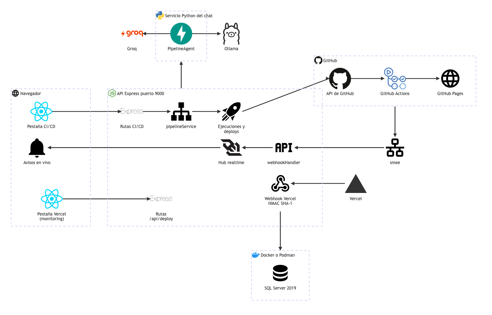

# CI/CD: arquitectura

**En una frase:** TaskMate escribe un *workflow* (archivo YAML que GitHub Actions ejecuta) en el repositorio del grupo, lo lanza y despliega el sitio a GitHub Pages desde la pestaña **CI/CD**, y GitHub avisa de vuelta con *webhooks* (avisos HTTP firmados); aparte, la pestaña **Vercel (monitoring)** solo muestra los despliegues que Vercel avisa por su propio webhook firmado.

Fuente del diagrama: [fuentes/08-cicd.mmd](fuentes/08-cicd.mmd)

| Flecha | Qué viaja |
|--------|-----------|
| Pestaña CI/CD → Rutas CI/CD | REST con el JWT (token de sesión) a `/api/github/groups/:gid/...` |
| Rutas CI/CD → pipelineService | Proponer, previsualizar y subir el pipeline. Las rutas de ejecuciones y deploys van directo a «Ejecuciones y deploys» |
| pipelineService → Ejecuciones y deploys | `deployService` usa `pipelineService` para leer el estado de GitHub Pages |
| API → Servicio Python del chat | Mensaje `propose_pipeline` por el WebSocket compartido con Python (`LLMService`), solo si el grupo permite la IA |
| PipelineAgent → Ollama (Groq de respaldo) | Usa el modelo del chat: Gemma 4 en Ollama (`gemma4:e2b-it-qat`, `LLM_PROVIDER=ollama`, lo que pone `scripts/local-up.sh`). Solo si se usa Groq (respaldo en la nube, `LLM_PROVIDER=groq`, valor por defecto del código), `openai/gpt-oss-20b`. En los dos casos el modelo solo elige valores entre las opciones que TaskMate detectó |
| API → SQL Server 2019 | CI/CD: `RepoPipelines` (el pipeline guardado) y `DeployRequests` (solicitudes de producción). Vercel: `GroupDeployTargets` (proyecto vinculado), `Deployments` y `DeploymentWebhookDeliveries` (bitácora del webhook) |
| Ejecuciones y deploys → API de GitHub | Con el token de la GitHub App: *dispatch* (lanzar el workflow a pedido), ejecuciones, logs, anotaciones y deployments. `pipelineService` también: lee el repositorio, sube el workflow y activa Pages |
| API de GitHub → Actions → Pages | El workflow `taskmate-ci.yml` corre los jobs `ci → build → deploy → close` («CI (…)», «Deploy build», «Deploy to GitHub Pages» y «Close the deploy») y publica el sitio |
| GitHub → smee → webhookHandler | Webhooks `workflow_run`, `workflow_job` y `deployment_status`. smee reenvía los webhooks de GitHub a la máquina local, solo en desarrollo |
| webhookHandler → Hub realtime → Avisos en vivo | Eventos `ci_run`, `ci_job` y `deployment` por el WebSocket `/events`. `deployService` publica además `deploy_request` en el hub (no dibujado) |
| Pestaña Vercel (monitoring) → Rutas /api/deploy | REST con el JWT a `/api/deploy/groups/:gid/...`: ver, vincular o desvincular el proyecto de Vercel y leer los últimos 20 despliegues. No hay tiempo real: la lista se recarga al abrir la pestaña o con «Refresh» |
| Vercel → Webhook Vercel | `POST /api/deploy/webhook/vercel`, público (sin JWT ni limitador), con eventos `deployment.*` firmados con HMAC-SHA1 en `x-vercel-signature` y el secreto `VERCEL_WEBHOOK_SECRET`. No pasa por smee: con una cuenta real hay que exponer la API con un túnel público ([ENTORNO-LOCAL.md](../09-linea-christian/ENTORNO-LOCAL.md)) |

## Piezas

| Pieza | Tecnología | Archivo |
|-------|------------|---------|
| Pestaña CI/CD | React 18 + MUI, se carga con `React.lazy` | `src/components/github/cicd/CicdPanel.jsx` y sus hijos (`PipelineCard`, `PipelineSetup`, `RunList`, `RunDetail`, `JobLog`, `DeployPanel`) |
| Pestaña Vercel (monitoring) | React 18 + MUI, se carga con `React.lazy` | `src/components/deploy/DeploymentPanel.jsx` |
| Avisos en vivo | React Context + WebSocket | `src/components/realtime/RealtimeContext.jsx`, `CicdNotifications.jsx` (`App.js` lo carga con `React.lazy`) |
| Clientes HTTP | `fetch` | `src/api/github.js` (CI/CD) y `src/api/deploy.js` (Vercel) |
| Rutas CI/CD (18) | Express | `taskmate-api/controllers/github.controller.js` |
| Rutas de despliegues (4) y webhook de Vercel | Express | `taskmate-api/controllers/deploy.controller.js`; el webhook se monta en `app.js` con `express.raw` antes de `express.json` |
| Plantilla del workflow | JavaScript puro, sin I/O | `taskmate-api/services/github/pipelineSpec.js` |
| Propuesta, vista previa y subida | Node.js | `taskmate-api/services/github/pipelineService.js` |
| Propuesta con IA (lado Node) | WebSocket a Python | `taskmate-api/services/github/pipelineAi.js`, `services/LLMService.js` |
| Ejecuciones, logs y anotaciones | API REST de GitHub | `taskmate-api/services/github/actionsService.js` |
| Entornos, deploys y solicitudes | API REST y GraphQL de GitHub | `taskmate-api/services/github/deployService.js` |
| Cliente de la GitHub App | JWT RS256 y token de instalación | `taskmate-api/services/github/githubApp.js` |
| Datos de CI/CD | tedious + SQL Server 2019 | `taskmate-api/models/cicd.model.js`, `migrations/007_cicd.sql` |
| Datos de Vercel | tedious + SQL Server 2019 | `taskmate-api/models/deployment.model.js`, `migrations/009_deployments.sql` |
| Webhooks de CI/CD | Express, firma HMAC SHA-256 | `taskmate-api/services/github/webhookHandler.js`, `cicdEvents.js` |
| Webhook de Vercel | Express, firma HMAC SHA-1 | `taskmate-api/services/deploy/deploySignature.js`, `deployWebhookHandler.js` y `vercelEvents.js` (traduce el evento) |
| Hub realtime | WebSocket `/events` | `taskmate-api/services/realtime.js`, `services/WebSocketServer.js` |
| PipelineAgent | Python, FastAPI, Ollama (Groq de respaldo) | `taskmate-api/mcp/agents/pipeline_agent.py`, `mcp/llm_service.py` |
| Workflow generado | GitHub Actions + Pages | `.github/workflows/taskmate-ci.yml` (en el repositorio del grupo) |

## Cómo se conectan

- **El navegador solo habla con la API** (REST y `/events`), nunca con GitHub ni con Vercel directo.
- **La API actúa como la GitHub App:** usa un token de instalación de 1 h, limitado al repositorio del grupo y a los permisos de cada operación (por ejemplo, `actions: write` solo para lanzar el CI o un deploy, re-ejecutar o cancelar).
- **En CI/CD, GitHub es la fuente de verdad:** las ejecuciones, los logs y el historial de deploys se leen en vivo. La base de datos solo guarda el pipeline configurado y las solicitudes de producción (y cada webhook queda en el registro de entregas del módulo GitHub).
- **La IA solo propone:** Node valida la propuesta contra el repositorio y genera el YAML con una plantilla fija. Nadie puede meter comandos libres en el workflow.
- **Camino de vuelta de GitHub:** webhook firmado → hub → `/events` → pantallas y avisos. Si se pierde un aviso, las pantallas consultan cada 60 s mientras algo corre (cada 10–15 s sin conexión en vivo).
- **Nombres del workflow en inglés (19 nov 2026):** jobs, pasos y títulos ahora salen en inglés («Deploy to production from TaskMate»), salvo el paso «Pruebas». Un workflow subido antes conserva los nombres en español hasta que el admin lo vuelva a subir, y TaskMate no lo marca como desactualizado (la versión de la plantilla sigue en 2). Por eso la API reconoce un deploy por los dos títulos (`/^Deploy (a|to) /`).
- **Vercel solo se monitorea:** TaskMate nunca llama a la API de Vercel ni despliega ahí; solo recibe sus webhooks. Los despliegues que hace TaskMate siguen siendo los de GitHub Pages.
- **El webhook de Vercel se enruta por el Project ID:** el admin del grupo vincula el Project ID (`GroupDeployTargets`). Un evento de un proyecto sin vincular queda solo en la bitácora, como `ignored`.
- **Idempotente y en orden:** la clave de cada entrega es el `id` del evento (o el SHA-256 del cuerpo); un `id` repetido responde `duplicate`. Un despliegue solo avanza si el evento es más nuevo que lo guardado. Después de reclamar la entrega siempre se responde 200 (`processed`, `ignored`, `failed` o `timeout` a los 8 s); sin firma válida o sin `VERCEL_WEBHOOK_SECRET`, 401.
- **Sin tiempo real en Vercel:** el webhook de Vercel no publica nada en el hub ni en `/events`.
- **Solo Vercel:** el esquema y las rutas aceptan el proveedor `aws`, pero solo existe el webhook de Vercel.

## Para saber más

- Arquitectura general: [00-general.md](00-general.md)
- Tablas del módulo: [03-base-de-datos/08-cicd.md](../03-base-de-datos/08-cicd.md)
- Casos de uso y permisos: [04-casos-de-uso/08-cicd.md](../04-casos-de-uso/08-cicd.md)
- Pantalla: [05-interfaz/08-cicd.md](../05-interfaz/08-cicd.md)
- Flujos paso a paso: [06-flujos/08-cicd.md](../06-flujos/08-cicd.md)
- Guía de uso: [guia-cicd.md](../07-guias/guia-cicd.md)
- Capítulo de la Fase 4 (workflow job por job, seguridad): [fase-04-pipeline-cicd/README.md](../08-fases/fase-04-pipeline-cicd/README.md)
- Monitoreo de Vercel en la línea de Christian (y cómo simular un despliegue sin cuenta): [09-linea-christian/README.md](../09-linea-christian/README.md) y [ENTORNO-LOCAL.md](../09-linea-christian/ENTORNO-LOCAL.md)
- Limitaciones conocidas (GitHub, CI/CD y Vercel): [cierre-del-proyecto.md](../01-proyecto/cierre-del-proyecto.md#limitaciones-conocidas)
