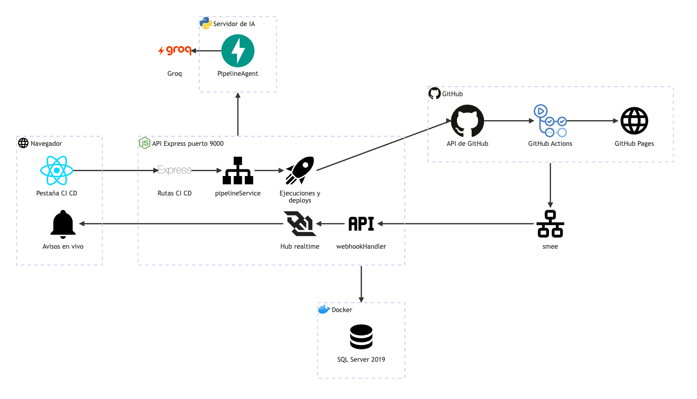

# CI/CD: arquitectura

**En una frase:** TaskMate escribe un *workflow* (archivo YAML que GitHub Actions ejecuta) en el repositorio del grupo, lo lanza y despliega el sitio a GitHub Pages desde la pestaña **CI/CD**, y GitHub avisa de vuelta con *webhooks* (avisos HTTP firmados).

Fuente del diagrama: [fuentes/08-cicd.mmd](fuentes/08-cicd.mmd)

| Flecha | Qué viaja |
|--------|-----------|
| Pestaña CI CD → Rutas CI CD | REST con el JWT (token de sesión) a `/api/github/groups/:gid/...` |
| Rutas CI CD → pipelineService | Proponer, previsualizar y subir el pipeline. Las rutas de ejecuciones y deploys van directo a «Ejecuciones y deploys» |
| pipelineService → Ejecuciones y deploys | `deployService` usa `pipelineService` para leer el estado de GitHub Pages |
| API → Servidor de IA | Mensaje `propose_pipeline` por el WebSocket compartido con Python (`LLMService`), solo si el grupo permite la IA |
| PipelineAgent → Groq | El modelo `openai/gpt-oss-20b` elige valores entre las opciones que TaskMate detectó |
| API → SQL Server 2019 | `RepoPipelines` (el pipeline guardado) y `DeployRequests` (solicitudes de producción) |
| Ejecuciones y deploys → API de GitHub | Con el token de la GitHub App: *dispatch* (lanzar el workflow a pedido), ejecuciones, logs, anotaciones y deployments. `pipelineService` también: lee el repositorio, sube el workflow y activa Pages |
| API de GitHub → Actions → Pages | El workflow `taskmate-ci.yml` corre los jobs `ci → build → deploy → close` y publica el sitio |
| GitHub → smee → webhookHandler | Webhooks `workflow_run`, `workflow_job` y `deployment_status`. smee reenvía los webhooks a la máquina local, solo en desarrollo |
| webhookHandler → Hub realtime → Avisos en vivo | Eventos `ci_run`, `ci_job` y `deployment` por el WebSocket `/events`. `deployService` publica además `deploy_request` en el hub (no dibujado) |

## Piezas

| Pieza | Tecnología | Archivo |
|-------|------------|---------|
| Pestaña CI/CD | React 18 + MUI | `src/components/github/cicd/CicdPanel.jsx` y sus hijos (`PipelineCard`, `PipelineSetup`, `RunList`, `RunDetail`, `JobLog`, `DeployPanel`) |
| Avisos en vivo | React Context + WebSocket | `src/components/realtime/RealtimeContext.jsx`, `CicdNotifications.jsx` |
| Cliente HTTP | `fetch` | `src/api/github.js` |
| Rutas CI/CD (18) | Express | `taskmate-api/controllers/github.controller.js` |
| Plantilla del workflow | JavaScript puro, sin I/O | `taskmate-api/services/github/pipelineSpec.js` |
| Propuesta, vista previa y subida | Node.js | `taskmate-api/services/github/pipelineService.js` |
| Propuesta con IA (lado Node) | WebSocket a Python | `taskmate-api/services/github/pipelineAi.js`, `services/LLMService.js` |
| Ejecuciones, logs y anotaciones | API REST de GitHub | `taskmate-api/services/github/actionsService.js` |
| Entornos, deploys y solicitudes | API REST y GraphQL de GitHub | `taskmate-api/services/github/deployService.js` |
| Cliente de la GitHub App | JWT RS256 y token de instalación | `taskmate-api/services/github/githubApp.js` |
| Datos del módulo | tedious + SQL Server 2019 | `taskmate-api/models/cicd.model.js`, `migrations/007_cicd.sql` |
| Webhooks de CI/CD | Express, firma HMAC | `taskmate-api/services/github/webhookHandler.js`, `cicdEvents.js` |
| Hub realtime | WebSocket `/events` | `taskmate-api/services/realtime.js`, `services/WebSocketServer.js` |
| PipelineAgent | Python, FastAPI, Groq | `taskmate-api/mcp/agents/pipeline_agent.py` |
| Workflow generado | GitHub Actions + Pages | `.github/workflows/taskmate-ci.yml` (en el repositorio del grupo) |

## Cómo se conectan

- **El navegador solo habla con la API** (REST y `/events`), nunca con GitHub directo.
- **La API actúa como la GitHub App:** usa un token de instalación de 1 h, limitado al repositorio del grupo y a los permisos de cada operación (por ejemplo, `actions: write` solo para lanzar el CI o un deploy, re-ejecutar o cancelar).
- **GitHub es la fuente de verdad:** las ejecuciones, los logs y el historial de deploys se leen en vivo. La base de datos solo guarda el pipeline configurado y las solicitudes de producción (y cada webhook queda en el registro de entregas del módulo GitHub).
- **La IA solo propone:** Node valida la propuesta contra el repositorio y genera el YAML con una plantilla fija. Nadie puede meter comandos libres en el workflow.
- **Camino de vuelta:** GitHub → webhook firmado → hub → `/events` → pantallas y avisos. Si se pierde un aviso, las pantallas consultan cada 60 s mientras algo corre (cada 10–15 s sin conexión en vivo).

## Para saber más

- Arquitectura general: [00-general.md](00-general.md)
- Tablas del módulo: [03-base-de-datos/08-cicd.md](../03-base-de-datos/08-cicd.md)
- Casos de uso y permisos: [04-casos-de-uso/08-cicd.md](../04-casos-de-uso/08-cicd.md)
- Pantalla: [05-interfaz/08-cicd.md](../05-interfaz/08-cicd.md)
- Flujos paso a paso: [06-flujos/08-cicd.md](../06-flujos/08-cicd.md)
- Guía de uso: [guia-cicd.md](../07-guias/guia-cicd.md)
- Capítulo de la Fase 4 (workflow job por job, seguridad): [fase-04-pipeline-cicd/README.md](../08-fases/fase-04-pipeline-cicd/README.md)
- Limitaciones conocidas: [cierre-del-proyecto.md](../01-proyecto/cierre-del-proyecto.md#github-y-cicd)
