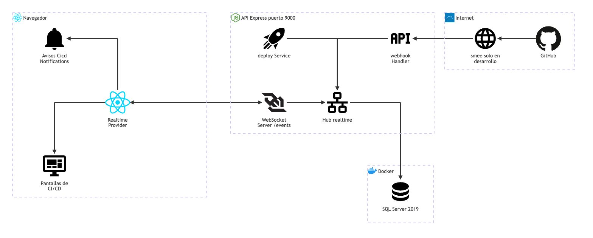

# Tiempo real y avisos: arquitectura

**En una frase:** el navegador abre un WebSocket a `/events`, se suscribe a sus grupos y la API le empuja al momento los eventos de CI/CD de esos grupos; con ellos aparecen avisos en cualquier pantalla y la pestaña CI/CD se recarga sola.

Las flechas del dibujo no llevan texto. Esto es lo que viaja por cada una:

| De → a | Qué viaja |
|---|---|
| GitHub → smee → webhook Handler | Webhooks `workflow_run`, `workflow_job` y `deployment_status`, firmados con HMAC, a `POST /api/github/webhook` |
| webhook Handler → Hub realtime | `ci_run`, `ci_job` o `deployment`, una vez por cada grupo vinculado al repositorio (los grupos salen de `GroupRepositories`) |
| deploy Service → Hub realtime | `deploy_request` al crear, aprobar, rechazar o cancelar una solicitud de producción |
| Hub realtime → SQL Server | ¿Este usuario es miembro de este grupo? (tabla `UserGroups`) |
| Realtime Provider ↔ WebSocket Server | Upgrade a `/events?token=JWT` (el mismo servidor atiende `/chat` y `/insights`). Navegador → API: `subscribe` y `ping`. API → navegador: `subscribed`, `event`, `error` y `pong` |
| WebSocket Server → Hub realtime | Alta y baja del socket, y la lista de grupos de cada `subscribe` |
| Realtime Provider → Avisos | Cada `event`; `CicdNotifications` decide si merece un aviso para ese usuario |
| Realtime Provider → Pantallas de CI/CD | Los eventos de su grupo; la pantalla vuelve a pedir sus datos a la API |

Términos:
- **WebSocket**: conexión que queda abierta; el servidor puede mandar mensajes sin que el navegador pregunte.
- **Hub**: el objeto que sabe qué socket escucha qué grupo y le reparte los eventos.
- **Webhook**: aviso HTTP que GitHub manda a TaskMate cuando algo cambia en el repositorio.
- **smee**: reenvía los webhooks de internet a `localhost`. Solo se usa en desarrollo.
- **Aviso (toast)**: mensaje corto que aparece abajo a la derecha y se cierra solo.
- **Polling**: volver a preguntar cada cierto tiempo; es el respaldo cuando no hay conexión en vivo.

## Piezas

| Pieza | Tecnología | Archivo |
|---|---|---|
| Servidor WebSocket: rutas `/chat`, `/insights` y `/events`; `Origin`, token, latido, cierre 4001, límite de 64 KB y de 10 sockets `/events` por usuario | ws 8 sobre el servidor HTTP de Express 4 | `taskmate-api/services/WebSocketServer.js` |
| Orígenes permitidos (`FRONTEND_URL`) | cors | `taskmate-api/middleware/cors.js` |
| Verificar el JWT de acceso | jsonwebtoken, HS256 | `taskmate-api/helpers/tokens.js` |
| Hub de eventos: suscripciones, membresía re-verificada y una cola por grupo | Node.js, en memoria | `taskmate-api/services/realtime.js` |
| Comprobar la membresía | tedious | `taskmate-api/models/access.model.js` (`isGroupMember`) |
| Datos mínimos de cada evento | Node.js | `taskmate-api/services/github/cicdEvents.js` |
| Webhooks de CI/CD → eventos | Express 4 | `taskmate-api/services/github/webhookHandler.js` |
| Solicitudes de producción → `deploy_request` | Node.js | `taskmate-api/services/github/deployService.js` |
| Cliente WebSocket con reconexión y latido | WebSocket del navegador | `src/hooks/useWebSocket.js` |
| Conexión única, suscripción y `useGroupEvents` | React 18 Context | `src/components/realtime/RealtimeContext.jsx` |
| Avisos globales | MUI 6 `Snackbar` y `Alert` | `src/components/realtime/CicdNotifications.jsx` |
| Pantallas que escuchan eventos | React 18 + MUI 6 | `src/components/github/cicd/{RunList,RunDetail,DeployPanel}.jsx` |
| Polling solo con la pestaña visible | React hook | `src/components/github/cicd/useVisibleInterval.js` |
| Dónde se montan el proveedor y los avisos | React Router 6 | `src/App.js` |

Este módulo no tiene tablas propias: solo lee `UserGroups` (membresía) y `GroupRepositories` (grupos de un repositorio).

## Cómo se conectan

- **Una puerta para tres rutas.** `/chat`, `/insights` y `/events` comparten el servidor y sus reglas: `Origin` permitido (si no, 403) y JWT de acceso en `?token=` (si no, 401). Cuando el token vence, el servidor cierra con 4001. `/chat` y `/insights` siguen en [Chat con IA](05-chat-ia.md) y [Analytics](06-analytics.md).
- **Una conexión por pestaña.** `RealtimeProvider` abre `/events` al iniciar sesión y se suscribe a todos los grupos del usuario. El servidor aplica un `subscribe` por segundo, siempre el último, y acepta 20 por minuto.
- **Membresía re-verificada.** El hub solo deja los grupos donde el usuario es miembro. Antes de entregar un evento, si esa comprobación tiene más de 5 min, la repite. Si la BD falla, el grupo queda `pending` y no se da de baja.
- **Origen de los eventos.** Los webhooks de CI/CD no se guardan en la BD: solo se marca la entrega y se reparten a los grupos del repositorio (`GroupRepositories`). `deploy_request` lo publica la API al cambiar una solicitud.
- **Respaldo.** Si no hay conexión confirmada, las pantallas de CI/CD consultan cada 10–15 s; con conexión, cada 60 s. En los dos casos, solo mientras algo corre y con la pestaña visible.
- **Una sola instancia.** Suscripciones y sockets viven en memoria: TaskMate corre como un solo proceso de API.

## Para saber más

- Quién recibe qué: [04-casos-de-uso/09-tiempo-real-y-avisos.md](../04-casos-de-uso/09-tiempo-real-y-avisos.md)
- Cómo se ven los avisos: [05-interfaz/09-tiempo-real-y-avisos.md](../05-interfaz/09-tiempo-real-y-avisos.md)
- Paso a paso y errores: [06-flujos/09-tiempo-real-y-avisos.md](../06-flujos/09-tiempo-real-y-avisos.md)
- El CI/CD que genera los eventos: [08-cicd.md](08-cicd.md)
- Arquitectura completa: [00-general.md](00-general.md)
- Guía de uso de las notificaciones: [guía de CI/CD](../07-guias/guia-cicd.md#9-notificaciones)
- Capítulo de la Fase 4: [Funcionalidad 13 — Notificaciones](../08-fases/fase-04-pipeline-cicd/README.md#funcionalidad-13--notificaciones)
- Limitaciones conocidas (por ejemplo, el JWT en la URL del WebSocket): [cierre del proyecto](../01-proyecto/cierre-del-proyecto.md#limitaciones-conocidas)
- Fuente del diagrama: [fuentes/09-tiempo-real-y-avisos.mmd](fuentes/09-tiempo-real-y-avisos.mmd)
