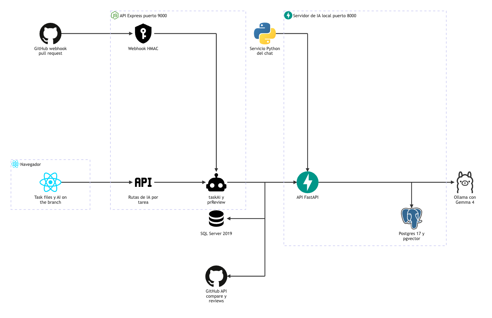

# IA sobre el código: arquitectura

**En una frase:** un servidor de IA local aparte (`taskmate-ai-server`, con Gemma 4 en Ollama) revisa el código de la rama de cada tarea: la API le manda el diff que pide a GitHub para auditarlo, proponer pruebas o revisar el PR, y publica la revisión del PR en GitHub como comentario.

Fuente del diagrama: [fuentes/10-ia-sobre-el-codigo.mmd](fuentes/10-ia-sobre-el-codigo.mmd).

Es de la línea de Christian (commits `f5c1359`, `efba978`, `7d83cdf` y `c2a6833`, 18 nov 2026) y entró por la rama `test/e2e`; está en `master` desde el 26 nov 2026.

Las flechas del dibujo no llevan texto. Esto es lo que viaja por cada una:

| De → a | Qué viaja |
|---|---|
| Task files y AI on the branch → Rutas de IA por tarea | `POST /api/github/tasks/:tid/audit`, `POST …/generate-tests`, `GET …/review` y `POST …/review`, con `Authorization: Bearer <JWT>` |
| GitHub webhook → Webhook HMAC | El evento `pull_request`, firmado, a `POST /api/github/webhook`; en desarrollo llega por smee ([módulo GitHub](07-github.md)) |
| Webhook HMAC → taskAi y prReview | Solo si la entrega quedó `processed`: `prReview.onPullRequestEvent(action, pr, repository)`. La respuesta del webhook no espera la revisión |
| Rutas de IA por tarea → taskAi y prReview | `taskAi.auditTask`, `generateTestsForTask`, `latestReview` y `reviewTaskPr` |
| taskAi y prReview → SQL Server | `AiReviews` por `aiReview.model.js` (reservar, cerrar y leer la última). La rama, el PR y el permiso de IA salen de `github.model.js` |
| taskAi y prReview → GitHub API | Con el token de instalación de la App: `GET compare/<base>...<rama>` (en la revisión del PR, `<base>...<commit>`; `contents: read`) para los parches por archivo, `GET pulls/{n}` (`pull_requests: read`) en la revisión manual y `POST pulls/{n}/reviews` con `event: COMMENT` (`pull_requests: write`) |
| taskAi y prReview → API FastAPI | `POST {AI_SERVER_URL}/commands/<comando>` (`audit`, `generate-tests` o `review-pr`) con `{project, args}` y la cabecera `X-AI-Server-Secret`. `args` lleva los parches del diff tal cual |
| Servicio Python del chat → API FastAPI | `POST /search` con `X-AI-Server-Secret`, solo cuando el chat no tiene proyecto elegido o el grupo está sin usar ([módulo Chat](05-chat-ia.md)) |
| API FastAPI → Ollama | HTTP a `127.0.0.1:11434`: `gemma4:e2b-it-qat` para escribir y `embeddinggemma:300m` para los embeddings |
| API FastAPI → Postgres | Cada comando deja una fila en `command_runs`; `/search` busca en `chunks` y `chunk_embeddings` |

Términos:
- **Servidor de IA local**: el repo aparte `taskmate-ai-server` de Christian (privado, usuario `Sirk02`). API FastAPI en `127.0.0.1:8000`. No es el **servicio Python del chat** (`taskmate-api/mcp/`, puerto 8001).
- **Modelo local**: Gemma 4 (`gemma4:e2b-it-qat`) servido por Ollama. La auditoría, las pruebas y la revisión corren solo ahí: nada de eso va a Groq.
- **Diff por archivo (parche)**: los cambios de la rama frente a su base, como los da la API compare de GitHub. Con eso, el servidor de IA no necesita una copia del repositorio.
- **Veredicto**: `pass`, `warn` o `fail`. Solo las reglas fijas pueden dar `fail`; lo que encuentra el modelo se marca «AI, advisory» y como mucho sube el veredicto a `warn`.
- **Revisión COMMENT**: revisión de un PR en GitHub que solo comenta; nunca aprueba ni pide cambios.
- **Embedding y pgvector**: un vector de 768 números que resume un pasaje; pgvector busca los más parecidos (índice HNSW con distancia coseno).

## Piezas

| Pieza | Tecnología | Archivo |
|---|---|---|
| Panel «AI on the branch» dentro del diálogo «Task files» | React 18 + MUI 6 | `src/components/github/TaskAiPanel.jsx`, `TaskFilesDialog.jsx`, `TaskGitHubActions.jsx` |
| Cliente HTTP | `fetch` con el JWT | `src/api/github.js` (`auditTask`, `generateTaskTests`, `getTaskReview`, `reviewTaskPr`) |
| Rutas y límite de 5 por minuto | Express 4 | `taskmate-api/controllers/github.controller.js` |
| Diff de la rama de la tarea | API compare de GitHub | `taskmate-api/services/aiServer/taskAi.js`, `services/github/repoService.js` (`getComparePatches`) |
| Revisión del PR: disparo, publicación y registro | Node.js | `taskmate-api/services/aiServer/prReview.js`, `services/github/webhookHandler.js` |
| Cliente del servidor de IA (errores `AI_SERVER_*`) | `fetch` con plazo de 180 s | `taskmate-api/services/aiServer/client.js` |
| Acceso a datos | `tedious` | `taskmate-api/models/aiReview.model.js` |
| Base de datos de TaskMate | SQL Server 2019 | `AiReviews`, migración 011 ([detalle](../03-base-de-datos/10-ia-sobre-el-codigo.md)) |
| API del servidor de IA y secreto compartido | Python, FastAPI, uvicorn | `taskmate-ai-server`: `src/api.py` |
| Comandos y su historial | Python, Pydantic | `src/commands.py` |
| Auditoría: reglas fijas y revisión del modelo | Python | `src/audit.py` |
| Pruebas propuestas | Python (`ast` para validar) | `src/testgen.py` |
| Revisión de PR: resumen, riesgos, escape y secretos tapados | Python | `src/review.py` |
| Indexado y búsqueda semántica | pgvector | `src/ingest.py`, `src/retrieve.py` |
| Modelo local | Ollama, Gemma 4 y EmbeddingGemma | `src/ollama_client.py`, `src/config.py` |
| Base propia del servidor | Postgres 17 + pgvector en podman | `db/migrations/001`–`004`, `scripts/start-db.sh` |
| Arranque | bash (Linux con systemd y podman) | `scripts/up.sh` del servidor; `scripts/local-up.sh` de TaskMate |

## Cómo se conectan

- **Dos repos, un secreto.** La API y el servicio Python mandan `X-AI-Server-Secret` (`AI_SERVER_SECRET` en la `.env` de la raíz). El servidor lo compara en tiempo constante y responde 401 si falta o no coincide; sin secreto solo responden `/health`, `/docs`, `/redoc` y `/openapi.json`. No arranca con un secreto de menos de 32 caracteres o con cara de ejemplo, ni sin secreto, salvo con `AI_SERVER_ALLOW_NO_SECRET=1`. Su `up.sh` lo genera y `local-up.sh` lo copia a la `.env` de TaskMate.
- **Configuración de la API.** `AI_SERVER_URL` (vacía = todo responde `AI_SERVER_DISABLED`; `local-up.sh` pone `http://127.0.0.1:8000`), `AI_SERVER_SECRET`, `AI_SERVER_PROJECT` (`TaskMate`, el mismo para todos los grupos) y `AI_SERVER_TIMEOUT_MS` (180000).
- **Sin copia del repositorio.** La API pide a GitHub el compare con tres puntos entre la base (la del PR o, sin PR, la rama por defecto) y la rama de la tarea, y manda los parches por archivo. GitHub incluye como mucho 300 archivos y omite el parche de los binarios o muy grandes.
- **Solo con permiso.** Las tres acciones y la revisión automática exigen que el admin haya activado «Allow AI analysis» en el grupo. Mandan al servidor de IA local el código del diff, sin tapar secretos. El texto de ese interruptor describe el análisis del repositorio del chat («The source code is NEVER read»), no estas acciones. Ver [limitaciones](../01-proyecto/cierre-del-proyecto.md#ia-sobre-el-código).
- **Revisión automática, una por commit.** Con un `pull_request` `opened`, `synchronize`, `ready_for_review` o `reopened` cuya entrega quedó `processed`, `prReview` revisa en segundo plano si hay `AI_SERVER_URL`, el PR está abierto y no es borrador, su rama es la de una tarea y ese grupo tiene el permiso de IA sobre ese mismo repo. Antes de llamar al servidor reserva en `AiReviews` la fila `pending` de (tarea, commit): un webhook repetido no revisa dos veces. Una revisión `failed`, o una `pending` de más de 15 minutos (de un proceso que se cayó), se reserva otra vez y se repite sobre el mismo commit, con «Review PR» o con el siguiente webhook (desde el 26 nov 2026).
- **Se publica como comentario.** El resultado va a GitHub como revisión `COMMENT` sobre el commit revisado, con comentarios en línea para los hallazgos altos y medios (máximo 30). Si GitHub rechaza un comentario en línea (422), se reintenta sin ellos. Sin el permiso «Pull requests: write» de la App, la revisión queda guardada como `no_permission`.
- **Lo que se publica va escapado.** En la revisión, el servidor de IA escapa el Markdown, las `@` y los `://` del texto del modelo y de las rutas, cambia por `***` los secretos que detectan sus reglas y, si el cambio trae una llave privada, no publica nada escrito por el modelo. La auditoría y las pruebas no pasan por ese filtro; la interfaz las muestra como texto, sin HTML.
- **Un modelo compartido.** Ollama sirve el mismo Gemma 4 al servidor de IA y al chat (`LLM_PROVIDER=ollama`, lo que pone `scripts/local-up.sh`), con el mismo contexto de 8192 tokens para no recargarlo. La auditoría revisa 4 archivos a la vez (`AUDIT_CONCURRENCY`).
- **Límites.** Las tres acciones comparten un límite de 5 por minuto por usuario («AI reviews hold a GPU slot for ~20 s each»). La API espera al servidor hasta 180 s. El webhook no tiene límite de frecuencia: lo frena la regla de una revisión por commit.
- **Quién llena el conocimiento.** Ningún código de TaskMate indexa documentos. `/search` solo encuentra lo que alguien indexó a mano en la máquina del servidor (`ingest-repo` o `POST /ingest`, dentro de `INGEST_ROOTS`).
- **La fuente es el código.** La documentación propia del servidor de IA tiene partes viejas (por ejemplo, dice que no hay autenticación). En `main` (`19ea7ef`, con los PR #4 audit, #7 generate-tests y #8 review-pr) manda el código: `src/api.py` y `src/commands.py`.

## Para saber más

- Tablas: [03-base-de-datos/10-ia-sobre-el-codigo.md](../03-base-de-datos/10-ia-sobre-el-codigo.md)
- Quién puede hacer qué: [04-casos-de-uso/10-ia-sobre-el-codigo.md](../04-casos-de-uso/10-ia-sobre-el-codigo.md)
- Pantallas: [05-interfaz/10-ia-sobre-el-codigo.md](../05-interfaz/10-ia-sobre-el-codigo.md)
- Paso a paso y mensajes de error: [06-flujos/10-ia-sobre-el-codigo.md](../06-flujos/10-ia-sobre-el-codigo.md)
- La App, los webhooks y la rama de cada tarea: [07-github.md](07-github.md)
- El chat y el modelo local: [05-chat-ia.md](05-chat-ia.md)
- Secretos y procesos: [seguridad](00-seguridad.md) y [despliegue y puertos](00-despliegue.md)
- Permiso «Pull requests: write»: [guía de la GitHub App](../07-guias/guia-github-app.md#revisión-de-pr-con-ia-opcional)
- Registro de Christian: [línea de Christian](../09-linea-christian/README.md#conexión-con-el-servidor-de-ia-19-nov-2026)
- Limitaciones conocidas: [cierre de la línea de Pablo y estado](../01-proyecto/cierre-del-proyecto.md#limitaciones-conocidas)
