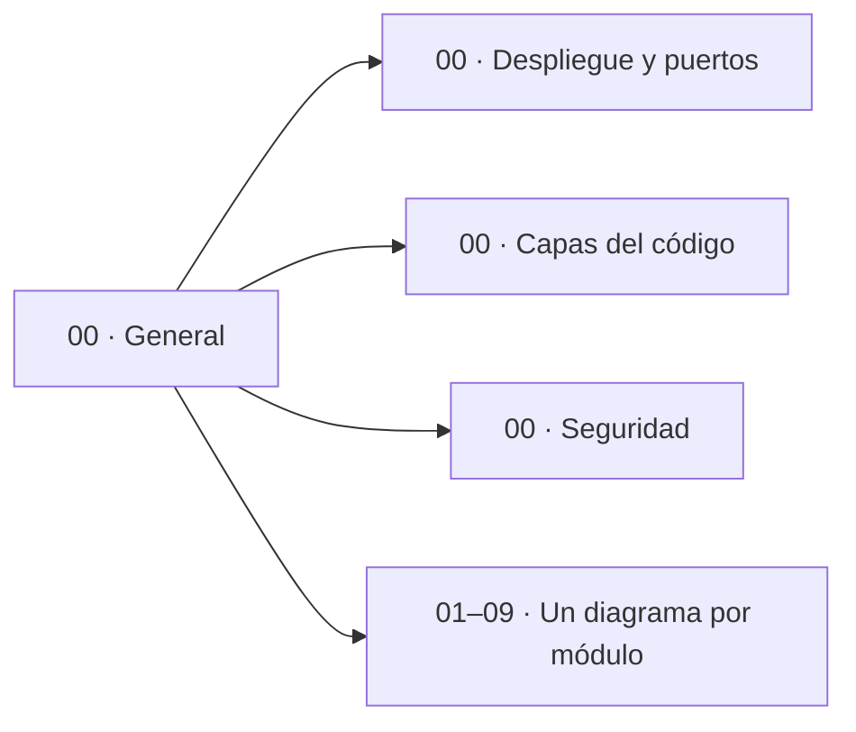

# 02 · Arquitectura

**En una frase:** cómo se conectan las piezas de TaskMate (navegador, API, servidor de IA, SQL Server y GitHub), primero en conjunto y después módulo por módulo.

## Páginas generales

| Página | Qué explica |
|---|---|
| [Arquitectura general](00-general.md) | Las capas (React, API Express, servidor de IA, SQL Server, GitHub) y qué conecta cada flecha |
| [Despliegue y puertos](00-despliegue.md) | Qué corre en la Mac de desarrollo, en qué puerto, qué servicios externos usa y qué hace `start.sh` |
| [Capas del código](00-capas-del-codigo.md) | De `App.js` a los componentes, de `app.js` a la BD y de `server.py` a los agentes y Groq |
| [Seguridad](00-seguridad.md) | El control de cada entrada (JWT, `Origin`, HMAC, `X-MCP-Secret`, tokens de GitHub), límites y roles |

## Páginas por módulo

| Módulo | Qué explica |
|---|---|
| [1 · Usuarios y acceso](01-usuarios-y-acceso.md) | Registro e inicio de sesión en `/api/users` y el JWT de 24 h en cada llamada y WebSocket |
| [2 · Grupos y roles](02-grupos-y-roles.md) | `/groups` → API, que revisa si eres miembro o admin antes de tocar las 4 tablas del módulo |
| [3 · Tareas](03-tareas.md) | `/tasks` → API → SQL Server en transacción; después, analytics y limpieza de la rama |
| [4 · Hitos y calendario](04-hitos-y-calendario.md) | Hitos (`Nodes`) y flechas (`Edges`) por REST, y los dos triggers que propagan el avance |
| [5 · Chat con IA](05-chat-ia.md) | WebSocket `/chat` → API → servidor de IA → Groq; el plan confirmado se guarda en SQL Server |
| [6 · Analytics](06-analytics.md) | Métricas del equipo por REST y recomendaciones de la IA por el WebSocket `/insights` |
| [7 · GitHub](07-github.md) | La GitHub App: conectar el repositorio, rama por tarea, webhooks y PR fusionado → tarea completa |
| [8 · CI/CD](08-cicd.md) | El workflow en el repositorio del grupo, GitHub Actions, deploy a GitHub Pages y sus webhooks |
| [9 · Tiempo real y avisos](09-tiempo-real-y-avisos.md) | El WebSocket `/events`: la API empuja los eventos de CI/CD a los miembros de cada grupo |

## Diagramas e imágenes

- **Arquitectura con íconos:** cada página la muestra como PNG desde [`imagenes/`](imagenes/) (`00-general.png`, `00-despliegue.png` y `01-…` a `09-….png`), con una tabla de conexiones debajo.
- **Fuentes de esas imágenes:** [`fuentes/`](fuentes/), un `.mmd` de Mermaid `architecture-beta` por imagen, con el mismo nombre.
- **Bloques Mermaid** (los de `00-general`, `00-capas-del-codigo`, `00-seguridad` y este índice): su copia en PNG también está en `imagenes/`, como `<página>-<n>.png` (n = orden del diagrama en la página).

## Para saber más

- [Índice de la documentación](../README.md) y la tabla de módulos × carpetas.
- Tablas de cada módulo: [03-base-de-datos](../03-base-de-datos/README.md).
- Paso a paso de cada operación: [06-flujos](../06-flujos/README.md).
- Referencia técnica completa (rutas, variables, puertos): [guía técnica](../07-guias/guia-tecnica.md).
