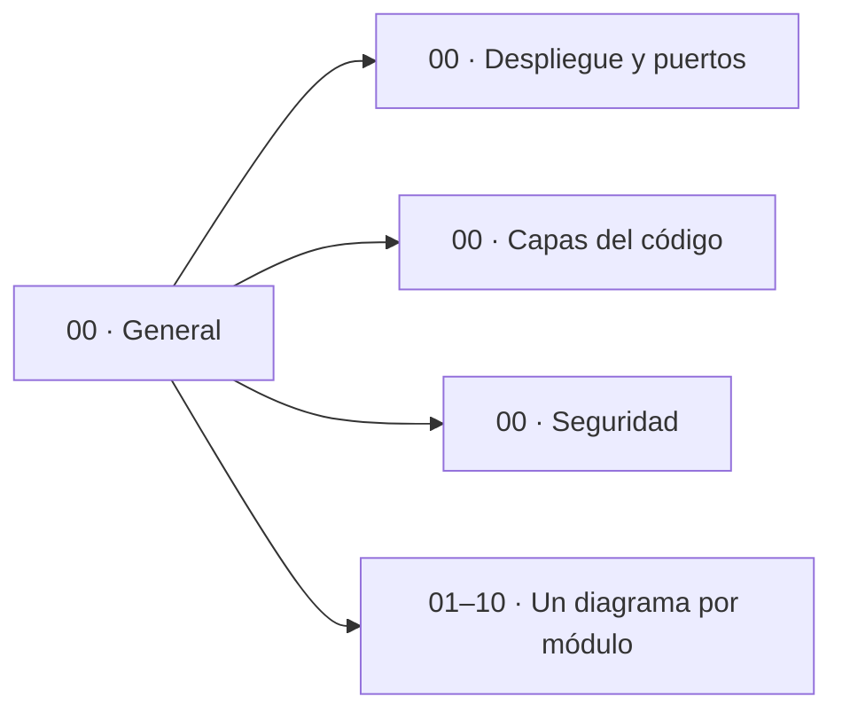

# 02 · Arquitectura

**En una frase:** cómo se conectan las piezas de TaskMate (navegador, API, servicio Python del chat, servidor de IA local, SQL Server, GitHub y Vercel), primero en conjunto y después módulo por módulo.

Actualizada el 25 nov 2026 con el código de la rama `test/e2e`, que trae la línea de Christian y está en `master` desde el 26 nov 2026, con los [arreglos de ese día](../01-proyecto/cierre-del-proyecto.md#correcciones-del-26-nov-2026).

## Páginas generales

| Página | Qué explica |
|---|---|
| [Arquitectura general](00-general.md) | Las capas (React, API Express, servicio Python del chat, servidor de IA local, SQL Server, GitHub, Vercel) y qué conecta cada flecha |
| [Despliegue y puertos](00-despliegue.md) | Qué corre en la máquina de desarrollo y en qué puerto, qué servicios externos usa, y qué hacen `start.sh` (macOS) y `scripts/local-up.sh` / `local-down.sh` (Linux con Podman) |
| [Capas del código](00-capas-del-codigo.md) | De `App.js` a los componentes, de `app.js` a la BD y de `server.py` a los agentes y al modelo (Gemma 4 en Ollama; Groq de respaldo) |
| [Seguridad](00-seguridad.md) | El control de cada entrada (JWT, `Origin`, HMAC de GitHub y de Vercel, `X-MCP-Secret`, `X-AI-Server-Secret`, tokens de GitHub), límites y roles |

## Páginas por módulo

| Módulo | Qué explica |
|---|---|
| [1 · Usuarios y acceso](01-usuarios-y-acceso.md) | Registro e inicio de sesión en `/api/users` y el JWT de 24 h en cada llamada y WebSocket |
| [2 · Grupos y roles](02-grupos-y-roles.md) | `/groups` → API, que revisa si eres miembro o admin antes de tocar las 4 tablas del módulo |
| [3 · Tareas](03-tareas.md) | `/tasks` → API → SQL Server en transacción; después, analytics y limpieza de la rama |
| [4 · Hitos y calendario](04-hitos-y-calendario.md) | Hitos (`Nodes`) y flechas (`Edges`) por REST, y los dos triggers que propagan el avance |
| [5 · Chat con IA](05-chat-ia.md) | WebSocket `/chat` → API → servicio Python → Ollama (Gemma 4; Groq de respaldo), con respuestas en streaming; el plan confirmado se guarda en SQL Server |
| [6 · Analytics](06-analytics.md) | Métricas del equipo por REST y recomendaciones de la IA por el WebSocket `/insights` |
| [7 · GitHub](07-github.md) | La GitHub App: conectar el repositorio, rama por tarea, archivos de la tarea, webhooks y PR fusionado → tarea completa |
| [8 · CI/CD](08-cicd.md) | El workflow en el repositorio del grupo, GitHub Actions, deploy a GitHub Pages, sus webhooks y el monitoreo de despliegues de Vercel |
| [9 · Tiempo real y avisos](09-tiempo-real-y-avisos.md) | El WebSocket `/events`: la API empuja los eventos de CI/CD a los miembros de cada grupo |
| [10 · IA sobre el código](10-ia-sobre-el-codigo.md) | La API → servidor de IA local (`:8000`): auditar la rama de la tarea, proponer pruebas y revisar el PR (webhook o botón, comentario COMMENT en GitHub) |

## Nombres que cambiaron

| Nombre | Qué es |
|---|---|
| **Servicio Python** (o servicio Python del chat) | `taskmate-api/mcp/`, FastAPI en `127.0.0.1:8001` (`MCP_PORT`). Hasta el 5 nov estas páginas lo llamaban «servidor de IA» |
| **Servidor de IA local** | El repo aparte de Christian, `taskmate-ai-server`: FastAPI en `127.0.0.1:8000` con Ollama y Postgres + pgvector. Se autentica con `X-AI-Server-Secret` |
| **Modelo local** | Gemma 4 en Ollama (`127.0.0.1:11434`): el modelo del chat, los planes, analytics, el análisis del repo y el pipeline (`LLM_PROVIDER=ollama`, lo que pone `scripts/local-up.sh`) |
| **Groq (respaldo en la nube)** | `openai/gpt-oss-20b` con `GROQ_API_KEY`. Es el valor por defecto de `LLM_PROVIDER` en el código, para que un checkout sin Ollama siga funcionando |

## Diagramas e imágenes

- **Arquitectura con íconos:** cada página la muestra como PNG desde [`imagenes/`](imagenes/) (`00-general.png`, `00-despliegue.png` y `01-…` a `10-….png`), con una tabla de conexiones debajo.
- **Fuentes de esas imágenes:** [`fuentes/`](fuentes/), un `.mmd` de Mermaid `architecture-beta` por imagen, con el mismo nombre.
- **Bloques Mermaid** (los de `00-general`, `00-capas-del-codigo`, `00-seguridad` y este índice): su copia en PNG también está en `imagenes/`, como `<página>-<n>.png` (n = orden del diagrama en la página).

## Para saber más

- [Índice de la documentación](../README.md) y la tabla de módulos × carpetas.
- Tablas de cada módulo: [03-base-de-datos](../03-base-de-datos/README.md).
- Paso a paso de cada operación: [06-flujos](../06-flujos/README.md).
- Referencia técnica completa (rutas, variables, puertos): [guía técnica](../07-guias/guia-tecnica.md).
- Lo que hizo Christian (Vercel, archivos por tarea, chat con IA local, servidor de IA local): [09-linea-christian](../09-linea-christian/README.md).
