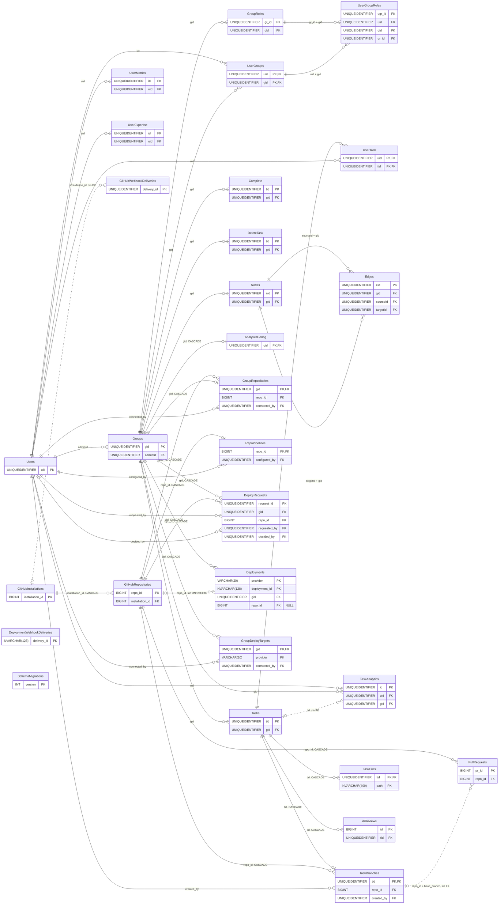

# Modelo de datos

**En una frase:** TaskMate guarda todo en una base SQL Server 2019 con **29 tablas**: 14 del esquema base, 1 de la migración 001, 6 de la 002 (GitHub), 2 de la 007 (CI/CD), 3 de la 009 (despliegues de Vercel), 1 de la 010 (archivos por tarea), 1 de la 011 (revisiones de IA) y la bitácora `SchemaMigrations`. El servidor de IA local tiene su propia base aparte, que no cuenta en las 29.

`PK` = llave primaria · `FK` = llave foránea · `||--o{` = uno a muchos · `||--o|` = uno a cero o uno · `|o--o{` = FK que admite `NULL` · línea punteada = relación lógica **sin FK** en la base · `CASCADE` = la FK tiene `ON DELETE CASCADE` (borrar el padre borra estas filas). Solo se dibujan las llaves; todos los campos están en [tablas y campos](00-tablas-y-campos.md). En `UserGroupRoles` y `Edges` se dibuja la FK compuesta y no las simples que cubre. `DeploymentWebhookDeliveries` y `SchemaMigrations` no tienen relaciones.

## Tablas por módulo

| Módulo | Tablas | Página |
|---|---|---|
| Usuarios y acceso | `Users`, `Groups` (grupo personal), `UserGroups` | [01-usuarios-y-acceso.md](01-usuarios-y-acceso.md) |
| Grupos y roles | `Groups`, `UserGroups`, `GroupRoles`, `UserGroupRoles` | [02-grupos-y-roles.md](02-grupos-y-roles.md) |
| Tareas | `Tasks`, `UserTask`, `Complete`, `DeleteTask` | [03-tareas.md](03-tareas.md) |
| Hitos y calendario | `Nodes`, `Edges` (el calendario lee también `Tasks`) | [04-hitos-y-calendario.md](04-hitos-y-calendario.md) |
| Chat IA | Sin tablas propias: el plan de un proyecto nuevo escribe en `Groups`, `UserGroups`, `GroupRoles`, `Tasks` y `Nodes` (en un grupo sin usar, el nombre en `Groups`, `GroupRoles`, `Tasks` y `Nodes`), y el de un grupo existente en `Tasks` y `Nodes`. Para el contexto del proyecto lee `Tasks`, `Nodes`, `UserTask`, los miembros y `GroupRepositories`, y `Complete` y `DeleteTask` para saber si el grupo está sin usar | [05-chat-ia.md](05-chat-ia.md) |
| Analytics | `TaskAnalytics`, `UserMetrics`, `UserExpertise`, `AnalyticsConfig` | [06-analytics.md](06-analytics.md) |
| GitHub | `GitHubInstallations`, `GitHubRepositories`, `GroupRepositories`, `TaskBranches`, `PullRequests`, `GitHubWebhookDeliveries` y, desde la 010, `TaskFiles` (archivos de cada tarea) | [07-github.md](07-github.md) |
| CI/CD | `RepoPipelines`, `DeployRequests` y, desde la 009, el monitoreo de Vercel: `Deployments`, `DeploymentWebhookDeliveries`, `GroupDeployTargets` | [08-cicd.md](08-cicd.md) |
| Tiempo real y avisos | Sin tablas propias: lee `UserGroups` y `GroupRepositories` para saber a quién avisar | [arquitectura](../02-arquitectura/09-tiempo-real-y-avisos.md) |
| IA sobre el código | `AiReviews` (011): la revisión de PR con IA, una por commit | [10-ia-sobre-el-codigo.md](10-ia-sobre-el-codigo.md) |
| Control | `SchemaMigrations` | [migraciones y triggers](00-migraciones-y-triggers.md) |

Por tema, las 29 son: 11 del núcleo, 4 de analytics, 6 de GitHub, 2 de CI/CD, 3 de despliegues, 1 de archivos por tarea, 1 de IA y `SchemaMigrations`.

## Qué hace

- Guarda cuentas, grupos, roles, tareas, hitos, el historial de analytics, el vínculo con GitHub, los archivos que tocó cada tarea, lo mínimo del CI/CD, los despliegues de Vercel y las revisiones de PR con IA.
- De GitHub no guarda tokens ni nada de GitHub Actions (ejecuciones, logs, deploys): TaskMate lo lee en vivo de GitHub.
- Los despliegues de Vercel sí se guardan: llegan por webhook a `Deployments`, y cada entrega queda en la bitácora `DeploymentWebhookDeliveries`.
- No guarda el historial del chat: vive en memoria.
- No guarda la auditoría de la rama ni las pruebas propuestas: quedan en la [base aparte del servidor de IA local](#base-aparte-del-servidor-de-ia-local).
- Con el `setup-db.sh` actual, la API entra con un login que solo lee y escribe datos; el esquema lo cambian las migraciones, como `SA`. Un contenedor creado con una imagen anterior no lo tiene aplicado ([pendiente](../01-proyecto/cierre-del-proyecto.md#prioridad-alta-seguridad-y-operación)).

## Cómo funciona

### Llaves y restricciones

- **Ids.**
  - Las tablas del núcleo usan `UNIQUEIDENTIFIER` (uuid v4 que genera la API); las de GitHub usan los `BIGINT` que da GitHub.
  - `Deployments` usa el id que da el proveedor (`NVARCHAR(128)`) junto con `provider`, y `DeploymentWebhookDeliveries` el id del evento de Vercel (o el SHA-256 del cuerpo si no trae id).
  - `AiReviews` usa un `BIGINT IDENTITY`. `GroupDeployTargets` y `TaskFiles` no tienen id propio: su PK es compuesta.
- **Un grupo, un admin.** `Groups.adminId` apunta a `Users`; la API exige además que el admin siga siendo miembro (`UserGroups`).
- **Coherencia del grupo.** Las FK compuestas (`uid`, `gid`) → `UserGroups` y (`gr_id`, `gid`) → `GroupRoles` impiden dar un rol a quien no es miembro o usar el rol de otro grupo; en `Edges`, los dos hitos deben ser del grupo de la arista.
- **Uno a uno.** Un repositorio por grupo (`GroupRepositories.gid` es PK), una rama por tarea (`TaskBranches.tid`), un pipeline por repositorio (`RepoPipelines.repo_id`) y una configuración de analytics por grupo.
- **Uno por par.**
  - Un proyecto por proveedor y grupo (PK `gid` + `provider` de `GroupDeployTargets`), y un proyecto de Vercel en un solo grupo (`UQ_GroupDeployTargets_Project`).
  - Una fila por archivo y tarea (PK `tid` + `path` de `TaskFiles`).
  - Una revisión por commit de la tarea (`UQ_AiReviews_TaskSha`, `tid` + `head_sha`).
- **Sin FK a propósito.**
  - `TaskAnalytics.tid` (el historial sobrevive a la tarea), `Complete.tid` y `DeleteTask.tid` (guardan el id viejo).
  - `PullRequests` ↔ `TaskBranches` (se unen por `repo_id` + `head_branch`).
  - `GitHubWebhookDeliveries` y `DeploymentWebhookDeliveries` (registran lo que manda GitHub o Vercel, aunque no se pueda enrutar).
  - `TaskFiles.pr_number` y `AiReviews.pr_number` (el número del PR, sin FK a `PullRequests`).
  - `GroupDeployTargets` ↔ `Deployments` (el webhook busca el grupo por `project_ref` y guarda el despliegue con ese `gid`).
- **Collation binaria.** Las columnas de ramas, los ids de Vercel (`Deployments.deployment_id`, `DeploymentWebhookDeliveries.delivery_id`, `GroupDeployTargets.project_ref`) y `TaskFiles.path` usan `Latin1_General_100_BIN2`: distinguen mayúsculas, como Git.

### Índices

Hasta la 007, cada FK tenía su índice (migraciones 001, 002 y 007) o era la primera columna de una llave; las FK nuevas de `gid` y `tid` van primero en una llave o un índice. Desde la 009 hay dos FK sin índice: `Deployments.repo_id` y `GroupDeployTargets.connected_by`. Hay dos índices únicos filtrados: uno evita procesar dos veces el mismo webhook de GitHub y otro permite una sola solicitud de deploy pendiente por grupo y entorno. `Deployments`, `TaskFiles` y `AiReviews` traen un índice para su consulta principal: últimos despliegues del grupo, qué otras tareas tocan una ruta y última revisión de una tarea. La lista completa está en [migraciones y triggers](00-migraciones-y-triggers.md#índices-importantes).

### Borrado

- **Núcleo, sin cascadas.** `group.model.deleteGroupCascade` borra todo el grupo en una transacción, de hijos a padres: `TaskAnalytics`, `UserTask`, `Tasks`, `Complete`, `DeleteTask`, `Edges`, `Nodes`, `UserGroupRoles`, `GroupRoles`, `UserGroups` y `Groups`.
- **Cascadas reales.**
  - Al borrar un grupo caen `AnalyticsConfig`, `GroupRepositories`, `DeployRequests`, `Deployments` y `GroupDeployTargets`.
  - Al borrar una tarea caen su `TaskBranches`, sus `TaskFiles` y sus `AiReviews`.
  - Al borrar una instalación caen sus repositorios, y con cada repositorio sus `GroupRepositories`, `TaskBranches`, `PullRequests`, `RepoPipelines` y `DeployRequests`.
- **Repositorio con despliegues.** `Deployments.repo_id` es la única FK hacia `GitHubRepositories` sin `ON DELETE`. Según el código, si un despliegue apunta al repositorio, borrar ese repositorio o su instalación choca con la FK y la entrega del webhook de GitHub queda `ignored` sin borrar nada ([limitaciones](../01-proyecto/cierre-del-proyecto.md#limitaciones-conocidas)).
- **Completar o mandar a la papelera.** Copia la tarea a `Complete` o `DeleteTask`, cierra sus hechos de `TaskAnalytics` y borra `UserTask` y `Tasks`, todo en una transacción. Por la cascada se van también su rama (`TaskBranches`), sus archivos (`TaskFiles`) y sus revisiones (`AiReviews`). Borrar una lista hace lo mismo con cada tarea, sin copiarla a `DeleteTask`. Por eso una tarea completada no conserva su lista de archivos ([limitaciones](../01-proyecto/cierre-del-proyecto.md#limitaciones-conocidas)).
- **Desvincular Vercel.** Borra solo la fila de `GroupDeployTargets`; los `Deployments` del grupo se quedan.
- **Bitácoras.** La purga diaria solo borra `GitHubWebhookDeliveries` viejas; `DeploymentWebhookDeliveries` no se purga.
- **Usuarios.** Ninguna ruta borra usuarios, y ninguna FK hacia `Users` tiene cascada (tampoco la nueva, `GroupDeployTargets.connected_by`).

### Triggers

Dos triggers de la migración 006 recalculan el porcentaje de los hitos unidos por aristas progresoras ([detalle](00-migraciones-y-triggers.md#triggers-migración-006)). Las migraciones 009–011 no agregan triggers.

### Base aparte del servidor de IA local

El servidor de IA local (repo aparte `taskmate-ai-server`, de Christian) tiene su propia base. **No es el SQL Server de TaskMate y sus tablas no cuentan en las 29.**

- **Motor:** Postgres 17 con pgvector y pgcrypto, en un contenedor de Podman (`taskmate-ai-db`, solo en `127.0.0.1:5432`, BD `taskmate_ai`).
- **7 tablas:** `projects`, `documents`, `chunks`, `chunk_embeddings` (`vector(768)`, con índice HNSW por coseno), `conversations`, `messages` y `command_runs`.
- **Qué se escribe:** los documentos indexados con sus fragmentos y embeddings (lo que busca el chat con `/search`) y una fila en `command_runs` por cada comando ejecutado (ahí quedan la auditoría de la rama y las pruebas propuestas). Ningún código escribe en `conversations` ni en `messages`.
- **Sin FK hacia TaskMate:** las referencias (`external_id`, `external_user_id`) son texto que admite `NULL`.
- **Cómo se conecta:** TaskMate nunca entra a esa base; solo llama a la API HTTP del servidor. De la IA sobre el código, TaskMate solo guarda en su SQL Server la revisión de PR (`AiReviews`).

Detalle en [IA sobre el código](10-ia-sobre-el-codigo.md).

## Dónde está en el código

| Archivo | Qué hace |
|---|---|
| `taskmate-api/taskmate_tables.sql` | Esquema base: 14 tablas |
| `taskmate-api/migrations/` | Migraciones 001–011, sus reversas y los dos aplicadores |
| `taskmate-api/setup-db.sh` | Arranque del contenedor: BD, login de mínimo privilegio, esquema y migraciones |
| `taskmate-api/models/` | Todas las consultas SQL de la API (las tablas nuevas: `deployment.model.js`, `github.model.js` para `TaskFiles` y `aiReview.model.js`) |
| `taskmate-api/helpers/pool.js`, `transaction.js`, `execQuery.js` | Pool de conexiones `tedious` y transacciones |
| `taskmate-ai-server/db/migrations/` (repo aparte) | Base del servidor de IA local: extensiones, 7 tablas e índices |

## Para saber más

- Todos los campos y tipos: [00-tablas-y-campos.md](00-tablas-y-campos.md)
- Migraciones, triggers e índices: [00-migraciones-y-triggers.md](00-migraciones-y-triggers.md)
- Levantar la base en Docker: [guía de la base de datos](../07-guias/base-de-datos-docker.md)
- Arquitectura general: [02-arquitectura/00-general.md](../02-arquitectura/00-general.md)
- La revisión de PR con IA y la base del servidor de IA local: [10-ia-sobre-el-codigo.md](10-ia-sobre-el-codigo.md)
- Limitaciones conocidas: [cierre de la línea de Pablo y estado](../01-proyecto/cierre-del-proyecto.md#limitaciones-conocidas)
