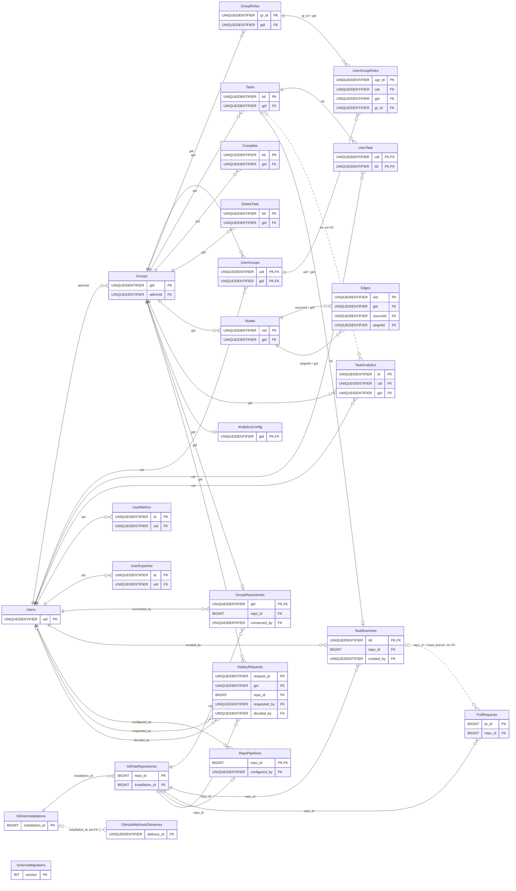

# Modelo de datos

**En una frase:** TaskMate guarda todo en una base SQL Server 2019 con **24 tablas**: 14 del esquema base, 1 de la migración 001, 6 de la 002 (GitHub), 2 de la 007 (CI/CD) y la bitácora `SchemaMigrations`.

`PK` = llave primaria · `FK` = llave foránea · `||--o{` = uno a muchos · `||--o|` = uno a cero o uno · `|o--o{` = FK que admite `NULL` · línea punteada = relación lógica **sin FK** en la base. Solo se dibujan las llaves; todos los campos están en [tablas y campos](00-tablas-y-campos.md). En `UserGroupRoles` y `Edges` se dibuja la FK compuesta y no las simples que cubre.

## Tablas por módulo

| Módulo | Tablas | Página |
|---|---|---|
| Usuarios y acceso | `Users`, `Groups` (grupo personal), `UserGroups` | [01-usuarios-y-acceso.md](01-usuarios-y-acceso.md) |
| Grupos y roles | `Groups`, `UserGroups`, `GroupRoles`, `UserGroupRoles` | [02-grupos-y-roles.md](02-grupos-y-roles.md) |
| Tareas | `Tasks`, `UserTask`, `Complete`, `DeleteTask` | [03-tareas.md](03-tareas.md) |
| Hitos y calendario | `Nodes`, `Edges` (el calendario lee también `Tasks`) | [04-hitos-y-calendario.md](04-hitos-y-calendario.md) |
| Chat IA | Sin tablas propias: el plan confirmado escribe en `Groups`, `UserGroups`, `GroupRoles`, `Tasks` y `Nodes` | [05-chat-ia.md](05-chat-ia.md) |
| Analytics | `TaskAnalytics`, `UserMetrics`, `UserExpertise`, `AnalyticsConfig` | [06-analytics.md](06-analytics.md) |
| GitHub | `GitHubInstallations`, `GitHubRepositories`, `GroupRepositories`, `TaskBranches`, `PullRequests`, `GitHubWebhookDeliveries` | [07-github.md](07-github.md) |
| CI/CD | `RepoPipelines`, `DeployRequests` | [08-cicd.md](08-cicd.md) |
| Tiempo real y avisos | Sin tablas propias: lee `UserGroups` y `GroupRepositories` para saber a quién avisar | [arquitectura](../02-arquitectura/09-tiempo-real-y-avisos.md) |
| Control | `SchemaMigrations` | [migraciones y triggers](00-migraciones-y-triggers.md) |

## Qué hace

- Guarda cuentas, grupos, roles, tareas, hitos, el historial de analytics, el vínculo con GitHub y lo mínimo del CI/CD.
- No guarda tokens de GitHub, ejecuciones de Actions, logs ni el historial de deploys: TaskMate los lee en vivo de GitHub.
- No guarda el historial del chat: vive en memoria.
- Con el `setup-db.sh` actual, la API entra con un login que solo lee y escribe datos; el esquema lo cambian las migraciones, como `SA`. Un contenedor creado con una imagen anterior no lo tiene aplicado ([pendiente](../01-proyecto/cierre-del-proyecto.md#prioridad-alta-seguridad-y-operación)).

## Cómo funciona

### Llaves y restricciones

- **Ids.** Las tablas del núcleo usan `UNIQUEIDENTIFIER` (uuid v4 que genera la API); las de GitHub usan los `BIGINT` que da GitHub.
- **Un grupo, un admin.** `Groups.adminId` apunta a `Users`; la API exige además que el admin siga siendo miembro (`UserGroups`).
- **Coherencia del grupo.** Las FK compuestas (`uid`, `gid`) → `UserGroups` y (`gr_id`, `gid`) → `GroupRoles` impiden dar un rol a quien no es miembro o usar el rol de otro grupo; en `Edges`, los dos hitos deben ser del grupo de la arista.
- **Uno a uno.** Un repositorio por grupo (`GroupRepositories.gid` es PK), una rama por tarea (`TaskBranches.tid`), un pipeline por repositorio (`RepoPipelines.repo_id`) y una configuración de analytics por grupo.
- **Sin FK a propósito.** `TaskAnalytics.tid` (el historial sobrevive a la tarea), `Complete.tid` y `DeleteTask.tid` (guardan el id viejo), `PullRequests` ↔ `TaskBranches` (se unen por `repo_id` + `head_branch`) y `GitHubWebhookDeliveries` (registra lo que manda GitHub).
- **Ramas de Git.** Las columnas de ramas usan la collation `Latin1_General_100_BIN2`: distinguen mayúsculas, como Git.

### Índices

Cada FK tiene su índice (migraciones 001, 002 y 007). Hay dos índices únicos filtrados: uno evita procesar dos veces el mismo webhook y otro permite una sola solicitud de deploy pendiente por grupo y entorno. La lista completa está en [migraciones y triggers](00-migraciones-y-triggers.md#índices-importantes).

### Borrado

- **Núcleo, sin cascadas.** `group.model.deleteGroupCascade` borra todo el grupo en una transacción, de hijos a padres: `TaskAnalytics`, `UserTask`, `Tasks`, `Complete`, `DeleteTask`, `Edges`, `Nodes`, `UserGroupRoles`, `GroupRoles`, `UserGroups` y `Groups`.
- **Cascadas reales.** Al borrar un grupo caen `AnalyticsConfig`, `GroupRepositories` y `DeployRequests`; al borrar una tarea, su `TaskBranches`; al borrar una instalación, sus repositorios, y con cada repositorio sus `GroupRepositories`, `TaskBranches`, `PullRequests`, `RepoPipelines` y `DeployRequests`.
- **Completar o mandar a la papelera.** Copia la tarea a `Complete` o `DeleteTask`, cierra sus hechos de `TaskAnalytics` y borra `UserTask` y `Tasks`, todo en una transacción.
- **Usuarios.** Ninguna ruta borra usuarios, y ninguna FK hacia `Users` tiene cascada.

### Triggers

Dos triggers de la migración 006 recalculan el porcentaje de los hitos unidos por aristas progresoras ([detalle](00-migraciones-y-triggers.md#triggers-migración-006)).

## Dónde está en el código

| Archivo | Qué hace |
|---|---|
| `taskmate-api/taskmate_tables.sql` | Esquema base: 14 tablas |
| `taskmate-api/migrations/` | Migraciones 001–008, sus reversas y los dos aplicadores |
| `taskmate-api/setup-db.sh` | Arranque del contenedor: BD, login de mínimo privilegio, esquema y migraciones |
| `taskmate-api/models/` | Todas las consultas SQL de la API |
| `taskmate-api/helpers/pool.js`, `transaction.js`, `execQuery.js` | Pool de conexiones `tedious` y transacciones |

## Para saber más

- Todos los campos y tipos: [00-tablas-y-campos.md](00-tablas-y-campos.md)
- Migraciones, triggers e índices: [00-migraciones-y-triggers.md](00-migraciones-y-triggers.md)
- Levantar la base en Docker: [guía de la base de datos](../07-guias/base-de-datos-docker.md)
- Arquitectura general: [02-arquitectura/00-general.md](../02-arquitectura/00-general.md)
- Limitaciones conocidas: [cierre del proyecto](../01-proyecto/cierre-del-proyecto.md#limitaciones-conocidas)
