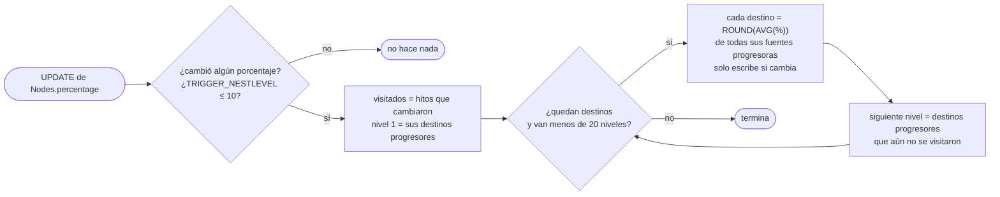

# Migraciones, triggers e índices

**En una frase:** el esquema base crea 14 tablas y ocho migraciones numeradas (001–008) lo llevan a 24 tablas, 2 triggers que propagan el porcentaje de los hitos, los índices de cada llave foránea y la fecha de creación de las tareas.

```mermaid
flowchart LR
    base["taskmate_tables.sql<br/>14 tablas, solo en BD vacía"]
    ctl["_schema_migrations.sql<br/>SchemaMigrations"]
    m1["001 índices, UQ<br/>y AnalyticsConfig"]
    m2["002 GitHub<br/>6 tablas"]
    m3["003 triggers<br/>con cursores"]
    m4["004 reparar admins"]
    m5["005 NVARCHAR, joined_at<br/>y anti-repetición"]
    m6["006 triggers BFS"]
    m7["007 CI/CD<br/>2 tablas"]
    m8["008 created_at<br/>de las tareas"]
    base --> ctl --> m1 --> m2 --> m3 --> m4 --> m5 --> m6 --> m7 --> m8
```

## Qué hace cada migración

| # | Archivo | Qué hace |
|---|---|---|
| — | `taskmate_tables.sql` | Esquema base: 14 tablas del núcleo y de analytics. No se edita; los cambios van en migraciones |
| — | `_schema_migrations.sql` | Crea `SchemaMigrations`, la bitácora de migraciones aplicadas |
| 001 | `001_schema_fixes.sql` | Índices en las FK, restricciones únicas que faltaban, FK compuestas que mantienen el `gid` coherente, quita la FK de `TaskAnalytics` a `Tasks`, agrega `DeleteTask.percentage` si falta y crea `AnalyticsConfig` |
| 002 | `002_github.sql` | Crea las 6 tablas de GitHub: instalaciones, repositorios, repo por grupo, rama por tarea, PRs y bitácora de webhooks |
| 003 | `003_triggers.sql` | Primera versión de los 2 triggers, con cursores: solo actualizaba los destinos directos |
| 004 | `004_repair_group_admins.sql` | Solo datos: si el admin de un grupo ya no es miembro, pasa a serlo otro miembro (por `uid`) |
| 005 | `005_unicode_membership_github.sql` | Textos visibles a `NVARCHAR`, `UQ_Users_Username`, `UserGroups.joined_at` y sucesión del admin por antigüedad, `gr_icon` de 40, `ai_analysis_enabled` y `payload_sha256` con índice único filtrado |
| 006 | `006_bfs_progress_triggers.sql` | Reemplaza los triggers de la 003 (`CREATE OR ALTER`) por la versión por conjuntos con recorrido en anchura (BFS) |
| 007 | `007_cicd.sql` | Crea `RepoPipelines` y `DeployRequests` |
| 008 | `008_task_created_at.sql` | Agrega `created_at` (`DATETIMEOFFSET(7)`, `DEFAULT SYSDATETIMEOFFSET()`) y `created_seq` (desempate) a `Tasks`, `Complete` y `DeleteTask`, con los que se ordenan las listas de `/tasks` («Creation Date»). A las filas que ya había les pone su primera asignación en `TaskAnalytics` si la tienen; si no, la hora de la migración |

Cada migración tiene su `.down.sql`. La de 004 no hace nada (solo reparó datos), la de 006 reinstala los triggers de la 003, la de 005 puede perder caracteres al volver a `VARCHAR` y la de 008 borra las fechas de creación.

## Cómo se aplican

1. **Contenedor:** `setup-db.sh` crea la BD y el login de la app; corre `taskmate_tables.sql` solo si no existe `dbo.Users`.
2. **Migraciones:** `run-migrations.sh` (con `sqlcmd`, como `SA`) aplica las que faltan en `SchemaMigrations`, en orden.
3. **Una transacción por migración:** `_begin.sql` + la migración + `_record.sql` (que inserta su fila) van juntos; si algo falla, no queda nada a medias.
4. **Desde Node:** `node migrations/runner.js up | down | status | reapply` hace lo mismo con `tedious` (`npm run db:migrate` = `up`). Acepta `--to`, `--steps` y `--with-base`.
5. **Credenciales:** el runner usa `MIGRATION_DB_USERNAME`/`MIGRATION_DB_PASSWORD` si están; el login de la app no puede cambiar el esquema.
6. **Idempotentes:** cada paso revisa si ya está hecho, así que `reapply` puede volver a correr una migración aplicada.
7. **Sin borrar datos:** si la 001 encuentra duplicados, omite esa restricción única con un `WARNING` y crea un índice simple en su lugar (`IX_UserGroupRoles_Uid`, `IX_GroupRoles_Gid`, `IX_Edges_SourceId` o `IX_UserTask_Utid`). Al corregir los datos y hacer `reapply 1`, se crea la restricción y se borra ese índice.
8. **Una BD que ya existía:** la imagen solo trae las migraciones que había al construirla, así que un contenedor viejo no aplica las nuevas al arrancar. Se aplican desde el host con `npm run db:migrate`; `taskmate-sql` ya tiene 001–008 (la 008 se aplicó el 5 nov 2026) ([guía de la BD en Docker, §5](../07-guias/base-de-datos-docker.md#5-migrar-una-bd-que-ya-existía)).

## Triggers (migración 006)

Solo cuentan las aristas **progresoras** (`Edges.prerequisite = 0`). Las de **prerrequisito** (`prerequisite = 1`, el valor por defecto) no mueven porcentajes.

Ejemplo: A (40 %) y B (80 %) son fuentes progresoras de C, y C lo es de D. Si A sube a 60 %, en el nivel 1 C pasa a 70 % y en el nivel 2 D pasa a 70 %. Una fuente unida a C como prerrequisito no entra en el promedio.

| Trigger | Tabla | Se dispara | Qué hace |
|---|---|---|---|
| `UpdateTargetNodePercentage` | `dbo.Nodes` | `AFTER UPDATE`, si cambió `percentage` | El recorrido del diagrama: propaga el promedio nivel por nivel |
| `UpdateTargetOnPrerequisiteChange` | `dbo.Edges` | `AFTER UPDATE`, si cambió `prerequisite` | Recalcula el destino de la arista (promedio de sus fuentes progresoras, o **0** si ya no le queda ninguna) y propaga igual, hasta 20 niveles |

- El conjunto de visitados hace que los ciclos terminen.
- Los dos salen sin hacer nada si `TRIGGER_NESTLEVEL()` pasa de 10.
- Crear o borrar una arista no recalcula nada: los dos son `AFTER UPDATE`, y una arista nueva nace como prerrequisito.
- El esquema base no tiene triggers.

## Índices importantes

Además de las llaves primarias y de las restricciones únicas (ver [tablas y campos](00-tablas-y-campos.md)):

| Migración | Índice | Columnas | Para qué |
|---|---|---|---|
| 001 | `IX_Tasks_Gid_List` (recreado en 005) | `Tasks (gid, list)` | Tareas de un grupo y borrar una lista |
| 001 | `IX_UserGroups_Gid`, `IX_Groups_AdminId` | `UserGroups (gid)`, `Groups (adminId)` | Miembros de un grupo y grupos de un admin |
| 001 | `IX_UserTask_Tid` | `UserTask (tid)` | Quién está asignado a una tarea |
| 001 | `IX_Nodes_Gid`, `IX_Edges_Gid`, `IX_Edges_TargetId` | `Nodes (gid)`, `Edges (gid)`, `Edges (targetId)` | Diagrama del grupo y fuentes de cada destino en los triggers |
| 001 | `IX_Complete_Gid`, `IX_DeleteTask_Gid` | `Complete (gid)`, `DeleteTask (gid)` | Completadas y papelera del grupo |
| 001 | `IX_UserGroupRoles_Gid`, `IX_UserGroupRoles_GrId_Gid` | `UserGroupRoles (gid)`, `(gr_id, gid)` | Roles del grupo y miembros de un rol |
| 001 | `IX_TaskAnalytics_Tid`, `IX_TaskAnalytics_Uid`, `IX_TaskAnalytics_Gid` | `(tid, success_status)`, `(uid, success_status)`, `(gid)` | Cerrar hechos `pending` y métricas por persona y grupo |
| 002 | `IX_GitHubRepositories_InstallationId` | `GitHubRepositories (installation_id)` | Repositorios de una instalación |
| 002 | `IX_GroupRepositories_RepoId`, `IX_GroupRepositories_ConnectedBy` | `GroupRepositories (repo_id)`, `(connected_by)` | Grupos de un repo |
| 002 | `IX_TaskBranches_CreatedBy` | `TaskBranches (created_by)` | FK a `Users` |
| 002 | `IX_PullRequests_Repo_HeadBranch` | `PullRequests (repo_id, head_branch)` | Unir cada PR con la rama de su tarea |
| 002 | `IX_GitHubWebhookDeliveries_ReceivedAt` | `GitHubWebhookDeliveries (received_at)` | Purga diaria de entregas viejas |
| 005 | `IX_GitHubWebhookDeliveries_PayloadSha256` (único, filtrado) | `(payload_sha256) WHERE payload_sha256 IS NOT NULL` | Rechazar un webhook repetido |
| 007 | `UX_DeployRequests_Pending` (único, filtrado) | `DeployRequests (gid, environment) WHERE status = 'pending'` | Una sola solicitud pendiente por grupo y entorno |
| 007 | `IX_DeployRequests_Gid_RequestedAt` | `(gid, requested_at DESC)` | Historial de solicitudes del grupo |
| 007 | `IX_DeployRequests_RepoId`, `_RequestedBy`, `_DecidedBy`; `IX_RepoPipelines_ConfiguredBy` | Una columna FK cada uno | FKs a repositorios y usuarios |

## Dónde está en el código

| Archivo | Qué hace |
|---|---|
| `taskmate-api/taskmate_tables.sql` | Esquema base (versión 0) |
| `taskmate-api/migrations/NNN_*.sql` y `NNN_*.down.sql` | Migraciones y sus reversas |
| `taskmate-api/migrations/_schema_migrations.sql`, `_begin.sql`, `_record.sql` | Bitácora y transacción de cada migración |
| `taskmate-api/migrations/run-migrations.sh` | Aplicador con `sqlcmd` (lo usa el contenedor) |
| `taskmate-api/migrations/runner.js` | Aplicador en Node: `up`, `down`, `status`, `reapply` |
| `taskmate-api/setup-db.sh` | Arranque del contenedor: BD, login, esquema base y migraciones |

## Para saber más

- Diagrama de las 24 tablas: [00-general.md](00-general.md) · todos los campos: [00-tablas-y-campos.md](00-tablas-y-campos.md)
- Los hitos y sus flechas en detalle: [hitos y calendario](04-hitos-y-calendario.md)
- Correr las migraciones y la BD de pruebas: [guía de la base de datos](../07-guias/base-de-datos-docker.md#4-migraciones)
- Limitaciones conocidas: [cierre del proyecto](../01-proyecto/cierre-del-proyecto.md#limitaciones-conocidas)
