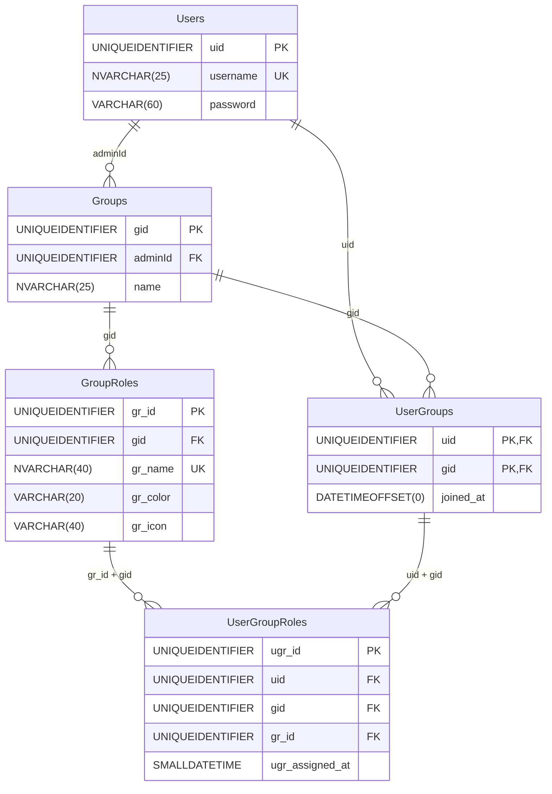
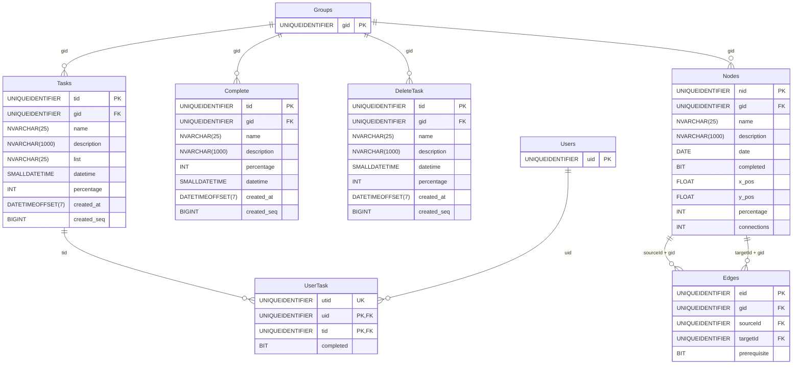
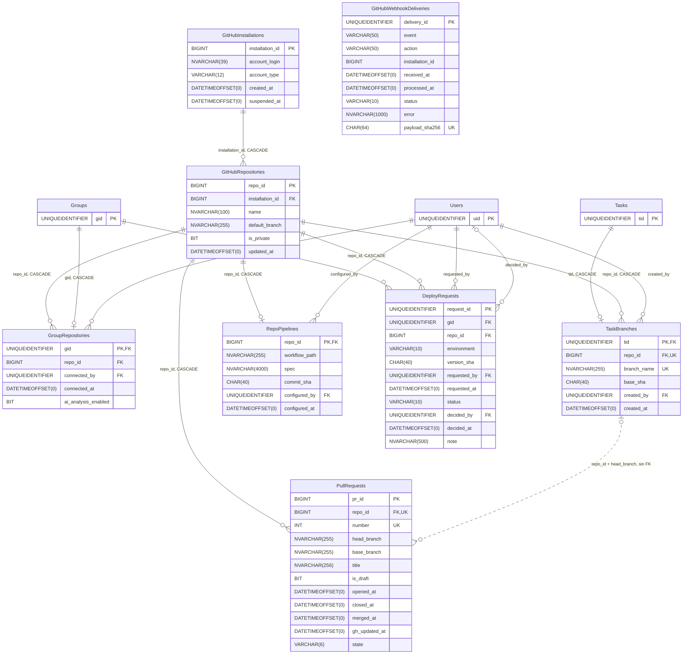
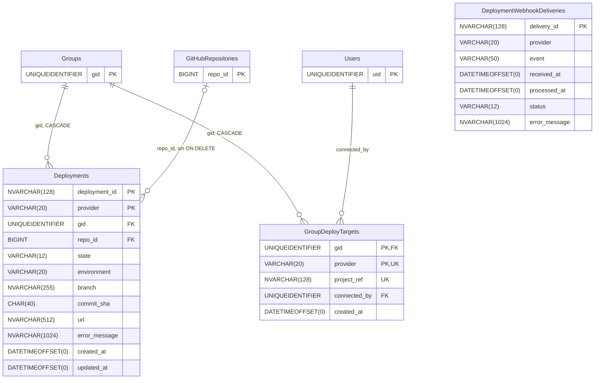
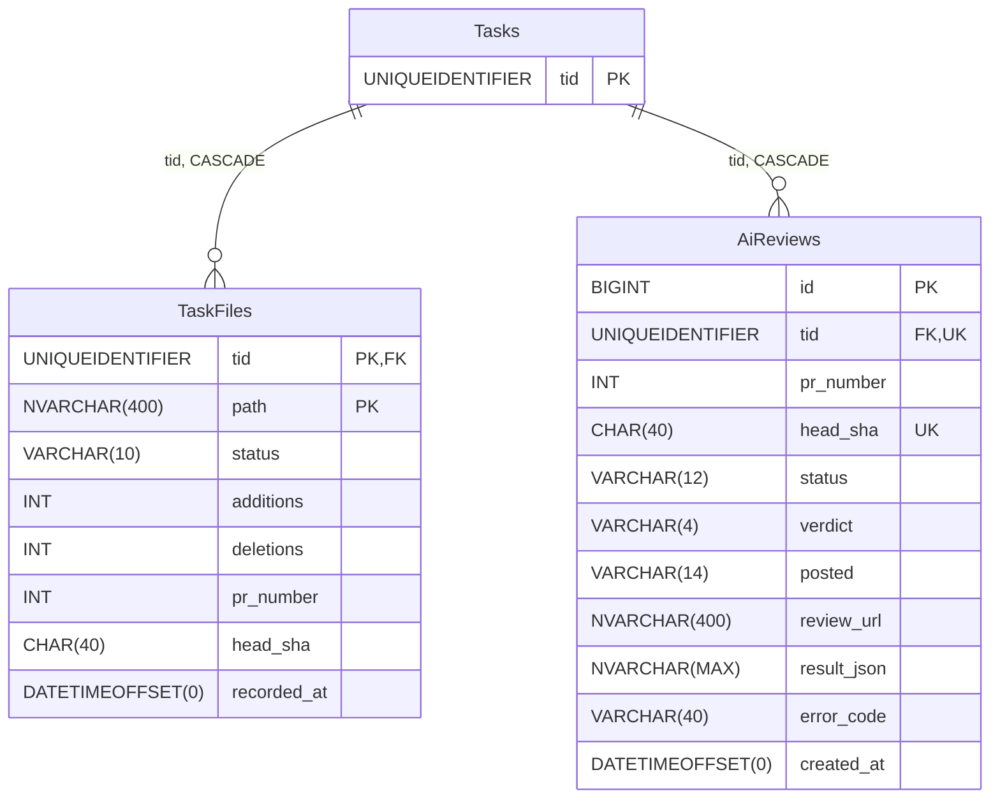
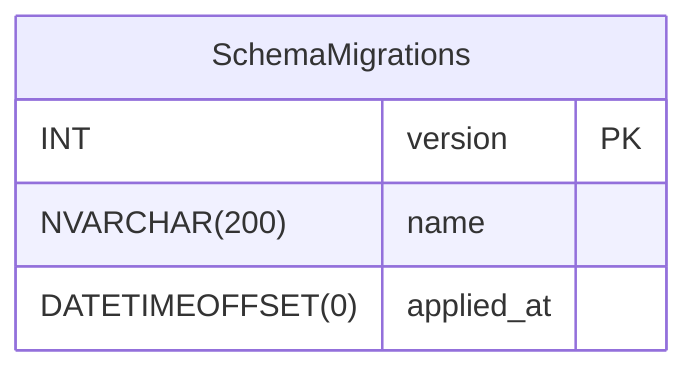

# Tablas y campos

**En una frase:** referencia completa de las 29 tablas de TaskMate, con todos sus campos, tipos, llaves y restricciones, tal como quedan con el esquema base más las migraciones 001–011.

Fuente: `taskmate-api/taskmate_tables.sql` (esquema base), `taskmate-api/migrations/001`–`011` y `_schema_migrations.sql`. El diagrama con solo las llaves está en [00-general.md](00-general.md). El servidor de IA local tiene su propia base (Postgres + pgvector, 7 tablas), que no cuenta aquí: ver [IA sobre el código](10-ia-sobre-el-codigo.md).

**Cómo leer los diagramas:** `PK` = llave primaria · `FK` = llave foránea · `UK` = parte de un valor único · `||--o{` = uno a muchos · `||--o|` = uno a cero o uno · `|o--o{` = FK que admite `NULL` · línea punteada = relación sin FK en la base. Una tabla de otra área aparece solo con su llave.

## Usuarios, grupos y roles



## Tareas e hitos



## Analytics

```mermaid
erDiagram
    Users ||--o{ TaskAnalytics : "uid"
    Groups ||--o{ TaskAnalytics : "gid"
    Tasks |o..o{ TaskAnalytics : "tid, sin FK"
    Users ||--o{ UserMetrics : "uid"
    Users ||--o{ UserExpertise : "uid"
    Groups ||--o| AnalyticsConfig : "gid, CASCADE"

    Users {
        UNIQUEIDENTIFIER uid PK
    }
    Groups {
        UNIQUEIDENTIFIER gid PK
    }
    Tasks {
        UNIQUEIDENTIFIER tid PK
    }
    TaskAnalytics {
        UNIQUEIDENTIFIER id PK
        UNIQUEIDENTIFIER tid
        UNIQUEIDENTIFIER uid FK
        UNIQUEIDENTIFIER gid FK
        VARCHAR(50) task_category
        DATETIME2 assigned_at
        DATETIME2 completed_at
        VARCHAR(20) success_status
        DECIMAL(10,2) completion_time_hours
        DATETIME2 created_at
    }
    UserMetrics {
        UNIQUEIDENTIFIER id PK
        UNIQUEIDENTIFIER uid FK
        DATE metric_date
        INT active_tasks_count
        INT max_concurrent_tasks
        DECIMAL(10,2) avg_completion_time_hours
        DECIMAL(5,2) success_rate_percentage
        DATETIME2 updated_at
    }
    UserExpertise {
        UNIQUEIDENTIFIER id PK
        UNIQUEIDENTIFIER uid FK
        VARCHAR(50) task_category
        DECIMAL(5,2) expertise_score
        INT tasks_completed
        DECIMAL(10,2) avg_completion_time_hours
        DECIMAL(5,2) success_rate_percentage
        DATETIME2 last_updated
    }
    AnalyticsConfig {
        UNIQUEIDENTIFIER gid PK, FK
        BIT analytics_enabled
        BIT track_completion_time
        BIT track_success_rate
        BIT track_workload
        BIT track_expertise
        BIT track_capacity
        INT data_retention_days
        VARCHAR(30) privacy_mode
        DATETIMEOFFSET(0) updated_at
    }
```

## GitHub y CI/CD



`GitHubWebhookDeliveries` no tiene FKs a propósito: registra lo que manda GitHub aunque la instalación no exista en la base.

## Despliegues de Vercel

Migración 009, del módulo [8 · CI/CD](08-cicd.md).



- `DeploymentWebhookDeliveries` no tiene FKs a propósito: registra lo que manda Vercel aunque el proyecto no esté vinculado.
- Entre `GroupDeployTargets` y `Deployments` no hay FK: el webhook busca el grupo por `project_ref` y guarda el despliegue con ese `gid`. Desvincular el proyecto borra solo la fila de `GroupDeployTargets`; los despliegues se quedan.

## Archivos por tarea y revisiones de IA

`TaskFiles` (010) es del módulo [7 · GitHub](07-github.md); `AiReviews` (011), del módulo [10 · IA sobre el código](10-ia-sobre-el-codigo.md).



`pr_number` es el número del PR en GitHub, sin FK a `PullRequests` en ninguna de las dos tablas.

## Control



## Diccionario de datos

Todos los campos son `NOT NULL` salvo los marcados **NULL**. El número del título (001, 002, 007, 009, 010 u 011) es la migración que creó la tabla; «005», «007» u «008» en una nota indica la migración que agregó o cambió el campo. Los `UNIQUEIDENTIFIER` del núcleo los genera la API (uuid v4); los `BIGINT` de GitHub son los ids que da GitHub, y `deployment_id` y `project_ref`, los que da Vercel.

### Users
| Campo | Tipo | Nota |
|---|---|---|
| `uid` | UNIQUEIDENTIFIER | PK |
| `username` | NVARCHAR(25) | Único (`UQ_Users_Username`, 005; antes `noDuplicates` y `VARCHAR`) |
| `password` | VARCHAR(60) | Hash bcrypt, nunca la contraseña |

### Groups
| Campo | Tipo | Nota |
|---|---|---|
| `gid` | UNIQUEIDENTIFIER | PK |
| `adminId` | UNIQUEIDENTIFIER | FK → `Users.uid`; el único admin del grupo |
| `name` | NVARCHAR(25) | `NVARCHAR` desde 005 |

### UserGroups
| Campo | Tipo | Nota |
|---|---|---|
| `uid` | UNIQUEIDENTIFIER | PK (`uid`, `gid`); FK → `Users` |
| `gid` | UNIQUEIDENTIFIER | PK; FK → `Groups` |
| `joined_at` | DATETIMEOFFSET(0) | DEFAULT `SYSDATETIMEOFFSET()` (005); ordena la sucesión del admin |

### GroupRoles
| Campo | Tipo | Nota |
|---|---|---|
| `gr_id` | UNIQUEIDENTIFIER | PK; único con `gid` (`UQ_GroupRoles_GrId_Gid`, destino de la FK compuesta) |
| `gid` | UNIQUEIDENTIFIER | FK → `Groups` |
| `gr_name` | NVARCHAR(40) | Único por grupo (`UQ_GroupRoles_Gid_Name`); si contiene «leader», el miembro es líder |
| `gr_color` | VARCHAR(20) | **NULL** |
| `gr_icon` | VARCHAR(40) | **NULL**; ampliado de 20 a 40 en 005 |

### UserGroupRoles
| Campo | Tipo | Nota |
|---|---|---|
| `ugr_id` | UNIQUEIDENTIFIER | PK |
| `uid` | UNIQUEIDENTIFIER | FK → `Users`; único con `gr_id` (`UQ_UserGroupRoles_Uid_GrId`) |
| `gid` | UNIQUEIDENTIFIER | FK → `Groups`; (`uid`, `gid`) → `UserGroups`: solo miembros; (`gr_id`, `gid`) → `GroupRoles`: rol del mismo grupo |
| `gr_id` | UNIQUEIDENTIFIER | FK → `GroupRoles` |
| `ugr_assigned_at` | SMALLDATETIME | DEFAULT `GETDATE()` |

### Tasks
| Campo | Tipo | Nota |
|---|---|---|
| `tid` | UNIQUEIDENTIFIER | PK |
| `gid` | UNIQUEIDENTIFIER | FK → `Groups` |
| `name` | NVARCHAR(25) | `NVARCHAR` desde 005 |
| `description` | NVARCHAR(1000) | |
| `list` | NVARCHAR(25) | Nombre de la lista; las listas no tienen tabla propia |
| `datetime` | SMALLDATETIME | Fecha y hora límite (minutos, hasta 2079) |
| `percentage` | INT | **NULL**; CHECK 0–100 |
| `created_at` | DATETIMEOFFSET(7) | DEFAULT `SYSDATETIMEOFFSET()` (008): cuándo se creó la tarea; ordena la lista («Creation Date») |
| `created_seq` | BIGINT | `IDENTITY(1, 1)` (008): orden de inserción. Desempata `created_at` cuando dos tareas se crean en el mismo instante (las de un plan de la IA se insertan en la misma transacción) |

### UserTask
| Campo | Tipo | Nota |
|---|---|---|
| `utid` | UNIQUEIDENTIFIER | Único (`UQ_UserTask_Utid`, 001) |
| `uid` | UNIQUEIDENTIFIER | PK (`uid`, `tid`); FK → `Users` |
| `tid` | UNIQUEIDENTIFIER | PK; FK → `Tasks` |
| `completed` | BIT | La interfaz envía 1 al asignar; no es un avance |

### Complete
| Campo | Tipo | Nota |
|---|---|---|
| `tid` | UNIQUEIDENTIFIER | PK; el `tid` que tenía la tarea, sin FK |
| `gid` | UNIQUEIDENTIFIER | FK → `Groups` |
| `name` | NVARCHAR(25) | |
| `description` | NVARCHAR(1000) | |
| `percentage` | INT | **NULL**; CHECK 0–100; se guarda 100 al completar |
| `datetime` | SMALLDATETIME | |
| `created_at` | DATETIMEOFFSET(7) | DEFAULT `SYSDATETIMEOFFSET()` (008); al completar se copia el de la tarea |
| `created_seq` | BIGINT | **NULL** (008); al completar se copia el de la tarea |

### DeleteTask
| Campo | Tipo | Nota |
|---|---|---|
| `tid` | UNIQUEIDENTIFIER | PK; el `tid` que tenía la tarea, sin FK |
| `gid` | UNIQUEIDENTIFIER | FK → `Groups` |
| `name` | NVARCHAR(25) | |
| `description` | NVARCHAR(1000) | |
| `datetime` | SMALLDATETIME | |
| `percentage` | INT | DEFAULT 0; CHECK 0–100 (la 001 lo agrega a bases viejas) |
| `created_at` | DATETIMEOFFSET(7) | DEFAULT `SYSDATETIMEOFFSET()` (008); al mandarla a la papelera se copia el de la tarea |
| `created_seq` | BIGINT | **NULL** (008); al mandarla a la papelera se copia el de la tarea |

### Nodes
| Campo | Tipo | Nota |
|---|---|---|
| `nid` | UNIQUEIDENTIFIER | PK; único con `gid` (`UQ_Nodes_Nid_Gid`) |
| `gid` | UNIQUEIDENTIFIER | FK → `Groups` |
| `name` | NVARCHAR(25) | |
| `description` | NVARCHAR(1000) | |
| `date` | DATE | Fecha del hito; sale en el calendario |
| `completed` | BIT | |
| `x_pos`, `y_pos` | FLOAT | Posición en el diagrama |
| `percentage` | INT | **NULL**; CHECK 0–100; lo recalculan los triggers |
| `connections` | INT | **NULL**; DEFAULT 0; ningún código lo usa |

### Edges
| Campo | Tipo | Nota |
|---|---|---|
| `eid` | UNIQUEIDENTIFIER | PK |
| `gid` | UNIQUEIDENTIFIER | FK → `Groups` |
| `sourceId` | UNIQUEIDENTIFIER | FK → `Nodes`; único con `targetId` (`UQ_Edges_Source_Target`); (`sourceId`, `gid`) → `Nodes (nid, gid)` |
| `targetId` | UNIQUEIDENTIFIER | FK → `Nodes`; (`targetId`, `gid`) → `Nodes (nid, gid)` |
| `prerequisite` | BIT | **NULL**; DEFAULT 1 = prerrequisito; 0 = progresor (mueve porcentajes) |

### TaskAnalytics
| Campo | Tipo | Nota |
|---|---|---|
| `id` | UNIQUEIDENTIFIER | PK; DEFAULT `NEWID()` |
| `tid` | UNIQUEIDENTIFIER | Sin FK desde 001: el historial sobrevive a la tarea |
| `uid` | UNIQUEIDENTIFIER | FK → `Users` |
| `gid` | UNIQUEIDENTIFIER | FK → `Groups` |
| `task_category` | VARCHAR(50) | **NULL**; DEFAULT `'general'` |
| `assigned_at` | DATETIME2 | DEFAULT `GETDATE()` |
| `completed_at` | DATETIME2 | **NULL**; no puede ser anterior a `assigned_at` |
| `success_status` | VARCHAR(20) | **NULL**; DEFAULT `'pending'`; `pending`, `completed`, `failed` o `reassigned` |
| `completion_time_hours` | DECIMAL(10,2) | **NULL**; ≥ 0 |
| `created_at` | DATETIME2 | **NULL**; DEFAULT `GETDATE()` |

### UserMetrics
| Campo | Tipo | Nota |
|---|---|---|
| `id` | UNIQUEIDENTIFIER | PK; DEFAULT `NEWID()` |
| `uid` | UNIQUEIDENTIFIER | FK → `Users`; único con `metric_date` (`UQ_UserMetrics_UID_Date`) |
| `metric_date` | DATE | Un registro por usuario y día |
| `active_tasks_count` | INT | **NULL**; DEFAULT 0; ≥ 0 |
| `max_concurrent_tasks` | INT | **NULL**; DEFAULT 0; ≥ 0 |
| `avg_completion_time_hours` | DECIMAL(10,2) | **NULL**; DEFAULT 0; ≥ 0 |
| `success_rate_percentage` | DECIMAL(5,2) | **NULL**; DEFAULT 0; 0–100 |
| `updated_at` | DATETIME2 | **NULL**; DEFAULT `GETDATE()` |

### UserExpertise
| Campo | Tipo | Nota |
|---|---|---|
| `id` | UNIQUEIDENTIFIER | PK; DEFAULT `NEWID()` |
| `uid` | UNIQUEIDENTIFIER | FK → `Users`; único con `task_category` (`UQ_UserExpertise_UID_Category`) |
| `task_category` | VARCHAR(50) | `frontend`, `backend`, `database`, `testing` o `general` |
| `expertise_score` | DECIMAL(5,2) | **NULL**; DEFAULT 0; 0–100 |
| `tasks_completed` | INT | **NULL**; DEFAULT 0; ≥ 0 |
| `avg_completion_time_hours` | DECIMAL(10,2) | **NULL**; DEFAULT 0; ≥ 0 |
| `success_rate_percentage` | DECIMAL(5,2) | **NULL**; DEFAULT 0; 0–100 |
| `last_updated` | DATETIME2 | **NULL**; DEFAULT `GETDATE()` |

### AnalyticsConfig (001)
| Campo | Tipo | Nota |
|---|---|---|
| `gid` | UNIQUEIDENTIFIER | PK; FK → `Groups` con `ON DELETE CASCADE` |
| `analytics_enabled` | BIT | DEFAULT 1 |
| `track_completion_time`, `track_success_rate`, `track_workload`, `track_expertise`, `track_capacity` | BIT | DEFAULT 1 cada uno |
| `data_retention_days` | INT | DEFAULT 365; 1–3650 |
| `privacy_mode` | VARCHAR(30) | DEFAULT `'team_leader_only'`; `team_leader_only`, `team` o `private` |
| `updated_at` | DATETIMEOFFSET(0) | DEFAULT `SYSDATETIMEOFFSET()` |

Se lee y se guarda, pero hoy no cambia lo que se registra ni lo que se muestra ([cierre](../01-proyecto/cierre-del-proyecto.md#analytics)).

### GitHubInstallations (002)
| Campo | Tipo | Nota |
|---|---|---|
| `installation_id` | BIGINT | PK; id de GitHub |
| `account_login` | NVARCHAR(39) | Cuenta dueña de los repositorios |
| `account_type` | VARCHAR(12) | `User` u `Organization` |
| `created_at` | DATETIMEOFFSET(0) | DEFAULT `SYSDATETIMEOFFSET()` |
| `suspended_at` | DATETIMEOFFSET(0) | **NULL** |

### GitHubRepositories (002)
| Campo | Tipo | Nota |
|---|---|---|
| `repo_id` | BIGINT | PK; id de GitHub |
| `installation_id` | BIGINT | FK → `GitHubInstallations`, CASCADE |
| `name` | NVARCHAR(100) | |
| `default_branch` | NVARCHAR(255) | Collation `Latin1_General_100_BIN2` |
| `is_private` | BIT | |
| `updated_at` | DATETIMEOFFSET(0) | DEFAULT `SYSDATETIMEOFFSET()` |

### GroupRepositories (002)
| Campo | Tipo | Nota |
|---|---|---|
| `gid` | UNIQUEIDENTIFIER | PK (un repositorio por grupo); FK → `Groups`, CASCADE |
| `repo_id` | BIGINT | FK → `GitHubRepositories`, CASCADE; un repo puede estar en varios grupos |
| `connected_by` | UNIQUEIDENTIFIER | FK → `Users` |
| `connected_at` | DATETIMEOFFSET(0) | DEFAULT `SYSDATETIMEOFFSET()` |
| `ai_analysis_enabled` | BIT | DEFAULT 0 (005); el admin lo activa antes de mandar datos a la IA |

### TaskBranches (002)
| Campo | Tipo | Nota |
|---|---|---|
| `tid` | UNIQUEIDENTIFIER | PK (una rama por tarea); FK → `Tasks`, CASCADE |
| `repo_id` | BIGINT | FK → `GitHubRepositories`, CASCADE; único con `branch_name` |
| `branch_name` | NVARCHAR(255) | Collation BIN2 |
| `base_sha` | CHAR(40) | Solo hexadecimal |
| `created_by` | UNIQUEIDENTIFIER | FK → `Users` |
| `created_at` | DATETIMEOFFSET(0) | DEFAULT `SYSDATETIMEOFFSET()` |

### PullRequests (002)
| Campo | Tipo | Nota |
|---|---|---|
| `pr_id` | BIGINT | PK; id de GitHub |
| `repo_id` | BIGINT | FK → `GitHubRepositories`, CASCADE; único con `number` |
| `number` | INT | > 0 |
| `head_branch`, `base_branch` | NVARCHAR(255) | Collation BIN2; `head_branch` une el PR con la rama de la tarea (sin FK) |
| `title` | NVARCHAR(256) | |
| `is_draft` | BIT | DEFAULT 0 |
| `opened_at` | DATETIMEOFFSET(0) | |
| `closed_at` | DATETIMEOFFSET(0) | **NULL** |
| `merged_at` | DATETIMEOFFSET(0) | **NULL**; exige `closed_at` |
| `gh_updated_at` | DATETIMEOFFSET(0) | Fecha de GitHub; ordena las actualizaciones |
| `state` | VARCHAR(6) | Columna calculada: `merged`, `closed` u `open` |

### GitHubWebhookDeliveries (002)
| Campo | Tipo | Nota |
|---|---|---|
| `delivery_id` | UNIQUEIDENTIFIER | PK; cabecera `X-GitHub-Delivery` |
| `event` | VARCHAR(50) | |
| `action` | VARCHAR(50) | **NULL** |
| `installation_id` | BIGINT | **NULL**; sin FK |
| `received_at` | DATETIMEOFFSET(0) | DEFAULT `SYSDATETIMEOFFSET()`; la purga diaria borra las viejas |
| `processed_at` | DATETIMEOFFSET(0) | **NULL** solo mientras `status = 'processing'` |
| `status` | VARCHAR(10) | DEFAULT `'processing'`; `processing`, `processed`, `ignored` o `failed` |
| `error` | NVARCHAR(1000) | **NULL** |
| `payload_sha256` | CHAR(64) | **NULL** (005); hexadecimal; único cuando no es NULL (contra repeticiones) |

### RepoPipelines (007)
| Campo | Tipo | Nota |
|---|---|---|
| `repo_id` | BIGINT | PK (un pipeline por repositorio); FK → `GitHubRepositories`, CASCADE |
| `workflow_path` | NVARCHAR(255) | Ruta del workflow en el repo |
| `spec` | NVARCHAR(4000) | JSON válido (`ISJSON`); con él se reabre la configuración |
| `commit_sha` | CHAR(40) | Solo hexadecimal |
| `configured_by` | UNIQUEIDENTIFIER | FK → `Users` |
| `configured_at` | DATETIMEOFFSET(0) | DEFAULT `SYSDATETIMEOFFSET()` |

### DeployRequests (007)
| Campo | Tipo | Nota |
|---|---|---|
| `request_id` | UNIQUEIDENTIFIER | PK; DEFAULT `NEWID()` |
| `gid` | UNIQUEIDENTIFIER | FK → `Groups`, CASCADE |
| `repo_id` | BIGINT | FK → `GitHubRepositories`, CASCADE |
| `environment` | VARCHAR(10) | `staging` o `production` |
| `version_sha` | CHAR(40) | Solo hexadecimal |
| `requested_by` | UNIQUEIDENTIFIER | FK → `Users` |
| `requested_at` | DATETIMEOFFSET(0) | DEFAULT `SYSDATETIMEOFFSET()` |
| `status` | VARCHAR(10) | DEFAULT `'pending'`; `pending`, `approved`, `rejected` o `cancelled`; una sola `pending` por grupo y entorno |
| `decided_by` | UNIQUEIDENTIFIER | **NULL** si y solo si `pending`; FK → `Users` |
| `decided_at` | DATETIMEOFFSET(0) | **NULL** si y solo si `pending` |
| `note` | NVARCHAR(500) | **NULL** |

### Deployments (009)
| Campo | Tipo | Nota |
|---|---|---|
| `deployment_id` | NVARCHAR(128) | PK (`provider`, `deployment_id`): el id solo es único dentro de su proveedor; collation BIN2 |
| `provider` | VARCHAR(20) | PK; `vercel` o `aws` (hoy solo llega `vercel`) |
| `gid` | UNIQUEIDENTIFIER | FK → `Groups`, CASCADE; el grupo vinculado al proyecto del evento |
| `repo_id` | BIGINT | **NULL**; FK → `GitHubRepositories` **sin** `ON DELETE` (la única hacia esa tabla sin cascada); el repo conectado al grupo cuando llegó el evento; una vez lleno no vuelve a NULL |
| `state` | VARCHAR(12) | `queued`, `building`, `ready`, `error` o `canceled`; sale del tipo de evento |
| `environment` | VARCHAR(20) | DEFAULT `'production'`; sin CHECK; la API guarda `production` o `preview` y no lo cambia después |
| `branch` | NVARCHAR(255) | **NULL**; collation BIN2 |
| `commit_sha` | CHAR(40) | **NULL**; solo hexadecimal |
| `url` | NVARCHAR(512) | **NULL**; la API la corta a 500 caracteres y le antepone `https://` si no empieza con `http` |
| `error_message` | NVARCHAR(1024) | **NULL**; solo en `error`; un evento posterior de otro estado lo borra |
| `created_at` | DATETIMEOFFSET(0) | DEFAULT `SYSDATETIMEOFFSET()`; en la práctica, la hora del evento que creó la fila |
| `updated_at` | DATETIMEOFFSET(0) | DEFAULT `SYSDATETIMEOFFSET()`; hora del último evento aplicado: uno más viejo no lo sobrescribe |

Índice: `IX_Deployments_Gid_CreatedAt` (`gid`, `created_at DESC`), para el panel del grupo. Según el código, la FK de `repo_id` sin cascada puede impedir que se borre un repositorio o una instalación ([limitaciones](../01-proyecto/cierre-del-proyecto.md#limitaciones-conocidas)).

### DeploymentWebhookDeliveries (009)
| Campo | Tipo | Nota |
|---|---|---|
| `delivery_id` | NVARCHAR(128) | PK (sin `provider`); collation BIN2; el `id` del evento de Vercel o, si falta, el SHA-256 del cuerpo |
| `provider` | VARCHAR(20) | Sin CHECK; hoy siempre `vercel` |
| `event` | VARCHAR(50) | Tipo del evento, por ejemplo `deployment.created` |
| `received_at` | DATETIMEOFFSET(0) | DEFAULT `SYSDATETIMEOFFSET()`; ninguna purga borra estas filas |
| `processed_at` | DATETIMEOFFSET(0) | **NULL**; la API lo llena al cerrar la entrega (ningún CHECK lo liga con `status`) |
| `status` | VARCHAR(12) | DEFAULT `'received'`; `received`, `processed`, `ignored` o `failed` |
| `error_message` | NVARCHAR(1024) | **NULL**; el error o el motivo de `ignored` |

Sin FKs a propósito. Índice: `IX_DeploymentDeliveries_ReceivedAt` (`received_at`). A diferencia de `GitHubWebhookDeliveries`, no hay único por hash del cuerpo.

### GroupDeployTargets (009)
| Campo | Tipo | Nota |
|---|---|---|
| `gid` | UNIQUEIDENTIFIER | PK (`gid`, `provider`): un proyecto por proveedor y grupo; FK → `Groups`, CASCADE |
| `provider` | VARCHAR(20) | PK; `vercel` o `aws`; único con `project_ref` (`UQ_GroupDeployTargets_Project`) |
| `project_ref` | NVARCHAR(128) | Collation BIN2; el Project ID de Vercel (`prj_…`); un proyecto pertenece a un solo grupo |
| `connected_by` | UNIQUEIDENTIFIER | FK → `Users`, sin cascada; el admin que lo vinculó |
| `created_at` | DATETIMEOFFSET(0) | DEFAULT `SYSDATETIMEOFFSET()`; se reinicia al volver a vincular |

Sin índices aparte de la PK y `UQ_GroupDeployTargets_Project`.

### TaskFiles (010)
| Campo | Tipo | Nota |
|---|---|---|
| `tid` | UNIQUEIDENTIFIER | PK (`tid`, `path`): un registro por archivo y tarea; FK → `Tasks`, CASCADE |
| `path` | NVARCHAR(400) | PK; collation BIN2; ruta del archivo en el repositorio |
| `status` | VARCHAR(10) | `added`, `modified`, `removed`, `renamed`, `copied` o `changed`, como lo da GitHub (otro valor se guarda como `modified`) |
| `additions`, `deletions` | INT | DEFAULT 0 cada uno; sin CHECK de no negativo |
| `pr_number` | INT | **NULL**; el PR del que salió la lista |
| `head_sha` | CHAR(40) | **NULL**; solo hexadecimal; commit en que se leyó la lista (la recuperación bajo demanda lo deja NULL) |
| `recorded_at` | DATETIMEOFFSET(0) | DEFAULT `SYSDATETIMEOFFSET()` |

Índice: `IX_TaskFiles_Path` (`path`) INCLUDE (`tid`, `status`), para saber qué otras tareas tocan una ruta. La lista sale de los archivos del PR en GitHub y se reemplaza entera. Al completar la tarea, mandarla a la papelera o borrar su lista, la fila sale de `Tasks` y sus archivos se borran en cascada ([limitaciones](../01-proyecto/cierre-del-proyecto.md#limitaciones-conocidas)).

### AiReviews (011)
| Campo | Tipo | Nota |
|---|---|---|
| `id` | BIGINT | PK; `IDENTITY(1, 1)` |
| `tid` | UNIQUEIDENTIFIER | FK → `Tasks`, CASCADE; único con `head_sha` (`UQ_AiReviews_TaskSha`): una revisión por commit |
| `pr_number` | INT | Número del PR revisado; sin CHECK |
| `head_sha` | CHAR(40) | Solo hexadecimal; el commit revisado |
| `status` | VARCHAR(12) | Sin DEFAULT; `pending` (se reserva antes de revisar), `done` o `failed` |
| `verdict` | VARCHAR(4) | **NULL**; `pass`, `warn` o `fail` |
| `posted` | VARCHAR(14) | **NULL**; si llegó a GitHub: `posted`, `no_permission` (a la App le falta Pull requests: write) o `failed` |
| `review_url` | NVARCHAR(400) | **NULL**; enlace a la revisión publicada |
| `result_json` | NVARCHAR(MAX) | **NULL**; respuesta del servidor de IA local; sin CHECK `ISJSON`; la API guarda NULL si pasa de 200 000 caracteres |
| `error_code` | VARCHAR(40) | **NULL**; código del error si `failed`, por ejemplo `AI_SERVER_UNAVAILABLE` |
| `created_at` | DATETIMEOFFSET(0) | DEFAULT `SYSDATETIMEOFFSET()` |

Índice: `IX_AiReviews_Task` (`tid`, `created_at DESC`): la vista de la tarea pide la revisión más reciente. Una revisión `failed` o `pending` sigue ocupando su commit: solo un commit nuevo genera otra ([limitaciones](../01-proyecto/cierre-del-proyecto.md#limitaciones-conocidas)).

### SchemaMigrations
| Campo | Tipo | Nota |
|---|---|---|
| `version` | INT | PK; número de la migración |
| `name` | NVARCHAR(200) | Nombre del archivo sin número |
| `applied_at` | DATETIMEOFFSET(0) | DEFAULT `SYSDATETIMEOFFSET()` |

## Para saber más

- Diagrama de las 29 tablas y tablas por módulo: [00-general.md](00-general.md)
- Migraciones, triggers e índices: [00-migraciones-y-triggers.md](00-migraciones-y-triggers.md)
- Reglas de cada módulo: [usuarios](01-usuarios-y-acceso.md), [grupos y roles](02-grupos-y-roles.md), [tareas](03-tareas.md), [hitos](04-hitos-y-calendario.md), [chat IA](05-chat-ia.md), [analytics](06-analytics.md), [GitHub](07-github.md), [CI/CD](08-cicd.md), [IA sobre el código](10-ia-sobre-el-codigo.md)
- Límites conocidos de estas tablas: [cierre de la línea de Pablo y estado](../01-proyecto/cierre-del-proyecto.md#limitaciones-conocidas)
