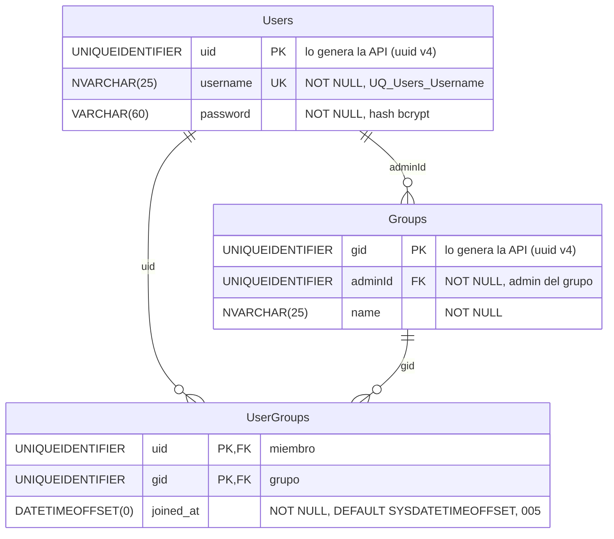

# Usuarios y acceso: base de datos

**En una frase:** una cuenta es una fila de `Users`; al registrarse, la misma transacción crea su grupo personal en `Groups` y su membresía en `UserGroups`.

`PK` = llave primaria · `FK` = llave foránea · `UK` = valor único · `||--o{` = uno a muchos.

## Tablas

| Tabla | Para qué sirve | Campos clave |
|---|---|---|
| `Users` | La cuenta: nombre de usuario y hash de la contraseña | `uid` (PK), `username` (único), `password` (hash bcrypt de 60 caracteres) |
| `Groups` | El grupo personal que se crea al registrarse (los demás grupos son del módulo [Grupos y roles](02-grupos-y-roles.md)) | `gid` (PK), `adminId` → `Users.uid`, `name` = «`<usuario>`'s Group» |
| `UserGroups` | La membresía usuario ↔ grupo; el registro mete al usuario en su grupo personal | (`uid`, `gid`) (PK), `joined_at` |

Origen: `taskmate_tables.sql` (esquema base). La migración 005 pasó `username` y `Groups.name` de `VARCHAR` a `NVARCHAR` y agregó `joined_at`. La 001 agregó los índices.

## Reglas

- **Usuario único.** `UQ_Users_Username` sobre `username` (en 005 reemplazó a la restricción `noDuplicates` del esquema base).
- **Registro atómico.** `registerUserWithPersonalGroup` hace tres `INSERT` (`Users`, `Groups`, `UserGroups`) en una sola transacción. Si algo falla, no queda nada a medias.
- **Dos registros con el mismo nombre a la vez.** La lectura previa usa `UPDLOCK, HOLDLOCK` (bloqueo de rango), así que el segundo espera y recibe «Username already exists». Si aun así choca con la restricción única, la API responde lo mismo (400).
- **Contraseña.** La base solo guarda el hash bcrypt (`VARCHAR(60)`), nunca la contraseña.
- **Límites de la API antes de escribir.** `username` de 1 a 25 caracteres; contraseña de 6 caracteres a 72 bytes (bcrypt ignora lo que pase de 72 bytes).
- **Nombre del grupo personal.** «`<usuario>`'s Group», recortado a 25 caracteres.
- **Sin cascadas.** Ninguna FK hacia `Users` tiene `ON DELETE`. Además de `Groups` y `UserGroups`, apuntan a `Users.uid` `UserTask`, `UserGroupRoles`, `TaskAnalytics`, `UserMetrics`, `UserExpertise`, `GroupRepositories`, `TaskBranches`, `RepoPipelines` y `DeployRequests`. No existe ninguna ruta para borrar un usuario.
- **Sin triggers.** Estas tablas no tienen triggers; los de la migración 006 son de los hitos (`Nodes` y `Edges`).
- **Índices (001).** `IX_Groups_AdminId` sobre `Groups (adminId)` e `IX_UserGroups_Gid` sobre `UserGroups (gid)`.
- **Reparación de admins (004 y 005).** Si el admin de un grupo ya no es miembro, pasa a serlo el miembro más antiguo (`joined_at`, luego `uid`).

## Dónde se usa

| Modelo | Qué hace con estas tablas |
|---|---|
| `taskmate-api/models/user.model.js` | Login (`getUserByUsername`), buscar el `uid` por nombre (`getidUserByUsername`, `getidUser`) y el registro con grupo personal (`registerUserWithPersonalGroup`) |
| `taskmate-api/models/access.model.js` | Revisa en `UserGroups` si alguien es miembro o admin de un grupo; lo usan los guardias de las rutas |
| `taskmate-api/models/group.model.js` | Crea grupos (con su admin como miembro), lista los grupos de un usuario y borra un grupo |
| `taskmate-api/models/userGroup.model.js` | Agrega, lista y quita miembros de `UserGroups` |

Los tres últimos pertenecen al módulo [Grupos y roles](02-grupos-y-roles.md).

## Para saber más

- Diagrama completo de las 24 tablas: [00-general.md](00-general.md)
- Todas las llaves y restricciones: [00-general.md, Llaves y restricciones](00-general.md#llaves-y-restricciones)
- Arquitectura del módulo: [02-arquitectura/01-usuarios-y-acceso.md](../02-arquitectura/01-usuarios-y-acceso.md)
- Flujo del registro paso a paso: [06-flujos/01-usuarios-y-acceso.md](../06-flujos/01-usuarios-y-acceso.md)
- Levantar la base en Docker: [guía de la base de datos](../07-guias/base-de-datos-docker.md)
