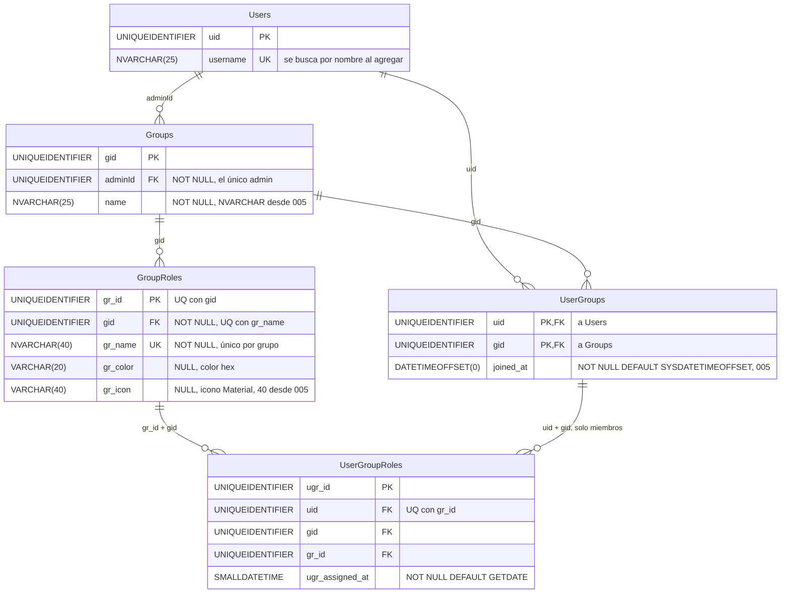

# Grupos y roles: base de datos

**En una frase:** cuatro tablas guardan los grupos, quién es miembro de cada uno, los roles de cada grupo y qué rol tiene cada miembro.

`Users` aparece reducida: es del módulo de usuarios y acceso. Los tipos son los finales, después de las migraciones 001–008.

## Tablas

| Tabla | Para qué sirve | Campos clave |
|---|---|---|
| `Groups` | Un grupo o proyecto. Todo lo demás (tareas, hitos, repositorio, CI/CD) cuelga de él por `gid` | `gid` (PK); `adminId` → `Users`; `name` (máx. 25) |
| `UserGroups` | Membresía: una fila por cada usuario en cada grupo | PK compuesta (`uid`, `gid`); `joined_at` decide quién hereda el admin |
| `GroupRoles` | Roles propios de cada grupo, con color e icono | `gr_id` (PK); `gid` → `Groups`; `gr_name` único dentro del grupo |
| `UserGroupRoles` | Qué rol tiene cada miembro; un miembro puede tener varios roles | `ugr_id` (PK); (`uid`, `gid`) → `UserGroups`; (`gr_id`, `gid`) → `GroupRoles`; (`uid`, `gr_id`) único |

## Reglas

**Llaves y restricciones** (PK = llave primaria, FK = llave foránea, UQ = valor único)
- `UserGroups`: PK (`uid`, `gid`), así que nadie es miembro dos veces del mismo grupo.
- `GroupRoles`: `UQ_GroupRoles_Gid_Name` (`gid`, `gr_name`) impide dos roles con el mismo nombre en un grupo. `UQ_GroupRoles_GrId_Gid` (`gr_id`, `gid`) existe para que la FK compuesta de abajo tenga a qué apuntar.
- `UserGroupRoles`: `UQ_UserGroupRoles_Uid_GrId` (`uid`, `gr_id`) impide asignar dos veces el mismo rol.
- `FK_UserGroupRoles_UserGroups` (`uid`, `gid`) → `UserGroups`: solo un miembro del grupo puede tener sus roles.
- `FK_UserGroupRoles_GroupRoles_Gid` (`gr_id`, `gid`) → `GroupRoles`: no se puede usar el rol de otro grupo.
- Además siguen las FK simples del esquema base: `uid` → `Users`, `gid` → `Groups` y `gr_id` → `GroupRoles`.
- Las UQ y las FK compuestas llegan con la migración 001. Si había datos duplicados o inconsistentes, la 001 omite esa restricción con un `WARNING` y sin borrar nada (ver [00-general.md](00-general.md#índices)).

**Borrado (no hay cascadas entre estas tablas)**
- Ninguna FK de estas cuatro tablas tiene `ON DELETE CASCADE`. El código borra en orden, hijos antes que padres, dentro de una transacción:
  - Quitar o salir de un miembro: primero sus `UserGroupRoles` en ese grupo, después su fila de `UserGroups`.
  - Borrar un rol: primero sus asignaciones, después el rol.
  - Borrar un grupo (`deleteGroupCascade`): `TaskAnalytics`, `UserTask`, `Tasks`, `Complete`, `DeleteTask`, `Edges`, `Nodes`, `UserGroupRoles`, `GroupRoles`, `UserGroups` y al final `Groups`.
- Al borrar el grupo, la base sí borra sola, por cascada, `AnalyticsConfig`, `GroupRepositories` y `DeployRequests`.

**Triggers**
- Ninguno en estas tablas. Los dos triggers del sistema son de hitos (`Nodes` y `Edges`, migración 006).

**Reglas que pone el código, no la base**
- **El admin debe ser miembro.** La base no lo exige. Lo garantizan las transacciones de salida y la guardia `isGroupAdmin`, que une `Groups` con `UserGroups`.
- **Sucesión del admin.** Si el admin sale o lo quitan, el nuevo admin es el miembro más antiguo: menor `joined_at` y, si empatan, menor `uid`. Nunca se elige por nombre de usuario.
- **Reparaciones únicas.** Las migraciones 004 y 005 dieron un admin a los grupos cuyo admin ya no era miembro (la 005 con la regla de `joined_at`).
- **Límites de texto** (la API responde 400 si no se cumplen): nombre del grupo hasta 25 caracteres; nombre del rol obligatorio y hasta 40; color en hexadecimal (`#1976d2`); icono con solo `a-z`, `0-9` y `_`.
- **Agregar es idempotente.** `addUserToGroup` usa `IF NOT EXISTS`: agregar a alguien que ya es miembro no hace nada.

## Índices (migración 001)

| Índice | Columnas |
|---|---|
| `IX_Groups_AdminId` | `Groups (adminId)` |
| `IX_UserGroups_Gid` | `UserGroups (gid)` |
| `IX_UserGroupRoles_Gid` | `UserGroupRoles (gid)` |
| `IX_UserGroupRoles_GrId_Gid` | `UserGroupRoles (gr_id, gid)` |

## Dónde se usa

| Archivo | Qué hace con estas tablas |
|---|---|
| `taskmate-api/models/group.model.js` | Crea un grupo con su admin como miembro, lista los grupos del usuario, lee los roles, borra el grupo con todo su contenido |
| `taskmate-api/models/userGroup.model.js` | Agrega y lista miembros; quita miembros y sale del grupo, con traspaso del admin |
| `taskmate-api/models/groupRoles.model.js` | Lista, crea, edita y borra roles |
| `taskmate-api/models/userGroupRoles.model.js` | Asigna y quita roles; consultas por usuario, por rol, conteo y matriz de roles del grupo |
| `taskmate-api/models/access.model.js` | `isGroupMember`, `isGroupAdmin`, `isGroupLeader` y a qué grupo pertenece un rol o una asignación |
| `taskmate-api/models/user.model.js` | Al registrarse: usuario, grupo personal «`<usuario>`'s Group» y membresía, en una transacción |
| `taskmate-api/services/ProjectService.js` | Plan del chat confirmado: crea `Groups`, `UserGroups` y `GroupRoles` junto con tareas e hitos |
| `taskmate-api/services/AnalyticsService.js` | Carga de trabajo del panel: une miembros con sus roles (solo cuenta a quien tiene al menos un rol) |
| `taskmate-api/tests/db/groups.dbtest.js` | Pruebas contra una SQL Server desechable: creación atómica, borrado, salida, sucesión del admin |

## Para saber más

- Modelo completo con las 24 tablas: [00-general.md](00-general.md)
- Arquitectura del módulo: [02-arquitectura/02-grupos-y-roles.md](../02-arquitectura/02-grupos-y-roles.md)
- Flujos que escriben en estas tablas: [06-flujos/02-grupos-y-roles.md](../06-flujos/02-grupos-y-roles.md)
- Archivos fuente: `taskmate-api/taskmate_tables.sql` y `taskmate-api/migrations/001`, `004` y `005`
