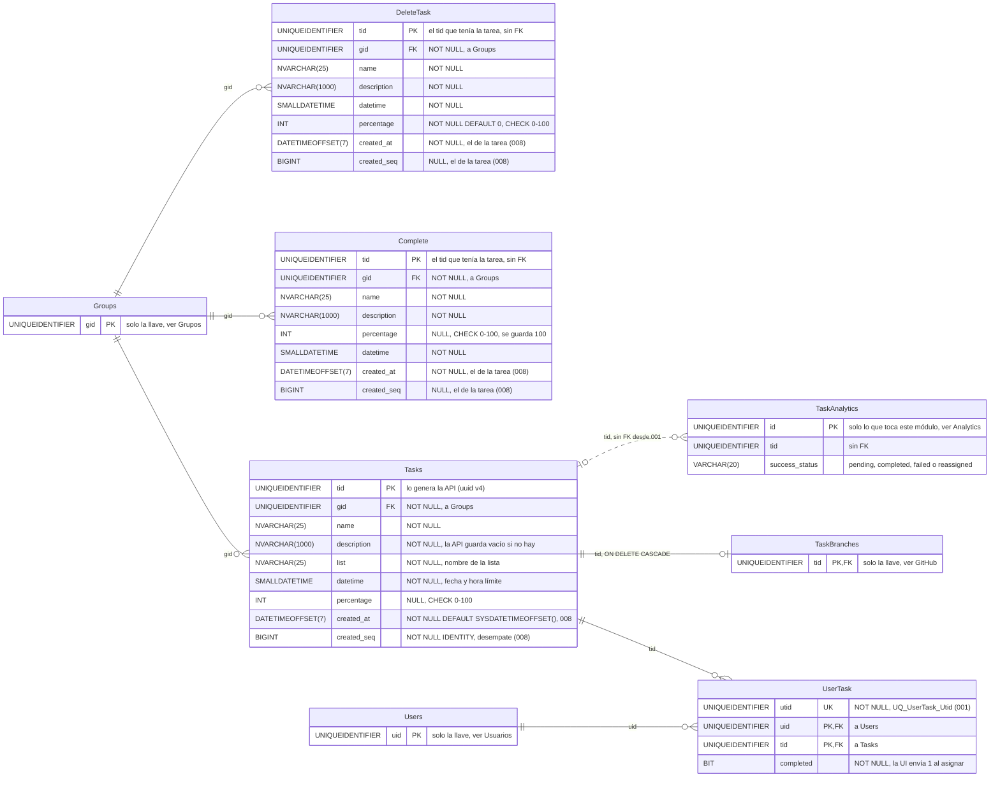

# Tareas: base de datos

**En una frase:** cuatro tablas guardan las tareas activas (`Tasks`), quién está asignado a cada una (`UserTask`), el archivo de las completadas (`Complete`) y la papelera (`DeleteTask`); las listas no tienen tabla propia, son la columna `Tasks.list`.

`Groups`, `Users`, `TaskBranches` y `TaskAnalytics` aparecen solo con las columnas que conectan con este módulo. El diagrama de toda la base está en [00-general.md](00-general.md).

## Tablas

| Tabla | Para qué sirve | Campos clave |
|---|---|---|
| `Tasks` | Tareas activas del grupo, agrupadas por lista | `tid`; `gid`; `list`; `datetime`; `percentage`; `created_at` |
| `UserTask` | Personas asignadas a cada tarea activa (una fila por persona y tarea) | (`uid`, `tid`); `utid` único |
| `Complete` | Archivo de las tareas completadas | `tid` (el de la tarea original); `gid` |
| `DeleteTask` | Papelera: tareas que se mandaron a borrar una por una | `tid` (el de la tarea original); `gid` |

## Reglas

**Llaves y restricciones** (PK = llave primaria, FK = llave foránea, UQ = valor único, CHECK = condición que la base revisa)
- `UserTask` tiene PK compuesta (`uid`, `tid`): una persona no puede quedar asignada dos veces a la misma tarea. `utid` es único desde la migración 001.
- `percentage` debe estar entre 0 y 100 en las tres tablas que lo tienen. En `DeleteTask` es `NOT NULL DEFAULT 0` (la 001 lo agrega a bases viejas que no lo tenían).
- `Complete.tid` y `DeleteTask.tid` no tienen FK a `Tasks`: el registro sobrevive a la tarea.
- Desde la migración 005, `name` y `description` (y `list` en `Tasks`) son `NVARCHAR`: aceptan acentos, emojis y otros alfabetos. Antes eran `VARCHAR`.
- Desde la migración 008, las tres tablas tienen `created_at` (`DATETIMEOFFSET(7)`). En `Tasks` lo llena su `DEFAULT SYSDATETIMEOFFSET()` al crear la tarea (ningún `INSERT` lo nombra); completar o mandar a la papelera copia el de la tarea, así que conserva su fecha de creación. `created_seq` (`BIGINT IDENTITY` en `Tasks`, también copiado) desempata las tareas creadas en el mismo instante, como las de un plan de la IA. Las filas que ya existían al aplicar la 008 tomaron la primera asignación de la tarea en `TaskAnalytics` o, si no tenía, la hora de la migración.

**Borrado**
- Estas cuatro tablas **no tienen** `ON DELETE CASCADE` entre ellas: el código borra en orden.
- Completar o mandar a la papelera, en una transacción: copia a `Complete` o `DeleteTask` → cierra los registros `pending` de `TaskAnalytics` (`completed` o `failed`) → borra `UserTask` → borra `Tasks`.
- Borrar una lista hace lo mismo con todas sus tareas, pero **sin copiarlas** a `DeleteTask`.
- Desasignar borra la fila de `UserTask` y cierra el registro `pending` de esa persona como `reassigned`.
- La única cascada del módulo: al borrar una fila de `Tasks`, su fila de `TaskBranches` cae sola (`ON DELETE CASCADE`).
- `TaskAnalytics` perdió su FK a `Tasks` en la migración 001 para conservar el historial.
- Borrar un grupo borra, en orden y en una transacción, `TaskAnalytics`, `UserTask`, `Tasks`, `Complete` y `DeleteTask` del grupo, entre otras (`group.model.deleteGroupCascade`).
- Quitar a alguien de un grupo borra su membresía y sus roles, pero no sus filas de `UserTask`.

**Triggers**
- Ninguno en estas tablas. Los dos triggers de la migración 006 están en `Nodes` y `Edges` (ver [Hitos y calendario](04-hitos-y-calendario.md)).

**Reglas que pone el código, no la base**
- Largos máximos y fechas válidas: la API responde 400 antes de llegar a SQL (`middleware/validate.js`). `SMALLDATETIME` llega hasta el 6 jun 2079 y guarda minutos, no segundos.
- Completar, mandar a la papelera y borrar una lista bloquean las filas (`UPDLOCK, HOLDLOCK`): dos operaciones sobre la misma tarea van una detrás de la otra.
- Asignar es idempotente: si la fila (`uid`, `tid`) ya existe, no inserta otra.
- Las tareas, las completadas y la papelera de un grupo se leen ordenadas por `created_at, created_seq` («Creation Date», el orden con que abre `/tasks`).

## Índices (migraciones 001 y 005)

| Índice | Columnas | Para qué |
|---|---|---|
| `IX_Tasks_Gid_List` | `Tasks (gid, list)` | Leer las tareas de un grupo y borrar una lista (la 005 lo recrea al pasar `list` a `NVARCHAR`) |
| `IX_UserTask_Tid` | `UserTask (tid)` | Ver quién está asignado a una tarea |
| `IX_Complete_Gid` | `Complete (gid)` | Listar y vaciar las completadas de un grupo |
| `IX_DeleteTask_Gid` | `DeleteTask (gid)` | Listar y vaciar la papelera de un grupo |

## Dónde se usa

| Archivo | Qué hace con estas tablas |
|---|---|
| `models/tasks.model.js` | Crear, editar, leer, completar (`completeTask`), mandar a la papelera (`trashTask`) y borrar una lista (`deleteTasksByList`) |
| `models/complete.model.js` | Listar y vaciar `Complete` de un grupo |
| `models/delete.model.js` | Listar y vaciar `DeleteTask` de un grupo |
| `models/usertask.model.js` | Asignar, desasignar, leer asignaciones y repartir asignaciones de demo (`populateAssignmentsForGroup`) |
| `models/access.model.js` | Averiguar el grupo de una tarea, una completada, una borrada o una asignación |
| `models/group.model.js` | Borrar todo al eliminar un grupo |
| `models/nodes.model.js` | El calendario lee las fechas de `Tasks` junto con las de los hitos |
| `services/ProjectService.js` | El plan del chat inserta tareas en una transacción |
| `services/github/pullRequestProcessor.js` | Un PR fusionado completa la tarea con `completeTask` |
| `services/AnalyticsService.js`, `services/analyticsContext.js` | Registran asignaciones y cuentan la carga actual con `UserTask` |

## Para saber más

- Arquitectura del módulo: [02-arquitectura/03-tareas.md](../02-arquitectura/03-tareas.md)
- Flujos que escriben en estas tablas: [06-flujos/03-tareas.md](../06-flujos/03-tareas.md)
- Ramas y PRs de las tareas: [GitHub](07-github.md) · métricas: [Analytics](06-analytics.md)
- Modelo completo con las 24 tablas: [00-general.md](00-general.md)
- Limitaciones conocidas: [cierre del proyecto](../01-proyecto/cierre-del-proyecto.md#limitaciones-conocidas)
