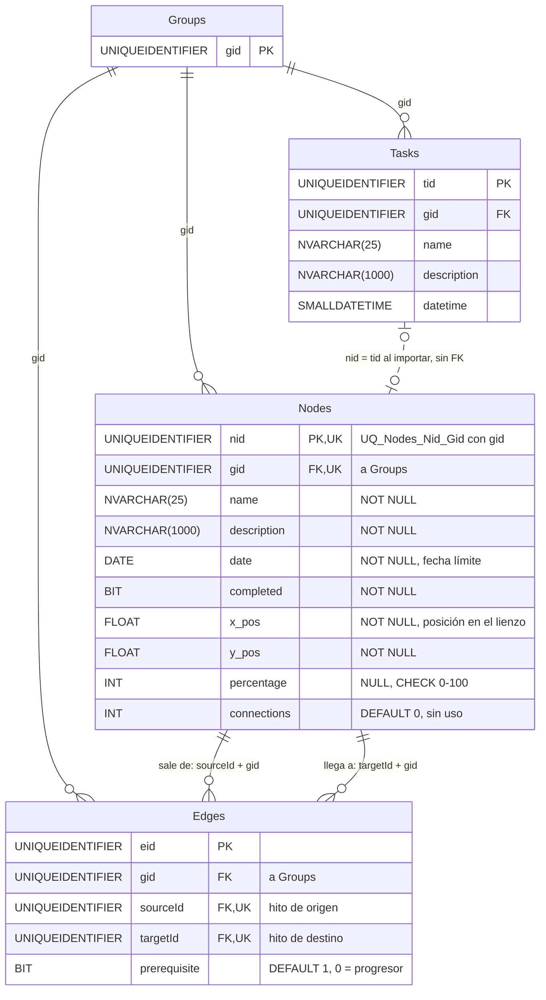

# Hitos y calendario: base de datos

**En una frase:** cada hito es una fila de `Nodes` y cada flecha entre hitos es una fila de `Edges`; dos triggers recalculan el porcentaje de los hitos unidos por flechas «progresoras».

`Groups` y `Tasks` salen solo con las columnas que usa este módulo. Sus tablas completas están en el [ERD general](00-general.md).

Términos:
- **PK:** llave primaria. **FK:** llave foránea (apunta a otra tabla). **UK:** restricción única.
- **CHECK:** regla que la base revisa en cada `INSERT` o `UPDATE`.
- **Transacción:** varias sentencias que se aplican todas o ninguna.

## Tablas

| Tabla | Para qué | Campos clave |
|---|---|---|
| `Nodes` | Un hito del diagrama `/block-diagram`: nombre, fecha, avance y posición en el lienzo | `nid`, `gid`, `percentage`, `x_pos`, `y_pos` |
| `Edges` | Una flecha de un hito a otro del mismo grupo | `eid`, `sourceId`, `targetId`, `prerequisite` |
| `Tasks` (solo lectura aquí) | El calendario muestra sus fechas; una tarea importada comparte su `tid` con el `nid` del hito | `tid`, `gid`, `datetime` |

Valores de `Edges.prerequisite`:
- **1 = prerrequisito** (valor por defecto): la flecha solo dibuja la dependencia. No mueve porcentajes.
- **0 = progresor:** el porcentaje del destino pasa a ser el promedio de todas sus fuentes progresoras.

## Reglas

**Restricciones**
- `name` hasta 25 caracteres y `description` hasta 1000. Son `NVARCHAR` desde la migración 005, así que aceptan acentos y emojis. La API valida lo mismo y responde 400.
- `percentage` entre 0 y 100 (`CHECK`). La API también lo valida.
- Una sola flecha por par origen → destino: `UQ_Edges_Source_Target` (migración 001). A → B y B → A son pares distintos.
- La flecha y sus dos hitos son del mismo grupo: las FK compuestas `FK_Edges_SourceNode_Gid` y `FK_Edges_TargetNode_Gid` apuntan a `(nid, gid)` de `Nodes`, que es única por `UQ_Nodes_Nid_Gid` (001).
- Índices de la 001: `IX_Nodes_Gid`, `IX_Edges_Gid` e `IX_Edges_TargetId`.

**Borrados (no hay `ON DELETE CASCADE`)**
- Borrar un hito: `nodes.model.deleteNode` borra en una transacción sus flechas (como origen o destino) y después el hito.
- Borrar un grupo: `group.model.deleteGroupCascade` borra `Edges` y luego `Nodes`, junto con el resto del grupo.
- Completar o mandar a la papelera una tarea no borra su hito importado: no hay FK entre `Nodes` y `Tasks`.

**Triggers (migración 006, reemplazan a los de la 003)**
- `UpdateTargetNodePercentage`, sobre `Nodes`, después de cada `UPDATE` que cambia `percentage`:
  1. Toma los hitos que cambiaron y sus destinos por flechas progresoras (nivel 1).
  2. En cada nivel, cada destino = `ROUND(AVG(percentage))` de todas sus fuentes progresoras. Solo escribe si cambia.
  3. Baja al siguiente nivel con los destinos que aún no visitó. Para a los **20 niveles**; los ciclos terminan porque no repite hitos.
- `UpdateTargetOnPrerequisiteChange`, sobre `Edges`, después de cada `UPDATE` que cambia `prerequisite`:
  1. Recalcula el destino de la flecha: promedio de sus fuentes progresoras, o **0** si ya no le queda ninguna.
  2. Propaga hacia abajo igual que el otro trigger, con el mismo límite de 20 niveles.
- Los dos salen sin hacer nada si `TRIGGER_NESTLEVEL()` pasa de 10.
- Solo reaccionan a `UPDATE`: crear o borrar una flecha no recalcula nada.
- Un hito destino se puede editar a mano, pero el trigger lo sobrescribe cuando cambia una de sus fuentes.

**Columnas sin efecto en la interfaz**
- `connections`: ningún código la lee ni la escribe.
- `completed`: la interfaz lo pone en 1 cuando alguien escribe 100 en «Progress». La tarjeta se pinta completada por `percentage = 100`, no por esta columna. Sí la lee el análisis del repositorio con IA (`repoSnapshot.buildExisting`).

## Dónde se usa

| Modelo | Funciones | Quién lo llama |
|---|---|---|
| `models/nodes.model.js` | `addNode`, `updateNode`, `updateNodeCoords`, `updateNodePercentage`, `updateNodeCompleted`, `deleteNode`, `getNode`, `getNodesByGroupId`, `getNodesAndTasks` | `controllers/nodes.controller.js` |
| `models/nodes.model.js` | `addNode`, `getNodeLayout` (bloquea el rango para que dos planes no usen la misma fila del lienzo) | `services/ProjectService.js`: planes del chat y del análisis del repositorio |
| `models/nodes.model.js` | `getNodesByGroupId` | `services/UserSession.js`: hitos existentes que se mandan a la IA al analizar el repositorio |
| `models/edges.model.js` | `addEdge`, `getEdgesById`, `getEdgesByGroupId`, `updatePrerequisite`, `deleteEdge`, `deleteEdgeBySource` | `controllers/edges.controller.js` |
| `models/tasks.model.js` | `updateTaskFromNode` | `PUT /api/tasks/nodes/:id`: copia nombre, descripción y fecha del hito a su tarea |
| `models/access.model.js` | `resolveGroupId('node' \| 'edge')` | Guardias de `middleware/groupAccess.js` |
| `models/group.model.js` | `deleteGroupCascade` | Borrar un grupo |

Pruebas con SQL Server real: `tests/db/migrations.dbtest.js` (unicidad de flechas, promedio, cadena con ciclo y cambio a prerrequisito) y `tests/db/groups.dbtest.js`.

## Para saber más
- Esquema completo (24 tablas): [00-general.md](00-general.md)
- Arquitectura del módulo: [02-arquitectura/04-hitos-y-calendario.md](../02-arquitectura/04-hitos-y-calendario.md)
- Cómo se ve la propagación paso a paso: [06-flujos/04-hitos-y-calendario.md](../06-flujos/04-hitos-y-calendario.md)
- Limitaciones conocidas: [cierre del proyecto](../01-proyecto/cierre-del-proyecto.md#limitaciones-conocidas)
