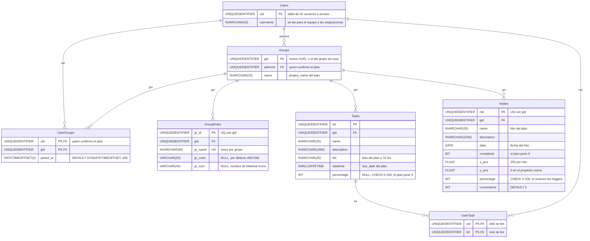

# Chat con IA: base de datos

**En una frase:** el chat no tiene tablas propias; **lee** las del grupo elegido para darle contexto a la IA y **escribe** solo al confirmar un plan: sin proyecto, `ProjectService` crea en **una transacción** un grupo nuevo con su membresía, sus roles, sus tareas y sus hitos; en un grupo sin usar del que el usuario es admin, le pone el nombre del proyecto y le agrega roles, tareas e hitos, también en una transacción; con un grupo con datos, el plan del análisis del repositorio se suma a ese grupo.

**Leyenda:** `PK` = llave primaria, `FK` = llave foránea, `UK` = parte de una restricción única. `Users` aparece reducida y `UserTask` solo con las columnas que lee el chat, porque son de otros módulos. Ninguna de estas FK tiene `ON DELETE CASCADE`.

## Tablas

| Tabla | Para qué la usa el chat | Campos clave |
|---|---|---|
| `Groups` | Escribe el proyecto nuevo (quien confirma queda como admin) o el nombre nuevo del grupo sin usar; lee el nombre y el admin del grupo elegido | `gid`, `adminId`, `name` |
| `UserGroups` | Escribe la membresía del creador; lee quién es miembro (en cada mensaje) y el equipo | `uid` + `gid` |
| `GroupRoles` | Escribe los roles que propuso la IA (nombre, color, ícono) | `gr_id`, `gid`, `gr_name` |
| `Tasks` | Escribe las tareas del plan, repartidas en listas; lee las del grupo para el contexto | `tid`, `gid`, `list`, `datetime` |
| `Nodes` | Escribe los hitos del plan en una fila del diagrama de hitos; lee los del grupo para el contexto | `nid`, `gid`, `date`, `x_pos`, `y_pos` |
| `UserTask` y `Users` | Solo lee: quién está asignado a cada tarea y los nombres de usuario del equipo | `uid`, `tid`, `username` |
| `Complete` y `DeleteTask` | Solo lee: si el grupo tiene tareas completadas o borradas, para saber si está sin usar | `gid` |
| `GroupRepositories`, `GitHubRepositories`, `GitHubInstallations` | Solo lee: si el grupo tiene repo, si la instalación está suspendida y si el admin activó «Allow AI analysis» (`ai_analysis_enabled`). Detalle en [07-github](07-github.md) | `gid`, `repo_id`, `ai_analysis_enabled` |

**Lo que no está en la base** (vive en memoria y se pierde al reiniciar):
- El historial del chat: una conversación por proyecto, de hasta 100 mensajes, y las de hasta 20 proyectos además de la que se ve; se conserva 60 min después de desconectarse. Los trozos de las respuestas en streaming (`assistant_chunk`) no entran al historial.
- El contexto del proyecto en la API (`UserSession.chatContext`): se arma con el primer mensaje tras elegir el grupo y queda en caché **sin refrescarse** hasta cambiar de grupo. En cada mensaje solo se vuelve a comprobar la membresía y, si guarda el resumen del repo, el permiso de IA. Las tareas o hitos creados después no llegan al chat hasta cambiar de grupo. Un grupo sin usar no se guarda en caché: se vuelve a leer en cada mensaje.
- El contexto de la IA en Python: las últimas 16 líneas de conversación, la idea del proyecto (hasta 4000 caracteres), el plan sin confirmar y el grupo de la conversación (`project_group`), más lo mismo de hasta 20 proyectos más (`saved_groups`). Si llega un mensaje de otro proyecto, guarda lo de este y recupera lo de aquel. Se borra tras 2 h sin uso.
- Los planes del análisis del repositorio sin confirmar: hasta 5 por usuario, 30 min.

## Reglas
- **Todo o nada:** las cinco tablas del proyecto nuevo se escriben dentro de `withTransaction`. Si falla un `INSERT`, se deshace todo y el usuario ve `SAVE_FAILED`. En un grupo sin usar (`fillEmptyGroupFromPlan`), la transacción primero comprueba con `UPDLOCK, HOLDLOCK` que quien confirma es el admin y que el grupo sigue sin usar; si no, no escribe nada y se crea un grupo nuevo. Si sí, cambia `Groups.name` e inserta roles, tareas e hitos. El plan del análisis (`addPlanToGroup`) también va en una transacción, solo con `Tasks` y `Nodes`.
- **Grupo sin usar** (`group.model.isGroupUnused`): cuenta sus filas en `Tasks`, `Complete`, `DeleteTask`, `Nodes` y `GroupRepositories`; está sin usar solo si todas dan 0. El grupo personal de toda cuenta nueva empieza así.
- **Textos recortados al tamaño de la columna:** nombre de tarea, de hito y de lista 25 (si sobra, terminan en «...»); nombre del grupo 25; descripción 1000; rol 40; color 20.
- **Roles únicos por grupo** (`UQ_GroupRoles_Gid_Name`, migración 001). `ProjectService` descarta antes los nombres repetidos, sin distinguir mayúsculas, y en un grupo sin usar también los que el grupo ya tiene.
- **Ícono del rol:** si no es un nombre válido de Material Icons, se traduce desde un emoji conocido o queda `star`.
- **Fechas:** `Tasks.datetime` es `SMALLDATETIME` (1900-01-01 a 2079-06-06). Una fecha inválida o fuera de rango se guarda como la fecha de hoy.
- **Hitos:** van en una fila (`x_pos` = 250 × posición), sin completar y al 0 %. En el proyecto nuevo, `y_pos` = 0; `addPlanToGroup` los pone en una fila nueva debajo de los hitos que ya tiene el grupo. El plan **no crea aristas** (`Edges`) ni asigna roles o tareas a nadie.
- **Llaves compuestas únicas** (migración 001): `UQ_GroupRoles_GrId_Gid` y `UQ_Nodes_Nid_Gid` existen para que `UserGroupRoles` y `Edges` no mezclen grupos.
- **Sin cascadas:** para borrar el grupo, `group.model.deleteGroup` borra antes sus filas hijas en una transacción.
- **Triggers** (migración 006): `UpdateTargetNodePercentage` (en `Nodes`) y `UpdateTargetOnPrerequisiteChange` (en `Edges`) son `AFTER UPDATE`. No se disparan al crear el plan; actúan después, cuando alguien cambia el avance de un hito en `/block-diagram`.
- **Índices** que usa este módulo: `IX_Groups_AdminId`, `IX_UserGroups_Gid`, `IX_Tasks_Gid_List` y `IX_Nodes_Gid`.

## Dónde se usa

| Archivo | Qué hace |
|---|---|
| `taskmate-api/services/ProjectService.js` | `createProjectFromPlan`: arma las filas del proyecto nuevo y abre la transacción; `fillEmptyGroupFromPlan`: guarda el plan en un grupo sin usar; `addPlanToGroup`: suma tareas e hitos a un grupo existente |
| `taskmate-api/models/group.model.js` | `addGroup`: `INSERT` en `Groups`; `getGroupById`: nombre y admin del grupo elegido; `isGroupUnused`: si el grupo está sin usar |
| `taskmate-api/models/userGroup.model.js` | `addUserToGroup`: `INSERT` en `UserGroups`; `getMembersByGroupId`: el equipo |
| `taskmate-api/models/groupRoles.model.js` | `addGroupRole`: `INSERT` en `GroupRoles` |
| `taskmate-api/models/tasks.model.js` | `addTask`: `INSERT` en `Tasks`; `getTasksByGroupId`: tareas para el contexto |
| `taskmate-api/models/nodes.model.js` | `addNode`: `INSERT` en `Nodes`; `getNodesByGroupId`: hitos para el contexto |
| `taskmate-api/models/usertask.model.js` | `getAssigneesByGroup`: quién tiene cada tarea (`UserTask` + `Tasks` + `Users`) |
| `taskmate-api/models/github.model.js` | `getGroupRepository`: repo del grupo, suspensión y permiso de IA |
| `taskmate-api/models/access.model.js` | `isGroupMember`: valida el grupo elegido y se repite en cada mensaje |
| `taskmate-api/helpers/transaction.js` | `withTransaction`: una conexión, `COMMIT` o `ROLLBACK` |

Pruebas: `taskmate-api/tests/ProjectService.test.js`, `taskmate-api/tests/UserSession.test.js` y `taskmate-api/tests/db/project.dbtest.js` (`npm run test:db`, sobre un SQL Server desechable).

## Para saber más
- Modelo completo de las 29 tablas: [00-general.md](00-general.md)
- Cómo se llega al guardado: [06-flujos/05-chat-ia.md](../06-flujos/05-chat-ia.md)
- Las tareas y los hitos ya creados: [03-tareas](03-tareas.md) y [04-hitos-y-calendario](04-hitos-y-calendario.md)
- El análisis del repositorio guarda tareas e hitos en un grupo existente: [07-github](07-github.md)
