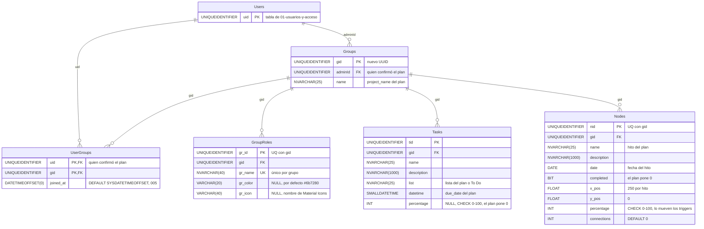

# Chat con IA: base de datos

**En una frase:** el chat no tiene tablas propias; cuando el usuario confirma un plan, `ProjectService` crea en **una transacción** un grupo nuevo con su membresía, sus roles, sus tareas y sus hitos.

**Leyenda:** `PK` = llave primaria, `FK` = llave foránea, `UK` = parte de una restricción única. `Users` aparece reducida a su llave porque es de otro módulo. Ninguna de estas FK tiene `ON DELETE CASCADE`.

## Tablas

| Tabla | Para qué la usa el chat | Campos clave |
|---|---|---|
| `Groups` | El proyecto nuevo; quien confirma queda como admin | `gid`, `adminId`, `name` |
| `UserGroups` | Hace miembro al creador | `uid` + `gid` |
| `GroupRoles` | Los roles que propuso la IA (nombre, color, ícono) | `gr_id`, `gid`, `gr_name` |
| `Tasks` | Las tareas del plan, repartidas en listas | `tid`, `gid`, `list`, `datetime` |
| `Nodes` | Los hitos del plan, en una fila del diagrama de hitos | `nid`, `gid`, `date`, `x_pos`, `y_pos` |

**Lo que no está en la base** (vive en memoria y se pierde al reiniciar):
- El historial del chat: hasta 100 mensajes por usuario en la API; se conserva 60 min después de desconectarse.
- El contexto de la IA en Python: las últimas 16 líneas de conversación, la idea del proyecto (hasta 4000 caracteres) y el plan sin confirmar; se borra tras 2 h sin uso.

## Reglas
- **Todo o nada:** las cinco tablas se escriben dentro de `withTransaction`. Si falla un `INSERT`, se deshace todo y el usuario ve `SAVE_FAILED`.
- **Textos recortados al tamaño de la columna:** nombre de tarea, de hito y de lista 25 (si sobra, terminan en «...»); nombre del grupo 25; descripción 1000; rol 40; color 20.
- **Roles únicos por grupo** (`UQ_GroupRoles_Gid_Name`, migración 001). `ProjectService` descarta antes los nombres repetidos, sin distinguir mayúsculas.
- **Ícono del rol:** si no es un nombre válido de Material Icons, se traduce desde un emoji conocido o queda `star`.
- **Fechas:** `Tasks.datetime` es `SMALLDATETIME` (1900-01-01 a 2079-06-06). Una fecha inválida o fuera de rango se guarda como la fecha de hoy.
- **Hitos:** van en una fila (`x_pos` = 250 × posición, `y_pos` = 0), sin completar y al 0 %. El plan **no crea aristas** (`Edges`) ni asigna roles o tareas a nadie.
- **Llaves compuestas únicas** (migración 001): `UQ_GroupRoles_GrId_Gid` y `UQ_Nodes_Nid_Gid` existen para que `UserGroupRoles` y `Edges` no mezclen grupos.
- **Sin cascadas:** para borrar el grupo, `group.model.deleteGroup` borra antes sus filas hijas en una transacción.
- **Triggers** (migración 006): `UpdateTargetNodePercentage` (en `Nodes`) y `UpdateTargetOnPrerequisiteChange` (en `Edges`) son `AFTER UPDATE`. No se disparan al crear el plan; actúan después, cuando alguien cambia el avance de un hito en `/block-diagram`.
- **Índices** que usa este módulo: `IX_Groups_AdminId`, `IX_UserGroups_Gid`, `IX_Tasks_Gid_List` y `IX_Nodes_Gid`.

## Dónde se usa

| Archivo | Qué hace |
|---|---|
| `taskmate-api/services/ProjectService.js` | `createProjectFromPlan`: arma las filas y abre la transacción |
| `taskmate-api/models/group.model.js` | `addGroup`: `INSERT` en `Groups` |
| `taskmate-api/models/userGroup.model.js` | `addUserToGroup`: `INSERT` en `UserGroups` |
| `taskmate-api/models/groupRoles.model.js` | `addGroupRole`: `INSERT` en `GroupRoles` |
| `taskmate-api/models/tasks.model.js` | `addTask`: `INSERT` en `Tasks` |
| `taskmate-api/models/nodes.model.js` | `addNode`: `INSERT` en `Nodes` |
| `taskmate-api/helpers/transaction.js` | `withTransaction`: una conexión, `COMMIT` o `ROLLBACK` |
| `taskmate-api/models/access.model.js` | `isGroupMember`: valida el proyecto elegido como contexto |

Pruebas: `taskmate-api/tests/ProjectService.test.js` y `taskmate-api/tests/db/project.dbtest.js` (`npm run test:db`, sobre un SQL Server desechable).

## Para saber más
- Modelo completo de las 24 tablas: [00-general.md](00-general.md)
- Cómo se llega al guardado: [06-flujos/05-chat-ia.md](../06-flujos/05-chat-ia.md)
- Las tareas y los hitos ya creados: [03-tareas](03-tareas.md) y [04-hitos-y-calendario](04-hitos-y-calendario.md)
- El análisis del repositorio guarda tareas e hitos en un grupo existente: [07-github](07-github.md)
