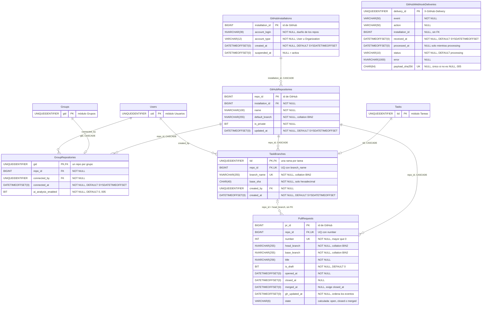

# GitHub: base de datos

**En una frase:** seis tablas guardan qué instalación de la App y qué repositorio tiene cada grupo, la rama de cada tarea, los pull requests de esas ramas y el registro de los webhooks recibidos; los tokens de GitHub nunca se guardan.

`PK` = llave primaria · `FK` = llave foránea · `UK` = valor único (sola o en pareja) · `||--o{` = uno a muchos · `||--o|` = uno a cero o uno · línea punteada = relación sin FK.

`Users`, `Groups` y `Tasks` son de otros módulos; aquí solo aparece su llave. `GitHubWebhookDeliveries` no tiene relaciones a propósito: registra lo que GitHub mandó, aunque sea de una instalación desconocida.

## Tablas

| Tabla | Para qué sirve | Campos clave |
|---|---|---|
| `GitHubInstallations` | Una instalación de la TaskMate App en una cuenta u organización de GitHub | `installation_id` (PK, id de GitHub), `account_login`, `suspended_at` |
| `GitHubRepositories` | Un repositorio al que la App tiene acceso; su dueño es la cuenta de la instalación | `repo_id` (PK, id de GitHub), `installation_id` → `GitHubInstallations`, `default_branch` |
| `GroupRepositories` | El vínculo grupo ↔ repositorio: uno por grupo; un repo puede estar en varios grupos | `gid` (PK) → `Groups`, `repo_id` → `GitHubRepositories`, `ai_analysis_enabled` |
| `TaskBranches` | La rama de GitHub de una tarea (`tm/<slug>-<8 caracteres del tid>`) | `tid` (PK) → `Tasks`, (`repo_id`, `branch_name`) único, `base_sha` |
| `PullRequests` | Copia mínima de los PRs del repositorio (no de forks) que llegan por webhook o por «Sincronizar PRs» | `pr_id` (PK), (`repo_id`, `number`) único, `head_branch`, `merged_at`, `state` |
| `GitHubWebhookDeliveries` | Registro de cada webhook: evita procesar dos veces la misma entrega | `delivery_id` (PK), `payload_sha256` (único), `status` |

Origen: migración `002_github.sql`. La `005` agregó `GroupRepositories.ai_analysis_enabled` y `GitHubWebhookDeliveries.payload_sha256` con su índice único filtrado.

## Reglas

**Restricciones (CHECK y UNIQUE)**
- `account_type` solo acepta `User` u `Organization`.
- `base_sha` y `payload_sha256` solo aceptan caracteres hexadecimales.
- `PullRequests.number` debe ser mayor que 0, y `merged_at` con valor exige `closed_at` con valor (`CK_PullRequests_MergedClosed`).
- `status` de una entrega solo puede ser `processing`, `processed`, `ignored` o `failed`. `processed_at` es NULL solo mientras está en `processing`.
- Únicos: (`repo_id`, `branch_name`) en `TaskBranches`, (`repo_id`, `number`) en `PullRequests`, y `payload_sha256` cuando no es NULL.
- `PullRequests.state` es una columna calculada: `merged` si hay `merged_at`, `closed` si hay `closed_at`, si no `open`. Nunca se escribe.
- `default_branch`, `branch_name`, `head_branch` y `base_branch` usan la collation `Latin1_General_100_BIN2`: en Git, `Main` y `main` son ramas distintas.

**Cascadas (`ON DELETE CASCADE`)**
- Borrar una instalación borra sus repositorios.
- Borrar un repositorio borra sus vínculos con grupos, sus ramas de tarea y sus PRs. También borra su pipeline y sus solicitudes de deploy ([CI/CD](08-cicd.md)).
- Borrar un grupo borra su vínculo. Borrar una tarea borra su rama en `TaskBranches`. Los PRs se quedan: no tienen FK a la rama.
- Las FK hacia `Users` (`connected_by`, `created_by`) no tienen cascada.

**Reglas que aplica la API**
- **Vincular otro repo o desvincular** borra, en la misma transacción, las ramas de tareas del grupo que apuntan a otro repositorio y las solicitudes de deploy pendientes. Cambiar de repo vuelve a poner `ai_analysis_enabled` en 0.
- **Completar, mandar a la papelera o borrar una lista de tareas** primero bloquea la fila de `TaskBranches` (`UPDLOCK, HOLDLOCK`, por `PK_TaskBranches`) y la lee. Así una rama creada al mismo tiempo no se cuela, y la API sabe qué rama limpiar en GitHub después del commit.
- **Orden de los eventos de un PR.** Manda `gh_updated_at`: un evento más viejo no cambia nada, salvo que traiga la fusión. `merged_at` nunca se borra. En un empate al segundo, `closed_at` no se pierde.
- **Entregas.** Una entrega se salta si su id, o su `payload_sha256` en otra entrega, ya está `processed`, `ignored` o `processing`. Se reintenta si quedó `failed` o lleva más de 10 min en `processing`.
- **Purga.** La API borra cada día las entregas más viejas que `WEBHOOK_DELIVERY_RETENTION_DAYS`: un entero de 30 o más; si falta, es menor o no es entero, se usan 90.

**Triggers:** ninguno. Los dos triggers de la migración 006 son de los hitos (`Nodes` y `Edges`).

**Índices:** `IX_GitHubRepositories_InstallationId`, `IX_GroupRepositories_RepoId`, `IX_GroupRepositories_ConnectedBy`, `IX_TaskBranches_CreatedBy`, `IX_PullRequests_Repo_HeadBranch`, `IX_GitHubWebhookDeliveries_ReceivedAt` y `IX_GitHubWebhookDeliveries_PayloadSha256` (único, filtrado).

## Dónde se usa

| Modelo | Qué hace con estas tablas |
|---|---|
| `taskmate-api/models/github.model.js` | Todo el módulo: guardar instalación y repositorio, vincular y desvincular, opción de IA, ramas de tareas, vínculos tarea ↔ rama ↔ PR, aplicar un PR y registrar, cerrar y purgar entregas |
| `taskmate-api/models/tasks.model.js` | Al completar, mandar a la papelera o borrar una lista: bloquea y lee la rama de la tarea antes de que la cascada la borre |
| `taskmate-api/models/group.model.js` | Al borrar un grupo, `GroupRepositories` se va por cascada y `TaskBranches` por la cascada desde `Tasks` |
| `taskmate-api/models/cicd.model.js` | Bloquea la fila de `GroupRepositories` antes de crear o reabrir una solicitud de deploy (mismo orden de bloqueos que vincular) |

## Para saber más

- Todas las tablas de TaskMate: [00-general.md](00-general.md)
- Arquitectura del módulo: [02-arquitectura/07-github.md](../02-arquitectura/07-github.md)
- Diseño 3FN y operaciones atómicas: [Fase 3, parte B](../08-fases/fase-03-integracion-github/SEGURIDAD-Y-BASE-DE-DATOS.md#parte-b--diseño-de-la-base-de-datos)
- Migrar la BD: [guía de la BD en Docker](../07-guias/base-de-datos-docker.md)
