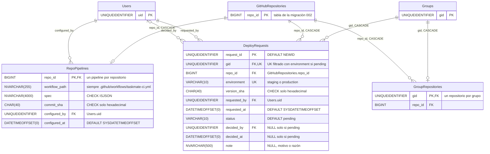
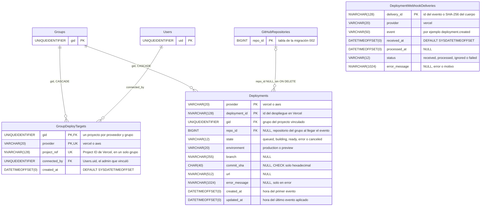

# CI/CD: base de datos

**En una frase:** de GitHub Actions el módulo guarda solo dos cosas, el pipeline que TaskMate escribió en cada repositorio (`RepoPipelines`) y las solicitudes de deploy a producción que esperan a un admin (`DeployRequests`), porque las ejecuciones, los logs y el historial de deploys viven en GitHub; desde la migración 009 guarda además el monitoreo de Vercel: el proyecto vinculado a cada grupo (`GroupDeployTargets`), los despliegues que avisa Vercel (`Deployments`) y la bitácora de su webhook (`DeploymentWebhookDeliveries`).

**Pipeline y solicitudes de producción (migración 007):**

**Monitoreo de Vercel (migración 009):**

`GitHubRepositories`, `GroupRepositories`, `Groups` y `Users` aparecen solo con las columnas que usa este módulo. Sus campos completos están en [Tablas y campos](00-tablas-y-campos.md#github-y-cicd), y los de las tres tablas de Vercel, en [Despliegues de Vercel](00-tablas-y-campos.md#despliegues-de-vercel).

## Tablas

| Tabla | Para qué | Campos clave |
|-------|----------|--------------|
| `RepoPipelines` | El pipeline que TaskMate subió a un repositorio. `spec` es el JSON validado con el que se generó el YAML, así el diálogo puede reabrirlo | `repo_id` (PK y FK), `spec`, `commit_sha` del commit que subió el workflow, `configured_by` |
| `DeployRequests` | Un miembro pide publicar en producción la versión de staging. Un admin la aprueba (TaskMate lanza el deploy) o la rechaza | `request_id`, `gid`, `repo_id`, `environment`, `version_sha`, `status`, `decided_by`, `note` |
| `GroupDeployTargets` | Qué proyecto de Vercel corresponde a qué grupo. Vercel manda su Project ID, no un repositorio, así que sin esta fila el webhook no sabe a qué grupo va | `gid` + `provider` (PK), `project_ref`, `connected_by` |
| `Deployments` | Cada despliegue que avisó Vercel, con su último estado. Es lo que muestra la pestaña «Vercel (monitoring)» | `provider` + `deployment_id` (PK), `gid`, `state`, `environment`, `branch`, `commit_sha`, `url`, `error_message`, `updated_at` |
| `DeploymentWebhookDeliveries` | Bitácora del webhook de Vercel: registra cada entrega aunque no se pueda enrutar y hace idempotentes los reintentos | `delivery_id` (PK), `event`, `status`, `error_message` |

`RepoPipelines` y `DeployRequests` vienen de la migración `007_cicd.sql` (la reversa es `007_cicd.down.sql`). Las tres de Vercel vienen de `009_deployments.sql`; su reversa, `009_deployments.down.sql`, borra las tres tablas con sus datos.

## Reglas

### Pipeline y solicitudes (007)

- **Un pipeline por repositorio:** `repo_id` es la PK. Si dos grupos usan el mismo repositorio, comparten su pipeline.
- **`spec`** debe ser JSON válido (`CK_RepoPipelines_Spec`). El modelo además rechaza un `spec` de más de 4000 caracteres.
- **SHAs:** `commit_sha` y `version_sha` son `CHAR(40)` y solo aceptan dígitos hexadecimales (`CK_..._CommitSha`, `CK_..._VersionSha`). El modelo los guarda en minúsculas.
- **Valores permitidos:** `environment` en (`staging`, `production`); `status` en (`pending`, `approved`, `rejected`, `cancelled`), con `pending` por defecto.
- **Decisión coherente (`CK_DeployRequests_Decision`):** si `status = 'pending'`, `decided_by` y `decided_at` son NULL. En cualquier otro estado, los dos tienen valor.
- **Una solicitud pendiente por grupo y entorno:** índice único filtrado `UX_DeployRequests_Pending (gid, environment) WHERE status = 'pending'`. Una segunda da `DEPLOY_REQUEST_PENDING` (409).
- **Cascadas:** al borrar un repositorio (`GitHubRepositories`) se borran su `RepoPipelines` y sus `DeployRequests`. Al borrar un grupo se borran sus `DeployRequests`. Las FKs a `Users` no tienen cascada.
- **Al cambiar de repositorio:** vincular otro repositorio o desvincularlo borra las solicitudes **pendientes** del grupo para el repositorio anterior. Las ya decididas quedan como historial (`github.model.js`).
- **Sin carreras:** crear y reabrir una solicitud bloquea la fila del grupo en `GroupRepositories` (`UPDLOCK, HOLDLOCK`). Decidir solo cambia una fila que sigue `pending`, así que dos admins no pueden decidir la misma.
- **Índices de apoyo:** `IX_RepoPipelines_ConfiguredBy`, `IX_DeployRequests_Gid_RequestedAt (gid, requested_at DESC)`, `IX_DeployRequests_RepoId`, `IX_DeployRequests_RequestedBy` e `IX_DeployRequests_DecidedBy`.

### Monitoreo de Vercel (009)

- **Un proyecto por proveedor y grupo:** PK `(gid, provider)`. Volver a vincular reemplaza el Project ID anterior (un `UPDATE`) y reinicia `created_at`.
- **Un proyecto de Vercel en un solo grupo:** `UQ_GroupDeployTargets_Project (provider, project_ref)`. Si ya es de otro grupo, el modelo lanza `DEPLOY_TARGET_TAKEN` y la API responde `CONFLICT` (409). Nadie comprueba con Vercel que el proyecto sea del grupo.
- **Proveedores:** `provider` en (`vercel`, `aws`) en `Deployments` y `GroupDeployTargets`, pero solo existe el webhook de Vercel.
- **Identidad del despliegue:** PK `(provider, deployment_id)`; el id es el de Vercel, único solo dentro de su proveedor. `deployment_id`, `branch`, `project_ref` y `delivery_id` usan la collation `Latin1_General_100_BIN2` (distingue mayúsculas).
- **Valores permitidos:** `state` en (`queued`, `building`, `ready`, `error`, `canceled`). `environment` no tiene CHECK (DEFAULT `production`); la API guarda `production` o `preview`. `commit_sha` es NULL o 40 caracteres hexadecimales, y la API lo guarda en minúsculas.
- **Solo avanza:** `applyDeployment` hace un `MERGE ... WITH (HOLDLOCK)` que actualiza la fila solo si su `updated_at` es menor o igual que la hora del evento. Un evento más viejo se descarta (`stale`) y la entrega queda `processed`. `created_at` y `updated_at` guardan la hora del evento (el `createdAt` del cuerpo; solo si falta, la del servidor) truncada al segundo; en un empate dentro del mismo segundo gana el que llega después.
- **Qué cambia en cada evento:** `state`, `error_message` y `updated_at` se sobrescriben (un estado que no es `error` deja `error_message` en NULL). `branch`, `commit_sha`, `url` y `repo_id` solo se llenan, nunca vuelven a NULL (`COALESCE`). `gid` y `environment` no cambian después del INSERT.
- **`repo_id` es opcional:** es el repositorio conectado al grupo cuando llega el evento. Si no hay repositorio, o si buscarlo falla, se guarda NULL y el despliegue se registra igual.
- **Bitácora sin FKs, a propósito:** `DeploymentWebhookDeliveries` guarda también los eventos de proyectos sin vincular. `delivery_id` es el `id` del evento (hasta 128 caracteres) o, si falta, el SHA-256 del cuerpo. Un `delivery_id` ya registrado se contesta `duplicate`, aunque esa entrega haya terminado en `failed`. `error_message` guarda el error o el motivo de `ignored`.
- **Sin purga:** la purga diaria solo borra `GitHubWebhookDeliveries`; las filas de `DeploymentWebhookDeliveries` se quedan.
- **Cascadas:** al borrar un grupo se borran sus `Deployments` y su `GroupDeployTargets`. Desvincular el proyecto borra solo la fila de `GroupDeployTargets`: los `Deployments` del grupo se quedan y vuelven a aparecer al vincular otro proyecto, porque la lista se filtra solo por `gid` (entre las dos tablas no hay FK). `FK_Deployments_Repositories` no tiene `ON DELETE`: es la única FK hacia `GitHubRepositories` sin cascada ([limitaciones conocidas](../01-proyecto/cierre-del-proyecto.md#limitaciones-conocidas)).
- **Índices:** `IX_Deployments_Gid_CreatedAt (gid, created_at DESC)` para la lista del grupo, e `IX_DeploymentDeliveries_ReceivedAt (received_at)`, que hoy ninguna consulta usa. `Deployments.repo_id` y `GroupDeployTargets.connected_by` no tienen índice.

**Triggers:** ninguno en las cinco tablas. Los dos triggers del proyecto (migración 006) son de `Nodes` y `Edges`.

## Dónde se usa

| Archivo | Qué hace con estas tablas |
|---------|---------------------------|
| `taskmate-api/models/cicd.model.js` | `getPipeline`, `upsertPipeline` (UPDATE con `HOLDLOCK` y, si no existía, INSERT, en una transacción), `deletePipeline` (solo la usan las pruebas) |
| `taskmate-api/models/cicd.model.js` | `createDeployRequest`, `getDeployRequest`, `listDeployRequests` (pendientes primero), `decideDeployRequest`, `reopenDeployRequest`, `cancelApprovedDeployRequest` |
| `taskmate-api/models/github.model.js` | Borra las solicitudes pendientes de otro repositorio al vincular o desvincular |
| `taskmate-api/services/github/pipelineService.js` | Guarda el pipeline después de subir el workflow y lo lee para reabrir el diálogo con el `spec` guardado |
| `taskmate-api/services/github/deployService.js` y `actionsService.js` | Leen el pipeline (¿hay pipeline?, ¿tiene deploy?) y manejan las solicitudes |
| `taskmate-api/models/deployment.model.js` | `linkDeployTarget`, `getDeployTarget`, `unlinkDeployTarget`, `findGroupByProjectRef`, `applyDeployment` (el `MERGE`), `listDeployments` (de 1 a 100, por `created_at DESC`), `beginDelivery` y `finishDelivery` |
| `taskmate-api/services/deploy/deployWebhookHandler.js` | Reclama la entrega, busca el grupo por Project ID, aplica el despliegue y cierra la entrega con su estado |
| `taskmate-api/controllers/deploy.controller.js` | Rutas `/api/deploy`: vincular, ver y desvincular el proyecto, y listar los despliegues |
| `taskmate-api/migrations/007_cicd.sql` y `009_deployments.sql` | Crean las tablas, las restricciones y los índices (cada una con su `.down.sql`) |
| `taskmate-api/tests/db/cicd.dbtest.js`, `migrations.dbtest.js` | Pruebas contra una base SQL Server desechable. `migrations.dbtest.js` aplica y revierte también la 009, pero ninguna prueba de BD consulta sus tablas: las pruebas de `tests/deploy/` simulan `deployment.model` |

## Para saber más

- Modelo completo (29 tablas): [00-general.md](00-general.md)
- Arquitectura del módulo: [02-arquitectura/08-cicd.md](../02-arquitectura/08-cicd.md)
- Ciclo de vida de una solicitud y camino del webhook de Vercel: [06-flujos/08-cicd.md](../06-flujos/08-cicd.md)
- Capítulo de la Fase 4, sección de base de datos: [fase-04-pipeline-cicd/README.md](../08-fases/fase-04-pipeline-cicd/README.md#base-de-datos-migración-007)
- Limitaciones conocidas: [cierre-del-proyecto.md](../01-proyecto/cierre-del-proyecto.md#limitaciones-conocidas)
